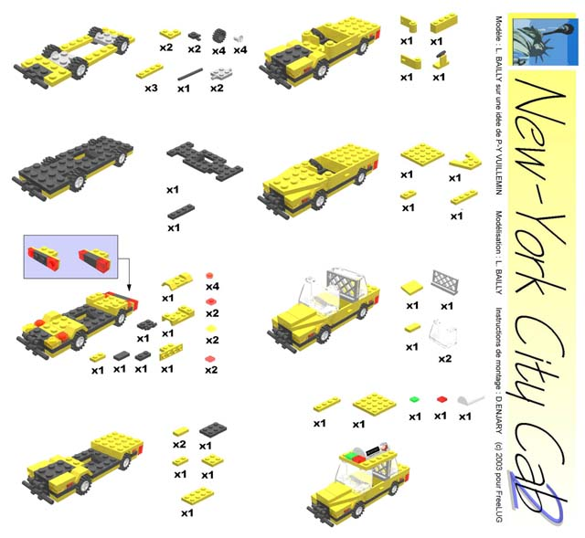

Voici les instructions de montage d’un modèle crée par Chimère sur la base du [New-York cab de Obi](http://photos.freelug.org/photo.php?cat=26&num=1&expand=all)

Je vous laisse découvrir de petites modifications de ce modèle rallongé par rapport au modèle de Obi.

Sur le toit, on retrouve le panneau publicitaire ou vous pourrez aposer des [autocollants "maison".](http://photos.freelug.org/main.php/v/6studs/BI/album49/)

Vous retrouverez aussi le fichier MLCad zippée de ce modèle :

A bientôt pour de nouvelles créations.
