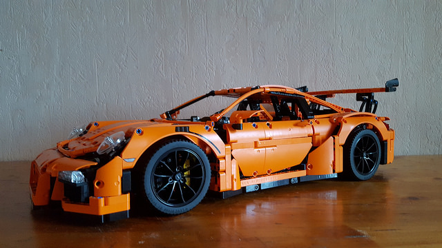
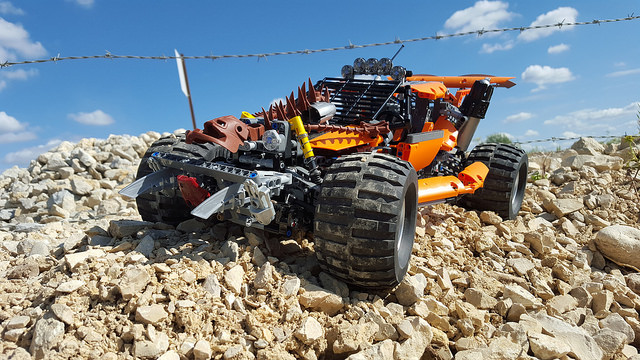
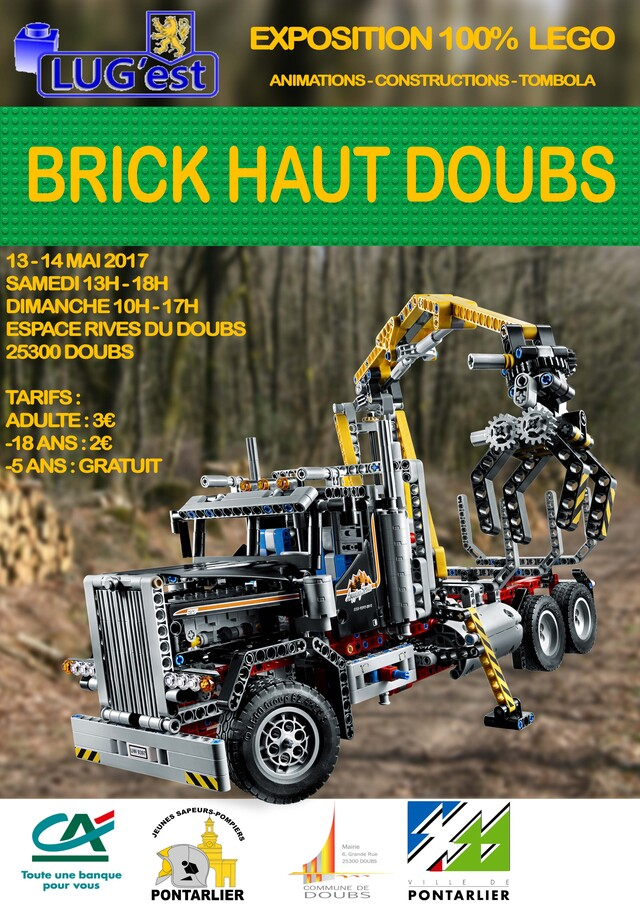

Cinq questions à un AFOL membre de LUG’Est à l’occasion de la préparation de leur prochain événement : Cyprien Cattet

_**Question 1 : Bonjour Cyprien, merci d’accepter de répondre à ces quelques questions à un mois de votre prochaine exposition Brick Haut Doubs. Nous nous étions rencontrés il me semble à Dôle en 2015. Mais pour ceux qui ne te connaissent pas, peux-tu te présenter ? Es-tu plutôt moceur ? Collectionneur ?**_

Hello, donc Cyprien CATTET alias Cypr-21 sur les forums. J’ai 25 ans, et suis pontissalien d’adoption (Pontarlier, dans le Haut Doubs), belfortain d’origine.  
J’ai replongé dans la brique il y a 7 ans maintenant et suis amateur de LEGO® Technic.

Collectionneur à mes débuts, encore un peu à l’heure actuelle, j’ai vite franchi le pas de la création, ne trouvant pas toujours mon compte dans les modèles officiels.

_**Question 2 : Quelle est la pièce de ta collection ou création dont tu es le plus fier ?**_

Allez, une de chaque :

-   Ma meilleure expérience de construction de set officiel LEGO® est la Porsche 911 GT3 RS sortie l’année dernière. Passionné d’automobile sportive, de Porsche et de LEGO®, j’ai eu le sentiment d’un modèle créé sur mesure.

**Porsche 911 GT3 RS**

-   Et la création qui m’a le plus marqué, c’est un buggy style Mad Max. Un buggy permet de s’affranchir de toute contrainte de réalisme, et d’être dans le « no limit ». Mocer avec des contraintes, c’est bien et instructif, mocer en toute liberté, c’est encore mieux.

**Moc Buggy**

_**Question 3 : As-tu une anecdote particulière à nous raconter autour de ta passion pour les LEGO® ?**_

A Dôle 2015, une personne est venue exprès depuis Lille pour voir mes créations. C’était assez flatteur.

_**Question 4 : Tu appartiens à [LUG’Est](https://www.facebook.com/lugestfc/?fref=ts). Il s’agit d’un LUG assez récent, peux-tu nous le présenter rapidement ? Qu’est-ce qui vous distingue des autres LUGs ? Quel rôle y joues-tu ?**_

[LUG’Est](https://www.facebook.com/lugestfc/?fref=ts) existe depuis 3 ans et a été créé pour réunir les passionnés de LEGO® en Franche-Comté, et soutenir l’organisation d’expositions. On est une quarantaine et on se limite à cette taille pour que cela reste « humain » et facilite les rencontres. On organise deux expositions par an, une au printemps et une à l’automne, et des rencontres entre membres une fois par trimestre.

On n’essaye pas de faire la plus grosse exposition, ou la plus ceci ou cela, on cherche avant tout une bonne ambiance et de belles présentations de LEGO®, mocs ou modèles officiels mis en scène, pour être dans le qualitatif.

Pour ma part, je suis secrétaire et je fais maintenant partie du club fermé des organisateurs d’expositions. En effet, on encourage les initiatives personnelles, et le membre qui souhaite faire une exposition par chez lui reçoit le soutien de l’association. Il n’est pas livré à lui-même, mais a en charge le gros de l’organisation.

_**Question 5 : Pour finir, peux-tu nous parler de cette exposition à venir ? Que pourra-t-on y voir ?**_

Brick Haut Doubs est la première exposition dans le Haut Doubs. L’événement se tiendra les 13 et 14 mai 2017, à Doubs, une commune limitrophe à Pontarlier. On attend autour de 2000 personnes.

Les exposants sont majoritairement [LUG’Est](https://www.facebook.com/lugestfc/?fref=ts), et y présenteront leur diverses créations. Un photographe local sera présent, et il y aura des vendeurs, dont Martin (Littlebricks).

Pendant l’exposition, il y aura aussi une tombola, le jeu de la famille [LUG’Est](https://www.facebook.com/lugestfc/?fref=ts) (5 minifigs à rechercher dans l’exposition), des tables de briques pour faire construire les jeunes, et une piscine de Duplo pour les plus petits.

**Brick Haut Doubs**

Informations sur l’événement :  
Organisé par L’association [LUG’Est](https://www.facebook.com/lugestfc/?fref=ts) à l’espace Rives du Doubs, à Doubs (25300) les 13 et 14 mai 2017.

Animations prévues :  
**–** Jeux de construction, tombola, boites à gagner...

Horaires :

-   Samedi 13 mai : 13h à 18h
-   Dimanche 14 Mai : 10h à 17h

Tarifs :

-   3 euros par adulte
-   2 euros moins de 18 ans
-   Gratuit moins de 5 ans
