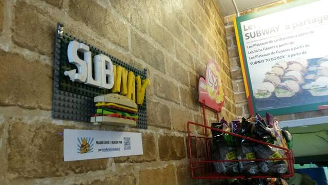
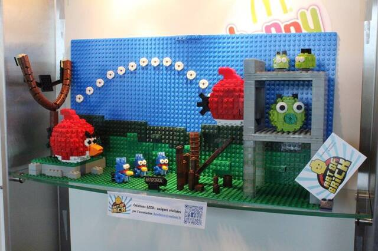
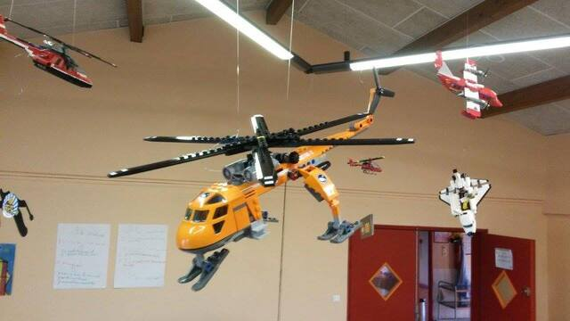
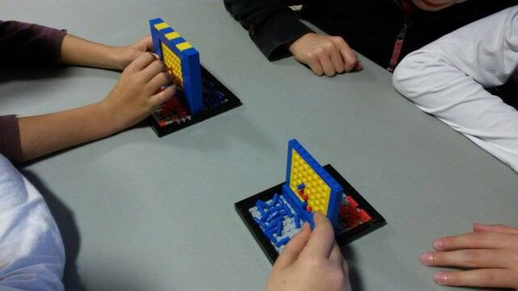
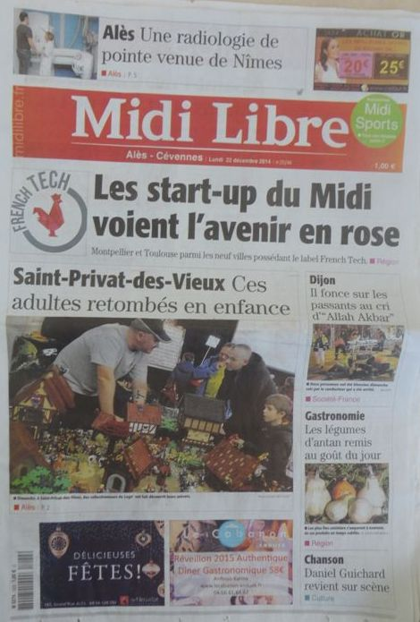
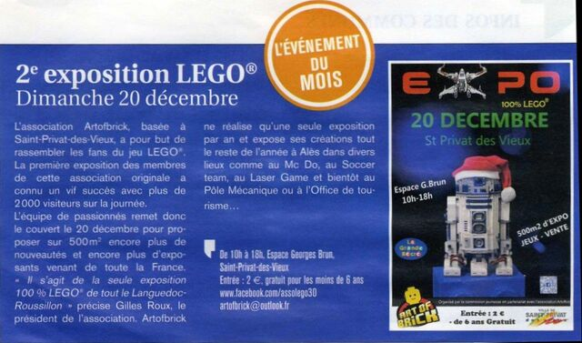
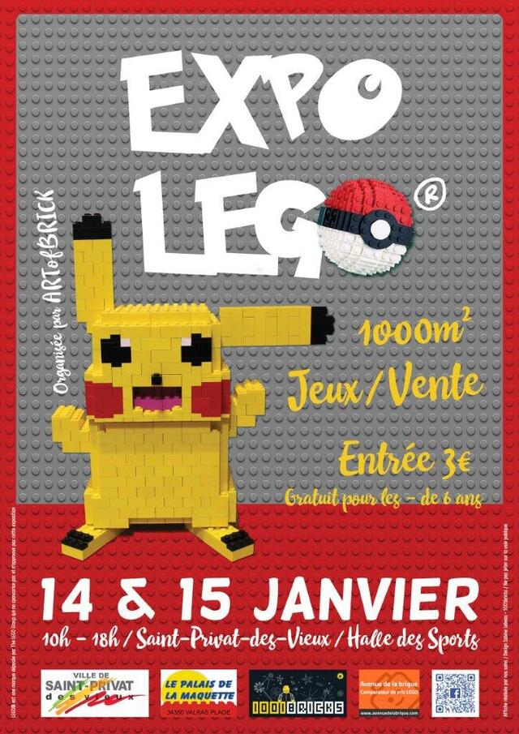
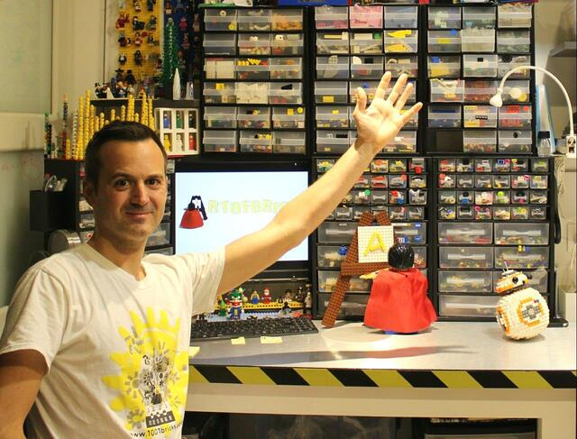

5 Questions à un AFOL à l’occasion d’un événement : Interview de Gilles Roux à l’occasion de l’exposition LEGO organisée par l’association ArtofBrick.

ArtofBrick est une association dédiée 100% aux jeux LEGO nouvellement créée et localisée dans le Sud de France. Mais qui se cache derrière ArtofBrick ? Voici 5 questions posées à Gilles Roux, son président, à quelques jours de la nouvelle édition de leur exposition 100% LEGO.

_**Question 1 : Bonjour Gilles, peux-tu te présenter, présenter l’association à laquelle tu appartiens ainsi que ton rôle ?  
**_

Basée à Saint Privat des vieux dans le Gard (30) tout près d’Alès et de Nîmes, l’association Artofbrick a été créée en 2014. J’en suis le président.  
Créer une association était la solution pour rassembler les AFOLs de la région.

Mais voilà, la région Languedoc Roussillon est pauvre en AFOLs, ou alors ils se cachent bien ! La présence du soleil du sud incite peut-être les gens à consacrer plus de de temps à des activités extérieures au détriment des LEGO.

_**Question 2 : Il s’agit d’une association récente, peux-tu nous raconter ce qui vous a amené à la créer ?**  
_

A la base Artofbrick a été créée pour pouvoir réaliser une grande exposition annuelle. Mais la passion est présente toute l’année, avec les membres de l’association nous réalisons plusieurs événements par an comme des ateliers NAP / TAP dans les écoles, des interventions dans les magasins de jouets, et le reste de l’année, on envahit la ville de LEGO en réalisant bénévolement des vitrines sur mesures dans des lieux bien ciblés, des logos ou des enseignes.

**Enseigne Subway**

**Vitrine Angry Birds pour Restaurant McDonald’s**

Mêmes les plafonds des cantines des écoles ont été décorés avec des avions, des figurines, engins, et bannières tissu Star Wars.

**Décoration de la catine des écoles**

Personnellement je réalise aussi des jeux en LEGO : spash, crazy ball, puissance 4, dames, échiquiers…….

**Mini jeux**

Tout au long de l’année je fais des mocs de tous styles, et j’ai réalisé 5 sets de petits mocs personnels avec notice 3D comme Bob l’éponge, Picachu, Minion, Mario, sans prétention, juste pour les faire monter le jour de l’expo aux visiteurs.

Toutes les photos des créations de l’association sont disponibles sur notre [page](https://www.facebook.com/assolego30).

_**Question 3 : Peux-tu nous parler de quelques événements que vous avez organisés ?**_

-   2014 : 1ère grande exposition avec 1500 visiteurs et 2 membres de l’association :  
    Pour cette première exposition, j’ai eu la bonne idée de contacter FreeLUG pour demander conseil et proposer aux AFOLs de nous rejoindre. Milkbrick répond présent avec un gros moc médiéval très détaillé et attractif pour le public ainsi que la boutique 1001 bricks.  
    Et voilà que l’exposition se forme, et on fait la première page du journal régional MIDI LIBRE :

**1ère Page Midi Libre**

-   2015 : 2ème grande exposition avec plus de 3000 visiteurs et 5 membres de l’association :  
    Pour cette 2ème édition, je suis contacté par plusieurs visiteurs qui souhaitent se joindre à nous. Alex rejoint l’équipe. Jeune professeur du Lycée d’Alès, il enseigne la programmation avec les LEGO Mindstorm, avec des combats qu’il organise entre élèves.  
    Puis c’est un AFOL spécialiste du City qui se joint à nous : Noël, également membre de FreeLUG !

**2ème édition**

-   2016 : On tourne la page et on change de date pour janvier. L’exposition aura finalement lieu les 14 & 15 janvier 2017, avec plus de 20 membres.  
    Pour cette édition, je me sens enfin entouré, avec des membres tous spécialistes d’un thème particulier, des savoir-faire différents et complémentaires pour réaliser une exposition encore plus belle. On se réunit maintenant à la maison une fois par semaine pour préparer tout ça !  
    Tout cela a été possible grâce aux forums et FreeLUG qui ont joué le jeu, et partagé les informations avec le monde des AFOLs.

_**Question 4 : Quels sont les prochains événements à venir ?  
**_

De nombreuses choses devraient arriver prochainement :

-   Le LUG, l’association atteignant le nombre de membres requis,
-   Le site internet d’Artofbrick,
-   De nouvelles vitrines en cours,
-   Et bien sûr, l’exposition en janvier (14 & 15 janvier 2017) :  
    Cette année, l’exposition change de lieu pour doubler la surface avec 1000m2 pouvant accueillir ainsi plus d’exposants !  
    Le coin jeux y sera fortement développé, le concours pour les enfants sera renouvelé. Un écran géant sera présent avec sonorisation, pour mettre en avant les animations et démonstrations !  
    Enfin, il y aura plus de 26m linéaire de ville avec un réseau ferroviaire !

**Exposition LEGO(r) les 14 et 15 Janvier 2017**

Cette année je réalise personnellement un coin artistique LEGO réunissant des œuvres différentes comme des toiles, des objets d’art d’illusion, des mosaïques, de grands Artpixel. Enfin, un photographe de la région, [ballou34](https://www.facebook.com/Ballou34/?fref=ts), sera présent avec son studio pour des démonstrations.

_**Question 5 : Enfin, peux-tu nous parler un peu plus de toi et des LEGO : quelles gammes affectionnes-tu, es-tu plutôt mocceur ou collectionneur, quel est le moc ou l’objet de ta collection dont tu es le plus fier ?**_

J’ai 39 ans, AFOL depuis 3 ans. Je ne me suis pas vu le devenir en fait ! La maison se remplit doucement de LEGO toute seule !

**Gilles dans son antre**

C’est une passion, un hobby qui revient cher, voire très cher quand on touche à tout comme moi : je suis collectionneur de figurines. J’aimerais toutes les avoir. Je ne suis pas grand collectionneur de sets officiels, même si j’ai quelques gammes complètes comme Space Classic, Scooby Doo…

Toute l’année je prépare l’exposition sans compter les heures et les nuits : je dors très peu, j’aime moccer. J’ai réalisé des dizaines de mocs de tous genres mais en général de taille modeste. En fait je touche à tout et je n’ai pas fait encore tout le tour ! Il en reste à faire.

Je me fixe en général des projets, qui commencent par une idée réalisable, ou pas, puis c’est comme un challenge qui mûrit au fur et à mesure des commandes Bricklink jusqu’au moment où le projet terminé sera exposé.

Comment j’ai débuté les LEGO ?  
Petit j’ai joué de 6 ans à 12 ans puis le vide jusqu’à mes 35 ans.

Dans la vraie vie, je travaille pour une Mairie au service enfance / jeunesse.  
Un jour on m’affecte aux garderies du soir d’une école où il y avait des vrac de LEGO. J’ai de suite vidé les bacs sur les tables, alors que c’était interdit par les autres collègues.

A ce moment les yeux des enfants se mirent à briller ! Le bonheur était là avec les cris des enfants ! Aucun des jours suivants de garderie ne se passaient sans sortir ce trésor caché. En discutant de mon enfance l’idée me vient de leur emmener mes vieux cartons de LEGO des années 70/80. Et me voilà à remonter avec eux mes vieux sets tel que le château jaune 375, la navette 6980, la station 6384. Et oui, j’avais été bien gâté à l’époque pour Noël mais il faut dire qu’on n’avait que 3 thèmes LEGO (city, castle et space).

Mais après toutes ces années, des notices me manquent, des pièces ont disparu. Je recherche sur le net et j’apprends à trouver des pièces au détail. Je trouve cela plaisant de jouer aux briques LEGO ! Puis je m’y mets plus sérieusement, en commençant par acquérir des sets officiels, des livres et sillonne le net qui fait rêver. Enfin je découvre Bricklink. Depuis, le virus ne m’a pas lâché !
