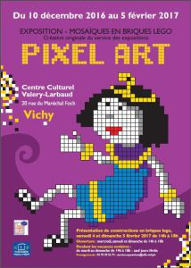
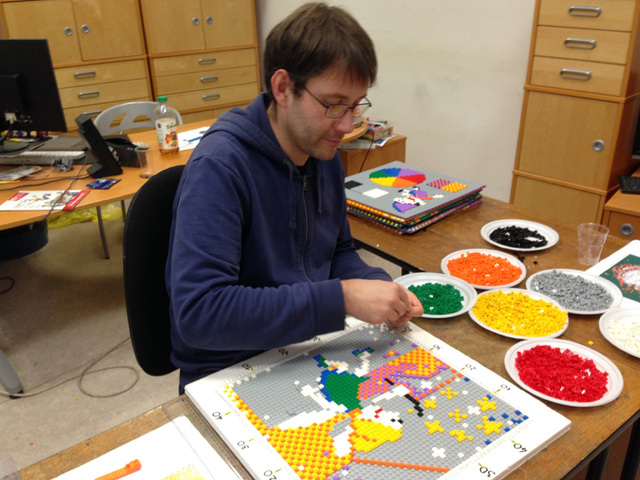
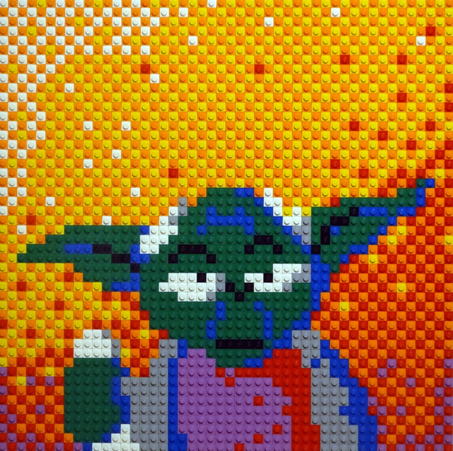
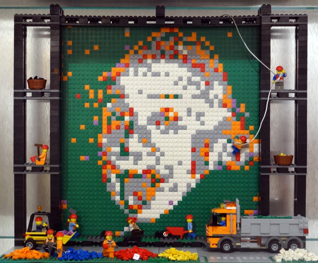

5 Questions à un AFOL à l’occasion d’un événement : Interview de Jérôme Schirtzinger à l’occasion de l’exposition Pixel Art et Briques LEGO® au Centre Culturel Valery-Larbaud de Vichy

_**Question 1 : Peux-tu te présenter, rapidement ? Comment t’es-tu découvert une passion pour les LEGO®  
**_

Je suis Jérôme Schirtzinger, mon pseudo est Cheub ! Je suis entre autre illustrateur pour enfant. Je travaille au Centre Culturel de Vichy.  
J’ai découvert ma passion pour les petites briques relativement tard. A 18 ans, j’ai acheté sur un marché aux puces un énorme carton de LEGO® en vrac… pour 80 francs ! C’est mon vrai point de départ, depuis je n’ai jamais cessé de m’y intéresser.

_**Question 2 : Peux-tu nous parler un peu plus de l’exposition à laquelle tu participes ?  
**_

**Exposition Pixel Art et Briques LEGO® au Centre Culturel Valery-Larbaud de Vichy**

Je travaille depuis 18 mois sur mon projet de personnages célèbres en mosaïque LEGO®.

L’exposition est composée de 34 mosaïques. Soit 48 plaques grises de 48x48 et plus de 110 000 petites briques 1x1 plate. Ces dernières sont déclinées en 9 couleurs.

La vraie difficulté du projet était d’obtenir toutes les briques dans les bonnes proportions. C’est vraiment le LEGO Store et en particulier Mathilde Leperlier qui a rendu le projet possible ! J’étais comme un dingue le jour où je suis allé les récupérer à Clermont :)

Pour rappel, l’exposition a lieu du 10 décembre 2016 au 5 février 2017 au Centre Culturel Valery-Larbaud de Vichy.

L’exposition se clôturera par un Week End spécial : Une salle d’environ 500m2 sera dédiée à une exposition de sets ou mocs avec la participation de FreeLUG :

-   Samedi 04 Février de 14h00 à 18h00
-   Dimanche 05 Février de 14h00 à 18h00

Plus d’informations sur le [site de la ville de Vichy](https://www.ville-vichy.fr/agenda/exposition-lego-pixel-art).

_**Question 3 : As-tu réalisé des pièces particulières pour cette exposition ? et d’une manière générale, peux-tu nous mettre un peu l’eau à la bouche en nous décrivant ce que nous pourrons voir ?**_

Chaque mosaïque est unique. J’ai réalisé chaque « plan » sur un logiciel de dessin vectoriel. Contrairement à ce que l’on pourrait croire cette partie-là est la plus longue !

**En pleine construction**

On réalisait la mise en briques à deux. Mes collègues et des amis sont venus me donner un coup de main pendant 3 mois. Il faut environ 1h30 à 2 personnes pour composer une mosaïque 48x48 tenons.  
L’ensemble des mosaïques forme un jeu dans la salle d’exposition où il faut découvrir le nom des personnages célèbres. J’ai mis en place des ateliers de construction et coloriage de mosaïques aux feutres pour les visiteurs. Des scolaires pourront profiter de visites et d’ateliers tout au long de l’exposition. Cela représente plus de mille enfants !

**Yoda en mosaïque**

On organise une rencontre avec des fans de LEGO® le dernier week-end de l’exposition (les 04 et 05 Février 2017). C’est quelque chose qui me motive beaucoup, je cherchais depuis longtemps l’occasion de proposer cet événement au public Vichyssois. Il reste d’ailleurs des places pour exposer s’il y a des volontaires !

_**Question 4 : As-tu déjà participé ou exposé sur d’autres événements ? Si oui, peux-tu nous donner tes impressions et souvenirs d’exposant ?**_

Je n’ai jamais participé à une exposition LEGO®.

Par contre j’ai fait avec mes illustrations un grand nombre d’expositions. Mon travail au centre culturel consiste à mettre en place des expositions et accueillir le public.

C’est super agréable de pouvoir présenter ses réalisations et de discuter avec le public.

_**Question 5 : Pour finir, peux-tu nous parler un peu plus de toi et de ta passion ? Es-tu plutôt mocceur ou collectionneur ? Quelle est la création ou pièce de ta collection dont tu es le plus fier ?**_

Je suis surtout collectionneur. J’adore les minifigs !

D’un autre côté, Je suis une sorte de doozer, je mets en place des structures un peu partout chez moi. Je peux placer dessus des vaisseaux Star Wars, des minifigs… Toutes mes structures sont construites à partir de 3 types de pièces (brick 2x2 noire, plate 1x10 noire et plate 6x10 grise). On voit un peu ce que ça donne sur la photo de la mosaïque d’Einstein ci-dessous !

**Einstein en mosaïque**

Je suis aussi fan du jeu LEGO® Heroica. Je l’ai adapté aux minifigs. J’ai réalisé des plateaux de jeu modulable, quelques décors. J’écris des histoires et je joue en famille. Mon personnage est un guerrier nain. C’est un super jeu de rôle, et je peux vraiment profiter au maximum de ma collection ! J’ai l’intention de l’exposer les 4 et 5 Février pour la rencontre avec les fans.

Pour le modèle en LEGO® dont je suis le plus fier, ça change un peu tous les jours. En ce moment j’adore ma tour d’Orthanc !

J’espère pouvoir poser cette dernière question à plein de fan de LEGO® durant cette exposition les 4 et 5 Février prochains !

Voir en ligne : [Pixel Art](https://www.ville-vichy.fr/agenda/exposition-lego-pixel-art)
