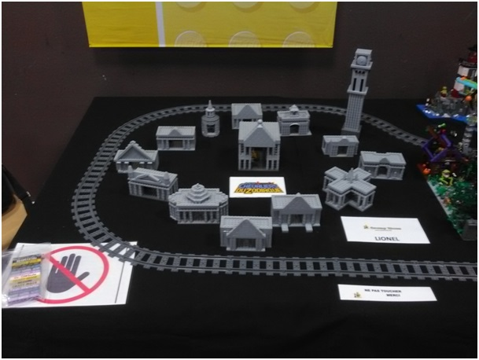
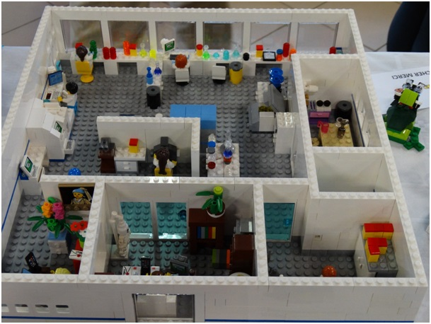
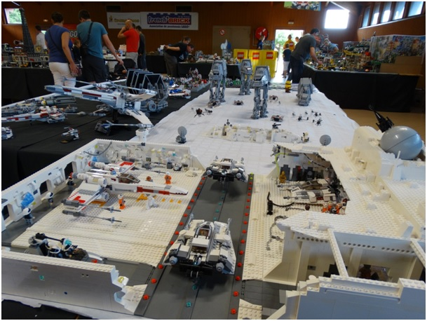
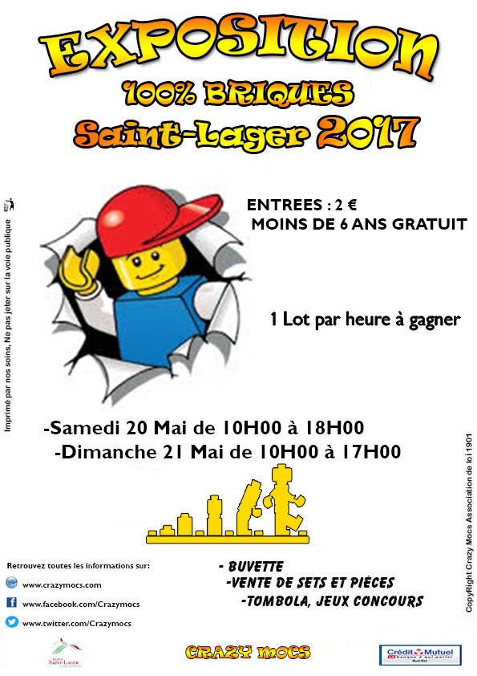

Cinq questions à un AFOL membre de CRAZYMOCS à l’occasion de la préparation de leur prochain événement : Lionel Peyrot.

_**Question 1 : Bonjour Lionel. Dans un premier temps, peux-tu te présenter ? Es-tu plutôt moceur ? Collectionneur ?**_

Alors Lionel Peyrot alias yoyolerigolo 38 ans, artisan dans le photovoltaïque, originaire de Limoges je suis maintenant dans le Rhône. Je suis tombé dans les LEGO® tout petit comme un peu tout le monde puis l’âge arrivant j’ai un peu lâché même si j’ai toujours eu des LEGO® à portée de main et les weekend je m’amusais à faire des petits vaisseaux en micro scale sans le savoir.

Lors de mon déménagement sur le lyonnais, deux choses m’ont suivi qui pour moi étaient indispensables : mes livres et mes LEGO®. Petit à petit ma chérie s’y est mise aussi. Et il y a 4 ans, ma belle-mère m’a dit qu’il y avait une expo LEGO® à Saint Lager, du coup j’y suis allé par curiosité et j’ai découvert des gens aussi déjantés que moi. Avec ma chère et tendre on est alors devenu membres de [CRAZYMOCS](http://www.crazymocs.com/).

Quand Emilie est tombée malade d’une leucémie je pouvais lui apporter des LEGO® mais uniquement scellés dans sa chambre stérile et ça lui a été bénéfique et a bien fait marrer les infirmières. Maintenant les LEGO® chez nous il y en a un peu partout mais surtout dans mon « bureau » qui est de plus en plus l’atelier du LEGO®.

_**Question 2 : [CRAZYMOCS](http://www.crazymocs.com/) a maintenant plusieurs années. Peux-tu nous parler un peu de votre LUG ? Comment est-il né ?**_

[CRAZYMOCS](http://www.crazymocs.com/) est née de la volonté de David et Thibault de se retrouver entre AFOL dans une ambiance familiale avec une petite structure qui est plus comme une bande d’amis. Nous somme devenu RLUG l’an passé ce qui nous apporte beaucoup de boulot mais qui est une formidable reconnaissance de notre travail et de notre passion.

_**Question 3 : Vous êtes très actifs sur la toile, avec notamment une page [Facebook](https://www.facebook.com/Crazymocs/) qui a un fort succès, avec plus de 20 000 personnes qui la suivent. Comment vous est venue l’idée de créer cette page et d’en faire ce qu’elle est devenue aujourd’hui ?**_

En fait le président a commencé la page [Facebook](https://www.facebook.com/Crazymocs/) pour partager des belles créations aussi diverses que variées. Puis petit à petit de plus en plus de monde a suivi la page et aujourd’hui il y a trois personnes qui s’en occupent.

_**Question 4 : Vous avez maintenant organisé plusieurs expositions. Peux-tu nous parler de quelques-unes de ces éditions passées ? Vos plus belles réussites ?**_

Pour moi la plus belle est toujours celle à venir mais la première que j’ai faite en exposant était vraiment sympa. C’était notre toute première expo en exposant avec ma chérie et j’avais fait un diorama sur la base Hoth et ma chérie avait fait son labo. On a passé un weekend a rigoler et s’amuser comme si on avait 10 ans. On passe beaucoup de temps à rigoler entre nous et avec les spectateurs.

_**Question 5 : Pour finir, peux-tu nous parler de cette exposition à venir ? Que pourra-t-on y voir ?**_

L’exposition de cette année verra des constructions très variées telles que le bateau de LEGO® movies, un gros château, du Star Wars, du retro gaming, du Disney et bien d’autres choses. L’ambiance sera à nouveau au rendez-vous avec nos membres toujours aussi déjanté.

Rappels sur l’exposition :  
Exposition 100% LEGO® organisée par CRAZYMOCS à Saint-Lager

Ouverture au public :

-   Samedi 20 Mai : 10h00 à 18h00
-   Dimanche 21 Mai 10h00 à 17h00

Tarifs :  
2€ (Gratuit pour les moins de 6 ans)

Site internet : [http://www.crazymocs.com/](http://www.crazymocs.com/)

Page Facebook : [ici](https://www.facebook.com/Crazymocs/)
