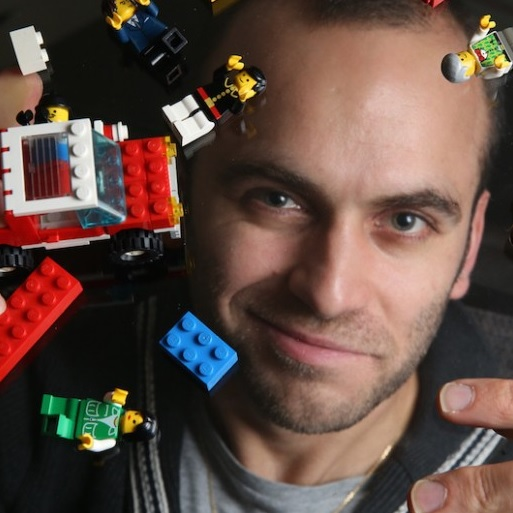
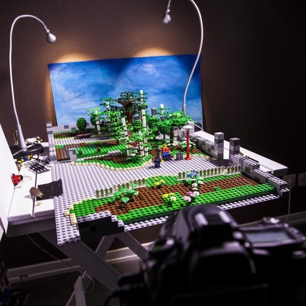
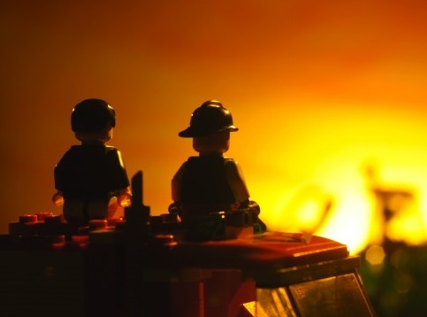
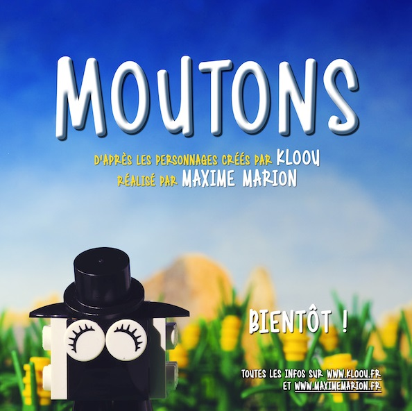

Cinq questions à un AFOL : Interview de Maxime Marion.

_**Bonjour Maxime.**_

_**Tout d’abord, pour ceux qui ne te connaissent pas, peux-tu te présenter rapidement, et nous expliquer un peu ton rapport avec les LEGO®, y as-tu beaucoup joué dans ta jeunesse ? Et maintenant, es-tu plutôt collectionneur ou moceur ?**_

Bonjour Yannick !

Maxime Marion, 33 ans, originaire de Strasbourg. Je suis "brickfilmeur" depuis 2007. J’ai pu faire connaître mon travail grâce aux aventures d’_Henri & Edmond_, une série animée que j’écris, réalise et anime. Mes films sont pour la plupart disponibles en ligne sur YouTube !

J’étais friand de LEGO® étant enfant, et je suis revenu vers la brique danoise au travers de la création de films d’animation. J’ai du mal à me définir en tant que collectionneur ou moceur. Disons que je m’apparente plutôt aux moceurs, dans le sens où je « construis » du mouvement et mes propres histoires à partir du LEGO®.

**Maxime Marion**

_**Tu as fait du brickfilm ta spécialité. Pourquoi cette discipline plutôt que le dessin animé ou le cinéma ? Et pourquoi les LEGO® comme support ?**_

Je ne dirais pas que c’est ma spécialité, vu que je réalise aussi d’autres projets d’animation sans élément LEGO® et que je crée beaucoup de contenu vidéo en général. Mais j’avoue que le brickfilm est une vraie passion !

Je pense que mon intérêt pour la vidéo a commencé très tôt, je tournais déjà des petits films avec des LEGO® quand j’avais 13-14 ans. Ce n’était pas vraiment de l’animation, juste de simples délires d’ados. Mais à la fin de mes études dans l’audiovisuel, j’ai eu envie de remanier ces histoires avec un oeil plus adulte. J’ai donc commencé à m’entraîner à animer avec des LEGO®, une bonne manière de combiner mon intérêt pour la brique et ma fascination pour le cinéma !

J’ai rapidement trouvé du plaisir à donner vie à ces petites figurines !

**Studio de travail**

_**Tu réalises tous les décors et objets de tes films en LEGO(R). Les réalises-tu toi même ? Comment procèdes tu pour les créer ?**_

_**J’imagine que tu écris des scénarios assez détaillés, avec scènes et dialogues. Dessines-tu les décors comme sur un story bord, ou tout cela sort-il directement de ton imagination ?**_

Faire du 100% LEGO® était un pari au départ, et ça a complètement façonné ma manière d’envisager mes films.

Au début je créais les éléments visuels tout seul, en puisant dans mes réserves de briques. Mais j’ai rapidement compris que je n’étais pas un moceur émérite, et je me suis donc tourné vers des artistes de cette discipline, à savoir les membres de l’association [Fanabriques](http://www.fanabriques.fr/), Thierry Meyer et Marc Schickelé. Avoir des amateurs de LEGO® doués, motivés, au travail admirable, et à quelques kilomètres de chez moi était une aubaine que je ne pouvais pas manquer.

Quand une histoire est prête, je fais une liste des décors nécessaires, avec des schémas plus ou moins détaillés selon les scènes. Les décorateurs-moceurs me proposent ce qu’ils ont en stock, ou construisent selon les besoins des films. Sur [Plastic Love](https://youtu.be/wwMDmlZWO2I), Marc Schickelé a créé des maquettes numériques des décors sur un logiciel spécialisé, ce qui nous permettait de discuter de chaque aspect avant de passer à la construction.

_**Tes films sont de beaux films, à la réalisation très professionnelle. L’animation est très détaillée. Pour des films de 20min (pour [Plastic Love](https://youtu.be/wwMDmlZWO2I)) ou 36min (pour [Droits d’auteur](https://youtu.be/Hmb0qVSd2rY)), cela doit représenter un travail colossal !  
Combien de temps t’a-t-il fallu pour réaliser ces deux films ? Les as-tu réalisés seul ou t’es-tu fait aider pour certaines choses ? Quelles difficultés as-tu rencontrées ?**_

J’essaye vraiment de proposer une expérience inédite avec chaque film. D’une part j’ai envie que le spectateur soit ravi, et d’autre part j’ai besoin d’être conquis par l’histoire afin de tenir le choc des nombreux mois de tournage !

Je fais généralement l’animation seul. [Droits d’auteur](https://youtu.be/Hmb0qVSd2rY) m’a pris 8 mois à raison de 5 à 15 heures de tournage par jour. Idem pour [Plastic Love](https://youtu.be/wwMDmlZWO2I), dont le tournage était plus morcelé de par mes obligations professionnelles.

En dehors des décorateurs, j’ai une petite équipe avec qui je travaille régulièrement. À commencer par Lilian Ginet qui m’accompagne dans l’écriture des scénarios et la mise en lumière des films. Quentin Billard, le compositeur à qui l’on doit le mémorable thème musical d’Henri & Edmond. Franck Rivolet, l’ingénieur du son qui mixe tous les éléments sonores des films. Dan Ene, le créateur du prologue graphique de [Plastic Love](https://youtu.be/wwMDmlZWO2I), et Williaan, la talentueuse artiste qui a créé de nombreux éléments d’habillage visuel. Sans oublier Hervé Bonafos et Jean-Marie Pexoto, qui prêtent leurs voix aux héros ! Ces films constituent un gros travail collaboratif.

La véritable difficulté à tourner un film d’animation, c’est le temps de production. Un court-métrage normal demande quelques jours de tournage, alors qu’un film en stop motion, aussi court soit-il, requiert des semaines voir des mois de travail. Cela peut vite devenir décourageant de ne voir avancer son film que de 10 secondes par jour de boulot !

**Moutons, une collaboration avec Kloou**

_**En visionnant la vidéo sur youtube "[Les videastes du LEGO®](https://youtu.be/XSLBPz6aa0w)" qui t’était en partie consacrée, tu teases une affiche avec les moutons de "[Kloou](http://www.kloou.fr/)", moceur alsacien bien connu de la scène AFOL".**_

_**Peux tu nous en dire plus sur ce projet ou sur tes autres projets à venir ?**_

En effet, j’ai récemment collaboré avec le brick-artiste [Kloou](http://www.kloou.fr/). J’ai découvert ses moutons au détour d’une expo au printemps dernier, et je les trouvais tellement adorables que j’ai tout de suite eu envie de faire un film avec eux ! C’est un nouveau défi car la manière de les animer est totalement inédite pour moi : ils sont constitués de briques, on peut donc varier leurs expressions, et puis leur manière de bouger est forcément très différente de celle des minifigs. Le film sera disponible d’ici peu, et devrait faire sourire avec son humour piquant et sa critique de la société.

Et puis j’ai un nouvel épisode des aventures d’Henri & Edmond en tête… Un épisode dans lequel ça va déménager pas mal ! Ça se concrétise tout doucement dans mon esprit… Mon rêve serait de pouvoir le présenter au public lors d’une première à l’exposition [Fana’briques](http://www.fanabriques.fr/) 2018, comme ça avait été le cas avec [Droits d’auteur](https://youtu.be/Hmb0qVSd2rY) en 2011. Mais pour ça il va falloir tenir les délais. J’ai du pain sur la planche !

* * *

Vous pouvez retrouver plus d’information sur Maxime Marion sur son [site internet](http://www.maximemarion.com/), ou sa [page youtube](https://www.youtube.com/user/studiosepsilon/).
