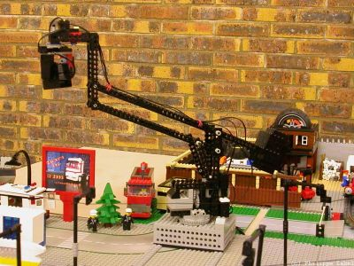
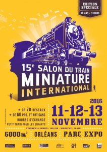
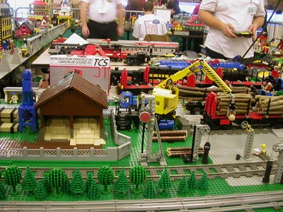
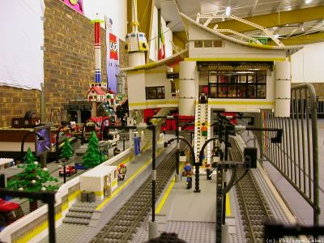
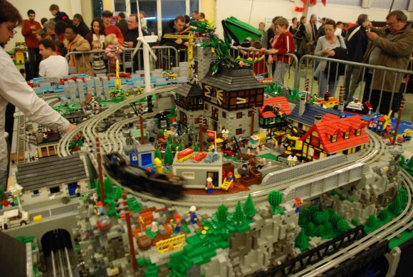
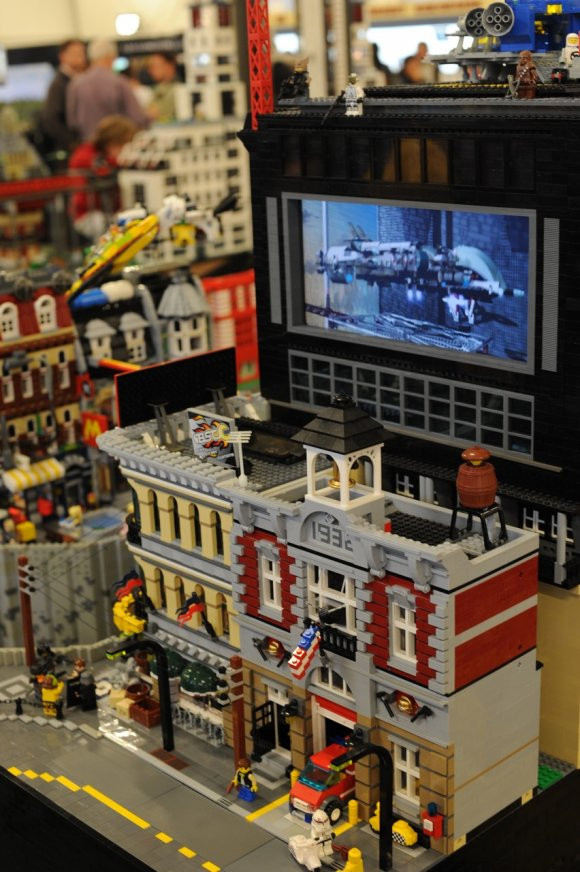
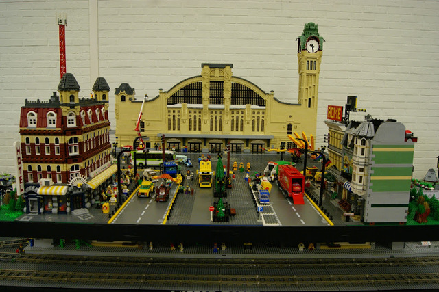
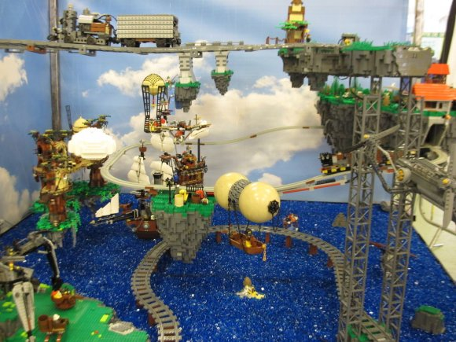
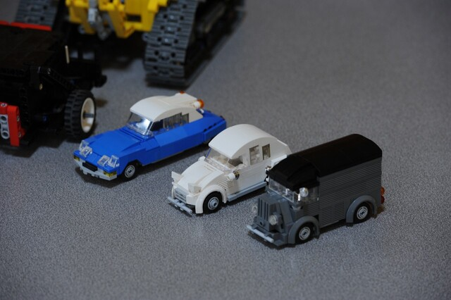

5 Questions à un AFOL à l’occasion d’un événement : Interview de Sébastien Hamon à l’occasion du Salon du Train Miniature d’Orléans.

FreeLUGien, membre du CA, ou Afol, chacun vit sa passion à sa manière. Voici donc une nouvelle rubrique qui donne la parole à l’un d’entre eux. 5 Questions pour présenter sa passion ou un événement à venir.

Pour cette première interview d’une série qu’on espérera longue, voici 5 questions à Sébastien Hamon à l’occasion du salon du train miniature d’Orléans.

**_Question 1 : Peux-tu te présenter rapidement, nous dire depuis combien de temps tu es dans l’association FreeLUG, et le rôle que tu y joues ?_  
**

Sébastien HAMON, 37 ans, finistérien d’origine et expatrié dans l’Orléanais depuis 15 ans maintenant. J’ai suivi la création de FreeLUG en lisant les discussions du groupe "LEGO-construction" sur Yahoo. A ma surprise générale, j’ai appris qu’une équipe serait présente en 2004 au Salon du Train Modélisme d’Orléans... je ne pouvais pas ne pas y aller. Une fois sur place, j’ai pu largement discuter avec Médérick, Alban et Philippe (qui m’a laissé jouer avec sa grue). Après il m’a fallu quelque temps pour rejoindre la grande famille FreeLUG ce que j’ai fait courant 2005. Ma première exposition en tant qu’exposant fut ce même salon en 2006 avec une plaque 32x32 sur laquelle il y avait une caméra sur un bras articulé.

**Caméra type « louma »**

Actuellement, je suis assez investi chez FreeLUG car j’y suis le secrétaire. Je m’occupe également de la gestion de notre matériel et plus particulièrement notre local sur Orléans. Et pour combler le peu de temps qu’il me reste, je suis aussi administrateur de nos outils informatiques (listes, wiki, galerie photo, Facebook...)

**_Question 2 : Tu vas participer à la prochaine édition du salon international du train miniature à Orléans. Peux-tu nous parler un peu de cet événement ?_**

**salon du train miniature d’Orléans**

[Toutes les informations sur cette nouvelle édition](https://www.freelug.org/spip.php?article2431).

Le Salon du Train Miniature d’Orléans est, comme son nom l’indique, un salon ferroviaire qui a lieu tous les 2 ans. Leur adage est "jamais les mêmes exposants à chaque édition" pour ne pas "ennuyer" les visiteurs avec ce qu’ils ont vu la fois précédente. La participation de FreeLUG a commencé en 2004 grâce au travail de Philippe auprès des organisateurs qui étaient sceptiques vis à vis des LEGO. En 2006 nous avons été réinvité (chose contraire à leur adage), toujours grâce au travail fait par Philippe. Et depuis nous sommes présents à chaque édition et sommes devenus quasi indispensables. Et oui, ils ont appris que nous sommes capables de faire des choses différentes à chaque fois. Dans nos membres exposant à ce salon, il y en a qui sont là à chaque édition car ce salon a un quelque chose de particulier et chaleureux. Hein, n’est-ce pas Pascal and family et bien sûr Daniel et Béatrice ainsi que Philippe.

A chaque fois nous avons présenté un réseau différent :

-   2004 un réseau fermé (une grue télécommandée, la gare de Fay aux loges - commune proche d’Orléans - faite par JAC...)
-   2006 une grande ligne droite tout gérer par du DCC et qui fut marqué par un nombre remarquable de déraillement et du mot "STOP". Et oui du poste de commandes, il était impossible de voir les bouts du réseau et donc des problèmes qu’il pouvait y avoir. Ne pas oublier la reproduction du "Petit Magasin Bleu" fait par Pascal, magasin de jouets sur Orléans qui nous avait prêté une alimentation pour le DCC.
-   2008 un réseau "tordu" avec comme fait remarquable : la chute de la tour de Nicolas.
-   2010 un brin futuriste avec comme thème principal le film Bladerunner.
-   2012 une ligne droite de nouveau retraçant la ligne Orléans - Chartres - Rouen, avec une reproduction remarquable de la gare de Rouen par Pascal, de la gare de Pacy sur Eure par Erik. Présence aussi de la fête foraine de Denis.
-   2014 un réseau en U mais également un train roulant dans les airs avec le Steampunk et un réseau de train en Duplo. Là le mot que nous avions répété tout le week-end était "Attention à la marche". Nous étions un peu surélevés par rapport au passage des visiteurs.
-   2016 ... Et bien ça sera la surprise.

Paradoxe pour moi, je n’y connais rien en train, mais pourtant je coordonne notre stand avec les organisateurs de ce salon. Comme quoi En Lego Tout Est Possible (ELTEP) !

**_Question 3 : Sans tout dévoiler, peux-tu nous dire ce que vous préparez pour cette édition, qui sera là, quel sera le thème de votre diorama ?_**

Pour cette édition, il n’y a pas de thème d’imposé, libre cours aux créateurs. Nous aurons de la ville, du pirate, du space port, du minecraft...

**_Question 4 : Ce n’est pas la première fois que FreeLUG y participe. Peux-tu nous parler de présentes éditions, les thèmes et grandes constructions présentées (ou si tu as des choses marquantes à dire) ?  
_**

Pour compléter ce qui a été dit dans les réponses précédentes, voici les articles publiés suite aux précédentes éditions et quelques photos :

-   [article de l’édition 2004](/articles/exposition-modelisme-ferroviaire-amfc-orleans-2004/)

**salon du train miniature d’Orléans 2004**

-   [article de l’édition 2006](/articles/compte-rendu-de-l-exposition-de-modelisme-ferroviaire-d-orleans-2006/)

**salon du train miniature d’Orléans 2006**

-   [article de l’édition 2008](/articles/resume-du-salon-du-modelisme-ferroviaire-d-orleans-2008/)

**salon du train miniature d’Orléans 2008**

-   [article de l’édition 2010](/articles/resume-du-salon-du-modelisme-ferroviaire-d-orleans-2010/)

**salon du train miniature d’Orléans 2010**

-   [article de l’édition 2012](https://www.freelug.org/spip.php?article1574)

**salon du train miniature d’Orléans 2012**

-   [article de l’édition 2014](/articles/resume-de-notre-participation-au-14ieme-salon-du-train-modelisme-d-orleans/)

**salon du train miniature d’Orléans 2014**

**_Question 5 : Enfin, peux-tu nous parler un peu plus de toi et des Lego : quelles gammes affectionnes-tu, es-tu plutôt mocceur ou collectionneur, quel est le moc ou l’objet de ta collection dont tu es le plus fier ?_  
**

Comme tout un chacun ou presque, j’ai eu une période de dark age à l’adolescence même si j’ai toujours pu jouer un peu au LEGO grâce à mon petit frère et aux cousins. Cette sortie a eu lieu lors de la sortie du set 8459 en 1997 puis en 1999 avec le set 8448... Vous aurez donc compris que je suis fan de la gamme Technic. De cette période à mon adhésion à FreeLUG, je suivais les nouveautés dans les magasins en regrettant de ne pouvoir les acheter faute de moyens. Et puis à cette époque, internet n’était pas ce qu’il y est maintenant.

J’affectionne aussi la gamme City, mais pas toutes les boites. Ceci me permet de présenter des dioramas lors des expositions qui tournent en général autour du train.

Je suis tout de même plus collectionneur et moddeur que mocceur. Mais il m’est arrivé de créer quelques MOCs : une caméra sur grue articulée, la reproduction du Pont de l’Europe d’Orléans (2 mètres de long - quelle idée j’ai eu ce jour-là d’en parler à Philippe), la reproduction de véhicules emblématiques de la marque Citroën (une 2CV, une déesse et un HY). Ces 3 créations sont celles dont je suis assez fier : Voir la photo prise par Pascal ci-dessous.

**Reproduction de véhicules emblématiques de la marque Citroën**

J’ai en projet la réalisation d’un paysage lié à mes origines du Centre Finistère et les cailloux. A vous de deviner ce que ça peut être. Mais il faut beaucoup de pièces...

De par mes origines, je suis très attiré par le monde agricole et du BTP. Et cela se voit à ma collection !
