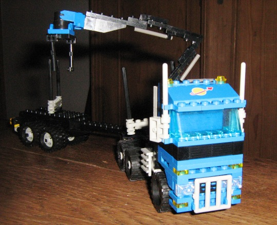
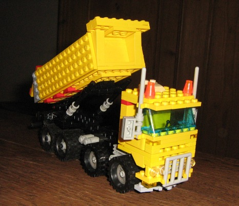
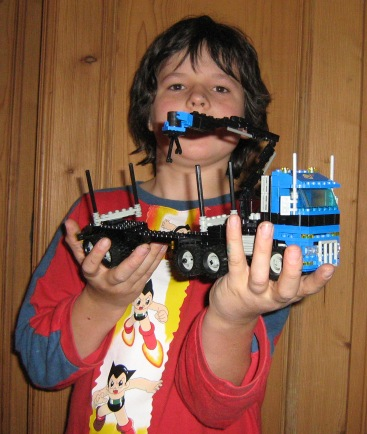
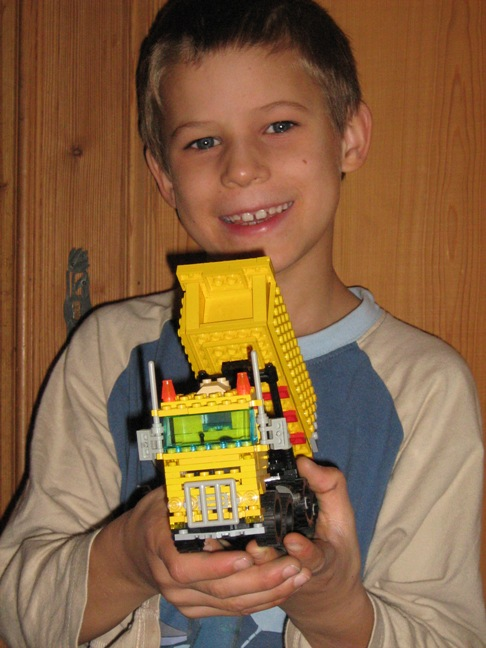

Au même titre que certains articles présentent des sets LEGO, je vous propose de découvrir un set non LEGO mais avec des LEGO.

Ceux qui connaissent JAC savent qu’il est presque partout lorsqu’il s’agit de parler ou de présenter des LEGO.  
Jac propose actuellement un CD permettant la construction d’un Grumier.

**Grumier**

J’ai pu l’acheter (référence J04-010 chez Jac)lors de l’exposition ’Orléans 2008’ ainsi qu’un CD plus ancien (Ref J25 008), le camion benne.

**Camion Benne**

Grand bien m’en a pris, car le résultat est superbe.

A mon retour de l’exposition orléannaise, Félix 11 ans et Paul 8 ans, deux de mes 3 garçons ont découvert les CDs.  
Tout de suite, ils ont insisté pour que nous construisions ces camions.

Le 11 novembre et son temps gris tombait bien.

A 9h00, démarrage,  
Félix pour le Grumier et Paul pour le Camion Benne recherchent les pièces nécessaires (+600 pièces au total !) à l’aide de la nomenclature (comprenant référence, couleur et photo des pièces) des pièces fournies sur le cd.

Deux heures plus tard, démarrage de la construction.  
Les étapes s’enchainent et 2 heures plus tard les vroum vroum se font entendre.

## Un vrai plaisir

Pas une fois j’ai du aider les garçons lors de la construction. La notice est parfaite !

Notons aussi la présence sur le cd d’une présentation du camion ainsi que des autocollants (plaque d’immatriculation et logo), la classe !  
Vous l’avez compris, grâce à Jac, une partie de la famille Meyer a mené à bien un petit projet très réjouissant et a été occupée de la plus belle manière une journée entière pour 6,50 euros seulement le CD (8,9 avec frais de port).  
Au registre des petites options qui pourraient être pratiques, le CD pourrait contenir un fichier BrickStore qui permettrait la commande quasi instantanée des pièces nécessaires.

[Toutes les informations sur le site de JAC](http://pagesperso-orange.fr/jac-creations/pajdevent-006.htm). Je précise que j’ai écrit cet article, non pour faire plaisir à JAC, mais pour mettre en avant cette initiative qui me semble intéressante.

_Thierry_

**Félix**

Dès que j’ai vu ce superbe grumier, j’ai commencé à dire papa je peux construire ce superbe grumier ? Et il a dit oui mais demain. Alors le lendemain matin, j’ai tout de suite commencé après le déjeuner à chercher toutes les pièces, quand j’avais fini. J’ai commencé à construire le modèle et après j’ai tout de suite joué ! joué ! joué !

_Félix_

**Paul**

LE CAMION EST BIEN !!!!!!!!!!!!!!!!

_Paul_

Tu as fait mieux que l’école, JAC !! Les gamins devaient allumer l’ordinateur, compter, combiner, avoir la patience de rassembler toutes les pièces pour enfin pouvoir se donner à fond la caisse à l’habituelle passion de construire !

Petite question : tu ne pourrais pas faire un objet sympa pour les filles ???!!!

_Eliane_
