Seconde participation de FreeLUG à la JapanExpo, [après celle de 2008](/articles/kultiverse-japan-expo-2008-quatre-jours-d-affluence/), c’est 164 000 visiteurs qui ont arpenté les allées du parc des expositions, et pour certains d’entre eux, découvert notre stand.

La JapanExpo est pour nous l’occasion de sortir des cartons des thèmes peu représentés en expositions. Le public, très différent de celui des salons de modélismes traditionnels, accroche facilement sur les excentricités offertes par nos petites briques.

Quatre thèmes principaux étaient présentés.

## Diorama Apocalego

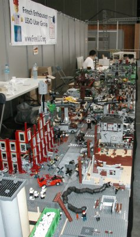

Le rendez-vous était déjà pris depuis plusieurs mois pour présenter à la JapanExpo un diorama Apocalego, d’inspiration libre post-apocalyptique.

David, Jérémy et Erik se sont joints pour proposer un diorama de plus de trois mètres où les zombies flirtaient entre les décombres et des hommes armés luttant pour leur survie.

Côté Erik, une station de métro abandonnée aux tentacules d’un alien prenait place sous les décombres d’un immeuble, tandis que des zombies tout fraichement transformés s’échappaient d’une fuite de produits toxiques d’un silo.

Au centre, David mélangeait pont à moitié détruit et combats entre factions humaines, laissant même une pauvre victime aux mains de cannibales (faut bien survivre, hein).  
Quelques créatures extraterrestres profitaient de la pagaille pour se frayer leur chemin.

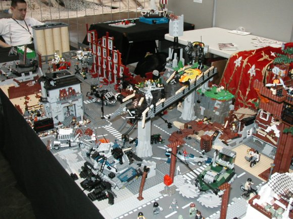

Côté Jérémy, une horde de zombies équipés de vaches-canons, envahissait les rues pour se diriger vers un camp de réfugiés. Dans les rues avoisinantes, le même chaos était toujours présent, mêlant hommes sans pitié et créatures étranges.

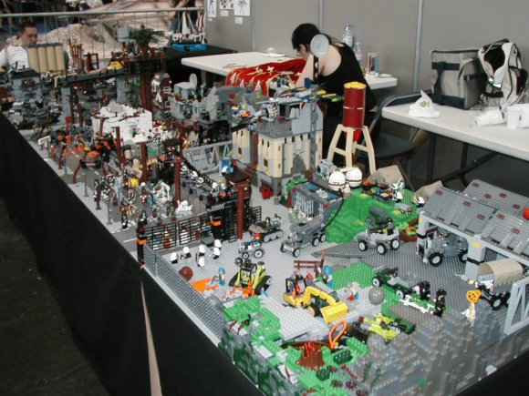

## Diorama Castle

_Par Tof_

Pour ma part, ce fut une exposition un peu spéciale, pour deux raisons.

C’était ma première exposition en temps que membre FreeLUG sur un salon pour FreeLUG donc un test.

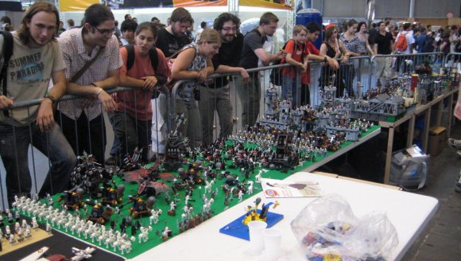

Ensuite, par manque de place chez moi et faute de temps, j’ai fait la construction sur place du diorama Castle. Les deux premiers jours, il n’y avait pas grand chose sur ma partie. Mais le troisième jour, ça avait bien avancé avec deux châteaux, deux tours et une vingtaine de catapultes.

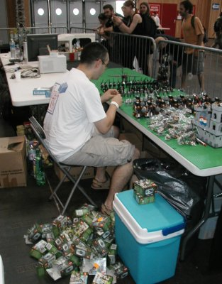

J’ai fais toute la période (sauf dimanche), beaucoup de monde ont pris des photos sur les univers exposés. Et même, des visiteurs croyaient que LEGO était remplacé par des jeux vidéo. LEGO mort ? Impossible dans le monde AFOL.

Pour moi ce fut une bonne expérience d’exposition à laquelle j’ai pris goût.

## Diorama StarWars

Bien sûr, le StarWars était de la partie. Jean-Louis a ressorti sa base Echo de la planète Hoth, mise à jour avec les TaunTaun fraichement sortis. A l’initial, l’objectif était de refaire une petite [séquence animée comme au Salon du Cinéma](/articles/salon-du-cinema-2009-paillettes-et-strass-pour-nos-minifigs/), mais nous n’en avons pas eu le courage. Simon a de son côté exposé des figurines StarWars dont des customs.

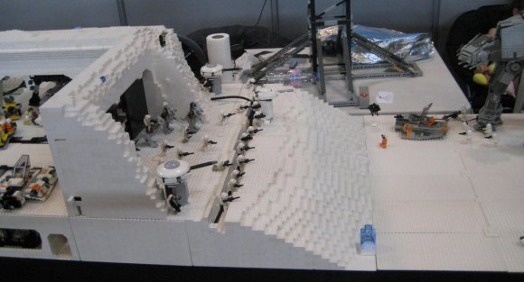

Nous avons également à nouveau profité de la présence de la 501ième, de la Rebel Legion et des décors de la Belgian Costume Division pour [agrandir notre série de minifigs/costumes](http://photos.freelug.org/main.php/v/guss/evenements/JE2009/Lego/Star+Wars+Delirium/). Pas moins de 14 paires !

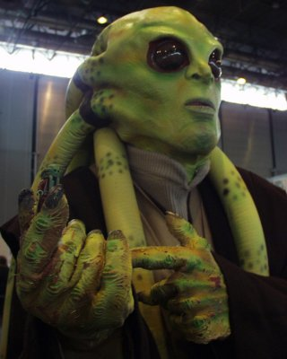

## Diorama PowerMiners

_Par Manu_

Pour cette seconde participation à la Japan Expo, j’ai choisi de montrer la première partie de mon module en cours de création pour le [LEGOWorld 2009](/articles/legoworld-2009-du-22-au-27-octobre/). Le thème est pour le moment peu exploité en exposition : la gamme Power Miners.

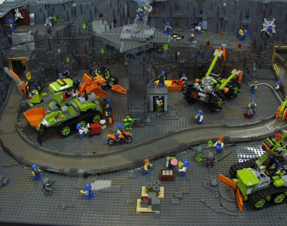

Ayant peu de temps pour faire des mocs, je me suis attaqué à la mise en scène des sets officiels dans un environnement minier. Au fur et à mesure des sorties des nouveaux sets, il a fallu agrandir la mine. cette première version restera pour moi un bon test. Mes différentes animations ont presque toutes fonctionné durant tout le salon et la piscine de diamants a eu l’effet voulu sur le public. Avec quelques améliorations et un agrandissement pour accueillir les derniers sets de l’année, elle sera fin prête pour le LEGOWolrd.

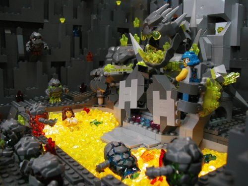

## Partie Manga

Heureusement que parmi nous, David est plongé dans le monde manga, ce qui l’a amené à présenter le Vogue Merry de l’anime One Piece, et la moto de Kaneda de l’anime Akira.

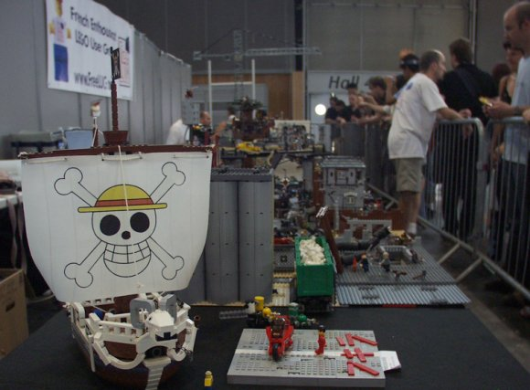

Autant dire que ces deux pièces ont eu un grand succès auprès du public de la Japan Expo.

## Japan Expo

Mais on ne trouve pas que du LEGO à la JapanExpo. La JapanExpo, c’est surtout tout ce qui se rapporte à l’univers manga, et plus généralement la culture japonaise. C’est aussi un évènement regroupant Kultiverse et Comic Con, dédiés à l’univers ludique et bandes dessinées.

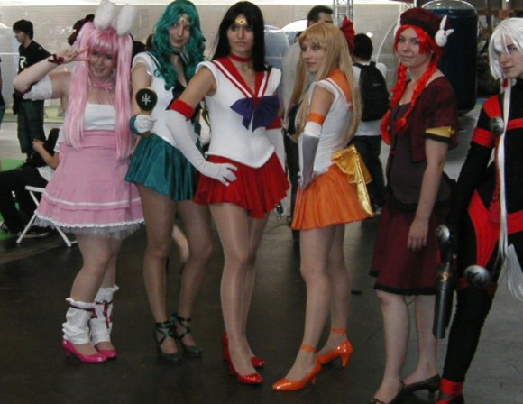

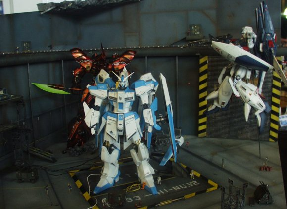

On y trouve donc du Cosplay, des maquettes sur différents supports, des auteurs de bandes dessinées et d’animes, des aires de jeux vidéos et d’innombrables allées commerçantes envahies par une foule compacte.

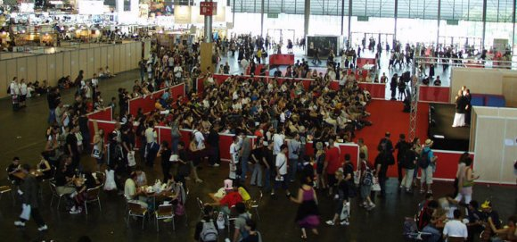

* * *

Enfin, on ne pourra pas terminer ce résumé sans souhaiter toutes nos félicitations à Christophe et sa femme qui a accouché d’une petite Lilou le dimanche, après avoir supporté notre compagnie le samedi sur le stand ! (Le papa et la maman vous remercient et Lilou est déjà dans les starting blocs pour Japan Expo 2015).

## Galeries photos

**–** [Galerie d’Erik](http://photos.freelug.org/main.php/v/brickerik/expositions/2009/JapanExpo2009/)  
**–** [Galerie de Guss](http://photos.freelug.org/main.php/v/guss/evenements/JE2009/)  
**–** [Galerie de Christophe](http://photos.freelug.org/main.php/v/Tof92/Kultima+2009/)
