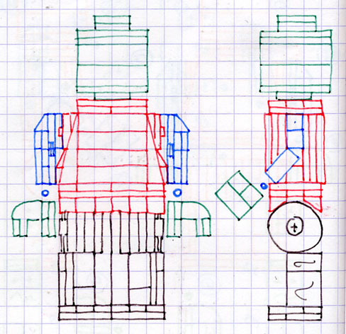
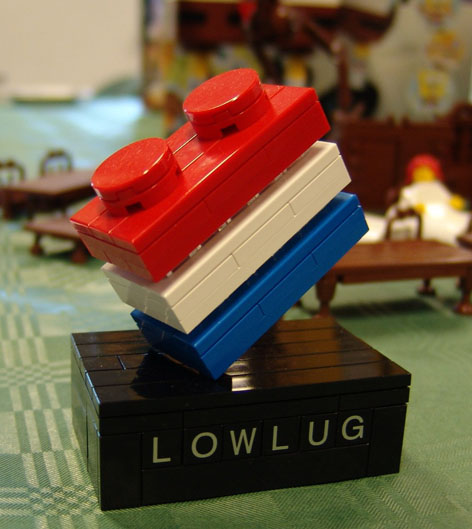
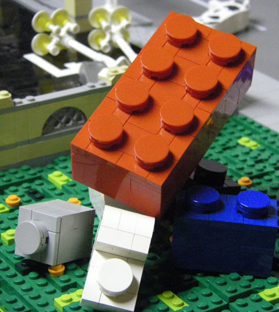
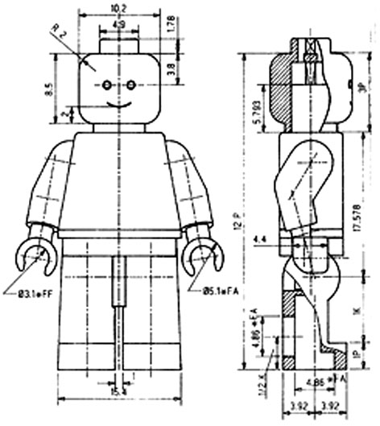
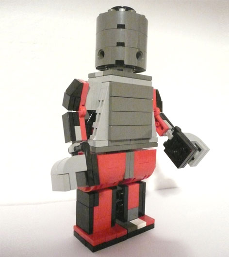
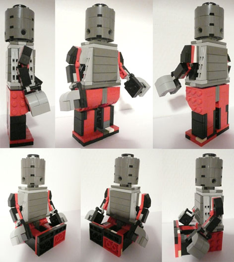
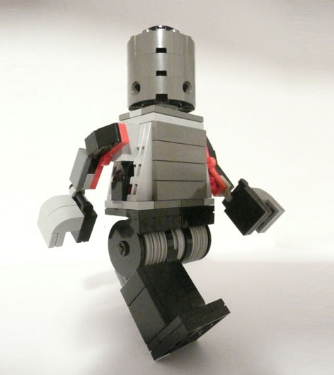
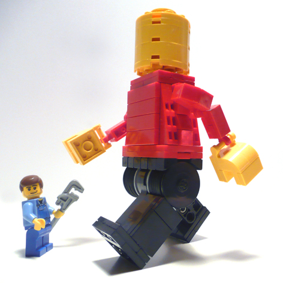
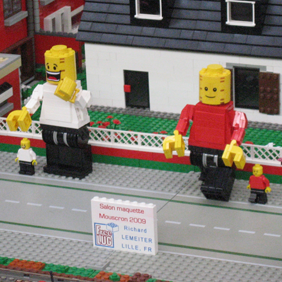

JOE, comme [son cousin Alfred](/articles/alfred/), est à mi-chemin entre le Maxifig et le Minifig. Si Alfred est né lors d’un week-end au bord d’une piscine, JOE est né d’abord sur une page d’un carnet de croquis avant de prendre forme au moment où Pierrick écrivait son article.

**Croquis de JOE**

## Les Origines

Mais revenons au point de départ : l’idée d’imaginer JOE... Elle ne provient pas de la vision des maxi-minifigs comparables mais d’une image vue sur Brickshelf de nos amis de LowLUG. Celle de leur logo réalisé en petites briques.

**LOGO de LowLUG**

Ce qui est intéressant dans cette réalisation est l’échelle utilisée. Concevoir des pièces LEGO en LEGO à l’échelle 3/1.

**Bricks LEGO à l’échelle 3/1**

J’ai commencé par tout redessiner : la brique 1x1, 2x2... pour étudier la fabrication et définir par exemple le "stud" en utilisant une "plate" et une "tile" ronde 2x2.

Et très vite en imaginant comment réaliser une brique ronde 1x1 à l’échelle 3/1, la brique ronde de 3 tenons de diamètre n’existant pas, la brique ronde de 4 tenons de diamètre ou les 4 quarts de brick "Macaroni" m’ont fait penser à la brique ronde plus large utilisée pour les têtes de minifig... et un nouveau défi se présenta à moi : A quoi pouvait ressembler un minifig à l’échelle 3/1 ?

## La conception

La règle de calcul étant simple, on multiplie tout par 3, j’ai commencé par mesurer un minifig en m’aidant de cette représentation.

**Dimensions Minifig**

Puis reportant les mesures sur le papier petits carreaux, j’ai esquissé la tête puis les mains, et très vite ont suivi les jambes, le torse puis les bras... Dans la foulée, il a fallu vérifier "en vrai" les assemblages et en une soirée, croquis à l’appui, le prototype de "_JOE 001_" est né.

**Proto JOE 001**

Moins d’une semaine s’est écoulée entre le premier trait de crayon et le prototype dans le creux de la main...  
Mais quelque chose me chiffonnait : l’articulation des jambes, JOE pouvait uniquement être debout ou assis ! Il ne pouvait pas marcher.

**Proto JOE 001 Debout / Assis**

C’est alors que j’ai repensé à l’articulation utilisée dans le [ATAT Star Wars](http://www.peeron.com/inv/sets/4483-1). De nouveau, crayon en main, il a fallu introduire [ces](http://www.peeron.com/inv/parts/44225) [pièces](http://www.peeron.com/inv/parts/44224) dans un JOE déjà bien proportionné. L’opération fut une réussite et le prototype de "_JOE 002_" vit le jour 3 jours après "_JOE 001_"... ça y est : **JOE MARCHE !**

**Proto JOE 002**

## Les dimensions

JOE mesure 11 tenons et 3 plates de large (9,76 cm, bras et mains compris), 3 tenons et 1 plate d’épaisseur (2,72 cm, au niveau du torse) et 17 tenons et 1 plate de haut (13,92 cm) soit une échelle de 3,5/1. Il est composé de 151 pièces pour "_JOE 001_" et 164 pièces pour "_JOE 002_" et pèse environ 200g.

Pour "_JOE 002_", on retrouve les mêmes articulations que les minifigs, c’est-à-dire au niveau des hanches, des épaules et de la tête à l’exception des poignées où là deux positions sont possibles, horizontale ou verticale.

## Les déclinaisons

L’articulation utilisée dans les ATAT a un panel de couleurs limité et la combinaison avec la "[Technic Wedge Belt Wheel](http://www.bricklink.com/catalogItemPic.asp?P=4185)" limite d’autant plus. Pour que JOE marche, il devra porter obligatoirement, dans sa version 002, un pantalon : Blanc, Noir, "Light Bluish Gray" ou "Light Old Gray"

C’est pourquoi la version 001 vous est présentée, car elle permet beaucoup plus de déclinaisons "vestimentaires"

## Le montage et sa notice

Notices réalisées à la main ainsi que la liste des pièces. Suivront prochainement les Notices MLcad.

**Notice JOE 001**

**Notice JOE 002**

Visages de "JOE" possibles, à imprimer sur transparent autocollant, pour le blanc des dents ou la pupille des yeux, des petits morceaux de papier blanc placés derrière et le tour est joué.

**Visages de JOE**

## Prêt pour l’aventure

**En route pour 2009**

Première sortie en Expo entre potes...

**EXPO à Mouscron en Belgique**
