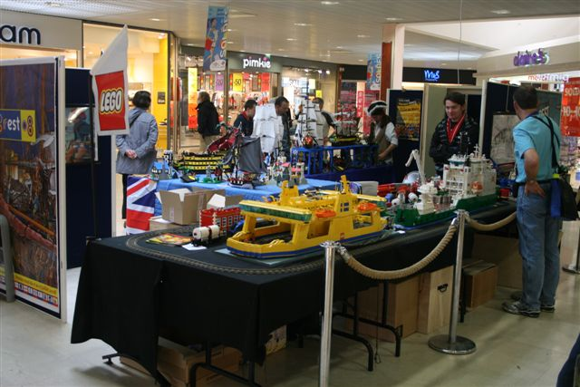
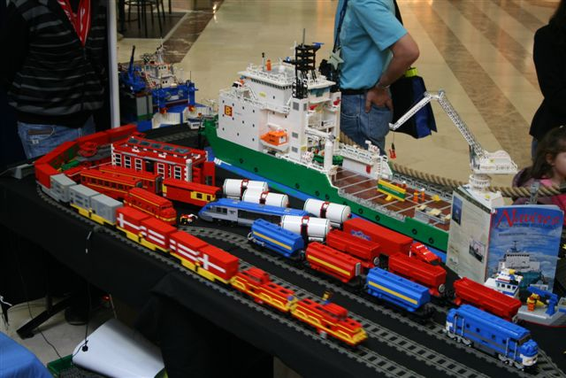
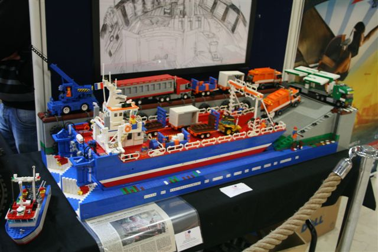
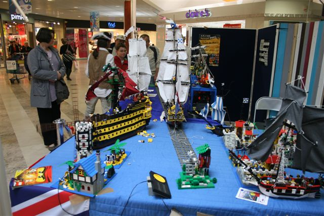
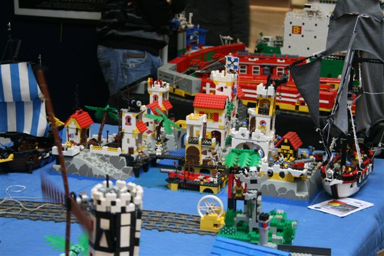
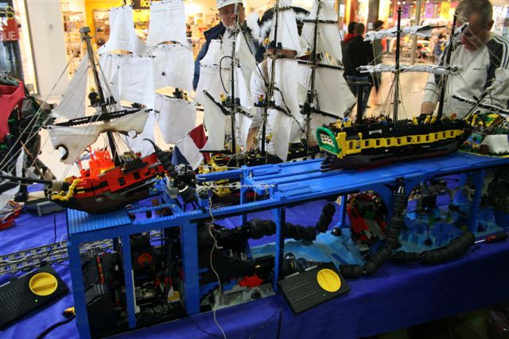

Une poignée d’amoureux de la brique au milieu de la foule dans une galerie marchande.

A l’initiative de Mickael et en prévision de la quinzaine legotique en février 2012, des créations de Laurent, Mickael et moi-même ont été exposées pour une journée.

J’avais amené la barge animée, mon Bourbon Entreprise, un petit circuit ferroviaire avec rames de conteneurs, et mon super ferrry jaune.

L’accueil a été chaleureux, le public a bien apprécié, les commerçants ont été conquis.

Merci à Mick et au président de l’association des commerçants pour cette initiative intéressante et instructive.

_Jean-Marc_

* * *

Une journée LEGO à Carrefour ? Des stands LEGO en plein milieu de la galerie avec moi et des déglingos de la brique derrière ? Ca c’est mon rêve d’enfant qui se réalise =)

Avec les quelques mètres de tables qui avaient été mises de côté par Mickael et l’association des commerçants de la galerie, j’ai donc rejoint la petite équipe constituée par Jean-Marc et Mickael, pour exposer mes vaisseaux de ligne ainsi que mon kraken animatronique, trait au thème de l’expo qui n’était autre que la mer !

Journée épuisante, sans temps mort, mais constructive ; nous avons fait plusieurs rencontres intéressantes, avons fait goûter des sushis à Jean-Marc, et en ce qui me concernait, cet évènement était l’occasion pour moi de faire fonctionner mes animations à l’échelle réelle, et de noter les dysfonctionnements pour avoir une base de travail sur les prochaines améliorations.

Comme il y avait les trains de Jean-Marc et les Toy Story, entre bien d’autres, de Mickael, mes bateaux ont plutôt servi à retenir la curiosité des plus grands, et l’attention des enfants qui s’arrêtaient de jouer au train quelques instants.

L’association des commerçants a rapidement validé le succès de cette opération, puisque l’invitation était déjà donnée en fin de journée, pour réitérer l’évènement sur deux jours durant le mois d’août !

_LaurentB & Bruno_

[Galerie photos](http://photos.freelug.org/main.php/v/barr__/expositions/2011/carrefour/)
