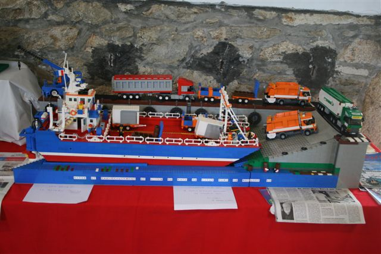

La Ville de Roscoff (au nord de Morlaix), petite Cité de caractère et célèbre port de la flibuste, a accueilli une nouvelle édition des Journées du Patrimoine en réquisitionnant tous les bâtiments publics et une chapelle !

Mon club de la maquette et moi avons pris place dans la superbe et confortable chapelle.

Après installation des tables, nous déposons nos créations et moi, ma barge animée.

Le public, malgré un parcours important entre les bâtiments, est venu nombreux grâce à un très généreux soleil, et a admiré nos petits chefs d’oeuvre.

Les locaux ont, bien sûr, reconnu la barge de l’Ile de Batz, mais en LEGO, c’était moins sûr. Quant au mécanisme, il a fallu tout expliquer en français car certains me parlaient en breton, hum, hum... ne rigolez pas, le breton est une véritable langue !

A l’heure du repas, samedi et dimanche, fort sympathique préparé par la cantine municipale, j’ai mangé avec des personnages hauts en couleurs, des troubadours, des soldats du temps du Roi soleil, des corsaires de Saint-Malo, des femmes en robe d’époque, des femmes de lle en tenue de travail, pleins de personnages allant du Moyen-Age à la Belle époque, c’était extraordinaire, j’ai même eu droit à des chants marins d’une association médiévale de Dinan.

Pour un féru d’histoire comme moi, c’est une aubaine car j’ai pu voir de prés ces costumes et surtout les couleurs.  
Idem pour le dimanche.

J’ai rencontré Mr le Maire, l’adjointe au maire chargée de la culture et des responsables, félicitations au passage.  
Dimanche soir, démontage et retour avec pleins de souvenirs.

[Galerie de photos](http://photos.freelug.org/main.php/v/barr__/expositions/2010/roscoff/)

_Votre serviteur breton_
