Nouvelle brique à notre déjà large ensemble de prestations réalisées un peu partout, nous avons été conviés à la fois par les Organisateurs (Continental Expo) et par LEGO France à venir participer à cette deuxième édition de Kidexpo qui s’est déroulée du 31 octobre au 2 novembre 2008. Pour nous c’est une rencontre avec un nouveau public, celui des jeunes enfants et il nous a fallu faire face à un enthousiasme pas toujours très maîtrisé.

## Exposer à Kidexpo

Lorsque l’organisation nous a contactés (fin 2007), elle nous avait fait part des commentaires recueillis lors de [l’édition précédente](https://www.freelug.org/spip.php?breve265) qui s’était déroulée au mois de juin. Les visiteurs de 2007 avaient en effet regretté de ne pas avoir vu de "trains" et la commissaire de l’organisation, qui avait également oeuvré sur le salon de la maquette, s’est rappelé de nos précédentes interventions à la Porte de Versailles.

Nous avions donc convenu d’un rendez-vous sur le salon Kultima pour présenter un peu plus ce que nous pouvions faire.

Entre le mois de novembre de l’année dernière et notre arrivée jeudi soir beaucoup de choses se sont passées pour nous permettre de réaliser notre prestations dans de bonnes conditions.

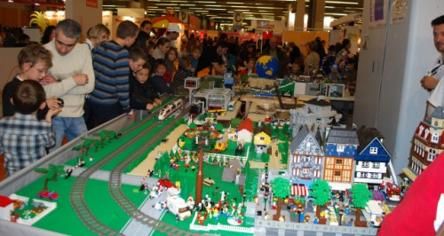

Tout d’abord confirmation des dates de Kidexpo 2008, un temps prévues pour juin 2008 et puis finalement bouclées sur le week-end de la Toussaint, qui présente l’avantage d’être un des rares week-end de vacances scolaire commun à l’ensemble des régions.

Ensuite rapprochement avec LEGO France, déjà présents en 2007, afin de mettre en place la logistique. Car malheureusement, comme c’est toujours le cas sur ces salons commerciaux, les organisateurs ne sont pas les propriétaires des lieux et chaque mètre carré a un coût et il faut bien quelqu’un pour payer la location de l’espace.

Notre stratégie à FreeLUG étant de ne pas payer pour participer à des expositions (à priori nous avons suffisamment de sollicitations gratuites, voir mêmes défrayées), notre participation a été couverte par LEGO France. Et c’est donc dans le contexte de ce partenariat que nous avons pu répondre à la fois à la demande des organisateurs et aux attentes de notre "sponsor" en mettant en place un diorama mettant en valeur notre savoir faire et quelques produits "catalogue".

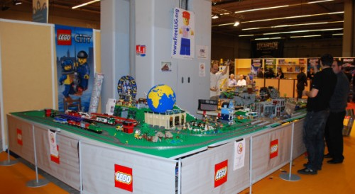

**Vue du diorama, avant l’ouverture**

Le calme avant la tempête...

Je remercie donc les organisateurs d’avoir pensé à nous pour mettre du "train" sur Kidexpo et LEGO France pour leur support logistique.

## Description du réseau.

Le plan du réseau a été conçu principalement par Richard "Charlie" Lemeiter, qui nous présentait sur son module un croisement modifié et intégré dans un ensemble de voies réalistes avec traverses bois et ballast.

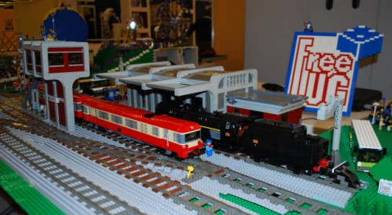

Nous avions comme projet de tester [les grandes courbes présentées dans "Railbrick 1"](https://www.freelug.org/spip.php?breve272), mais nous avons du y renoncer faute de place suffisante. Les essais préliminaires ayant démontré que la tenue du rayon minimum indiqué dans l’article n’était pas appropriée au plan de tables et nous n’avions pas de raccordement propre pour reprendre la pose des voies pour effectuer la boucle, les grandes courbes n’étant pas vraiment appropriées pour de la double voie.

Sur la partie droite du module de Richard "Charlie", se trouvait le module de Jérémy "Thaaz" avec son globe terrestre et son ensemble Grande Roue + skate parc, le tout posé sur un plateau offrant un passage en tunnel pour les trains circulant sur la boucle.

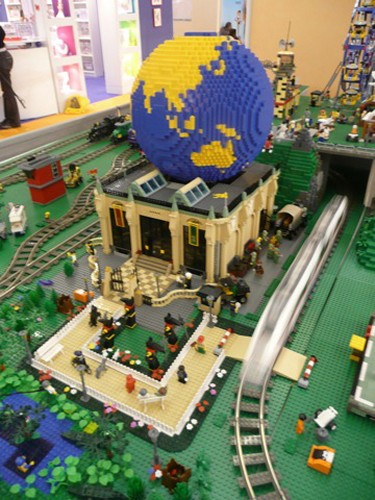

Quelques mares pleines de réalisme (et de grenouilles) formaient l’avant plan à la gare de triage où les trains "se reposaient".

Sur la gare de triage, était exposé en statique (à cause des tunnels), l’EAD réalisé par Nicolas, qui a pu participer à distance à cet évènement. Nicolas tu peux arrêter de faire ton timide maintenant, car tes réalisations ont été vues et appréciées par près de 50 000 visiteurs. Je pense que ton autorail devrait pour son prochain voyage s’arrêter à Orléans avant de revenir sur Lyon.

A gauche du module de Richard se trouvait le module de Denis, avec une référence à Fana’briques, puisque Denis nous présentait le Poney Club de Rosheim, associé à un camp de Scouts (toujours prêts !)

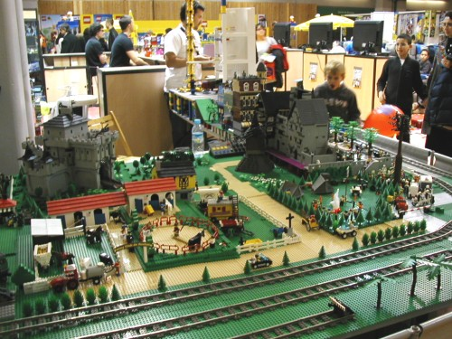

De l’Alsace on passait à la Bretagne, car sur le module préparé par le binôme Erik/Manu (non Mme Bonnard, la remise montée par Manu dans le jardin n’est pas la résidence secondaire d’Erik), un bloc de trois maisons médiévales assemblées par Erik représentait des maisons réelles à Lannion.

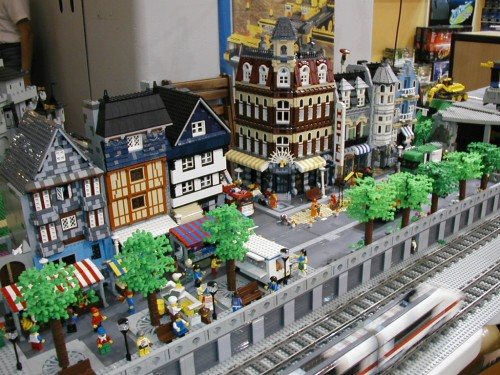

Toute cette zone a été particulièrement photographiée, pas uniquement par les visiteurs, car il y avait également en entrée de la ville une "boîte à images" qui n’a pas arrêté de mitrailler le pauvre motard placé devant. Mais bon, j’ai cru comprendre que nous allions entendre reparler du radar.

Ensuite, pour compléter la ville avec une architecture plus moderne, Brice avait apporté une réalisation sur le thème de la Grande Arche, encore dans sa phase de construction, pour évidemment y mettre en valeur sa grue.

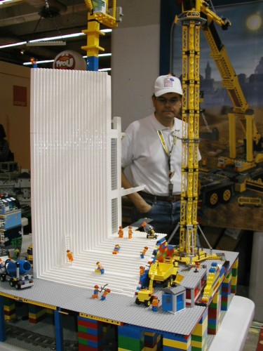

Et puis pour ceux qui ne l’avaient pas bien vu durant Kultima, le château qui avait servi de cadre à la bataille des squelettes a traversé les âges pour se retrouver à notre époque comme arrière plan d’une fête médiévale.

Coté matériel roulant, outre la Caravelle de Nicolas, il y avait également en première exposition publique, la splendide 141R de Richard, sachant que le plus impressionnant n’est pas forcément le modèle monté, mais surtout les carnets de notes dont Richard s’est servi pour concevoir son modèle. Je pense que ça mériterait aussi un bel article.

Il y avait aussi quelques modèles du commerces et des réalisations de Jérémy et Didier, mais ce que les enfants ont vu le plus tourner, ce sont les deux trains RC qui ont servi de support au coté interactif de notre show, interactif à développer pour les prochaines expositions du genre.

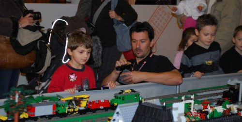

Une ribambelle de cheminots et cheminotes en herbes s’est essayée au maniement de la télécommande.

Christophe, Daniela, Gilles et Eric se sont également joints à nous afin de visiter le salon en famille, exposer quelques créations au passage, donner un coup de mains à droite à gauche. Merci à eux pour leur visite et leur soutien.

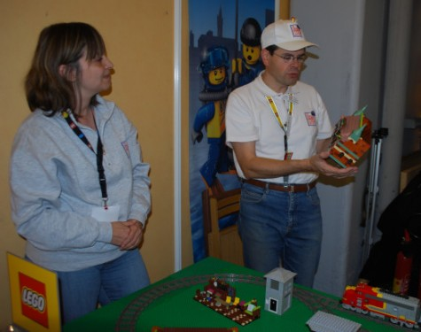

## Les autres activités du salon

En premier lieu, il y avait les deux activités proposées par LEGO, avec à l’entrée du Salon la réalisation de la mosaïque "Tous Solidaires" qui permettait chaque jour à une centaine de visiteurs de faire preuve de solidarité en venant participer à l’assemblage de cette grande fresque. FreeLUG a participé activement à ce projet avec l’aide d’Anna de chez LEGO France, puisque nous avons défini avec elle le concept (mosaïque constitué de briques posées sur 100 plaques de base), modélisé la fresque, défini le nombre de briques à approvisionner et réalisé les notices de montage. Avant le démarrage du salon, Anna se demandait si la fresque serait bien réalisée durant les 3 jours. Grâce à l’équipe d’animation et au renfort des exposants FreeLUGiens, la mosaïque a été monté et remonté plusieurs fois durant les trois jours, avec le soutien des politiques puisque la première plaque a été déposée par Mme Rama Yade, qui a passé quelques instants à discuter avec les enfants présents sur le stand.

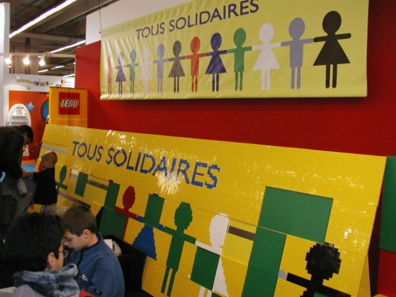

Coté LEGO, c’était la carte du monde géante qui était de nouveau présente cette année, avec également un atelier Duplo pour les plus petits.

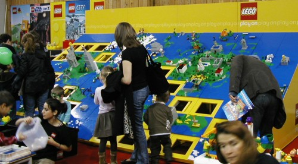

Parmi les autres activités du salon, les fans de trains ont été impressionnés par le [nouveau système Märklin de vision embarqué](http://www.marklin.fr/communique-de-presse-marklin-mobile-visionae/). Ce système vendu dans un coffret complet avec une rame ICE, comprend à l’intérieur de la rame une caméra montée sur un support orientable à partir des mouvements de tête que l’on exerce en visualisant les images sur des lunettes spéciales. Lunettes sur le nez, on tourne la tête à gauche et la caméra se déporte sur la gauche. Vraiment bluffant, on a véritablement l’impression de piloter le train. Bientôt vous pourrez peut-être piloter les trains de Philippe à distance, depuis l’intérieur de ses locomotives en LEGO.

Sinon certains se sont gavés de bananes et de chocolat et d’autres ont récupéré quelques cadeaux pour leurs enfants, acheté quelques miniset Star Wars, appris plein de choses sur les activités des enfants et prêter leur "débloqueur" LEGO.

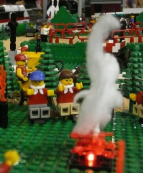

## Les avis des participants

**Didier**

Beaucoup d’enthousiasme parmi les visiteurs et la nécessité d’être très présents devant les barrières, mais toujours la même magie dans les regards des petits et des plus grands. Coté organisation, on constate que nous sommes de plus en plus rodés à l’exercice et malgré le faible délai de réalisation, car même si le projet avait été initialisé de longue date, il a fallu attendre pratiquement jusqu’à la dernière minute pour avoir confirmation du plan de tables. Le partenariat avec LEGO France s’est très bien passé et il sera amené, je pense, à se reconduire sur d’autres évènements et pas forcément des évènements parisiens.

Un grand merci à Nicolas pour le prêt de son magnifique autorail que nous avons photographié sous toutes les coutures devant les impressionnantes réalisations de Richard. Et merci à mon pote Régis pour avoir fait le facteur.

Merci à Eric Letang, Didier Enjary et à Tobias et Adrian pour leur aide dans l’utilisation du logiciel "[Pictobrick](http://www.pictobrick.de/en/pictobrick.shtml)" pour le design de la mosaïque "Tous Solidaires".

Merci également à Jan Beyer pour son soutien.

**Erik**

Bon Didier en a déjà beaucoup dit :) je complèterais par un coucou à tous les adhérents qui sont passés nous voir, Sylvain (pas ceux de Daniela), Thibaud, Pascal, Jean-Claude (en espérant ne pas en oublier) et ainsi qu’à tous les autres passionnés qui se sont arrêtés (parfois à plusieurs reprises) à notre stand pour discuter !

La journée du samedi s’est achevée par un petit restaurant à proximité du parc.

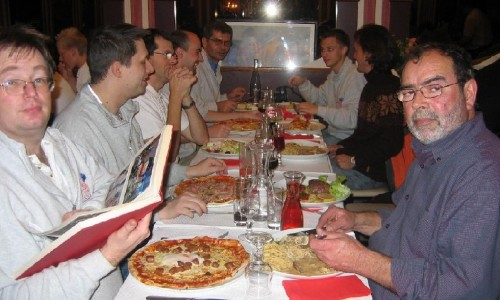

**Eric**

Un salon un peu étonnant, un public trés jeune, des animations parfois bruyantes. Mais les jouets LEGO ont la particularité de faire jouer autant les parents que les enfants ! Et cela c’est vraiment bien ! J’espère que beaucoup d’autres adhérents feront un jour le pas pour venir exposer. Je n’ai participer qu’en amont pour cette exposition mais après ma visite du samedi, je suis revenu le dimanche aussi ! C’était bien et j’ai passé un très bon moment. Merci également à tous ceux qui ont permis que cette exposition est lieue.

**Richard**

C’était une première pour moi, après une participation au Mondial 2007 avec seulement une loco, lorsque Didier "qdm" m’a parlé de KidExpo à l’AG je me suis lancé dans la conception d’un module restant dans l’esprit de ma 141R, pour franchir le pas et exposer pour la première fois.  
Première également pour mon père, que je remercie vivement, encouragements lors de la conception, transport, renseignement au public et surtout surveillance assidue de la gare de triage !!

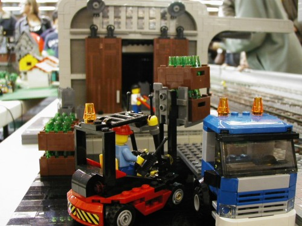

**Christophe**

Magnifique Expo qui a du donner envie à certains adultes de replonger. Ce fut mon cas après le salon du modelisme du Bourget.  
A étayer pour une interactivité meilleure.  
En 2009, pourquoi pas des MOC RC à base de PFS ( Bulldozer - Chargeur ).  
Grands remerciements à tous les exposants pour avoir laissé mon fils au pupitre.

**Jérémy**

Comme tout le monde a déjà tout dit, je vais juste me permettre de rajouter que j’ai "lâchement" laissé tomber mes camarades pour aller m’amuser au niveau de la mosaïque, à noter justement pour ma part pas mal d’échanges (de détaches briques) avec les personnes de LEGO lors des démontages de mosaïques.

Cette exposition m’a également fais prendre conscience de la nécessité d’avoir mes propres tables (j’ai du palier à des décalages de 1 ou 2cm par endroit).

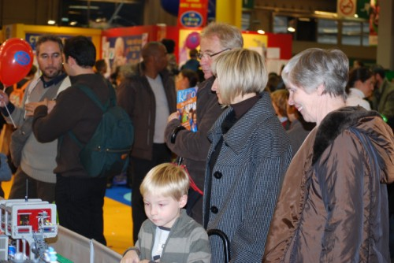

## Galeries de photos

**–** [Galerie de Gilles](http://photos.freelug.org/main.php/v/gmifr/KidExpo2008/)  
**–** [Galerie d’Erik](http://photos.freelug.org/main.php/v/brickerik/expositions/2008/kidexpo2008/)  
**–** [Galerie de Didier](http://photos.freelug.org/main.php/v/La-Gallerie-de-qdm/Expositions/2008-Kidexpo/Exposition/)  
**–** [Galerie de Richard](http://photos.freelug.org/main.php/v/Charlie/KidExpo/)  
**–** [Galerie d’Eric](http://photos.freelug.org/main.php/v/f1tvf/expositions/kidexpo/)  
**–** [Galerie de Daniela](http://photos.freelug.org/main.php/v/Daniela+et+Sylv1/Expositions/2008+Kidexpo/)  
**–** [Galerie de Christophe](http://photos.freelug.org/main.php/v/tottoff/Kidexpo+2008/)
