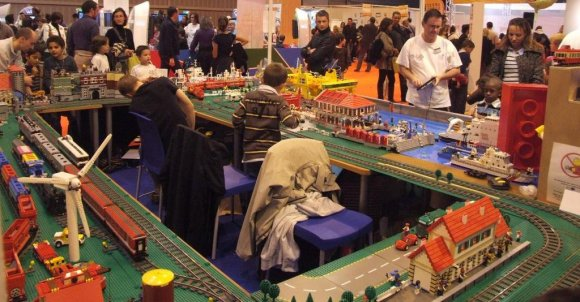
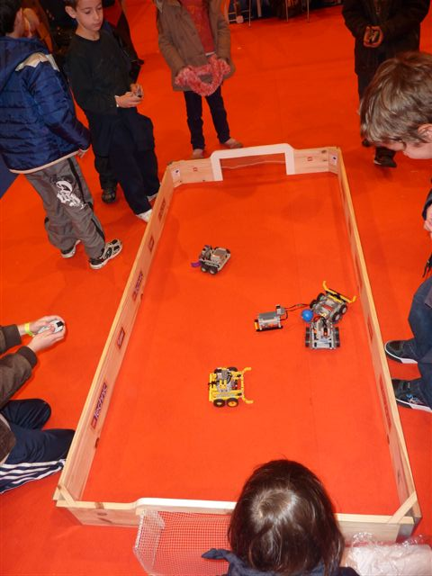
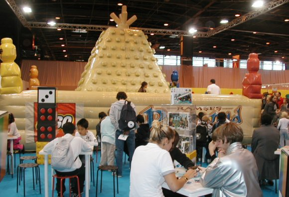
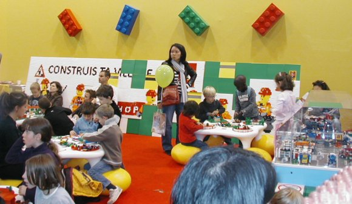
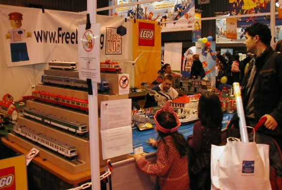

Une nouvelle fois invités par LEGO France pour prendre part à la troisième édition du Salon Kidexpo, nous avons pu présenter sur un espace de 20m2 un diorama toujours aussi apprécié, ainsi qu’une animation Techball très remarquée.

## Recevoir 71 000 visiteurs !

71 000 visiteurs, c’est le nombre communiqué par les organisateurs, qui précisent que c’est généralement lors de la 3ème édition d’un événement qu’il est possible de mesurer si celui-ci va pouvoir vivre sur les bases existantes ou s’il va être nécessaire de revoir encore la copie.

Il est donc à prévoir que ce salon Kidexpo, dédié à l’univers de l’enfance et à ses différentes activités, va pouvoir maintenant perdurer et qu’il restera pour nous une opportunité d’exposer notre savoir faire. Du moins tant que LEGO France continuera à nous inviter et à supporter les coûts induits par notre participation.

Cette année nous avons eu droit à un beau stand de 20m2, avec moquette et éclairage. Nous avons réduit nos besoins en matière de mobilier en fournissant nos propres tables et nous avons pu rogner quelques m2 sur l’espace voisin pour installer le terrain de Techball.

Notre diorama reposait en grande partie sur le réseau maritime de Jean-Marc qui souhaitait exposer à Paris depuis longue date. Nous en avions déjà évoqué sa visite lorsque le mondial de la maquette existait encore.

Sa présence a été d’une grande aide, car malheureusement je n’ai pu me consacrer à la préparation de cet événement autant que je l’aurai souhaité et savoir qu’une grande partie du réseau avait déjà fait ses preuves a été d’un grand secours.

Merci également aux "petits nouveaux" qui se sont joints à nous pour leur baptême. C’est sûr que commencer par un salon comme Kidexpo, c’est une sacré entrée en matière. Nous vous accueillerons encore avec plaisir en 2010, si nous sommes toujours invités et nous prévoirons un plan pour que vos conjointes puissent nous rejoindre facilement pour notre repas du samedi soir ;-) !

Merci aussi aux "anciens" pour leur aide indéfectible.

Avis aux amateurs, Kidexpo 2010, ça sera cette fois-ci sur 4 jours du 22 au 25 octobre, toujours à la porte de Versailles.

**Didier**

* * *

## Le stand FreeLUG

Répondant à l’invitation de la section parisienne de FreeLUG, je suis donc monté à KidExpo à la Porte de Versailles avec mon réseau au complet.

La configuration du stand offert par notre marque préférée m’a permis d’exposer seulement la plus intéressante partie de mon grand réseau trains et ferries avec deux connexions ferroviaires.

Durant les trois jours, nous avons reçu beaucoup de monde, surtout les enfants.

La vigilance a été sans faille, les petits doigts sur mon réseau ont été hélas très nombreux, mais au final, pas de vol, ni de casse. OUFFFFFFFFFFFF !!!!!! je m’en souviendrai...

Merci à LEGO FRANCE pour le stand et l’accueil. Merci à QDM pour sa disponibilité malgré son travail. Merci aux exposants de m’avoir tenu compagnie. Merci aux Afols venus nous voir...

**Jean-Marc très heureux du séjour parisien**

* * *

## Le TechBall

**Le stade de Techball**

Ma modeste contribution cette année fut de fournir le terrain de [TechBall](/articles/reglement-de-la-competition-de-techball/) et une douzaine d’heures de présence. Cette attraction non loin du stand FreeLUG, a permis de faire évoluer quatre engins et a remporté un vif succès qui n’a pas cessé durant les trois jours.

**DenisL**

* * *

## Le stand LEGO

De son côté, LEGO France proposait une aire où le public était invité à s’initier aux futurs jeux de société. Les enfants pouvaient également se glisser dans le rôle des aventuriers du jeu Ramses Pyramid et escalader la pyramide gonflable.

Une aire de construction était aussi à disposition avec une grande table dotée d’un circuit ferroviaire autour duquel les enfants étaient invités à construire le décor. Une mosaïque "Construis ta ville" était également présente, à laquelle Didier a participé à la conception sur ordinateur.

* * *

## Première Expo

Un petit mot pour vous faire part de mes impressions suite à ma première exposition.

C’est marrant d’entendre toutes les réflexions des passants. Beaucoup de gens étonnés, un brin de perplexité dans les yeux "des adultes qui jouent au LEGO ?". Les enfants sont en général plus spontanés "c’est à vous tous ces LEGO ?" avec un brin d’envie et de respect.

C’est épuisant de veiller sur les LEGO ou les robots TechBall, mais les questions sont souvent intéressantes, et débouchent parfois sur des aveux "vous savez, moi aussi quand j’étais petit, je jouais au LEGO...", bref, que du spontané.

L’ambiance avec les autres membres de FreeLUG est épatante : convivialité et accueil du "petit nouveau" en sont les maîtres mots. Merci à vous !

Voilà, super expérience, même si mon robot TechBall manquait singulièrement de fiabilité (doux euphémisme pour dire qu’il se désagrégeait à chaque choc ;-), et n’était pas à la hauteur, mais la prochaine fois...

**Benco**

* * *

Pour ma première exposition , j’en suis revenu plein de bons souvenirs, bref, superbe !

Il faut avoir l’oeil de partout avec ces petits garnements comme dirait Jean Marc. Je me suis retrouvé avec une façade de caravelle complètement démembrée , mais bon plus de peur que de mal :-) .

Je tiens à remercier tous les exposants pour le bon déroulement pendant ces deux jours et la très bonne ambiance et plus particulièrement à Didier à qui je dis un grand MERCI.

**Nicolas (Acidburn)**

* * *

Magnifique exposition et ravi d’avoir participé et rencontré d’autres membres. Épuisant tout de même. Ça n’a pas l’air mais jouer aux LEGO (enfin les surveiller comme la prunelles de ses yeux) demande de l’attention.

Succès ininterrompu du Techball : nombreux sont les parents qui demandaient des explications et où trouver les éléments.  
Quelques-uns franchiront le pas ? Grand Gamin : NON - Le plaisir avant tout.

**Christophe (Tottoff)**

* * *

Ma contribution à cette exposition a été minime, grâce à Jean-Marc qui n’a pourtant emmené qu’une partie de son diorama. Je me suis limité à l’aide pour l’installation le jeudi et la surveillance animation du stand FreeLUG et le démontage.

Le techball a été bien apprécié mais pas toujours facile de gérer l’attribution des télécommandes aux enfants, pour des salon avec beaucoup d’affluence comme celui-ci, il faudra peut-être prévoir un système de file d’attente, voir de ticket...

Comme toujours, beaucoup de discussion et de bonne humeur sur le stand.

Merci à QDM même s’il trouve qu’il n’a pas assez fait. Car moi je me demande déjà comment il arrive à faire tout ce qu’il fait.

**Gilles**

* * *

## Galerie photos

**–** [Galerie de Jean-Marc](http://photos.freelug.org/main.php/v/barr__/expositions/2009/Kidexpo2009/)  
**–** [Galerie d’Erik](http://photos.freelug.org/main.php/v/brickerik/expositions/2009/Kidexpo2009/)  
**–** [Galerie de Benco](http://photos.freelug.org/main.php/v/benparsy/Kid-Expo2009/)  
**–** [Galerie de Christophe](http://photos.freelug.org/main.php/v/tottoff/Kidexpo/Kidexpo/)  
**–** [Galerie de Sébastien](http://photos.freelug.org/main.php/v/sebhamon/Kidexpo+2009/)  
**–** [Galerie de Didier](http://photos.freelug.org/main.php/v/La-Gallerie-de-qdm/Expositions/2009-Kidexpo/Exposition/)
