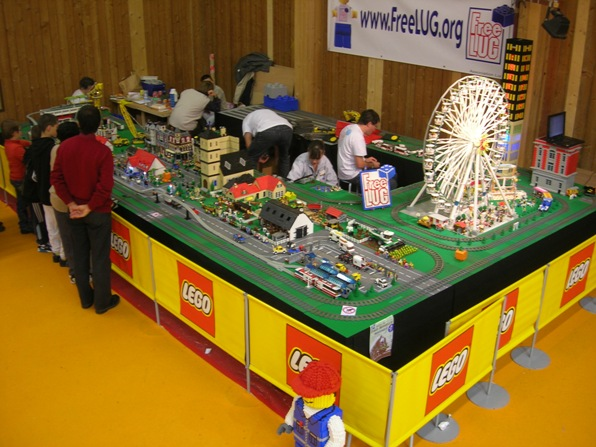
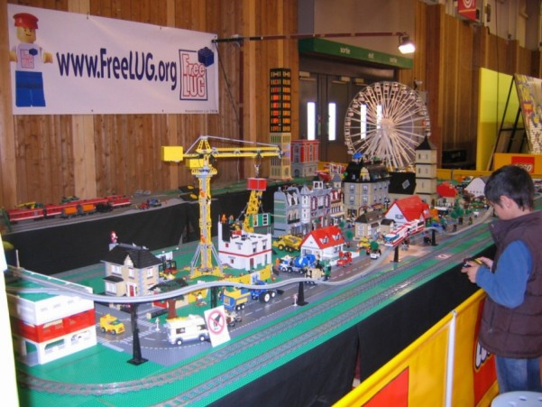
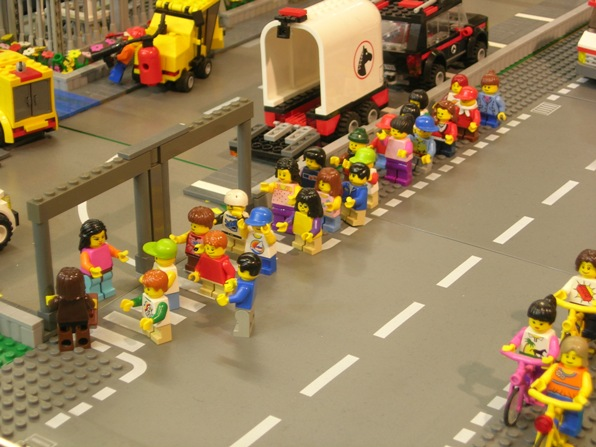
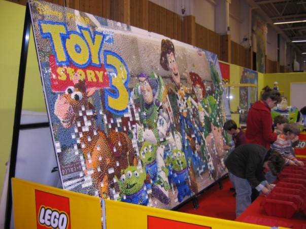

Nous étions à nouveau invités par LEGO France pour participer à l’édition KIDEXPO 2010 qui avait lieu du 22 au 25 octobre.  
Cette fois-ci, nous étions installés directement à côté du stand LEGO France.

Notre présentation sur environ 24m2 était variée et les visiteurs ont pu admirer la campagne, la ville de Jean-Claude ainsi qu’un chantier de Sébastien. La grande roue et un autre manège de Denis ont de nouveau fait sensation. Gilles nous a ramené un circuit monorail ainsi que la tour FreeLUG. Mais que serait un diorama sur le thème de la ville sans train ? Je vous rassure, il y en avait pour le plus grand bonheur des jeunes conducteurs. N’est-ce pas T..., un jeune garçon qui se reconnaîtra certainement en lisant ces lignes ; c’était lui notre plus fidèle conducteur pendant 6 heures. Et oui, son papa était très patient et le repas du midi se prenait dans la file d’attente pour (re)-conduire un des deux trains mis à la disposition des enfants.

**Vue générale du stand**

**Notre stand**

Le salon Kidexpo étant ouvert le dernier jour d’école avant les vacances scolaires de la Toussaint, nous avons accueilli sur notre stand plusieurs groupes d’élèves en sorties scolaires.

La preuve ci-dessous :

Du côté du stand LEGO France il y avait une grande mosaïque sur le thème de Toy Story, faite uniquement de briques 1X1.

**Mosaïque du stand LEGO France sur l thème de Toy Story**

Les enfants ont pu jouer avec les briques sur un espace réservé à cette activité et les plus petits n’étaient pas oubliés car il y avait des tables remplis de briques DUPLO et pleins d’animaux et personnages pour s’amuser.

Je souhaite remercier LEGO France pour l’invitation et pour la prise en charge des coûts pour cette quatrième édition qui a fait plus de 100 000 visiteurs (chiffres communiqués par les organisateurs).

Merci à tous les exposants et leurs épouses qui ont participé à cette réussite et une pensée spéciale à Didier "Bonnet Rouge" qui a fait sa première exposition et qui avait le "droit" de remonter la grande roue de Denis (elle avait été partiellement détruite pendant la nuit et n’avait plus de nacelles).

Merci aussi à tous les Freelugiens qui sont venus nous rendre visite sur le stand.

Nos galeries photos :  
**–** [Galerie de DenisL](http://photos.freelug.org/main.php/v/dlaurencon/Expo/Kidexpo+2010/)  
**–** [Galerie de Sébastien](http://photos.freelug.org/main.php/v/sebhamon/KIDEXPO+2010/)
