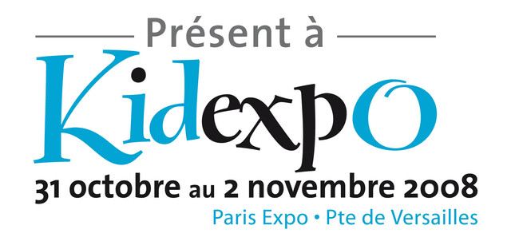

A la demande de la société LEGO France et des organisateurs du salon, FreeLUG prévoit de présenter sur un espace de 20m2 un diorama interactif de trains LEGO®.

Le salon se tient du 31 Octobre au 2 Novembre 2008 au Parc des Expositions de la Porte de Versailles à Paris.

Kidexpo est un salon dédié à la famille, qui regroupe les différents acteurs du jeu, des loisirs et des activités concernant les enfants :  
**–** Vie pratique et éducation ;  
**–** Sports Loisirs et Vacances ;  
**–** Jeux Jouets et loisirs créatifs.

Le salon est ouvert de 9h30 à 18h30 durant les trois jours, les tarifs sont les suivants :  
**–** adulte : 10€  
**–** enfant (de 4 à 14 ans) : 5€  
**–** pass 1 adulte + 1 enfant : 12€  
**–** pass 2 adultes + 3 enfants : 22€

**Attention** notre association dispose d’invitations uniquement pour les adhérents FreeLUG à jour de cotisation et leur famille. Nous n’avons pas d’autres invitations à distribuer.

Les liens importants pour la préparation sont :  
**–** [Le site officiel du salon Kidexpo.](http://www.kidexpo.fr/)  
**–** [Le blog Kidexpo](http://blog.kidexpo.fr/)  
**–** [La page de préparation.](http://gallery.freelug.org/main.php/v/La-Gallerie-de-qdm/Expositions/2008-Kidexpo/Preparation/)  
**–** [La page d’inscription wiki Kidexpo 2008](http://wiki.freelug.org/tiki-index.php?page=Kidexpo+2008)
