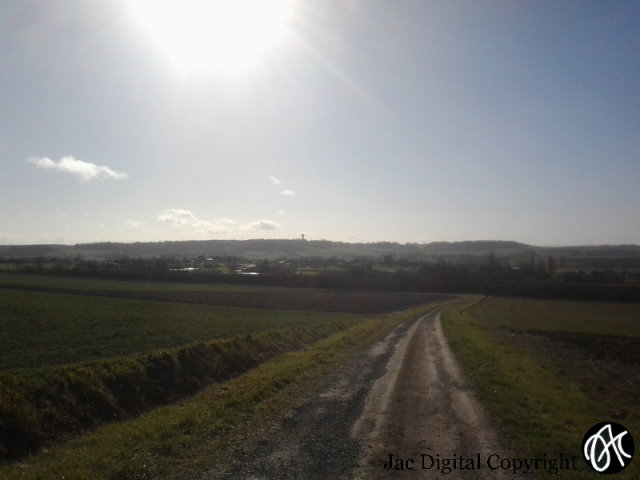
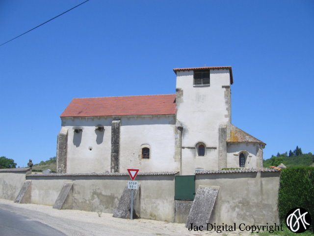
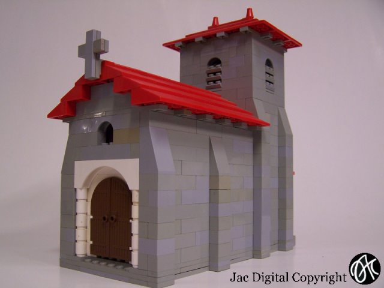
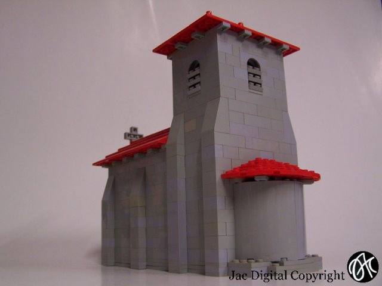
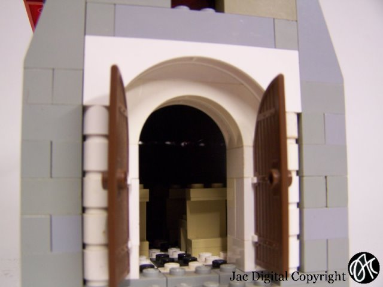
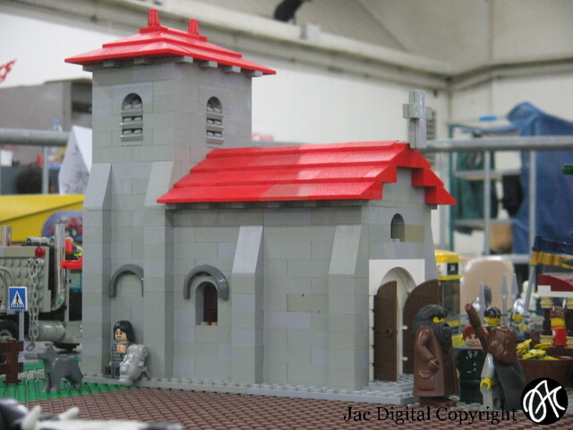

Très inspiré par cette petite chapelle, voici comment je l’ai reproduite.

Jussat est un hameau composé de quelques groupes de fermes et résidence, situé sur la commune de Randan, au Nord du département du Puy-de-Dôme (63), en Auvergne.

Sur le mur d’enceinte de l’église, il y a une belle plaque explicative de la vie de l’édifice avec quelques gravures. En voici un extrait.

"L’édifice modeste par ses dimmensions se compose d’une nef unique voutée en berceau, d’un avant choeur couvert d’une coupole sur trompes, et d’une abside voutée en cul-de-four. A l’extérieur, quelques modillons représentent des figures humaines ou animales. Dans le choeur une arcature repose sur des chapitaux ornés de motifs végétaux. Des peintures décoratives soulignent l’architecture du bâtiment. Comme les murs de la nef s’écartaient sous le poids de la voute, 3 tirants en bois ont été mis en place pour consolider l’édifice. Les extrémités de ces tirants sont maintenues par des clefs en bois à l’extérieur et protégés des intempéries par des dalles de pierre insérées dans la maçonnerie. Cette restauration originale a été réalisée en 1426 ! Le clocher qui surmonte l’avant choeur conserve une cloche datée de 1713. Autrefois la plupart des églises étaient entourées d’un cimetière. Pour des raisons de salubrité publique, ces cimetières ont été transférés à l’extérieur des agglomérations. Seules quelques églises de campagne, comme celle de Jussat, ont conservés leur cimetière ce qui rajoute à leur charme."

L’église de Jussat est une petite construction qui date du XIIe siécle. Elle a reçu une restauration au 15e siècle, car les murs, assez haut pour sa taille avaient tendance à s’écarter. Le bâtiment est classé au patrimoine national. La construction est très simple puisqu’elle est en longueur, avec le fond dominé d’un clocher et terminé par son abside en arrondi. Les murs sont crépis mais sûrement faits de pierre. Des pierres taillées supportant les bord de la toiture sont particulières, car on peut reconnaitre des têtes d’animaux.

Je cherchais une petite église à reproduire pour nos dioramas. J’en avais trouvé une de style romane à Saint-Denis-Combarnazat (63). Mais la reproduction que j’en avais fait ne me satisfaisait pas du tout, trop grosse et en plus de couleur jaune... En continuant mes recherches, j’ai trouvé celle là beaucoup plus belle à mon goût.

En réalité, elle est entourée de son cimetière et d’un mur d’enceinte, comme ça se fait dans les petits villages. Mais, je n’ai pas reproduit le cimetière ici. Ce n’est pas vraiment le genre de chose que j’aime construire.

J’ai choisi la couleur grise, mais ce n’est pas celle qui se rapproche le plus de son aspect réel. En fait il faudrait que je refasse seulement les pans de mur avec des briques couleurs sable. Mais l’ensemble me plait comme ça. L’abside m’a posé quelques problèmes, surtout pour la toiture, mais ça a été résolu. Par contre, j’ai simplifié pour les gargouilles, pas évident à transcrire à cette échelle et en briques LEGO. Je n’ai pas reproduit exactement les ouvertures du clocher, mais j’ai pris plaisir à placer les abassons.

Il fallait pouvoir placer quelques fidèles du village, j’ai donc reproduit succintement l’intérieur qui n’est pas très riche en réalité. Il n’y a pas beaucoup de place, mais les petits bancs pourront tout de même accueillir quelques minifig pieuses...

J’ai pu la mettre en place sur quelques expositions, lors de la reproduction de village. Voici justement une photo. En dessous, le lien vers sa galerie.

[Photo de l’église en briques LEGO](http://photos.freelug.org/main.php/v/JAC/MOC/Batiment/Medieval/Eglise2Jussat/)
