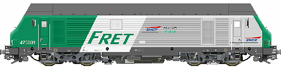
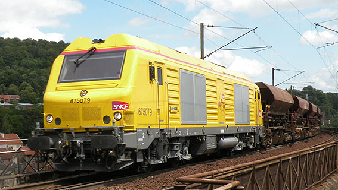
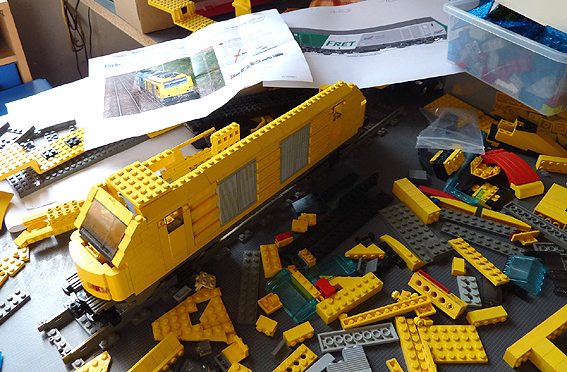
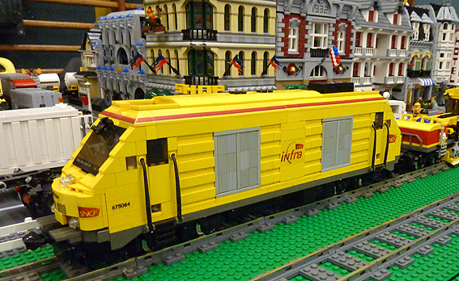
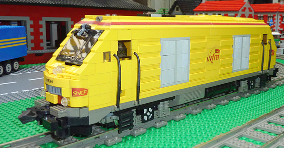
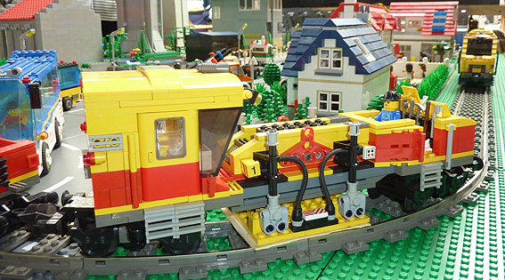

Début 2009, une première locomotive de cette série, la BB 75079, a été affectée à l’Infra d’où son nouveau numéro 675079.

Les BB 75080 à 75099 suivront la BB 75079 à l’Infra et recevront la livrée de couleur SNCF Infra.

**Pourquoi ce choix ?**

Au départ le voulais construire un wagon nettoyeur de voies pour la LGV et en me documentant sur internet je tombe sur cette locomotive toute jaune correspondant parfaitement au sujet : l’entretien des voies.

Après quelques minutes d’observation, je me décide : elle semble plutôt simple à réaliser et tout en jaune donc un large choix de pièces possible. Ça va être facile...

**6 tenons ou 8 tenons ?**

La première brique n’est pas encore sortie du tiroir que déjà une question insoluble se pose : 6 ou 8 de large ?  
Je commence par faire quelques essais en six, mais bien vite je craque pour me décider à faire du huit.  
En cela, je me rallie donc (définitivement ... ?) à la théorie du 468 :  
**–** 4 pour les voitures  
**–** 6 pour les camions  
**–** 8 pour les trains

Le tout avec une tolérance mécanique de -0 / +1 briques.

Certes cela fera une locomotive plus lourde et plus longue, mais comme son usage principal sera sur la LGV : pas de problèmes d’alimentation électrique pour deux moteurs et pas de problèmes d’empattement dû à la longueur du futur engin pour respecter à peu près les proportions.

**La V1**

Pour ce qui deviendra la V1 je commence par vouloir faire du "compressing" en longueur.  
Mais au bout de quelques heures de construction j’arrête tout, car cela ressemble à rien et surtout pas à une 75000.

**La V2**

Je pars sur un châssis plus long (ajout de 7 tenons) et je retravaille tout un tas de détails.  
Première sortie à l’exposition de Chatenois le Royal et cette version roule sans problèmes sur la LGV.

Cette 675084 fait aussi un petit tour à St Rambert mais elle ne peut pas réellement rouler avec la courbe normale des voies LEGO. Il faut que je revois aussi encore ce point.

**La V3**

Donc, en fait, cette V2 ne me satisfait toujours pas : le toit, la tôlerie, les bogies, l’avant, la prise des courbes, le poids, etc.  
Et me voilà reparti pour une V3 alors que je pensais au départ : _ça va être facile !_

Finalement, avec encore quelques tenons de plus en longueur, le résultat me convient enfin (presque...). Bien, sûr il est possible d’améliorer tel ou tel point ; mais il n’y aura pas de V4 pour moi : je laisse cela à d’autres MOCqueur car d’autres projets m’attendent.

Epilogue : Finalement j’ai aussi fini par construire le wagon nettoyeur de voies pour la LGV : et ça fonctionne même sur une voie secondaire...

**Lien :**

[http://fr.wikipedia.org/wiki/BB\_75000](http://fr.wikipedia.org/wiki/BB_75000)
