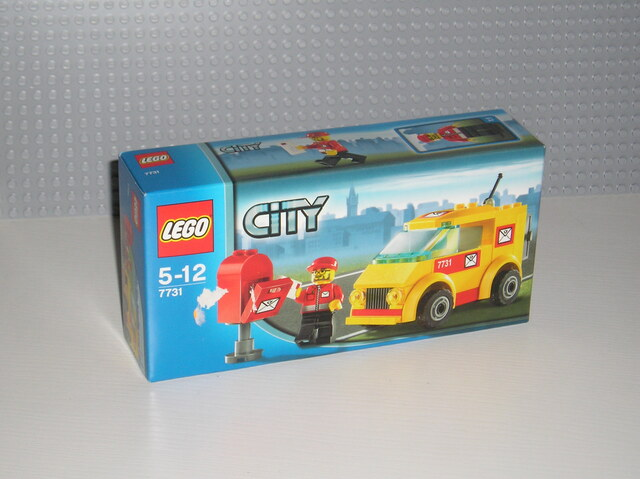
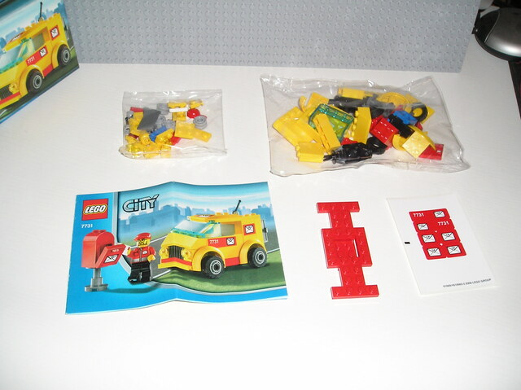
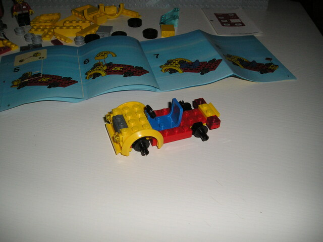
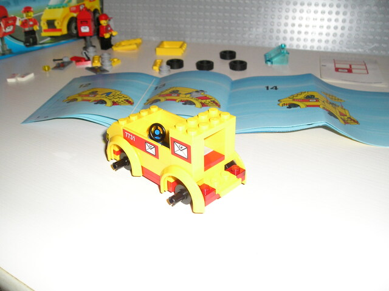
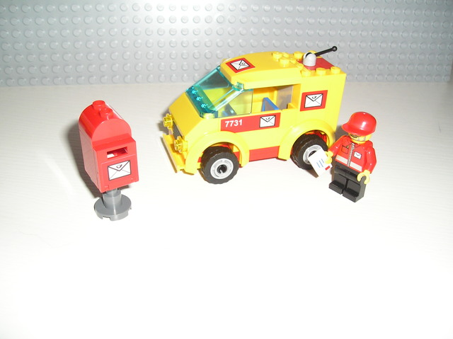
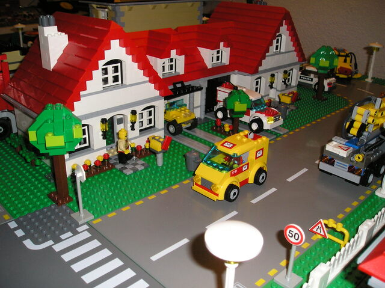

Parmi les nouveautés LEGO CITY 2008, on retrouve le thème du facteur, avec un petit avion, boite 7732, et une petite camionnette, boite 7731.  
C’est le montage de cette dernière que j’ai choisi de vous décrire.

## Descriptif de la boite

**la boite**

**–** Nom de la boite : la camionnette du facteur  
**–** Numéro de la boite : 7731  
**–** Nombre de pièces : 66  
**–** Date de commercialisation : janvier 2008

On la trouve sur le [shop](http://shop.lego.com/ByTheme/Product.aspx?p=7731&cn=356&d=9) à 6,49€ ainsi que dans le commerce.

## Montage

**contenu de la boite**

Après ouverture de la boîte, on retrouve la notice de montage avec une planche d’autocollants. Il y a deux sachets ainsi qu’un châssis de voiture mis à part.

Après un bref aperçu des pièces, on s’attaque à la construction du personnage ainsi que d’une boîte aux lettres, puis on commence la camionnette.

**étape 8**

**étape 14**

**fin de la construction**

Il est vrai que c’est une construction facile, mais c’est un plaisir, puisque l’on se retrouve avec une charmante camionnette à placer dans notre ville.

**distribution du courier**

## Conclusion

Belle petite camionnette de facteur bien réalisée, facile de construction, et que l’on peut mettre partout dans la ville, idéale pour compléter sa gamme city.

En ouvrant les deux portes à l’arrière, il y a un petit coffre où l’on peut stocker des lettres, ou encore des colis allant jusqu’à 2x2 tenons.

A noter que les lettres présentes dans la boîte sont identiques aux anciennes lettres, ainsi que le logo.

L’année 2008 s’annonce pleine de nouvelles boîtes, il va encore falloir faire de la place pour pouvoir tout mettre en place...
