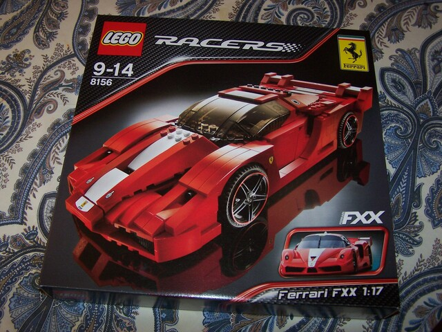
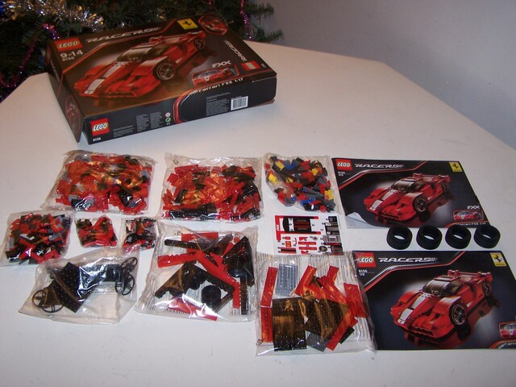
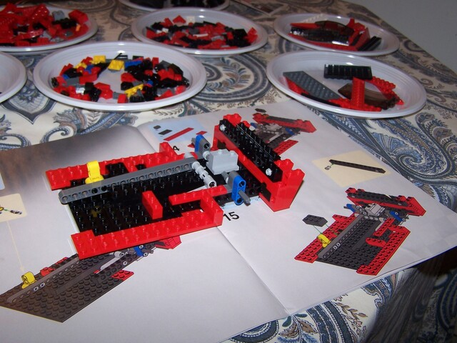
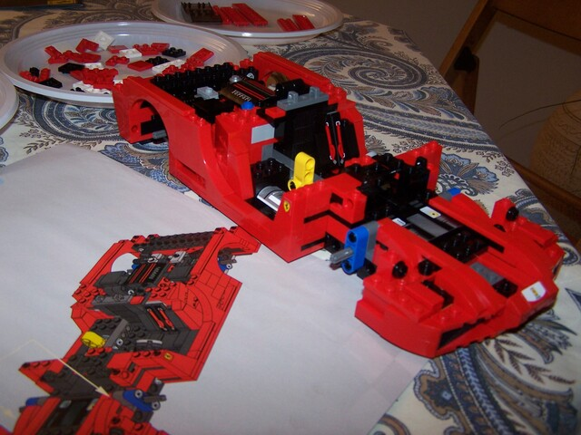
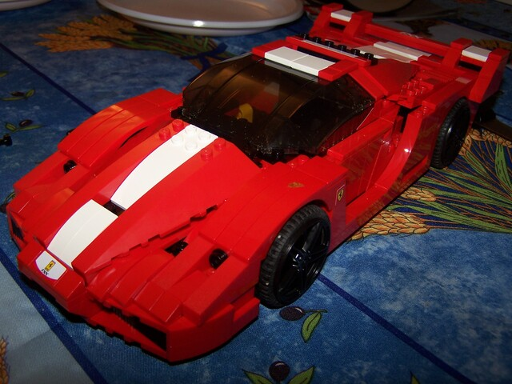
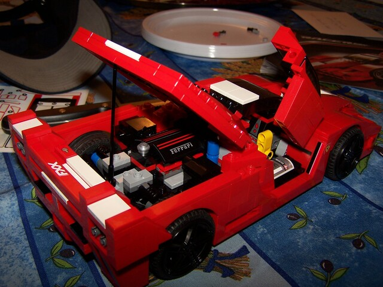
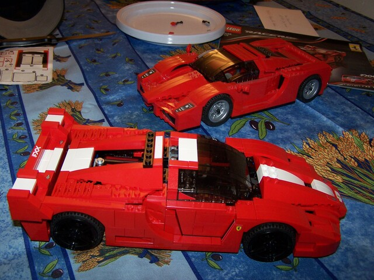
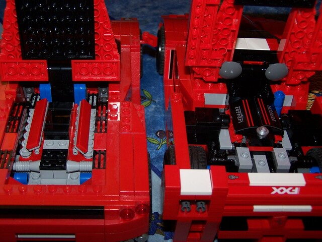
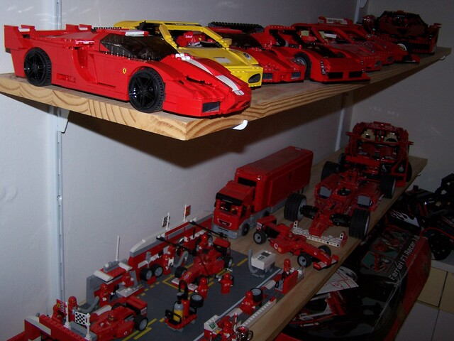

Jour de l’an 2008, 2h30 du matin il faut être vraiment un AFOL pour aller visiter entre deux E.mail, le shop@home de LEGO et découvrir que ce nouveau set 8156 Ferrari est mis en vente.

Quelques jours plus tard cette nouveauté tant désirée est sur la table du salon.

Ce set coûte 49.90 euros, et est composé de 626 pièces réparties dans 9 sachets, plus les quatre roues, une planche d’autocollant ainsi que la notice de montage, divisé en deux parties laissant penser à un montage très long,

Les pièces sont bien reparties et facilement identifiables, le montage commence d’abord par la partie arrière. On retrouve un système permettant de lever la caisse, réalisé avec des éléments Technic comme sur le [set 8143 Ferrari Challenge](/articles/description-du-set-lego-racers-ferrari-8143/)

Le montage se réalise sans grande difficulté, les instructions sont assez claires, la progression est rapide tout en prenant son temps.

Enfin terminée, cette FXX en LEGO est plutôt sympa avec les portes qui s’ouvrent, ainsi que le capot avant. Le capot arrière s’ouvre et reste maintenu avec une antenne.

Je me permet un comparatif avec la Ferrari Enzo (set 8153) dont la FXX est dérivée.

Une petite déception, le moteur sur ce set ressemble plus à un V8 qu’à un V12 malgré les caches avec l’autocollant Ferrari collé dessus. Par rapport à la Ferrari Enzo 1.17 (set 8153), le moteur fait petit.

Finalement à l’exception du compartiment moteur, ce modèle reste bien dans la lignée de la gamme Racers Ferrari, et rejoindra ma scuderia « LEGO racers » Ferrari.

