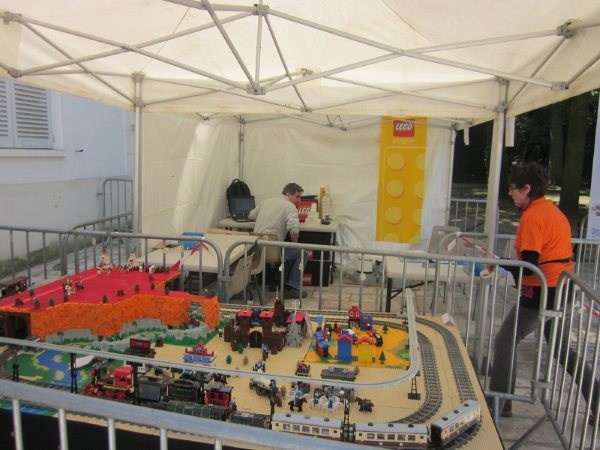
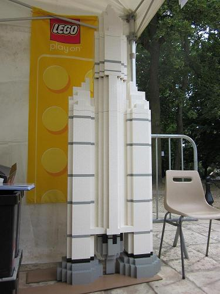

Nous avons organisé un stand avec le montage de la fusée FreeLUG lors de la Fête du Jeu organisée dans le parc Jean Vilar, à la demande de la mairie car notre association est domiciliée à Saint-Michel-sur-Orge, et que nous trouvions qu’il aurait été dommage de ne pas participer.

Malgré l’exposition à Parigné le weekend précédent qui a mobilisé une grande partie de nos forces, cela a été possible aussi par le fait que cette nouvelle manifestation ne durait que le dimanche après-midi.

De plus avec Thaaz nous n’habitons qu’à 10 km maximum.

Pour cette manifestation, le but était de faire participer les enfants, ce qui tombait bien puisque nous avions la [fusée FreeLUG à disposition](/articles/fusee-ariane-5/)

Nous avons rajouté un diorama Farwest pour agrémenter le stand.

C’était une première pour nous la manifestation était totalement en plein air (ce qui occasionne du stress par rapport à la météo qui nous a épargnée juste quelques gouttes... Ouf).

Arrivés vers 09H00, nous avons commencé le montage, nous étions opérationnels à l’heure prévue 13h30.

Comme toujours avec ce type d’activité, le démarrage est un peu dur, mais grâce aux bénévoles qui nous ont aidé à aller chercher des enfants et leur expliquer le montage, de temps en temps les 4 places que nous avions prévues étaient insuffisantes, par moment nous avions 7 personnes montant en même temps.

Nous avions aussi la concurrence d’autres activité : murs d’escalade, structure gonflable et jeux divers. Nous n’avons malheureusement pas pu essayer et pas vu toutes les activités proposées.

Les enfants ont réussi à finir la fusée vers 18H15 (fin de la manifestation à 19H00), une adresse internet a été donnée pour pouvoir voir le [résultat final](http://photos.freelug.org/main.php/v/gmifr/FUSEE/STMichel2011/) :

La tente était juste assez haute ;-)

Démontage et remballage fini vers 20h00, et Kangoo pleine à ras bord...

Superbe journée et avec le temps qui s’est maintenu au beau, beaucoup de participants.

Merci aux organisateurs, pour l’accueil, l’aide et les repas du midi, tous cela a permis à notre fusée de prendre son deuxième envol ;-).

Les liens :  
**–** [Présentation de la manifestation du site de Saint-Michel-sur-Orge](http://saintmichelsurorge.fr/actualites-mairie/555)  
**–** [Photos de Thaaz](http://photos.freelug.org/main.php/v/gmifr/FUSEE/STMichel2011/)
