A quelques petites exception près, LEGO ne nous avait pas produit de boîtes dans la gamme postale depuis plus de 20 ans. Depuis deux ans, la gamme City renoue avec les origines et c’est avec plaisir que nous recevons en 2008 deux nouvelles boîtes dans la gamme postale.

## Les nouveautés 2008

Deux boîtes font leur apparition : un petit véhicule et un petit avion.

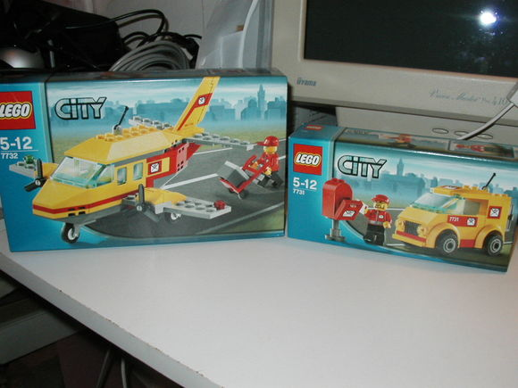

## 7731 : la voiture de la poste

_Résumé :_  
**–** Nombre de pièces : 66  
**–** Prix : environ 6 euro  
**–** Année : 2008

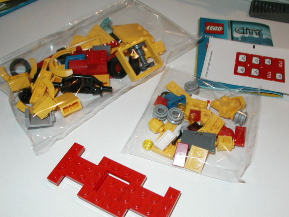

Le contenu de la boîte est classique : 2 sachets, la notice et une planche d’autocollant.

Première surprise : l’usage du classique châssis des voitures 4212. Cette pièce n’a pas été utilisée depuis 2003, et en rouge depuis 2001. Seconde surprise agréable : les deux lettres (plaques lisses 2x1) sont toujours les mêmes depuis 26 ans. Il est agréable de voir que certaines pièces persistent.

Toutefois, quelques nouvelles pièces composent cette boîte : tout d’abord, le buste avec la nouvelle sérigraphie. On retrouve également le nouveau cadre de fenêtre (comme dans [le camion 7733](/articles/camion-de-transport-7733/)) ainsi que deux portes type containers adaptées à ce nouveau cadre.

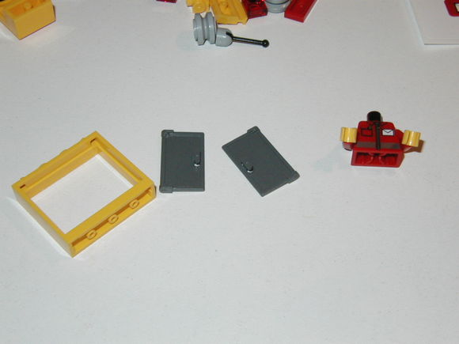

Le montage se fait sans encombre. L’oeil affûté remarquera que la brique avec grille sur le devant de la voiture n’est pas dans le même sens entre la notice et la photo de la boîte. Choix est laissé au constructeur :)

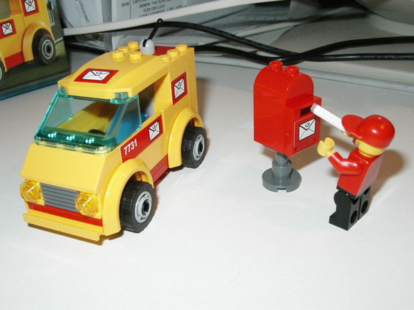

Bref, un bien joli véhicule moderne.

Mais quand même quelques remarques : les nouvelles portes ne sont pas jointives, un jour apparaît entre. Les parois du coffre auraient pu être faites avec des panels 2x1x2 plutôt que des briques 2x1x2, cela aurait fait gagner du volume au coffre et comme cela est de coutume sur de nombreux véhicules.

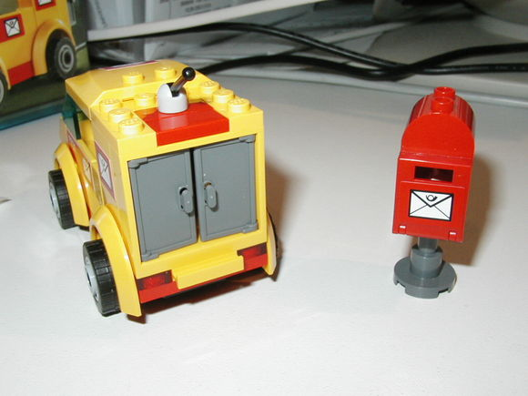

Enfin, dernière remarque, la boîte aux lettres est quand même haut perchée, obligeant nos minifigs à monter sur la pointe des pieds pour poster leurs lettres !

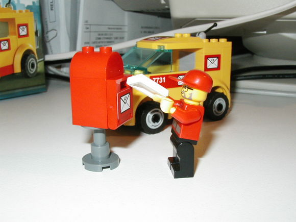

## 7732 : l’avion de la poste

_Résumé :_  
**–** Nombre de pièces : 88  
**–** Prix : environ 12 euro  
**–** Année : 2008

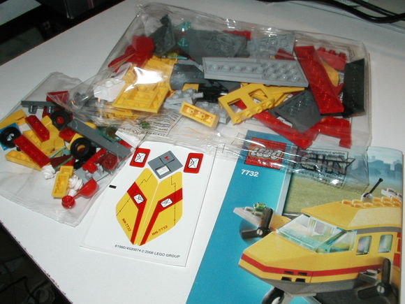

Comme pour la voiture, le contenu se compose de deux sachets, une notice et une planche d’autocollants.

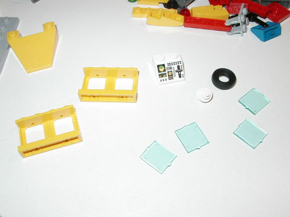

Aux côtés de pièces très classiques et anciennes pour les avions comme les petites roues, on trouve deux nouvelles pièces, ou plutôt une nouvelle version de pièces.

Il s’agit des hublots. Les vitres ne sont plus des éléments en relief épousant la forme du hublot, mais un simple rectangle plat disposant d’un ergot en haut et en bas. Le résultat est moins beau que les anciens hublots, mais il est à parier que ces vitres plates vont se retrouver ailleurs.

L’assortiment des pièces et le montage ravira les nostalgiques [des petits avions comme le 6687](http://www.brickset.com/detail.aspx?Set=6687-1). Même si la forme générale est identique, il semble plus moderne. C’est sans doute grâce à l’usage du pare brise plus incliné.

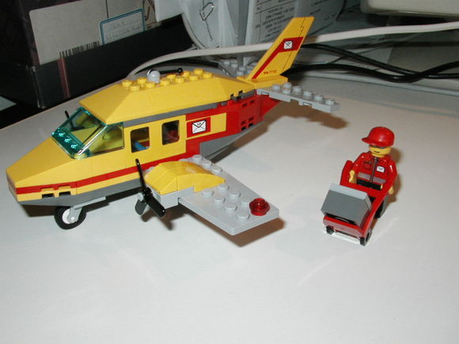

Les amateurs d’avions apprécieront ce premier avion postal de LEGO. Bien conçu, il permet même d’accueillir en passager le facteur de la voiture, en plus du colis. Et c’est parti pour une tournée aérienne !

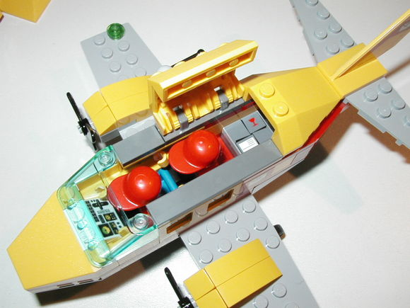

## Années 80 : premières apparitions

La gamme de la poste est inaugurée en 1982 avec deux boîtes : une poste et un petit camion.

**6651 : le camion de la poste** _1982_

Alors évidement on ne peut s’empêcher de faire le rapprochement entre ce véhicule et la nouvelle voiture 7731.

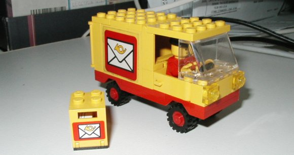

Même gabarit, même palette de couleurs (base rouge et parois jaunes), nous avons là l’ancêtre du 7731, et nous ne pouvons que remercier LEGO d’avoir su conserver et remettre à jour cet héritage.

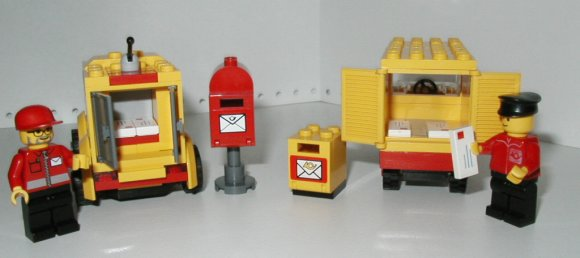

L’ancien camion a l’avantage de proposer un plus gros chargement utile. Heureusement que ce vieux camion de 25 ans roule encore pour transporter les gros colis !

**6362 : le bureau de la poste** _1982_

Petit bureau de poste et centre de tri, cette boîte assure de belles fonctionnalités : une boîte aux lettres intégrée, une autre à placer dans la ville, un petit camion de ramassage, une figurine et de nombreuses lettres.

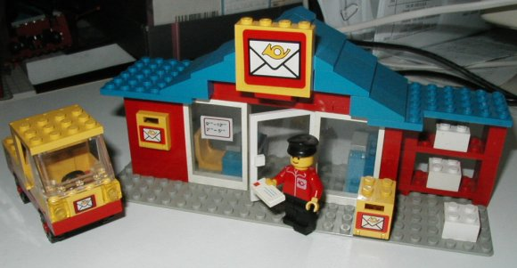

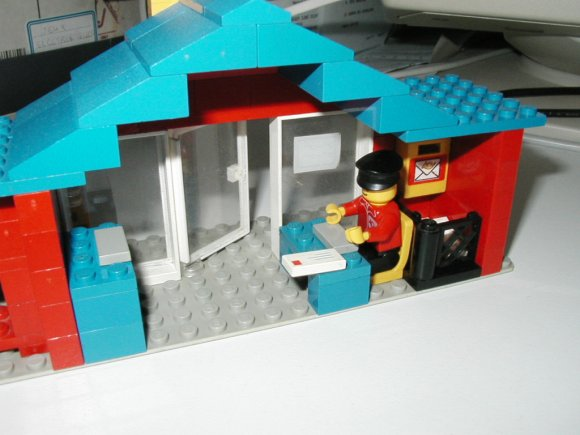

**7819 : le wagon postal** _1983_

Alors que les trains postaux disparaissent de nos jours en France, c’était un moyen de transport du courrier grandement employé par le passé. A la belle époque où LEGO produisait une gamme riche et diversifiée de trains, ce wagon fît son apparition et remplaça son prédécesseur le [7820 (1980)](http://guide.lugnet.com/set/7820). En plus de correspondre aux couleurs de la gamme postale, ce wagon était un parfait complément à [la rame 7740](http://guide.lugnet.com/set/7740).

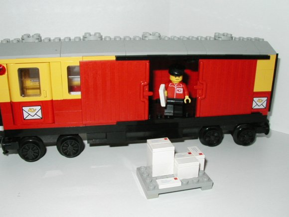

**6622 : le side-car postal** _1984_

Original, LEGO nous gratifie d’un motard postier sur moto équipée d’un side-car.

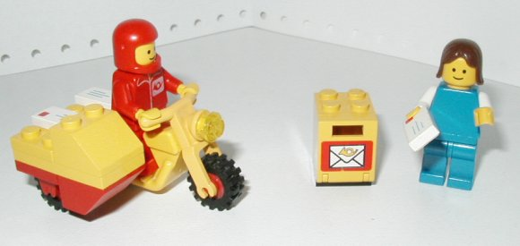

**6689 : le bureau de poste** _1985_

Trois ans après le premier, un second bureau de poste, plus petit cette fois ci fait son apparition.

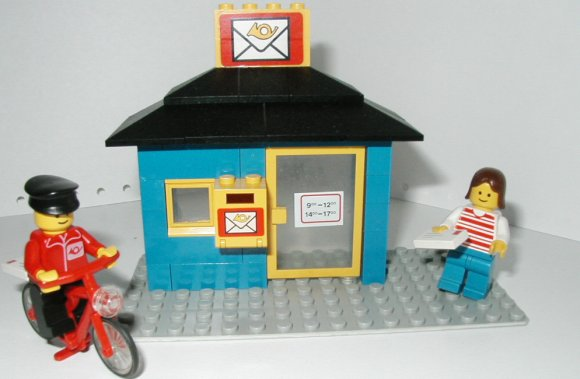

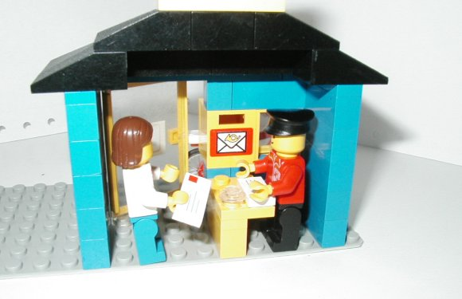

**7722 : le train électrique** _1985_

[Le train à piles 7722](http://guide.lugnet.com/set/7722) dispose lui aussi d’un petit wagon postal, toujours aux mêmes couleurs.

**Pack de minifigs**

La minifig postale se retrouve également dans divers packs de minifigs, comme les [1067, 1063, 9361 et 6301](http://guide.lugnet.com/set/?q=9361%2C1067%2C1063%2C6301)

## Et après ?

Après ces quelques boîtes au début des années 80, on ne peut pas dire que la gamme postale fut très riche.

**6420 : le postier à vélo** _1998_

C’est la seule boîte réalisée entre 1985 et 2008... une toute petite boîte à diffusion limitée, introduisant un nouveau logo sur fond bleu. Petite boîte contenant d’ailleurs le seul vélo jaune jamais produit et le seul buste contenant ce logo bleu.

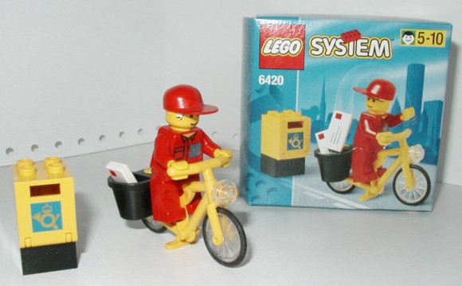

**Jacques Tati reprend du service !**

**Et en dehors de ce set ?**

Des boîtes aux lettres sont régulièrement contenues dans des boîtes, en général des maisons.

Le logo postal apparaît aussi sur quelques planches d’autocollants comme dans le [train 4564](http://guide.lugnet.com/set/4564)

## Photo de famille

Les temps sont durs, les nouvelles boîtes sont moins riches en lettres que les précédentes. Il faut dire que de nos jours, l’email est beaucoup plus employé qu’il y a 25 ans ! Mais c’est un plaisir non dissimulé de voir que LEGO a su garder le même esprit, reprenant quasiment le logo postal à l’identique, le cor est noir au lieu d’être jaune, mais il est aussi inversé. La boîte aux lettres quant à elle n’est plus jaune carré, mais rouge arrondi ce qui semble être la nouvelle tendance puisque nous retrouvons une boîte similaire dans le [nouveau poste de police 7744](http://guide.lugnet.com/set/7744)

Alors, peut-on espérer d’autres modèles pour cette gamme, comme un bureau de poste ? Train, voitures, motos, vélos, avion, il ne manque plus que le bateau pour compléter la gamme des véhicules ! En attendant, voici une petite photo de famille.

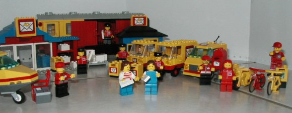

**Revue des troupes par deux clientes satisfaites**

[Les sets sur Lugnet](http://guide.lugnet.com/set/?q=6651%2C6622%2C6362%2C6689%2C6420%2C7819)
