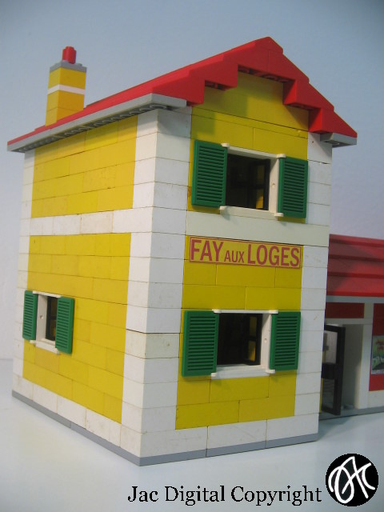
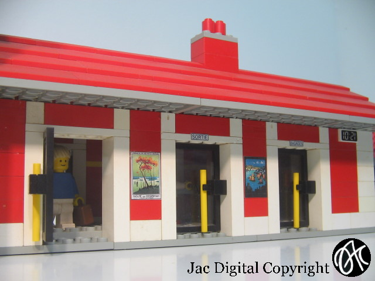
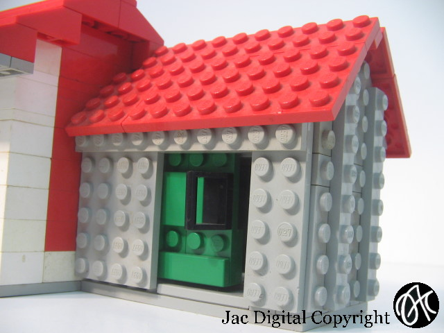
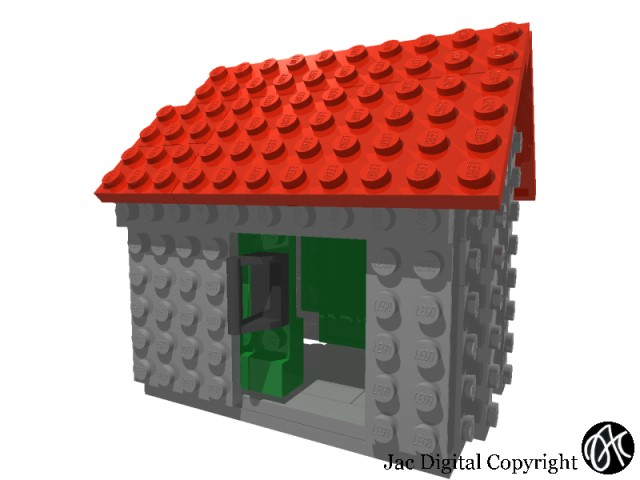
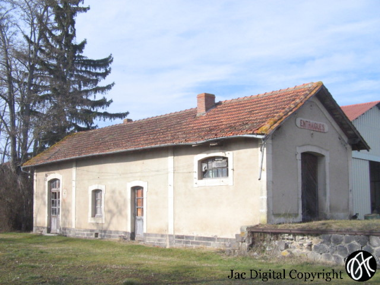

La [première partie](/articles/la-gare-de-fay-aux-loges-partie-1/) était consacrée à la présentation de cette petite gare et à la description de l’abri de quai. Pour cette suite, je vais vous décrire la partie principale de la gare, c’est à dire, son bâtiment.

La gare en elle même, est constituée d’éléments standards et courants sur les réseaux SNCF. C’est à dire, un bâtiment d’habitation, un bâtiment voyageurs, et un hangar à marchandises. L’architecture diffère suivant les régions, les moyens des réseaux et des communes. Les matériaux utilisés dépendent aussi du lieu de construction du bâtiment.

A Fay-aux-Loges, on retrouve les parties principales, sauf qu’elles sont détachées et bien visibles.

L’habitation, tout d’abord, avec l’utilisation des plans d’une maison de garde barrière, construite en maçonnerie courante à la SNCF. Assez simple à reproduire en briques LEGO, avec les angles de mur et les bords de fenêtres en blanc. Ici, l’utilisation de la couleur jaune est permise. L’intérieur est aménagé, pour plus de profondeur à la vision des visiteurs.

**La partie habitation.**

Ensuite, le bâtiment voyageurs(BV), construit en briques rouges. Il est placé à la perpendiculaire de la partie habitation. Il contient les guichets, la salle d’attente et le bureau du chef de gare. J’ai écrit "Bagages" à sa porte, petite erreur de conception ! Ici, utilisation de briques rouges et bordure des portes en blanc. J’ai fabriqué moi-même les petits autocollants pour nommer "Entrée", et "Sortie". Et puis, j’ai cherché de belles affiches sur internet, à placer sur les murs.

**La partie voyageurs (BV)**

La halle à marchandises est très petite et est construite en prolongement des autres bâtiments. Elle devait servir seulement pour de petits objets. J’ai voulu la reproduire, avec portes fonctionnelles. Cela permet de les entrouvrir légèrement, pour y voir l’intérieur. On peut ainsi l’agrémenter de diverses choses pouvant être transportées dans les trains.

**La petite halle à marchandises**

Pour cette deuxième partie, je vous propose de construire la petite halle à marchandises. Ci-dessous, une petite vue virtuelle, suivie plus bas, du fichier MLCad. Le toit est légèrement tronqué, pour pouvoir être placé en continuité du bâtiment voyageurs. Le reste du bâtiment n’étant pas vraiment compliqué à reproduire.

**Vue virtuelle de la petite halle**

**Pour construire la petite halle.**

Les bâtiments SNCF étant très caractéristiques, il est amusant de reconnaître sur le terrain, une maison de garde barrière, une ancienne gare, alors que la voie a totalement disparue.

**La halte d’Entraigues.**

Située dans la plaine de la Limagne (63), la voie a complètement disparue...

La suite dans un prochain numéro, merci d’avoir patienté pour ce deuxième article.
