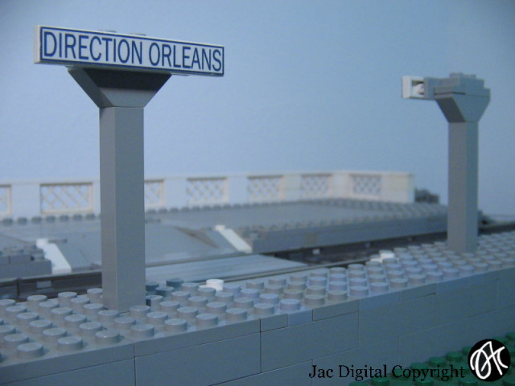
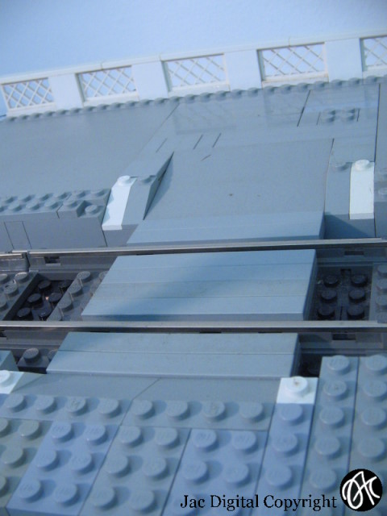
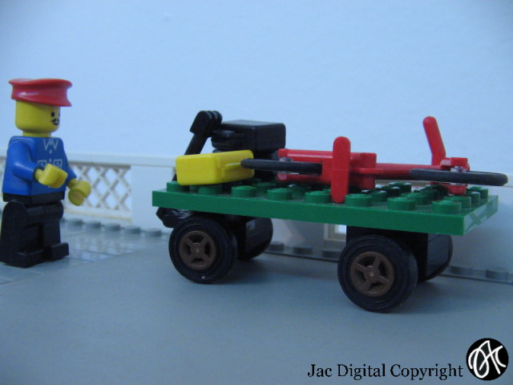

Une gare c’est un bâtiment voyageurs et tous les "à côté" : poubelles, panneaux indicateurs... En voici une petite description.

Suite des articles sur la Gare de Fay aux Loges :  
**–** [Article 1](/articles/la-gare-de-fay-aux-loges-partie-1/)  
**–** [Article 2](/articles/la-gare-de-fay-aux-loges-partie-2/)

Les lampadaires sont très simples, ils viennent de la gamme Fabuland. Je ne m’y attarderais pas plus.

Les petites poubelles ont été décrites dans la première partie. Elles sont inspirées de sets courants. On les retrouve parfois sur d’autres réseaux, avec des couleurs différentes.

Les panneaux indicateurs de directions sont au nombre de deux. Dans les petites gares de village, très souvent, le train vient d’une grande ville pour aller à une autre. Il y a donc seulement deux directions. Sur le réseaux SNCF, les trains roulent à gauche. Du coup, pas besoin d’écran afficheur, les directions sont fixes.

**Indication de direction.**

Lors de la construction de cette gare, je n’ai pas pu reproduire la cloche qui annonce l’arrivée des trains. En effet, dans le temps, avant l’entrée ou le passage en gare des trains, le chef de gare était prévenu par un tintement de cloche.

Les quais sont en général placés de part et d’autres des 2 voies. Avec le système de rails 9V, on a la place de construire un quai entre les deux voies. De plus, en exposition, la gare se trouve en bord de réseau. Et donc, ce n’est pas facile de placer des objets trop en avant. Cela gène le champ de vision... Un plan incliné permet aux minifigs de traverser les voies sans enjamber les rails.

**Traversée autorisée des voies LEGO...**

Très souvent sur les quais, on trouvait aussi un chariot à bagages. Il permettait au personnel de la gare de transporter facilement Les colis et autres bagages du train à la gare.

**Petit chariot à bagages.**

Cela concerne les petites gares. Dans les grandes, la liste est un peu courte évidement. Mais, j’ai peut-être oublié des choses, libre à vous de les rajouter.

Rendez-vous dans le quatrième article pour la fin de ce reportage sur la gare de Fay aux Loges.
