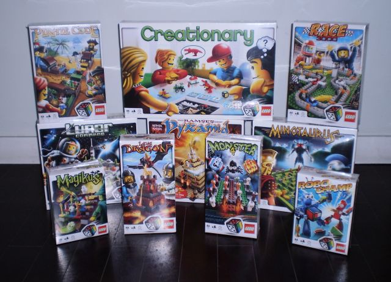
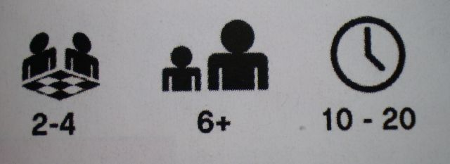
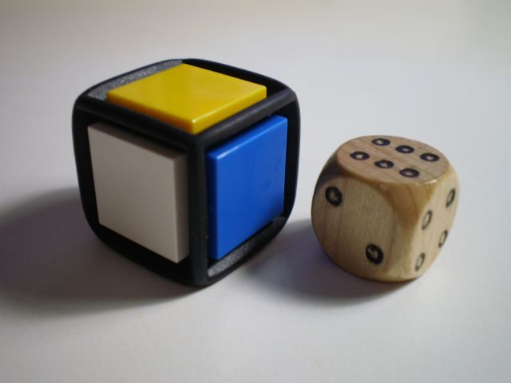
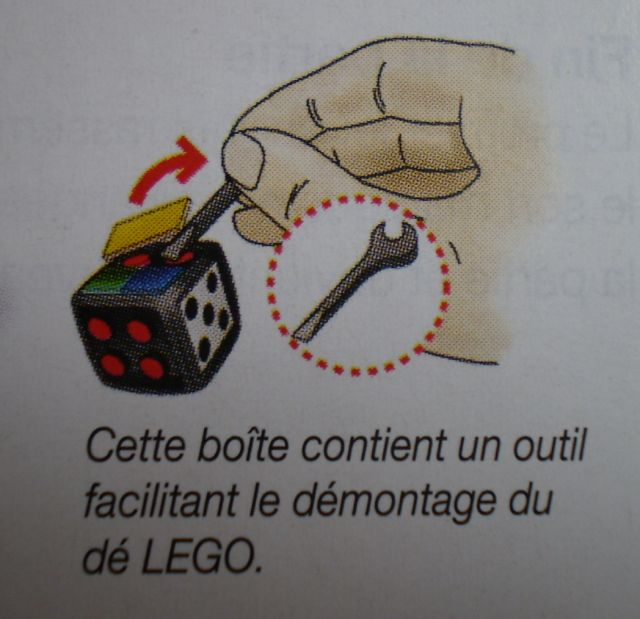

Vous vous doutez sûrement que je suis un fan de LEGO, mais je suis aussi un fan de jeux de société, alors quand TLC a décidé d’allier les deux en un seul produit, ça m’a mis dans le même état d’excitation que lorsque TLC a décidé d’allier LEGO et StarWars il y a 10 ans...

Je me doute qu’il y aura des détracteurs face à ce nouveau mélange, mais personnellement j’ai toujours été convaincu du mélange entre les briques LEGO et les jeux de société et c’est pour cette raison que j’ai créé mes propres règles de wargame pour briques LEGO, [c.f. mon site Bow](http://bow.lswproject.com/). Aussi je n’ai pas hésité un instant à acheter la collection complète.

**Toute la collection : 10 jeux**

La gamme complète se compose en dix jeux de différentes tailles. Dix, c’est plutôt pas mal pour un premier jet, on sent que TLC y croit vraiment car sinon ils auraient testé le marché avec deux ou trois jeux différents.

Toutes les boîtes font 6 cm de hauteur, ensuite elles sont réparties en 4 tailles :  
**–** les petits jeux dans des boites de 14 x 20 cm ;  
**–** les jeux moyens dans des boites de 14 ou 19 x 27 cm ;  
**–** les grands jeux dans des boites de 27 x 28 cm ;  
**–** et le très grand jeux dans une boite de 27 x 42 cm.

Comme sur presque toutes les boîtes de jeux de société, TLC a ajouté quelques pictogrammes pour indiquer le nombre de joueurs, l’âge minimum, ainsi que la durée de jeu.

**Pictogrammes**

D’autre part, toutes les boîtes arborent la photo du dé personnalisable qui, on peut bien le dire, est l’idée géniale derrière la gamme. Le hasard est souvent présent dans les jeux de sociétés, soit sous la forme de dés à lancer, soit sous la forme de cartes mélangées en paquet et distribuées ou piochées selon les règles.

Avoir un dé que l’on peut personnaliser à volonté en fonction de nos désir est franchement très séduisant. Cela permet par exemple de changer les probabilités en utilisant deux tiles de même couleurs. On peut même faire du pile ou face en utilisant 3 tiles blanches et 3 noires. Ou bien on peut créer une probabilité de 1/6 en utilisant une tile rouge et 5 blanches : dans la majeur partie du temps, il ne se passe rien, mais si le joueur tombe sur le rouge, BOOM ça explose !

**Le dé Lego**

L’inconvénient est qu’en utilisant une tile 2x2 comme base pour la face du dé, le dé devient lui-même plutôt grand, comparé à un dé de taille classique. Néanmoins, on s’y habitue très bien.

En revanche les arrêtes du dé sont formées d’une sorte de caoutchouc élastique, si bien que le dé a tendance à rebondir beaucoup. Il fait littéralement des bonds. Mais franchement ces petits inconvénients ne boudent pas mon plaisir d’avoir en main un dé configurable à souhait.

Fait amusant, TLC a ajouté dans les boîtes une [clef plate pour minifig réf 4006](http://www.peeron.com/inv/parts/4006), pour aider à défaire le dé. Ainsi la vieille clef plate se retrouve reconvertie en décapsuleur à dé...

**Décapsuleur de Dé !**

Cette article touche à sa fin mais annonce en fait une série de 10 articles, où je vous ferai une revue complète agrémentée de quelques commentaires pour chaque jeu :  
**–** [Revue de la boîte 3836 Magikus](/articles/revue-de-la-boite-3836-magikus/)  
**–** [Revue de la boîte 3841 Minotaurus](/articles/revue-de-la-boite-3841-minotaurus/)  
**–** [Revue de la boite 3835 Robo Champ](/articles/revue-de-la-boite-3835-robo-champ/)  
**–** [Revue de la boîte 3838 Lava Dragon](/articles/revue-de-la-boite-3838-lava-dragon/)  
**–** [Revue de la boîte 3837 Monster 4](/articles/revue-de-la-boite-3837-monster-4/)  
**–** [Revue de la boîte 3839 Race 3000](/articles/revue-de-la-boite-3839-race-3000/)  
**–** [Revue de la boîte 3840 Pirate Code](/articles/revue-de-la-boite-3840-pirate-code/)  
**–** [Revue de la boîte 3842 Lunar Command](/articles/revue-de-la-boite-3842-lunar-command/)  
**–** [Revue de la boîte 3843 Ramses Pyramid](/articles/revue-de-la-boite-3843-ramses-pyramid/)  
**–** [Revue de la boîte 3844 Creationary](/articles/revue-de-la-boite-3844-creationary/)

A bientôt !
