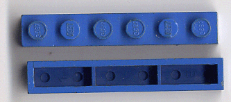
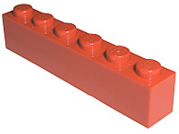
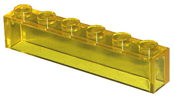
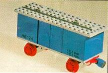
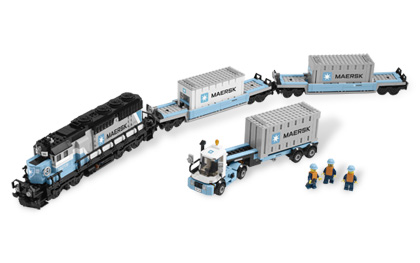

Mise à part la banalité de sa longueur, la brique 6 tenons est aussi une largeur qui préfigure souvent d’échelle pour la plupart des modèles LEGO officiels. Le Sixstuds lui est unique et est un AFOL incontournable de notre association.

La Pièce 6 tenons est apparue en 1955 :

**brick 1 x 6 sans tubes**

A ne pas confondre avec le [Sixstuds](https://www.freelug.org/spip.php?auteur24) né lui en 1972 :

**Sixstuds**

Ce n’est que quelques années plus tard que la 6 tenons a gagné ces fameux tubes qui en ont fait la pièce 3009 que nous connaissons tous maintenant !

**la pièce 3009**

Elle a connu aussi une autre évolution qui lui a fait perdre tous ses tubes :

**la brique 1 x 6 transparente**

La 6 tenons a servi donc de largeur de référence à un grand nombre de plates et à beaucoup de modèles :

**wagon largeur 1 x 6**

**Le dernier train "Maersk"**

Le Sixstuds nous sert aussi de référence pour savoir [quels articles faire](/articles/pourquoi-j-ecris/) et découvrir les [tendances des AFOLs et de leur thème de prédilection](/articles/des-pieces-et-des-sets/).

Et pour finir, la brique 6 tenons comme notre Sixstuds n’est donc pas une pièce banale !

 :-)
