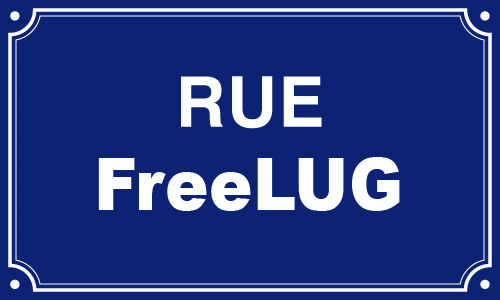
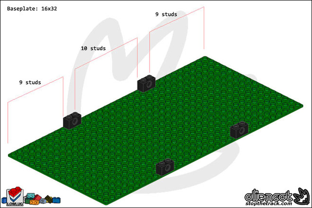
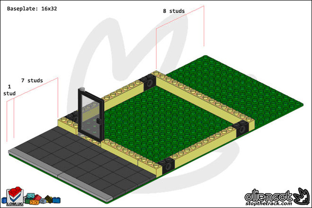
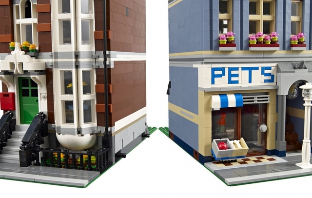
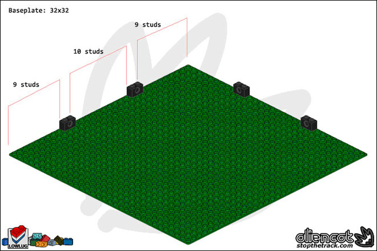
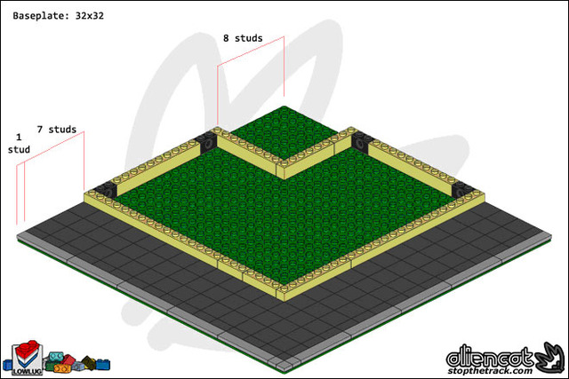
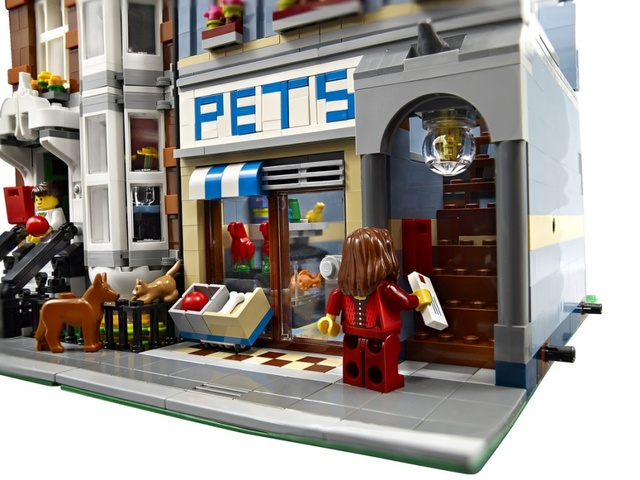
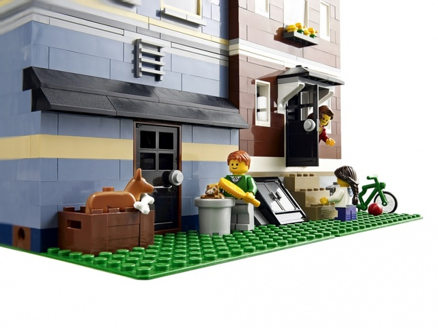
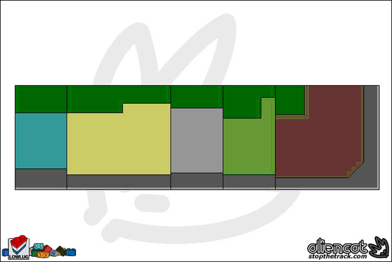

La série des bâtiments modulaires est probablement la gamme qui donne envie de faire de la « Ville » au-delà du « City ». La série modulaire a permis d’élargir les fonctions habituelles de la ville du catalogue LEGO, que sont les casernes de pompiers, postes de police et autres hôpitaux.

La série modulaire offre à chaque nouvelle boite un grand engouement chez les AFOLs avec de belles surprises : nouvelles couleurs, nouvelles techniques d’assemblage.

Mais l’attrait des bâtiments modulaires vient également des principes simples de gabarits et d’assemblage des modules entre eux, qui permettent la construction d’ensemble soigné et extensible à volonté, pouvant mêler bâtiments officiels et créations.

**D’où cette idée, réaliser une « Rue FreeLUG », la « FreeLUG street » si nous devions, un jour, collaborer à une « LUG’s street ».**

Forte d’un peu plus de 250 adhérents répartis aux six coins de l’hexagone et même au-delà de nos frontières, l’association pourrait avoir sa rue aux bâtiments tous uniques et originaux représentant chacune nos régions. En reprenant les architectures diverses et variées qui composent nos villes et villages, allant des colombages de l’_Est_ aux briques du _Nord_ en passant par les enduits chauds et colorés du _Sud_ ou les pierres des maisons bretonnes.

Nos rassemblements, expositions, le décor de la LGV, deviendraient ainsi des moments privilégiés pour assembler la "**Rue FreeLUG**", à chaque fois différente par la présence des régions représentées.

Au-delà de cette proposition, il s’agit au travers de cet article de présenter un petit guide pratique à la réalisation de bâtiments modulaires. Il reprend le travail déjà réalisé par AlienCat ou par [Rick et Rapseflaps sur Eurobricks](http://www.eurobricks.com/forum/index.php?showtopic=36535&hl=modular+standards).

## Le petit guide de la construction modulaire

Nous voyons régulièrement, les uns les autres, lors d’expositions ou de réunions, l’utilisation en alignement d’immeubles pour agrémenter nos dioramas, en apportant quelques bâtiments modulaires officiels et une construction ou deux qui nous sont propres.

Pour harmoniser nos créations, il existe déjà une norme idéale pour les immeubles modulaires, c’est la norme dite du "Système Modulaire Corner Café" (ou SMCC, CCMS en anglais).

Mais si vous ne possédez pas de Café Corner, Green Grocer, etc, comment savez-vous quelles sont les règles à suivre pour permettre à votre bâtiment de s’intégrer avec le reste ?

Cet article à pour objet la description de la SMCC appliquée dans les constructions de LEGO et appliquée par de nombreux AFOLs. Il y a essentiellement deux types de construction dans cette norme, le bâtiment linéaire ou maison en bande et le bâtiment d’angle.

**\- 1. Bâtiments linéaires (ou maisons en bande)**

De manière générale, chaque plaque de base est de 32 tenons de profondeur. La largeur est variable avec les bâtiments linéaires, étant toujours un multiple de 8 tenons. Une largeur généralement utilisée est de 16 tenons de large. Les points de connexion, la chaussée, les murs etc, auraient alors les tailles suivantes :

**Fixations bâtiments linéaires 1**

**Fixations bâtiments linéaires 2**

Que votre bâtiment soit de 8 tenons de large ou 64 tenons de large, les dimensions sur la profondeur des fixations sont toujours les mêmes. De cette façon, les briques Technic 2x1 avec 1 trou seront toujours alignées et permettront ainsi aux bâtiments d’être attachés les uns aux autres grâce à l’utilisation de « pins » Technic.

**Fixation des modules de l’animalerie - ©LEGO®**

**\- 2. Bâtiments d’angle**

Dans le cas d’un bâtiment d’angle, vous avez à faire deux points de connexion, avec un angle de 90 degrés, les uns par rapport aux autres. Par conséquent, votre socle devra toujours être de 32 x 32 tenons. Bien sûr, vous pouvez rendre le bâtiment plus grand en attachant des bâtiments linéaires formant un ensemble continu de chaque côté, mais le module d’angle doit rester 32 x 32 :

**Fixations bâtiments d’angle 1**

**Fixations bâtiments d’angle 2**

**\- 3. Variation de la profondeur des bâtiments**

Le principe adopté est 8 tenons à l’avant et 8 tenons à l’arrière. Comme pour le dernier modèle réalisé par LEGO.

**Façade avant de l’animalerie - ©LEGO®**

**Façade arrière de l’animalerie - ©LEGO®**

Si vous regardez dans la réalité une ancienne rue, vous verrez que tous les bâtiments ne s’alignent pas sur une ligne parfaitement droite : certains dépassent un peu, d’autres sont légèrement en retrait.

Si vous mettez un certain nombre de bâtiments dans une rangée, cette méthode de l’alignement "non parfait" vous donnera de plus jolis résultats. L’essentiel est de laisser les briques Technic 2x1 sur la plaque de base, dans la bonne position pour la connexion, vous êtes ainsi libres de placer vos façades avant et mur arrière comme vous le souhaitez. Il pourrait en résulter quelque chose comme ceci :

**Vue en plan de la variation de profondeur**

Gardez à l’esprit cette variation de la profondeur pour la réalisation de vos parois latérales, car dans certains cas, une partie de vos parois latérales seront visibles. Donc, si vous décidez pour vos murs latéraux de ne pas faire quelque chose d’homogène ou « visuel » en utilisant les couleurs des façades avants et arrières (normalement cachées), assurez-vous qu’au moins le bord de la paroi latérale qui s’avance soit constitué d’une des couleurs qui s’accorde avec le reste de l’édifice.

_Conseils_ : Si possible, toujours construire la paroi latérale en entier de façon uniforme, car on ne sait pas ce qui va se retrouver à côté de vous et quelle configuration d’assemblage va combiner votre construction avec d’autres bâtiments. Votre construction peut également terminer un rang de maisons, en laissant une de vos parois latérales entièrement exposée.

Dans une exposition, le diorama peut être vu parfois de tous les côtés. La qualité des façades et le souci du détail sont donc aussi importants à l’avant qu’à l’arrière et parfois sur les côtés.

**\- 4. Hauteur des bâtiments**

Le dernier point à aborder dans ce petit guide est la hauteur. En termes de hauteur, vous êtes essentiellement libre de faire ce que vous voulez. Vous pouvez vous lancer dans un bâtiment aussi bien grand, immeuble de 8 étages que bas maison de plain pied.

L’échelle qui peut être employée, est 3 tenons pour un mètre, c’est-à-dire 5 briques de haut correspondant à 2 m, soit la hauteur d’une porte classique.

Par exemple, un immeuble peut avoir des étages de 6 briques de haut correspondant à une hauteur entre planchers de 2m40 et un Rez de Chaussée un peu plus haut sous plafond, de 10 à 12 briques de haut... Bref, tout est possible !!

Cependant, ne gardez à l’esprit, que le fait suivant pour un immeuble très haut : vos murs latéraux seront visibles.

Donc il s’agit de faire quelque chose d’original et passionnant, avec par exemple des fenêtres ou un espace de publicité, ce n’est pas juste un ennuyeux mur plat.

Prenez garde seulement à ne rien avoir en saillie sur les deux murs latéraux, puisque vous ne pouvez pas savoir quelle hauteur aura le bâtiment à côté du vôtre. La variation de hauteur est une autre raison de construire des murs latéraux soignés dans une couleur assortie. Notamment lorsque votre création placée dans une combinaison, sera à côté d’un bâtiment de très faible hauteur et çà vous ne pouvez le savoir à l’avance.

Voilà, ici s’achève ce petit guide de la construction modulaire.

A présent place à la "**FreeLUG street**"
