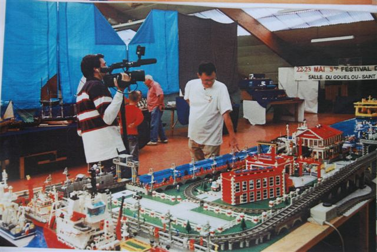

Le 21 juillet dernier, un mail arrive dans ma boîte électronique. Un journaliste, mr Jean-Marie Le Brun de l’émission "Incroyable mais vrai" sur TMC souhaitait me voir. Surpris et excité, j’ai répondu favorablement à sa proposition.

Suivant ses souhaits, je me suis efforcé de les satisfaire du mieux que j’ai pu. J’ai facilité son travail en réquisitionnant d’urgence auprès de Mr le Maire du pays (mon premier fan LEGO) une salle. J’ai informé mon club de la maquette qui est venu spontanément pour le montage de mon grand diorama, objet principal du film, j’ai apporté aussi ma barge animée.

Coté hébergement, c’était chez moi. Lundi 16 aout, gare de Morlaix, le journaliste arrivé par TGV de Paris fut pris en charge par moi et un de mes collègues de la maquette.

Un vin d’honneur fut préparé à son arrivée dans la salle avec la présence de Mr le Maire et de la presse. Après un premier tour d’horizon technique et programme de la journée, nous sommes partis manger dans un Buffalo Grill. Après le repas, les premières prises de vue commencent difficilement au début pour finir bien tout en gardant le naturel et la spontanéité, exercice pas toujours évident.

Le tournage continue jusqu’à 20h.

Ne connaissant pas la région, je lui ai fait une visite guidée de ma ville et du bord de mer.

Le lendemain matin, il a filmé longuement mon Bourbon en cours de construction et mon grenier où un réseau sur 5 niveaux fut créé en 2005 et presque abandonné pour raison personnelle. Sachant que j’avais fait la reproduction d’un bateau des Phares et Balises de Morlaix en LEGO, Jean-Marie m’a demandé de l’emmener au port prés du balisier, début du tournage de la journée. A 11 heures, nous partîmes pour Quimper rejoindre nos amis du restolego quimpérois.  
J’ai prévenu mes collègues s’ils souhaitaient ou pas être filmés, apparemment, ca ne les gênait pas et c’était bien vrai.

Le tournage a pris fin vers 16h, Mr Le Brun, impressionné par mon organisation et ma gentillesse, a repris le train à Quimper pour Paris avec 5 cassettes de 40 mn en 2 jours pour... 5mn de reportage.

**–** [Photos du tournage et du restolego](http://photos.freelug.org/main.php/v/barr__/rencontres/tournage2010/)  
**–** [Revue de presse](http://photos.freelug.org/main.php/v/barr__/presse/tournage082010/)
