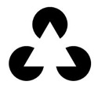
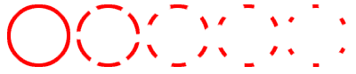

Cet article est la traduction de trois articles en anglais parus sur [http://www.mechahub.com](http://www.mechahub.com/). Ils font partie d’une série de 5 articles dont 2 restent à paraître.

Gestalt est un mot qui désigne le "tout" ou sa "forme". Ça paraît simple ? Oui mais la Gestalt parle de conception où rien n’est jamais facile. Plus généralement la Gestalt décrit l’effort de l’esprit humain dans l’organisation, l’interprétation et la classification de ce qui s’offre à sa vue. La construction d’un mecha [^1] en pièces LEGO est par essence un exercice de conception. Apprendre davantage sur la Gestalt et comment elle s’applique vous permettra de mieux cibler vos décisions durant la conception de votre mecha.

L’étude de la Gestalt prend ses origines en Allemagne dans les années 1920. C’est une discipline de la psychologie qui s’intéresse à décrire les processus cognitifs englobants, d’une façon comportementaliste [^2]. Les aspects du gestaltisme qui concernent le constructeur de mecha sont d’abord ses lois de la perception visuelle et principalement la projection de la partie sur l’ensemble du modèle.

Le monde est visuellement si complexe que l’esprit a développé un ensemble de stratégies pour mater la confusion. L’esprit cherche d’abord la solution la plus simple. Une de ses façons de faire consiste à regrouper les entités qui présentent les mêmes caractéristiques.

Nous allons nous intéresser à la façon dont ces groupes sont formés et comment ceci affecte notre perception. Plus le regroupement est cohésif plus forte est la Gestalt. C’est ce regroupement ou son absence qui font ou défont l’unité d’un modèle. La Gestalt est un des outils les plus sûrs pour un créateur afin de garantir unité, variété et équilibre.

Les mêmes idées qui servent à regrouper serviront également à différencier, à rendre quelque chose unique et à part. C’est la base de la variété, la variété est ce qui provoque la curiosité pour un modèle.

L’objectif est de trouver un équilibre entre unité et variété. Trop d’unité et le modèle paraîtra lassant et répétitif, trop de variété et il paraîtra disséqué et chaotique. Le constructeur s’aidera des concepts de la Gestalt pour assurer cet équilibre entre unité et variété.

L’oeil aime le constraste entre des zones plus fournies et des zones plus dégagées.

L’équilibre reste une règle générale. Il vous faudra adapter son application à la spécificité de chaque modèle. Que votre mecha soit une bête féroce, une machine de guerre ou un cyborg intelligent, chacun aura ses particularités, le but étant de faire en sorte que chacune d’entre elles contribue à construire la personnalité recherchée.

Considérez un modèle que vous aimez particulièrement. Regardez-le une minute. Soyez attentifs à la façon dont votre oeil analyse différentes zones, s’attardant sur certaines et balayant d’autres. Vous aurez certainement remarqué comment les zones encombrées vous occupent davantage le regard alors qu’une multitude de tuiles vous apparaissent immédiatement comme une seule toiture. Cette façon de détailler et d’appréhender c’est celà la Gestalt.

**Simplicité**

La simplicité est le concept élémentaire de la Gestalt. Toutes les autres idées s’articulent sur celle-ci, à un problème visuel l’esprit cherchera toujours la solution la plus simple. Non pas par fainéantise mais parce que le monde est visuellement si complexe qu’il n’est tout simplement pas possible d’en extraire toute l’information sans une simplification préalable. L’esprit commence par enlèver le superflu visuel. Une de ces simplifications consiste à reconnaître des formes simples et à les relier. Les formes complexes sont peut être plus intéressantes mais nous sommes prédisposés aux formes simples et nous les identifions aussitôt qu’elles se présentent.

Ce penchant vient probablement de l’urgence à différencier les situations dangereuses des situations bénignes. Le raccourci nous fait alors gagner un temps précieux ou critique.

Un exemple, sur cette image nous pensons immédiatement voir deux disques superposés, le rouge sur le noir, une solution parfaitement valide mais qui occulte pourtant la forme immédiate qui s’offre à nous : un croissant de lune noir qui embrasse un disque rouge.

L’esprit associe à la forme noire ce qu’il sait déjà de la forme rouge et suppose que cette interprétation est plus probable que la présence hétéroclite d’un disque et d’un croissant.

Comment celà s’applique-t-il à la construction LEGO ? En utilisant le concept de simplicité nous pouvons assembler des pièces qui ne font qu’un. Plusieurs tuiles peuvent faire une jambe ou un pied. En joignant ces éléments nous créons une forme unifiée que l’esprit pourra solidariser comme un tout. L’usage de la notion de simplicité nous aide à identifier le modèle comme un ensemble cohérent.

Inversement nous pouvons utiliser la notion de simplicité pour faire un modèle plus quelconque. En mélangeant des motifs variés on peut briser toute forme. Le résultat est un modèle plus difficile à appréhender, plus long à identifier, qui paraît plus chaotique.

L’idée étant que l’intention du constructeur doit se refléter dans ses choix de conception. Un mecha qui doit présenter des lignes fluides et des courbes élancées très organiques sera différent d’un ordinateur cyborg qui devra présenter un aspect plus mécanique. La notion de simplicité vous permet de mieux intégrer vos idées dans votre modèle.

**Clôture**

Un objet complexe comme un modèle de mecha est en réalité un groupe d’éléments plus simples que l’esprit réunit en une seule entité. Un visage est la réunion des yeux, oreilles, nez, bouche... Vous reconnaissez un visage familIer même si une partie vous est cachée (par exemple par un chapeau et des lunettes de soleil). Votre esprit fourni les parties manquantes qui complètent les parties visibles tant qu’elles sont en importance suffisante.

Ceci peut être illustré par la série de cercles qui suit.

En lisant de gauche à droite la forme est toujours identifiable comme un cercle alors que l’on en retire de plus en plus jusqu’à ce qu’il manque davantage que ce qu’il reste. Ce phénomène s’appelle la clôture parce que l’esprit "ferme" l’image en fournissant les éléments manquants.

Ça marche avec une figure géométrique simple parce que vous n’avez pas besoin de beaucoup d’indices pour reconstituer la forme. Des objets plus complexes demandent davantage de précautions quant à ce qui peut être retiré ou non. Certains éléments sont essentiels et doivent être préservés tandis que d’autres sont de l’ordre de l’anecdotique et peuvent (et quelquefois doivent) être éliminés.

La clôture est très utilisé dans le design. Ce n’est pas tant la quantité que la qualité de l’information qui permet de décoder une image. Un constructeur avisé laisse des choses à deviner pour l’observateur de son modèle. Ainsi la clôture implique l’observateur d’un modèle en l’invitant à participer à sa construction mentale.

[^1]: Les mechas sont des robots humanoïdes issus de la culture Manga

[^2]: c’est-à-dire sans faire appel aux connaissances en neurobiologie
