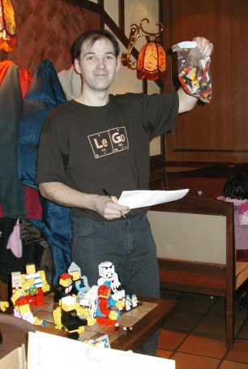
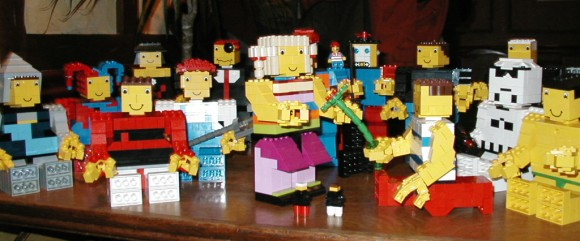
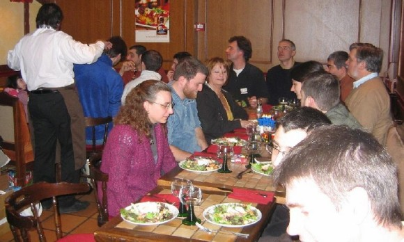
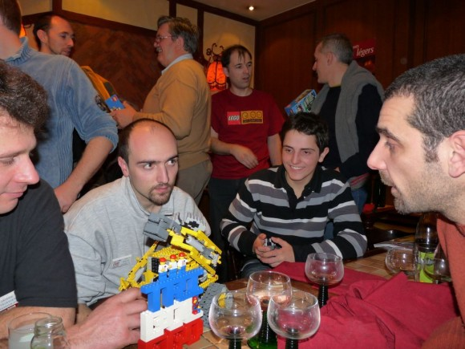
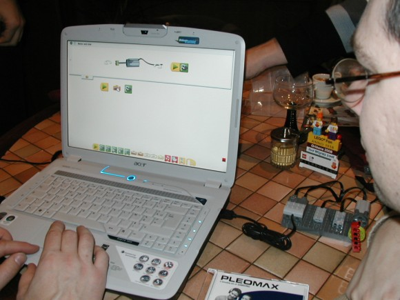
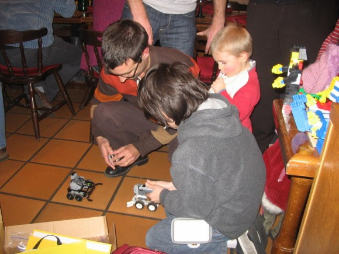
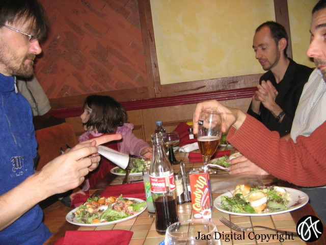
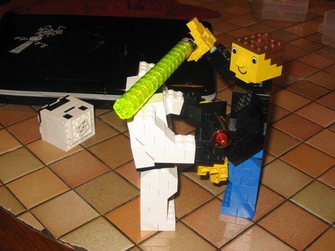
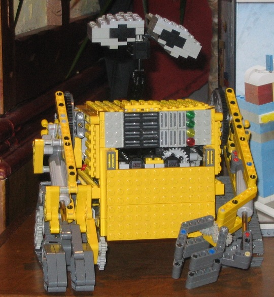

Les faits se sont déroulés le samedi 10 janvier 2009 à la taverne Midi-Minuit à Lyon.

D’après nos sources un groupe d’Alfreds venu d’un peu partout en France s’est réuni dans ce restaurant mais chose étrange les Alfreds ne sont pas venus seuls.  
En effet d’étranges créatures nommées AFOLs se sont jointes au groupe.

Des témoins racontent.

La soirée a débuté sur les coups des 17h par la vente aux enchères organisée par Didier. Les nombreux lots proposés, principalement des pièces Technic, ont trouvé preneur, même les plus insolites. Les palmes reviennent à la jeep Indy, les aimants de trains et surtout la casquette couleur lime :)

Puis les Alfred se sont rassemblés sur le buffet. Ils étaient nombreux et, tout comme nous, ont rencontré de nouvelles personnes et bien discuté ensemble. L’un d’eux a cherché à séduire Alfredine en lui offrant une rose, tandis qu’un Jedi s’en prenait au pauvre stormtrooper. Bien qu’aucune concertation n’a été faite sur la réalisation des Alfreds, la plupart d’entre eux ont pu trouver leur pair :  
**–** Alfredine et son prétendant à la rose  
**–** un soldat castle et le fou du roi  
**–** un pirate aux allures de vampire avec une Alfredine plutôt sombre  
**–** un Jedi et un stormtrooper  
**–** deux ouvriers  
**–** puis en vrac un clown, un pompier, un joueur de foot, un nageur.

Puis différents articles à vendre ont envahi les tables : boîtes de LEGO soldées, BrickJournal... nombreux sont ceux qui ont du faire un saut au distributeur de billets avoisinant pour ces dépenses imprévues !

Puis lorsque l’heure du repas est arrivée, les Alfred ont du libérer la place pour se tasser sur une petite table. L’étroitesse des lieux et l’activité effrénée du serveur et de sa trentaine de plats ont eu raison de malheureux Alfred qui se sont vus offrir un plongeon depuis la table.

Le repas achevé, ce fût l’occasion de rediscuter à nouveau avec l’ensemble des participants. Alban faisait une démonstration de son Wall-e, tandis que Julien sortait quelques-unes de ses créations.

Sur une autre table, le kit Education WeDo a été déballé et installé sur un ordinateur. Les plus jeunes d’entre nous se sont rapidement pris au jeu de tester les possibilités de ces nouveaux éléments Power Function.

L’activité dans notre petite salle a suscité la curiosité des autres convives de la brasserie qui venaient jeter un oeil de temps à autres.

La soirée s’est achevée vers 23h30, non pas sans une certaine tristesse à l’idée de mettre fin à cette rencontre.

* * *

## Le témoignage d’Erik

Que d’Alfred ! Des noms que je connaissais, mais pas les personnes, et me voilà décidé à faire le déplacement pour les rencontrer.

J’en profite pour embarquer avec moi dans le TGV un autre Francilien et mon Alfred Pirate. Je ne regrette pas le déplacement ! Soirée charmante, retrouvailles et nouvelles rencontres, au final un petit week-end bien sympathique, merci Pierre pour nous avoir hébergés :)

* * *

## Le témoignage de Pierre C. - Tribolego

Observer les Alfreds est très enrichissant. En plus il y en a de toutes sortes. On a pu voir des Alfreds ouvriers, des amoureux, des Jedis, des Alfreds du passé etc... et même des micro-Alfreds !

En plus ceux-ci sont très calmes. Même quand nous les humains nous mangions et que nous discutions, tous les Alfreds ainsi qu’Alfredine sont restés bien sages. Et pourtant nous sommes restés longtemps à table !

Pour résumer, merci à tout les Alfreds d’avoir apporté leur humain respectif, ce fut un week-end très sympathique. Encore une fois plein de rencontres et de retrouvailles pour plein de souvenir à la clef !

* * *

## Alfred de SystemDbrick

Alfred de SystemDbrick est un soldat (à vous de chercher lequel c’est ! ). Il est venu par le IDTGV avec son copain Alfred Pirate de Paris. Deux heures de voyage à 300 km/h enfermé dans un sac, c’est comme cela que ça voyage un Alfred !

A peine arrivés, ils ont trouvé deux autres Alfreds qui les ont tout de suite remis dans un autre train ( un métro lyonnais que ça s’appelle ) pour aller dans l’appartement d’Alfred de Tribolego. L’appartement d’Alfred de Tribolego, il est envahi de morceaux d’Alfred, certains sont d’ailleurs montés de façon différente et ne ressemblent plus à Alfred ! C’est très curieux.  
Donc après s’être un peu reposé Alfred Soldat est reparti avec les autres Alfreds au centre de Lyon dans un restaurant ! Ou là il y avait encore plein d’Alfreds qui attendaient !

Les Alfreds ainsi réunis se sont congratulés pendant plusieurs minutes. Puis ils se sont assis sur une table et ont été photographiés sous toutes les coutures. Les Alfreds sont habitués à cet exercice, bien qu’ils ne savent toujours pas pourquoi ont les photographie autant !

Ensuite les étranges Afols venus avec les Alfreds se sont livrés à une activité bizarre, tous assis autour d’une table ils ont dîné et beaucoup parlé. Les Alfreds eux sont restés sur leur table en attendant que cela se termine, sans rien dire. C’était long pour eux, très long, car les Afols ont parlé, parlé, parlé...

Et puis les Afols ont repris leur Alfreds et sont tous repartis du restaurant, fatigués mais bien contents de cette soirée !

Les Alfreds ont beaucoup apprécié d’avoir retrouvé leur copains et d’en avoir rencontré de nouveaux. Ils se sont dit que la prochaine fois ils seront encore plus nombreux...

Les Alfreds remercient Alfred PZ pour ce dîner.

* * *

## Le témoignage de Jérôme/JAC

Bin tiens, un repas afol à Lyon, c’est une bonne idée, ça, alors pourquoi ne pas y participer ? Ah, il faut construire un Alfred ? Mais, comment le faire, y’a tellement de possibilités, que je ne sais laquelle choisir. Alors, sans être narcissique ô possible, je me suis transformé en Alfred padawan, et j’ai muni ma construction d’un sabre laser. Du coup, il a pu aussi trouver son double, et poser pour de bonnes photos, grâce à Sylvain...

C’était une très bonne soirée, avec de très belles discussions, et des rencontres sympathiques. Du coup, je sais plus ce que nous avons mangé. Mais, heureusement que j’ai pris quelques photos !

**Miam !!!**

Miam miam....

JAC / Maître d’Alfred jedi !!

* * *

Il faut faire un alfred .... aie aie aie pas d’idée ???  
Ah si le fou du roi du calendrier castle !! c’est fait c’est parti .......... des nouvelles têtes, sympas, des anciennes, toujours sympas. Bonne ambiance et super soirée.

Encore merci à Pierrick pour l’organisation et vivement le prochain.

Xavier

* * *

## Alfred ouvrier du bâtiment

« _Justin, de quelle couleur veux-tu que je fasse mon Alfred ? » : « Orange ! »_ Et me voilà naître en clone de la minifig de l’ouvrier du bâtiment, bientôt rejoint par un conducteur de train, transformé en footballeur, au large sourire.  
Nos concepteurs, « malgré l’absence de Corner Plate 1X2x2 jaune pour les mains » qu’ils disaient, nous ont alors emmenés, dans une boîte, rencontrer d’autres Alfred. Nos peurs des autres Alfred se concrétisaient ! Il y en a qui sont éjectés hors de la table par un serveur, d’autres qui se battent jusqu‘à se couper la tête ! J’en ai plusieurs fois perdu ma casquette.

Malgré cela, nous sommes tous repartis entiers, plus de peur que de mal. Mon maître, Daniel, avait l’impression de revoir de vieux amis dont il avait admiré les réalisations sur internet. Soirée conviviale et des plus réussies grâce à Pierrick et à tous les Af(f)ols qui avaient répondu présent.

## Alfred footballeur :

« Justin était content de faire la connaissance de Sylvain et trouvait extraordinaire le nombre de boîtes LEGO apportés par tous les participants à cette soirée et leurs réalisations (Wall-e, WeDo...) ».

« L’explication de Daniela et ses minifig était drôle car qu’elle est capable d’acheter des boîtes LEGO rien que pour avoir toutes les parties possibles d’une minifig ».

Daniel&Justin

* * *

## Les Alfreds Stormtrooper et ouvrier...

Nous sommes donc venus de Saint-Etienne avec nos maîtres respectifs...

Après avoir fait un rapide détour par le Toys’R’Us de Lyon Bron, où nous avons retrouvés d’autres Alfreds qui étaient même venus en avion, on est arrivé au resto...

Là-bas, nous y avons fait de nouvelles connaissances... ça a beaucoup parlé, papoté, legoté, mangé (très bien même !)...

Ce fut donc une magnifique soirée ! Nos maîtres en sont repartis heureux !

Merci donc à Pierrick, le grand maître de tous les Alfreds, d’avoir osé et organisé ce super repas...

C’est quand le prochain...?

Etienne L. (Kit Fisto)

Pierre L. (Pierrolego)

* * *

## PZ Alfred festivalier

Avec cette idée, je pensais réunir une grosse dizaine de personnes, but largement atteint avec 31 participants. Tout s’est déroulé à merveille à tel point qu’une autre soirée sera organisée d’ici la fin de l’année (surement en septembre). D’ici là, j’essaierai de résoudre le paradoxe temporel qui fait passer 8h comme une 1/2 heure.

Encore merci et rendez-vous en septembre.

* * *

## Galerie de photos

**–** [Photos d’Erik](http://photos.freelug.org/main.php/v/brickerik/expositions/2009/BrasserieLyon2009)  
**–** [Photos de Jac](http://photos.freelug.org/main.php/v/JAC/Exposition/Expositions2009/Repas-Lyon/)  
**–** [Photos de Daniela](http://photos.freelug.org/main.php/v/Daniela+et+Sylv1/Lyon+10+janvier+2009/)  
**–** [Photos de Pierrick](http://photos.freelug.org/main.php/v/-PZ/rencontre/lyon+le+10-01-09/)  
**–** [Photos de Daniel](http://photos.freelug.org/main.php/v/rigal_daniel/REPAS_LYON/)
