Après avoir vu les [vidéos de présentation de la gamme faites par les désigners](http://powerminers.lego.com/en-us/Movies/function-movies/default.aspx), je me suis dit pourquoi pas ?

Leur enthousiasme est communicatif.

Pour commencer cette nouvelle série, j’ai longuement hésité devant le rayon LEGO du Toy’s de Cergy. Par quel set débuter ?

Je me décide pour le set 8707 le brise-roche en "limited edition" pour une trentaine d’euros.

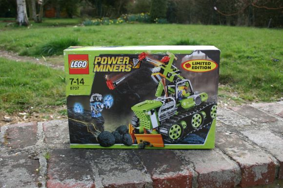

**Face avant**

La face avant

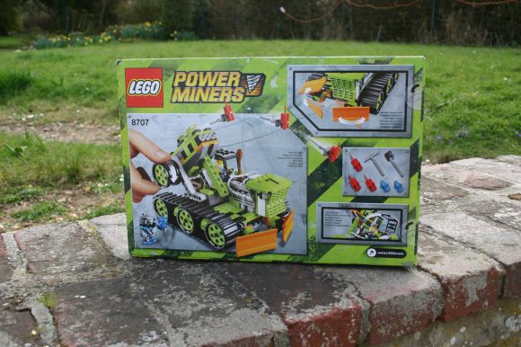

**Face arrière**

La face arrière

Après ouverture, deux sachets numérotés, la notice, la planche d’autocollants, un sachet avec le monstre et les deux chenilles.

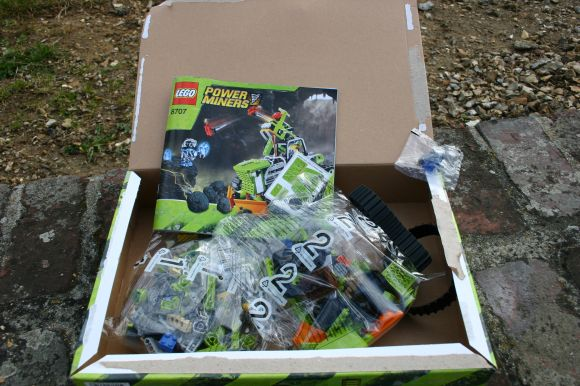

Le premier sachet contient les pièces nécessaires à la construction du châssis, de la cabine ,la minifig et le second le système de projection de la dynamite et le reste des éléments du véhicule.

## Attaquons de suite le premier sachet

Rapidement le châssis prend forme.

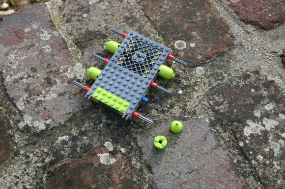

Le support du lanceur est en place

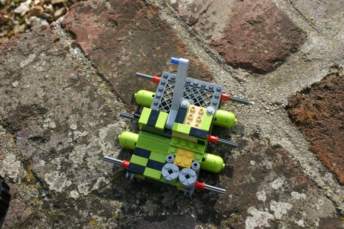

Puis la cabine, à noter l’absence de siège pour le conducteur et l’arceau qui pivote pour accéder au poste de conduite.

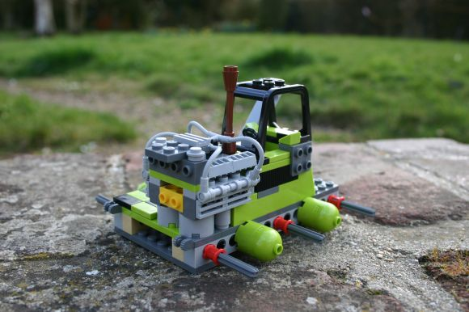

Dans un sens

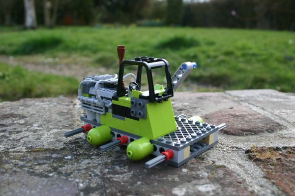

Et dans l’autre

## Maintenant le second

Tout d’abord l’élastique est dans une petite pochette carton et non plus sur un support plastique.

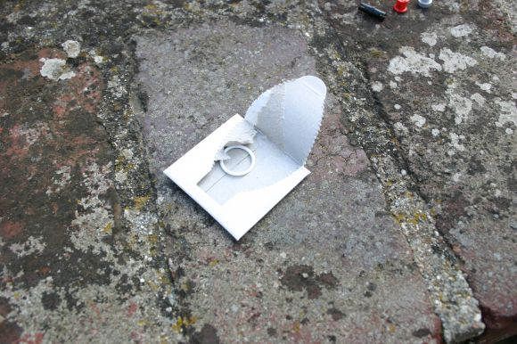

Le lanceur est simple à mettre en action, en tournant la roue. La pièce [57585](http://peeron.com/inv/parts/57585) montée sur le même axe [32140](http://peeron.com/inv/parts/32140) fait basculer la pièce et voilà au retour la dynamite part

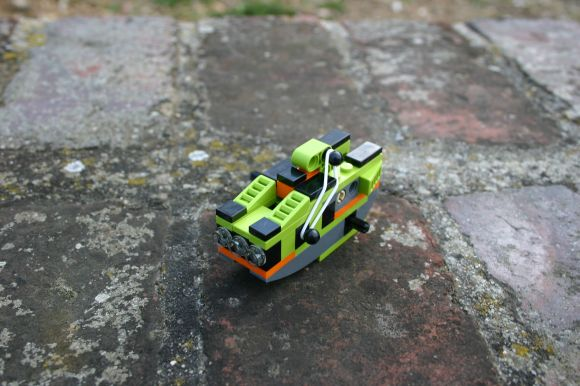

Le lanceur

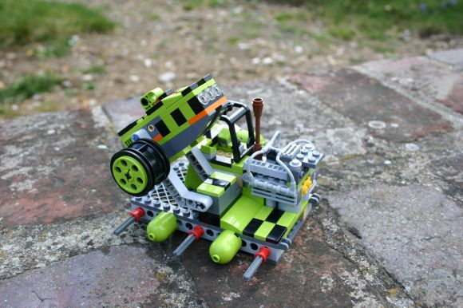

il est en place

Il ne reste plus que les lames et la calandre à mettre en place.

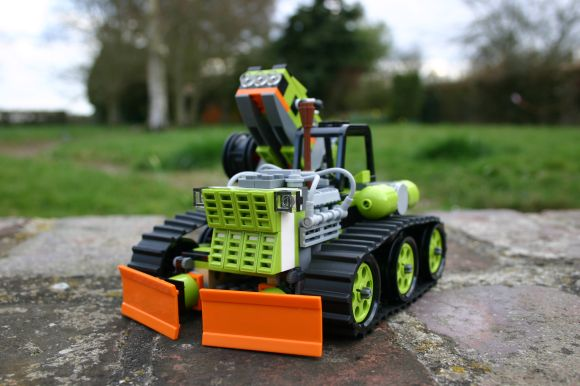

Et voilà le set est fini, reste maintenant à trouver une mine pour tester l’engin.

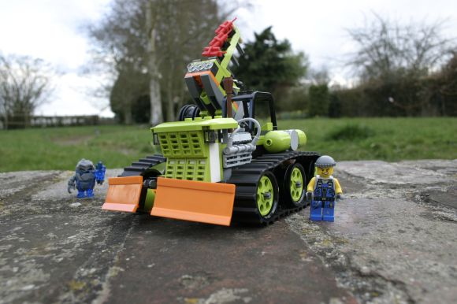

J’ai pris plaisir à monter ce set qui sera certainement pas le seul à venir compléter ma collection.

Le choix des couleurs correspond bien avec la réalité des engins miniers souvent de couleurs flashy afin de trancher avec l’obscurité ambiante. N’hésitez pas à relire la traduction de l’article [Du fan LEGO au designer de set LEGO - Une entrevue avec Mark Stafford](/articles/du-fan-lego-au-designer-de-set-lego-une-entrevue-avec-mark-stafford/) à ce sujet.

A vous de jouer maintenant.
