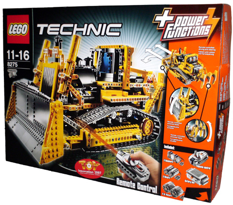

## _Connais ton sujet._

Un conseil habituel que l’on donne aux jeunes constructeurs, c’est d’étudier à fond le modèle qu’ils veulent modéliser avant de s’attaquer à la construction. En ce qui concerne le bulldozer [^1], il semble que les designers LEGO aient suivi ce précieux conseil.

Le 8275 est un modèle réduit d’un bulldozer conventionnel. Les bulldozers sont de puissants tracteurs à chenilles équipés d’une lame à l’avant et de socs de ripage à l’arrière. Cette définition souligne trois caractéristiques principales :  
**–** tracteur à chenille : le bulldozer est équipé de chenilles à la place de roues, permettant de diminuer la pression au sol en répartissant le poids sur une plus grande surface, permettant ainsi au tracteur d’évoluer en terrain meuble (boue ou neige par exemple).

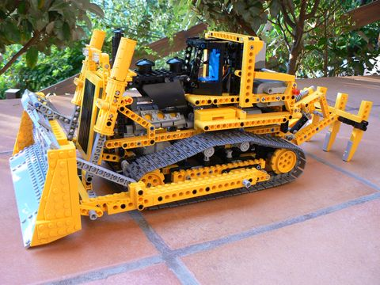

  
**–** la lame est employée pour pousser ou dégager de grandes quantités de terre, déblai, sable, détritus, etc.

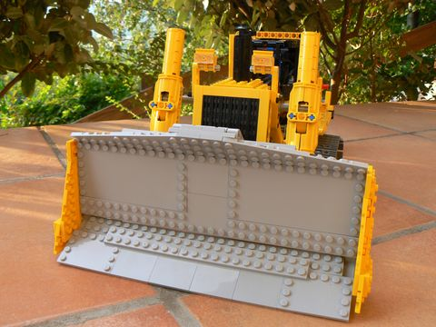

**Lame avant**

  
**–** le dispositif de ripage est constitué d’un ou plusieurs socs (généralement 2 ou 3). Le dispositif de ripage ameublit les sols rocailleux. Le soc unique est préféré pour les travaux durs.

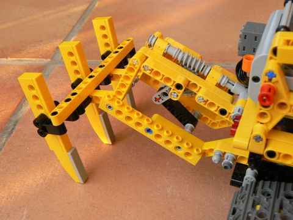

**Dispositif de ripage**

Vous retrouverez chacun de ces éléments sur le modèle réduit en LEGO.

Les plus puissants bulldozers au monde sont le Caterpillar D11 et le Komatsu D575. Ce qui distingue le Caterpillar du Komatsu c’est la roue dentée motrice en hauteur qui donne cette forme triangulaire particulière à la chenille.

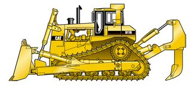

**Caterpillar D11R**

L’allure générale du 8275 le fait ressembler au Caterpillar avec sa livrée de travail noire anti-éblouissement. Mais l’absence de roue dentée en hauteur rappelle le profil du Komatsu.

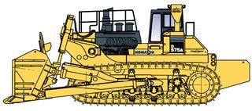

**Komatsu 575**

## La boîte

Ce modèle Technic est le plus imposant à sortir en 2007. Plus de 1300 pièces remplissent une boîte énorme avec une double ouverture. Ainsi en ouvrant le premier volet, vous découvrez une description richement illustrée du nouveau système de motorisation : le Power Functions System (PFS) (que vous avez pu découvrir, en anglais, dans le [BrickJournal n°8](http://www.brickjournal.com/wiki/show/Issue+8) ou en français dans l’article [Power Functions : le nouveau système électrique LEGO](/articles/power-functions-le-nouveau-systeme-electrique-lego/)). C’est donc un gros modèle, mais surtout il est pleinement motorisé et télécommandé. La boîte n’est pas encore ouverte et vous avez déjà le sentiment que c’est un "must".

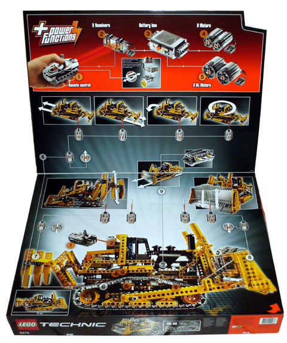

Ouvrons donc cette boîte. Rien de surprenant au premier abord pour un fan de LEGO : 21 sachets de différentes tailles et 3 livrets pour le montage. La surprise vient surtout des éléments PFS ensachés individuellement parmi lesquels on compte pas moins de 4 moteurs. Oui, vous lisez bien : 4 moteurs électriques dans un seul set.

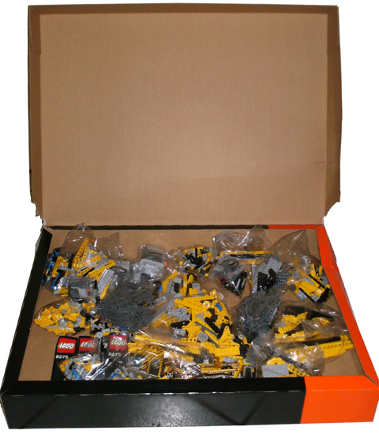

Les trois livrets permettent de construire le bulldozer mais n’offrent pas d’instructions pour un modèle alternatif. Ne soyez pas déçu, vous trouverez bientôt la notice pour un modèle alternatif sur le site officiel de LEGO ([http://www.lego.com/technic](http://www.lego.com/technic)), un modèle détaillé au dos de la boîte et qui devrait plaire aux fans de robotique.

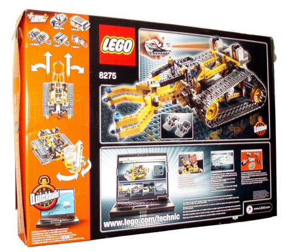

## Les pièces

Quoi de neuf parmi les pièces ?

Les éléments PFS sont composés d’une télécommande (qui tient bien en main, avec 4 canaux de communication), de deux récepteurs, d’un boitier de piles et de 4 moteurs (2 moyens et 2 gros). Vous pouvez donc tout de suite courir vous acheter quelques piles (des AAA et des AA).

Notons tout de suite que les moteurs sont très puissants.

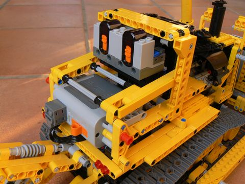

**Boitier de piles et récepteurs**

On voit bien ici le boitier de piles et les deux récepteurs.

Les éléments de chenilles sont d’un nouveau type, on ne les rencontre pour l’instant dans un seul set : [la motoneige (déjà commentée dans nos pages)](/articles/8272-motoneige-et-nouvelles-chenilles/). Ces chenilles ne sont donc pas nouvelles mais fort appréciées car ici vous les trouverez en nombre (2 sachets de 42).

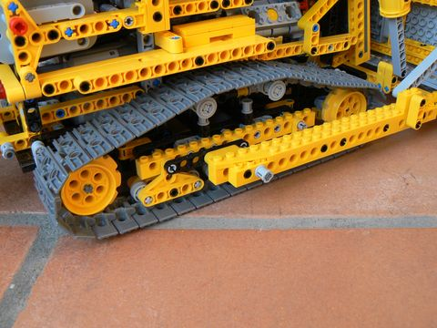

**Chenille**

Quoi d’autre. Une pièce étrange pourrait tromper ceux qui pense que le modèle dispose de pièces pneumatiques :

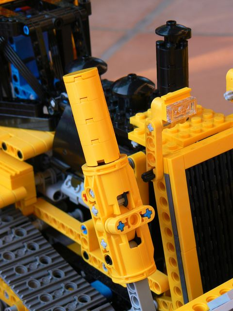

**Pseudo-système pneumatique**

il n’en est rien, toutes les fonctions sont actionnées par l’intermédiaire de moteurs.

Sinon LA couleur des engins de construction c’est le jaune. Si vous n’aimez pas attendez la sortie du [camion bleu n°8273](http://www.brickset.com/detail.aspx?Set=8273-1) ou de la [moissonneuse-batteuse verte n°8274](http://www.brickset.com/detail.aspx?Set=8274-1) :-).

On le voit donc, ce sont les éléments PFS qui font le set : ils donnent à ce modèle toute sa dimension quand on parle de jouabilité.

## La construction

Bien sûr, la construction est basée sur ces poutres Technic sans tenons bien connues maintenant. Sans surprise non plus, les éléments PFS s’accordent bien avec ce type de construction. Des éléments moins Technic (plaques par exemple) permettent de donner au modèle une allure réaliste.

Pas de difficulté au montage pour un modèle de cette taille. C’est un jeu d’enfant au point que les fans adultes pourraient même trouver le montage ennuyeux, ce qui serait un comble. Je suppose que c’est une raison pour laquelle les adultes créent leurs propres modèles.

## La jouabilité

C’est LE point fort de ce modèle. Sans conteste. Elle provient de deux aspects : les fonctionnalités motorisées et le pilotage par télécommande.

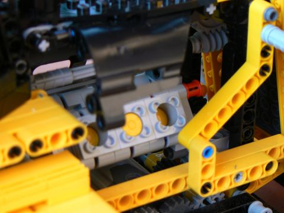

**Capot moteur**

Comme tout le monde le sait, les fonctions mécaniques sont au coeur des modèles Technic de la firme danoise. Vous en trouverez trois principales sur ce modèle : la direction différentielle, le relevage de la lame et du dispositif de ripage. Un moteur fictif complète ces fonctions avec des capots relevables et des portes de cabine.

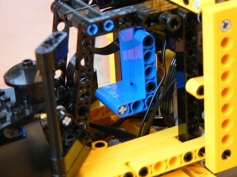

**Porte de cabine**

Mais ce qui fait que ce modèle est incontournable ce sont les possibilités de télécommande. C’est tout simplement enthousiasmant, les fonctions principales sont pleinement utilisables. La direction différentielle permet au pilote de faire avancer le modèle, de le faire tourner ou même pivoter sur lui-même : le modèle est comme vivant et toute la puissance semble concentrée dans cette télécommande qui tient dans la main. Toute les personnes qui ont pu jouer avec ont été saisies par la surprise et l’enthousiasme.

## Conclusion

Ca faisait bien longtemps que la société LEGO ne nous avait pas proposés un modèle motorisé aussi réussi. Réaliste et jouable. Les plus aficionados regretteront peut être que le boitier de piles n’ai pas été remplacé par une batterie rechargeable comme celle des ordinateurs portables, mais noteront une excellente fiabilité.

Une petite vidéo commentée :

Video Player

[Vidéo de la publication d’origine](https://www.freelug.org/IMG/mov/technicbulldozer.mov)

**Vidéo commentée (QuickTime 6,5 Mo)**

[^1]: Nos amis québécois préfèreront le terme "bouteur"
