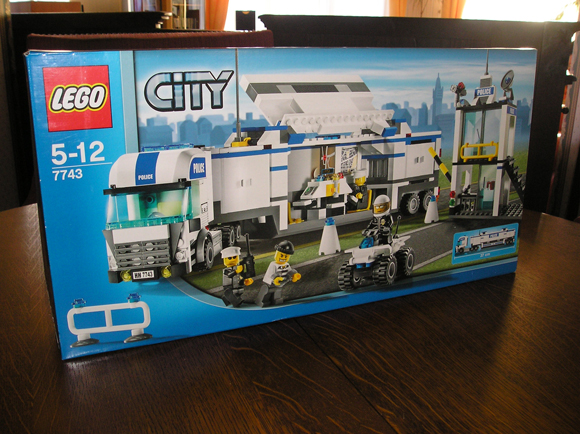
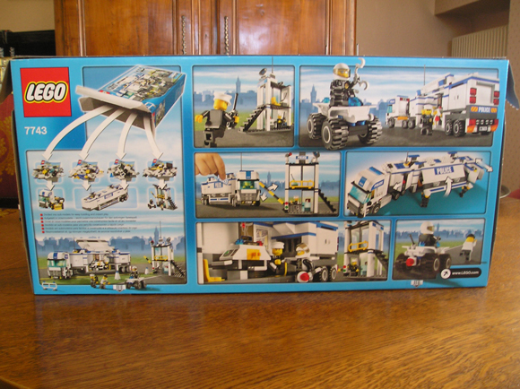
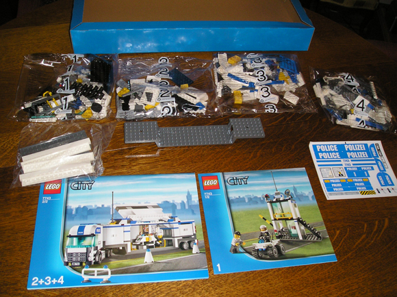
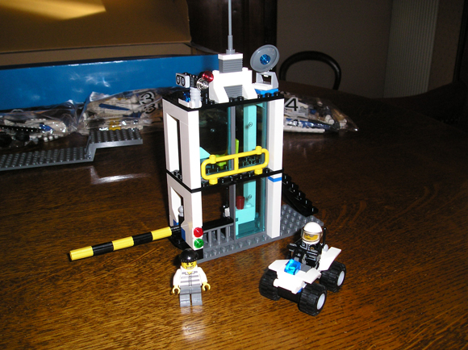
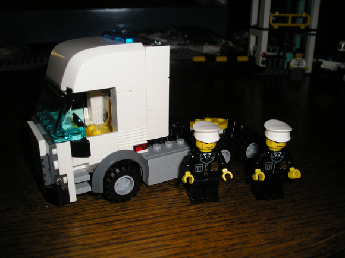
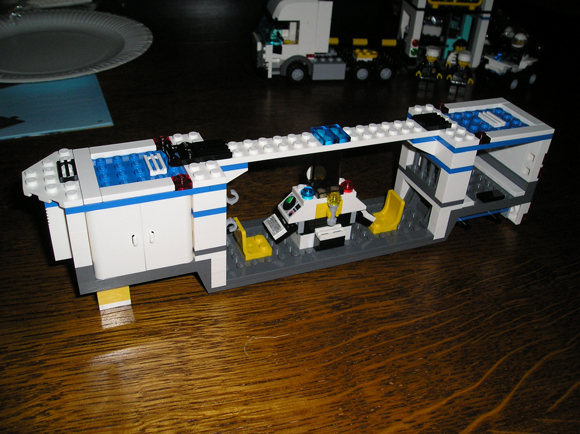
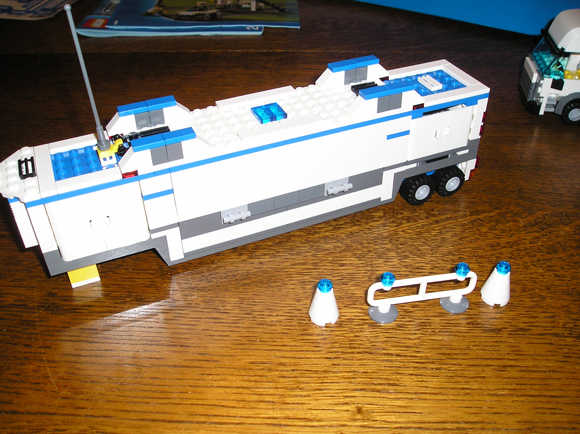
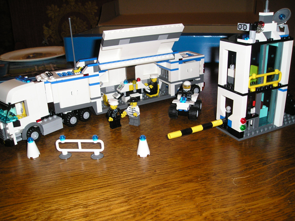
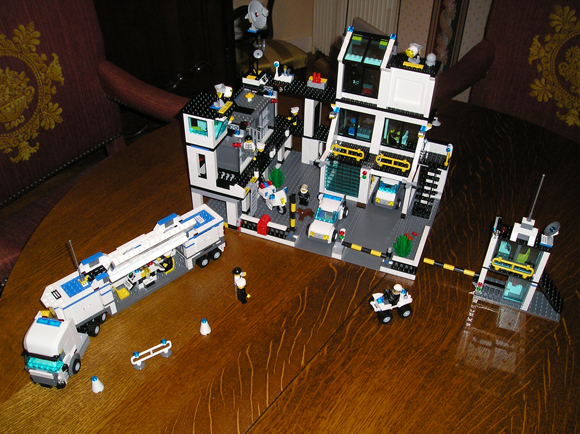

Descriptif du montage du nouveau camion de police, boite 7743.

Il y avait eu le camion [6348](http://www.peeron.com/inv/sets/6348-1), puis le [7034](http://www.peeron.com/inv/sets/7034-1). LEGO nous offre aujourd’hui une nouvelle version de ce camion de police.

J’ai toujours regretté de ne pas avoir eu le 6348, c’est donc avec plaisir que j’ai découvert ce nouveau set.

## Descriptif de la boîte

**la boite**

**–** Nom de la boîte : le camion de police  
**–** Numéro de la boîte : 7743  
**–** Nombre de pièces : 524  
**–** Date de commercialisation : janvier 2008

On la trouve sur le [shop](http://shop.lego.com/ByTheme/Product.aspx?p=7743&cn=153&d=9) pour 37,99 euros et dans le commerce.

Derrière la boîte, on nous montre que le montage se fera en 4 étapes.

**l’arrière de la boite**

## Montage

En ouvrant la boîte, on retrouve donc 4 sachets numérotés, un sachet avec quelques grandes pièces, une plate 6x34 sans protection, une planche d’autocollants, ainsi que 2 notices.

**le contenu**

Aucune véritable nouvelle pièce me saute aux yeux, si ce n’est les menottes déjà vues dans le poste de police.

On commence alors la construction avec le premier sachet.

**étape 1**

On découvre alors un petit quad, ainsi qu’un petit poste de contrôle, chose qu’il n’y avait pas dans les boîtes précédentes.

Pour la deuxième étape, on construit le tracteur du camion.

**étape 2**

On retrouve le même toit que le [camion 7733](/articles/camion-de-transport-7733/), ceci va peut être devenir un classique dans les toits des futurs camions. La liaison entre le tracteur et la remorque n’est pas faite avec une turntable, mais avec un [technic axe pin](http://www.peeron.com/inv/parts/3749), ce qui permettra d’enlever la remorque sans difficulté.

Ensuite, nous passons à l’étape 3.

**étape 3**

On commence la construction de la remorque. Celle-ci est construite à partir de cette [pièce](http://www.peeron.com/inv/parts/2972), pièce facilement réutilisable pour des wagons.

Et enfin la dernière étape.

**étape 4**

La remorque est finie, une barrière et deux plots complètent l’ensemble. Il y a deux rangements à l’avant et à l’arrière de la remorque. L’antenne sur le toit peut se coucher.

L’assemblage final montre un bel ensemble de police, un gros camion, un quad ainsi qu’un petit poste de police.

**assemblage final**

Lorsque l’on rajoute ce camion avec le poste de police, il commence à y avoir une grosse caserne de police.

**le camion avec le poste de police**

Sympa, pour des heures de jeux...

## Conclusion

**–** Beau camion, un bel ensemble pour compléter sa gamme police.  
**–** Il faut avouer que le camion est un peu long pour passer les croisements dans la ville, mais heureusement qu’il y a un quad pour faire de la place ! ( et aussi à éviter de traverser des passages à niveaux... ).  
**–** Il y a encore 22 autocollants à mettre...  
**–** La construction reste simple, mais agréable à construire... et oui, c’est des LEGO !
