Les trains peuvent se suivre à intervalles de 3 minutes, sans se rattraper. Mais comment ça marche ?

Bien sûr, dans l’article je vous explique aussi la fonction des feux suivant les différentes couleurs, sur le réseau SNCF.

## Fonctionnement du cantonnement

La voie ferrée est divisée en portions isolées entre elles, les cantons. Les cantons sont protégés par des feux tricolores. Un feu protège deux cantons, voire trois. La longueur des cantons est fonction de la vitesse autorisée sur la portion de voie où ils sont situés. C’est à dire que le train doit pouvoir s’arrêter sur la longueur de deux cantons. Si on a trois cantons : A, B et C, alignés et quatre feux : 1 avant A, 2 entre A et B, 3 entre B et C et 4 en bout de C.

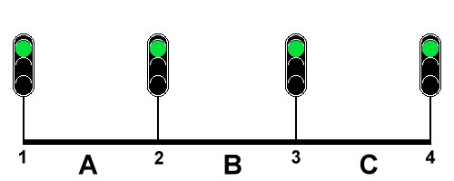

**Plan de base**

Plan 01

Un train entre en A, il a eu le feu vert. Lorsqu’il passe en A, le feu 1 passe au rouge. Il roule jusqu’au canton B.

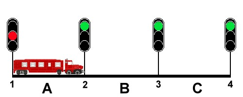

**Plan 02**

Le feu 2 passe au rouge lorsqu’il le franchit. Tant que le reste du train est en A le feu 1 reste au rouge. Dès qu’il quitte A, le feu passe au orange.

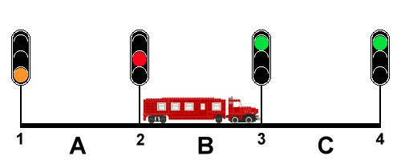

**Plan 03**

Lorsque le train quitte complètement le canton B : 1 passe au vert, 2 passe au orange et 3 au rouge. Et ainsi de suite.

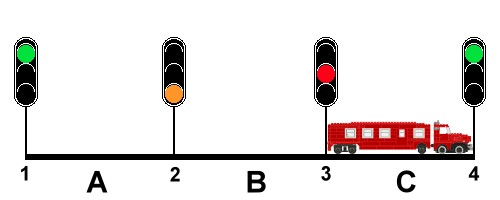

**Plan 04**

Sur certaines portions de voie, la vitesse autorisée a été augmentée, plus de 160 Km/h. Pour ne pas redimensionner les cantons, il a été rajouté une fonction au feu orange. C’est à dire que, si on prend la position du train dans le dernier schéma, il est dans la zone "C", le feu situé en "1" fait clignoter la couleur orange.

Ce sont les essieux des trains qui conduisent un courant entre les 2 fils de rails et qui informent le système de la présence d’un train dans un canton. La micheline était équipée de frotteurs pour faire la liaison électrique, car les pneus ne sont pas conducteurs.

## Les feux tricolores de cantonnement en réalité

Ils comportent 3 couleurs, comme expliqué ci-dessus. Toutes les locomotives comportent une brosse, située en général sous la cabine 1. Un peu avant le feu est placé un "crocodile" entre les voies. C’est une sorte de grille longue de 1,50m environ. C’est elle qui envoie l’information de la position du feu par l’intermédiaire de la brosse, dans la cabine. Si le conducteur franchit la portion du crocodile, l’automate considère que le train est sur le canton suivant. Ce qui peut être très préjudiciable dans le cas d’un carré non franchissable, car tout est enregistré dans une boîte noire, dans la locomotive.

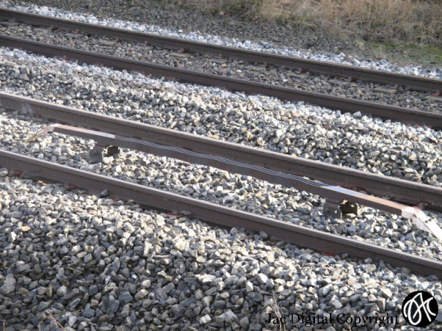

**Le "crocodile"**

Lorsque le canton suivant est libre, le feu est vert. Un bruit de sonnette se fait entendre dans la cabine. Le train peut rouler normalement.

Si le feu orange est éclairé, cela signifie que le canton d’après est occupé. Le conducteur connait l’emplacement des feux. Il a repéré dès qu’il l’a vu sa couleur orange et l’a signalé à l’ordinateur de la locomotive en appuyant sur un bouton spécial. Lorsqu’il franchit le feu, si la couleur n’a pas changé entre temps, un buzz se fait entendre dans la cabine et il faudra qu’il appuie à nouveau sur le même bouton pour l’arrêter. S’il n’y a aucune réponse, au bout de quelques secondes, la locomotive est stoppée nette. C’est la sécurité de "l’homme mort".

Si le canton suivant est occupé c’est le feu rouge qui s’éclaire. le conducteur a effectué exactement la même opération que pour un feu orange. Il a signalé le signal fermé à l’ordinateur de la locomotive. Mais ce feu rouge qui implique un arrêt autorise toutefois une marche à vue. C’est indiqué sur le portique par un "F" pour "franchissable". Le conducteur va alors parcourir tout le canton sans dépasser la vitesse de 30 Km/h.

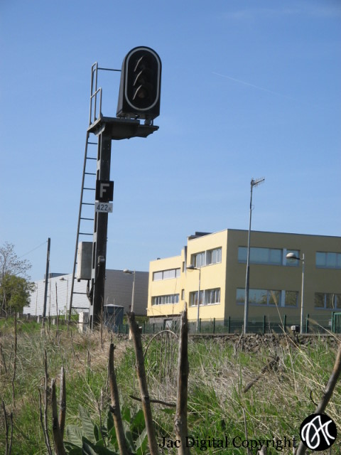

**Signal de cantonnement**

Ce signal a été pris sur la portion de voie réelle entre Clermont Ferrand et Cournon d’Auvergne

On croirait le feu éteint, mais il n’en est rien. C’est qu’en fait, le feu orange clignotait, comme expliqué plus haut.

L’œilleton de sécurité est blanc et sert à préciser que c’est bien un feu rouge franchissable de cantonnement. Il est toujours éclairé lorsque le signal est en mode "cantonnement". Il est situé à côté du panneau noir cerclé de blanc qui comporte les feux. L’oœilleton sert à assurer le conducteur qu’il est bien en présence d’un signal franchissable de cantonnement. Au contraire d’un carré de 2 feux rouges dont l’un des deux pourrait être grillé.

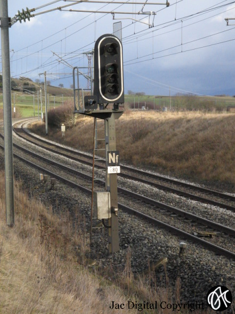

**Signal NF, comportant un "carré" : 2 feux rouges.**

Ce signal a été pris sur la portion de voie réelle entre Randan et St Clément, sur la ligne Clermont Ferrand/Vichy en Auvergne.

**Le système TGV**

Le fonctionnement est similaire, mais les signaux sont répétés au conducteur directement dans la cabine. Il a été estimé que la vitesse atteinte par ces trains ne permet pas de visionner suffisamment tôt un signal en bordure de voie.

## Les signaux pour le passage des aiguillages

Ils sont beaucoup plus importants et donnent beaucoup d’informations. Ils peuvent être aussi bien un feu de cantonnement, un carré (2 feux rouges) et une indication de positionnement des aiguillages. Donc, voyons tous ces cas :

-   S’il est en position cantonnement, cela veut dire que l’aiguillage est droit. Le train va tout droit, pas de limitation de vitesse.

-   S’il est en position aiguille tournée, il le signale dans la partie haute par les deux feux oranges.

Un panneau d’informations supplémentaire surmonte quelques signaux.

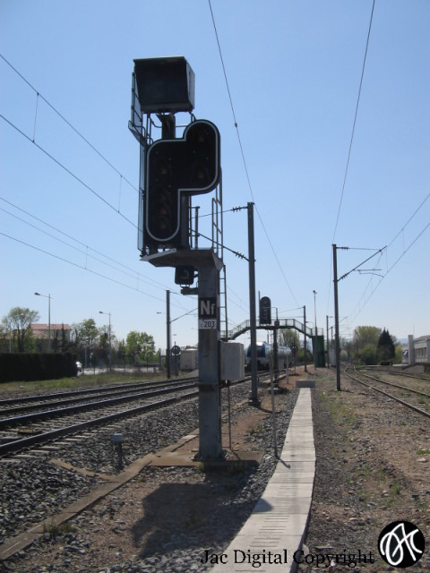

**Signal de limitation de vitesse**

Ce signal a été pris sur la portion de voie réelle en entrée du triage de Clermont Ferrand, à la gare de Gerzat.

Vous trouverez beaucoup d’information sur ce site :  
[La signalisation SNCF](http://geillon.pagesperso-orange.fr/trains/signaux/)

## La signalisation dans les triages ou voies de garage

Les signaux placés dans les triages sont très simples, mais très stricts. Ils comportent deux feux, un blanc et un violet, que l’on confond facilement avec du rouge. Le blanc signifie que la voie est ouverte mais limitée à 30 Km/h. Le violet est un carré. Le franchissement est strictement interdit.

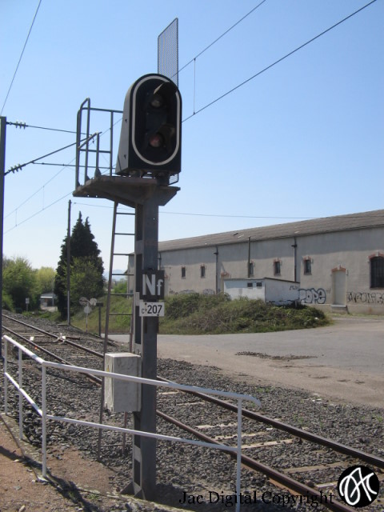

**Signal de triage**

Ce signal a été pris sur une portion de voie réelle en sortie du triage de la zone industrielle de Ladoux, à la gare de Gerzat.

Certains signaux à deux feux sont aussi placés par terre, entre les voies.

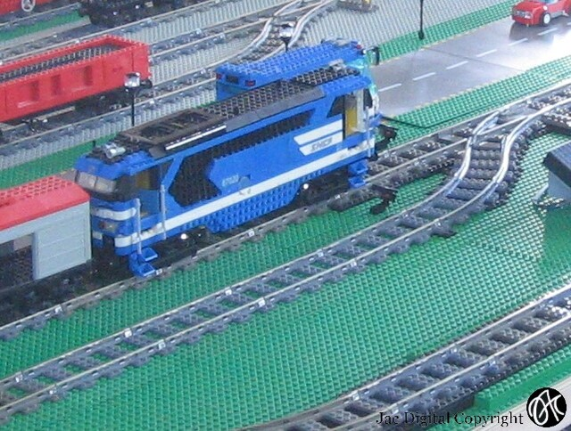

**Feux de départ de faisceaux**

Locomotive attendant le départ donné par un feu au sol. Il est placé à la gauche de la voie.

## Le signal de cantonnement en Lego

Cet article est seulement là à titre d’information. Sans vouloir être absolument rigoureux, il explique la base du fonctionnement des signaux lumineux à la SNCF. Ne comptez pas conduire les trains après sa lecture, c’est beaucoup plus compliqué. Toutefois, le cantonnement appliqué aux réseaux LEGO a été très bien mis en place dans l’article de Daniel : [Le principe du cantonnement](/articles/le-principe-du-cantonnement-applique-a-une-lgl-en-exposition/).

Retrouvez également les articles de Xavier et Banban pour la [fabrication d’un signal lumineux](/articles/un-feu-de-signalisation-de-train/) ou de la [réalisation d’un canton](/articles/un-systeme-de-cantonnement-pour-train-9v/).

J’ai reproduit un signal qui peut être placé en pleine voie et qui comporte un signal d’arrêt absolu. Il a donc l’oœilleton. J’en avais mis 2 en place sur le réseau que l’on a présenté à [l’exposition d’Avignon](/articles/24e-model-show-avignon-6-et-7-novembre-2010/). Mais je lui ai apporté quelques petites modifications.

[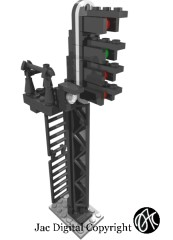](https://www.freelug.org/IMG/zip/Notice-3.zip "Zip - 9.8 kio")

**Notice de construction d’un signal 4 feux.**

[Galerie photos de mon signal en briques](http://photos.freelug.org/main.php/v/JAC/MOC/Train/Signal4feux/)
