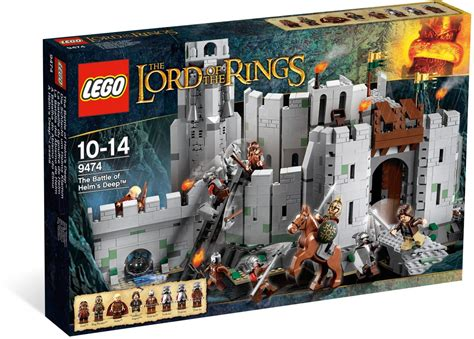
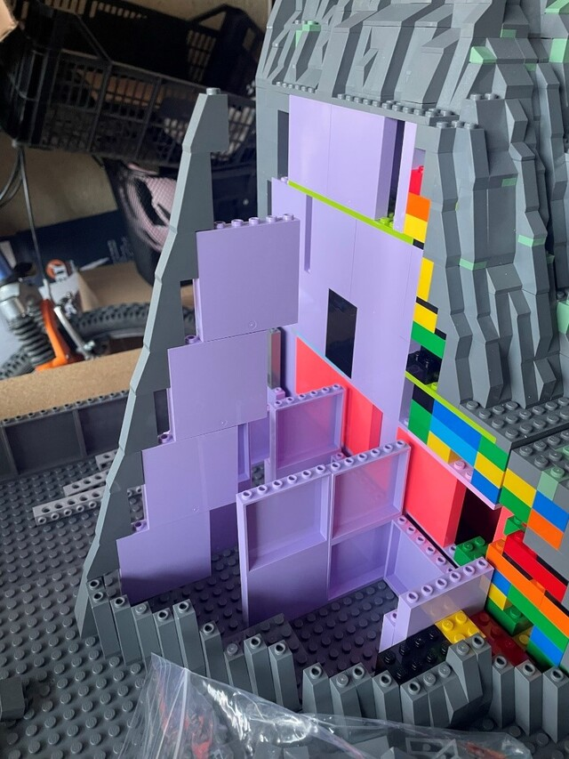
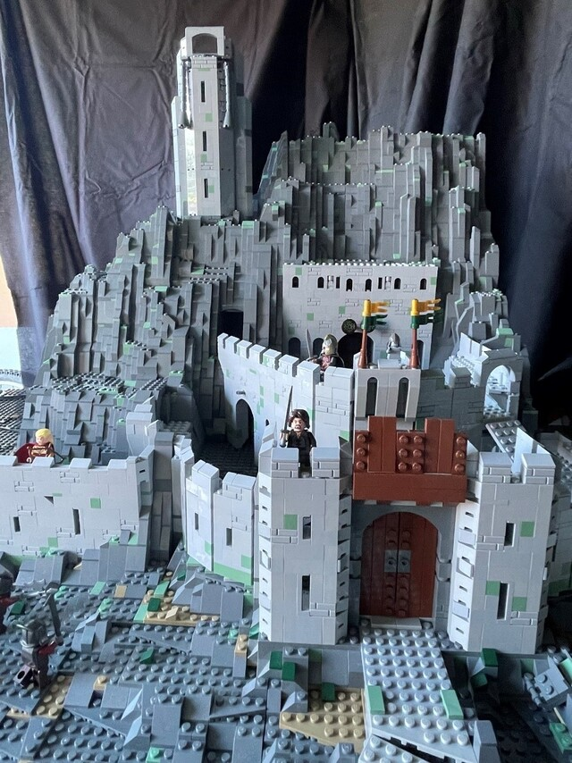
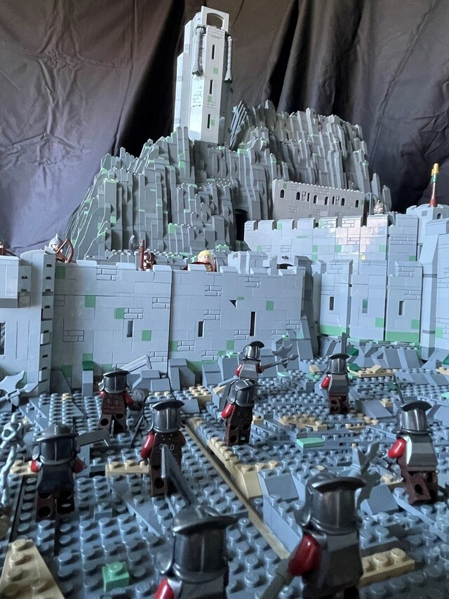
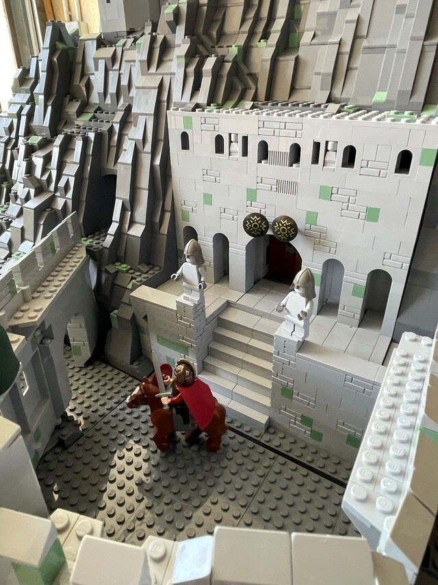
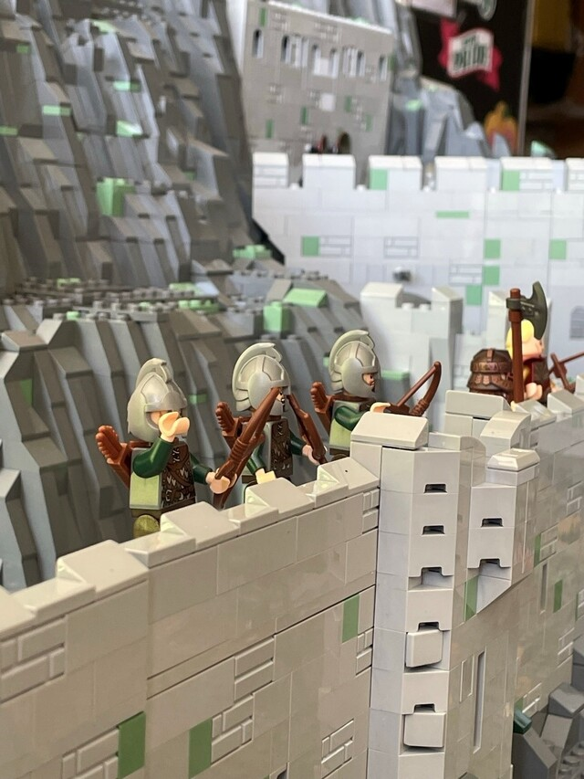

Lorsque LEGO propose un set sur le gouffre d’Helm en 2012 contenant 1332 éléments et 8 personnages, c’est que du bonheur pour les fans de l’univers du Seigneur des Anneaux.  
Le set est plutôt réussi et la gamme offre un complément en achetant un petit mur, le set 9471, qui vient compléter l’ensemble.

Le set comprend comme personnages ARAGORN, GIMLI, HALDIR, le roi THEODEN et 4 URUK-HAI.  
L’idée de créer un MOC sur le gouffre d’Helm et sur le Fort LECORR fait son chemin et la possibilité de constituer un stock de pièces via des BULKS successifs est une occasion rêvée pour disposer des centaines de pièces nécessaires à mon projet.  
Au printemps 2023, je me lance donc dans ce MOC.

La base comprend 4 plaques de 32 tenons pour 3 plaques de 32 tenons sur la profondeur. La difficulté principale est de bien appréhender les différents niveaux sans créer une montagne trop importante et gourmande en pièces.  
Une fois, les différents éléments positionnés, il ne reste plus qu’à donner vie à ces flancs rocheux.

La conception doit permettre le transport pour une exposition future, toujours dans la volonté de partager ce MOC avec le public. Lors de la création, il se doit de trouver le compromis entre solidité et économie de briques.

Des centaines de briques plus tard, le Fort-le-Cor prend forme.

