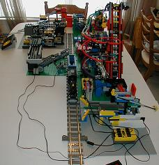
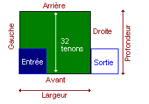

Ce document est une traduction/adaptation de "[The Great Ball Contraption](http://www.teamhassenplug.org/GBC/)", par [Steve Hassenplug](mailto:steve_AT_teamhassenplug.org)

"Il peut être vraiment simple, ou aussi diaboliquement complexe que le temps le permet !"

## Principe :

Réaliser une création Mindstorms/Technic (sans notion de compétition) à laquelle des gens de tous niveaux de construction puissent participer. Chaque participant peut construire un (ou plusieurs) module(s). Tous les modules seront assemblés pour former un grand bidule "à la [Rube Goldberg](http://www.rube-goldberg.com/)" ("contraption").

Dans d’autres thèmes, les Adultes Fans de LEGO (AFoLs) ont conçu des standards qui permettent à des personnes de différentes régions de construire des sections qui seront intégrées dans un montage commun. Exemples de tels standards : [Moonbase](http://www.scibrick.org/moonbase/), [Classic Castle](http://www.classic-castle.com/ccc/cccstandard.html)... ou plus près de chez nous [Brickciel](http://www.freelug.org/article.php3?id_article=148).

FreeLUG prévoit d’assembler un Grand Bidule à Balles lors de l’exposition itinérante Freelug de l’été 2005.

* * *

Ce concept est né du "[Passage de balles de Ping Pong](http://www.teamhassenplug.org/pingpong.htm)" au sein du Lafayette LEGO Robotics Club (LafLRC), combiné à l’" [Usine à caisses du SMART](http://news.lugnet.com/org/us/smart/?n=303)" (Seattle Mindstorms And Robotics Techies) pour devenir le **Grand Bidule à Balles**.

Le but est de faire passer des [ballons de football LEGO](http://www.peeron.com/inv/parts/x45px1) d’un module au suivant (les [ballons de basket](http://www.peeron.com/inv/parts/x493px1) conviennent également). Chaque module peut être aussi simple ou aussi complexe que le souhaite son constructeur.

* * *

## Interface standard de type 1 :

**Disposition standard d’un module**

1.  Chaque module possède un panier d’entrée, et transporte les balles jusqu’au panier d’entrée du module suivant, qui doit être aligné. [Voici](http://www.brickshelf.com/cgi-bin/gallery.cgi?f=88862) quelques exemples de disposition de modules. Attention, les dimensions de ces exemples ne sont pas correctes !
2.  Le [panier d’entrée](http://www.brickshelf.com/cgi-bin/gallery.cgi?i=813223) mesure 10 tenons par 10 tenons (dimensions extérieures) avec une ouverture de 8x8, et une hauteur de 10 briques.
3.  L’avant du panier doit être placé à 32 tenons (maximum) de l’arrière du module. Ceci permet à tous les modules d’être alignés le long d’un mur. L’arrière du module PEUT être plus près du pannier d’entrée, mais pas plus loin.
4.  Le panier d’entrée est situé à gauche du module, et la sortie est dirigée vers la droite.
5.  Il n’y a pas d’autre limite de dimensions que celles citées ci-dessus.
6.  Chaque module doit pouvoir accepter les balles au rythme moyen de 1 balle par seconde. Les balles peuvent être fournies en continu, ou par lots. Un lot ne doit pas excéder 30 balles.

Selon l’interface de type 1, seules des balles sont transmises d’un module au suivant. Dans le futur, des caisses de balles pourraient être utilisées.

Voir [Grand Bidule à Balles : Installation et exemples](/articles/grand-bidule-a-balles-installation-et-exemples/)

* * *

## Interface standard de type 1b :

Il s’agit d’un sous-ensemble du type 1, permettant une intégration facile dans un circuit de train. Pour le type 1b, tous les modules sont construits sur une ou plusieurs plaques de base 32x32 (alignées).

Il est aussi recommandé que les modules de type 1b aient un débit encore plus élevé, de plus d’une balle par seconde. En effet, ils seront généralement montrés dans des GBB avec peu de modules et un débit élevé les rendra plus intéressants.

* * *

## Notes de construction :

Cette définition permet beaucoup de souplesse. La distance entre l’arrière du module et les entrées/sorties ne doit pas dépasser 32 tenons, car lorsque le Grand bidule à Balles est assemblé, il peut être placé contre un mur, et ceci permet d’avoir une distance au mur uniforme.

**–** La distance devant le panier d’entrée n’est pas limitée, mais il est recommandé que le module soit plus large que profond.

**–** Le débit de 1 balle par seconde peut sembler rapide, mais c’est nécessaire afin d’éviter que les balles ne s’accumulent à l’entrée d’un module lent. Le rythme réel est probablement plus faible, de l’ordre de 2 balles toutes les 3 secondes.

**–** Il n’y a pas actuellement de norme fixant l’interconnexion des modules ensemble. La plupart (mais pas tous) les modules seront construits sur une plaque de base, et on suppose que ces plaques pourront être reliées ensemble.

**–** Il semble que les _chenilles de tank_ du kit Mindstorms fassent un parfait tapis roulant pour monter les balles en haut d’une petite colline... **EN FAIT, NON !**

**–** Une autre suggestion : Beaucoup de modules contrôlés par RCX attendent le remplissage d’une section avant de la vider puis d’enchaîner sur plusieurs mouvements, et enfin de revenir à l’état "attente" . En fait, c’est une bonne idée de placer cette attente à la fin de la séquence. De cette façon si le module est arrêté tandis que les modules précédents fonctionnent, la première chose qu’il fera sera de se vider, au lieu d’attendre le débordement avant de décharger.

Voir [Grand Bidule à Balles : Casser les règles](/articles/grand-bidule-a-balles-casser-les-regles/)

* * *

## Une balle par seconde, ça va à quelle vitesse ?

Pour faire un module utilisant un seul moteur et fonctionnant à un débit minimum d’une balle par seconde, à quelle vitesse doit-il fonctionner ?

Les moteurs Mindstorms standard fonctionnent à environ 360 tours/minute, soit 6 tours par seconde. Voici quelques chiffres bruts :

**–** Si le moteur est connecté par une roue dentée 8 dents à une 24 dents, cela fait 2 cycles par secondes.  
**–** De 8 vers 40 dents, 1,2 cycle/seconde.  
**–** D’une vis sans fin vers une 24 dents, 0,25 cycle/seconde : prévoir le transport d’au moins 4 balles par cycle.  
**–** D’une vis sans fin vers une 8 dents, 0,75 cycle/seconde.

**NDT :** les 6 tours par seconde supposent un moteur peu ou pas chargé. S’il y a beaucoup de frottements dans votre module, prenez plutôt une base de 3 ou 4 tours/seconde à la sortie moteur.

* * *

## Balles :

Si vous êtes intéressé par cette construction mais que vous n’avez pas de balles pour effectuer les tests, quelques-unes pourront être fournies, plus de renseignements bientôt.

* * *

## Exemples :

Voici quelques images et videos réalisées par Steve Hassenplug lors de rassemblements préliminaires :  
(Les videos, hébergées sur Brickshelf, peuvent ne pas être disponibles temporairement afin de limiter la bande passante du site).

**–** [Vue d’ensemble](http://www.teamhassenplug.org/GBC/GBCpreview.JPG)

**–** [Galerie Brickshelf](http://www.brickshelf.com/cgi-bin/gallery.cgi?f=111180)

**–** [Videos](http://www.brickshelf.com/gallery/Hassenplug/GBC/Video/)

* * *

## Idées :

Des idées sur ce que vous pouvez construire ? [Voici une liste, préparée par Brian Davis](http://www.teamhassenplug.org/GBC/contraptionideas.htm) (en Anglais).

## Autres :

**–** Brian Alano a répertorié d’autres sources intéressantes [ici](http://www.lugnet.com/%7E1048/GBC_Index) (en Anglais). (NDT : je recommande particulièrement ce [site](http://www.kugelbahn.info/deutsch/haupt/rauf.html). Bien qu’en Allemand, ses images et animations sont très parlantes).  
**–** [Modules GBB par David Koudys](http://sparky.i989.net/mmisc4.htm)  
**–** [Modules GBB par Philo](http://philohome.com/gbc/gbc.htm)

* * *

Ces standards ne sont pas figés et peuvent évoluer en fonction des besoins.

Dernière mise à jour 21 Février 2005.  
Traduction Philippe Hurbain 11 Février 2005, mise à jour 23 Février 2005
