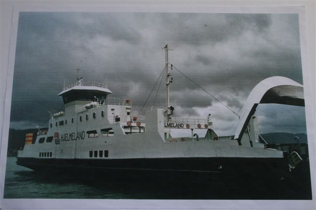
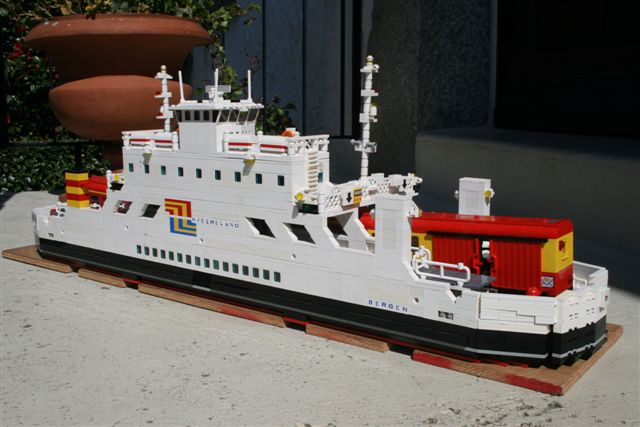
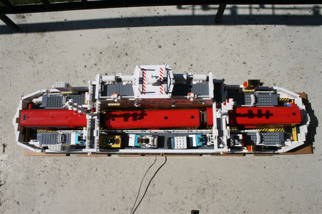
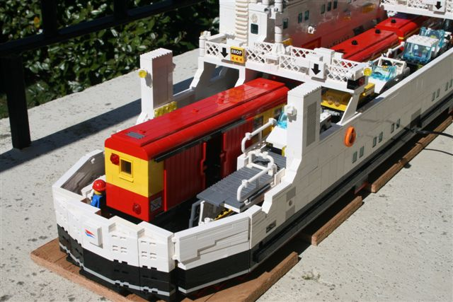
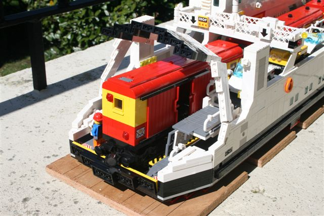
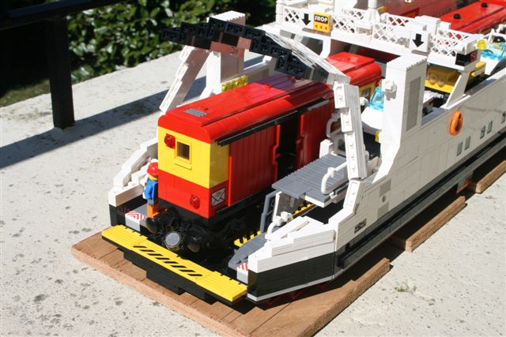
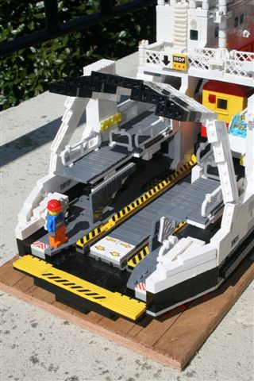
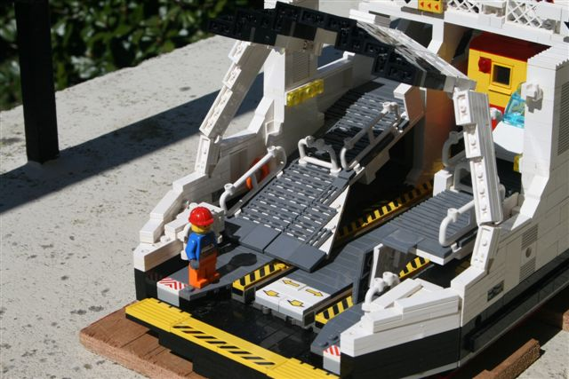
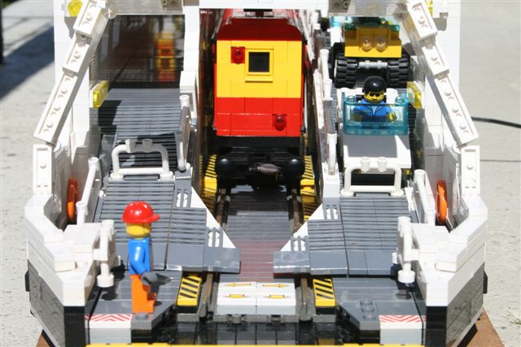
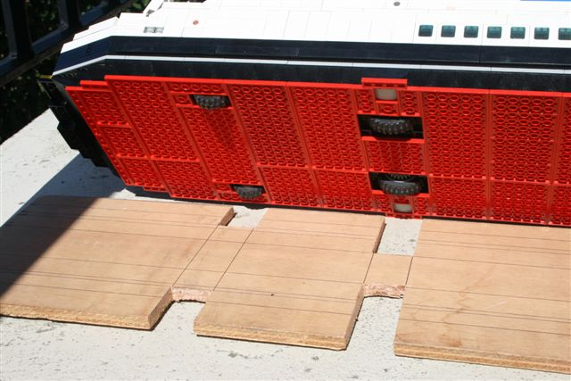

Jean-Marc est Breton. Il est passionné par le train et les bateaux. Mais c’est surtout pour le fait qu’il aime à reproduire tout cela en brique LEGO et à tout présenter en exposition que nous le connaissons. Cette série d’articles qui va suivre présentera un modèle réel de chaque bateau que Jean-Marc a reproduit en LEGO pour notre plus grand plaisir. Car non content d’exposer dans les salons en Bretagne, Jean-Marc se déplace, parfois même en Alsace et, qui sait, un jour jusqu’aux Pays-Bas (Zwolle pour le LEGOWORLD) avec sa Polo...

Lors d’un voyage en Norvège, il a été inspiré par Le "HJELMELAND". C’est un ferry qui appartient à la compagnie TIDE. Il navigue sur la ligne Stavanger, au sud de Bergen, à Tau. Il effectue des traversées en 90 min environ en transportant des passagers et des véhicules de tourisme.

**le "HJELMELAND"**

Pour les besoins de son diorama, Jean-Marc a ajouté une voie ferrée à l’intérieur de la reproduction. Cette possibilité technique permet de faire des manoeuvres de trains sur la portion maritime du réseau. En exposition, Jean-Marc laisse les commandes aux visiteurs. Cela lui permet de leur expliquer comment se passait la mise en place des trains dans les ferry, à l’époque où ils servaient beaucoup. Pour faire le tour du réseau, les trains empruntent obligatoirement le ferry. Par contre, le train complet ne rentre pas dans le bateau. Cela implique des manoeuvres ingénieuses avec une locomotive supplémentaire.

La reproduction du "HJELMELAND" en LEGO mesure 90 tenons de long et 24 de large (72 x 19,2cm environ). Elle peut accueillir 3 wagons par traversée et possède deux voies de garage supérieures terminées par des passerelles escamotables pour la montée et la descente des voitures. S’il n’y a pas de trains, les voitures occupent les 2 voies inférieures.

**La maquette.**

**En vue de dessus, on voit bien la place qu’occupe le train.**

Le ferry en LEGO est fonctionnel. Un régulateur de train 9v alimente 4 gros moteurs Technic qui commandent les roues. Aux extrémités du ferry, les 2 grandes portes sont manuelles, pour l’instant. Sous les rails, un panneau amovible noir et jaune zébré sert de support aux rails de la passerelle d’embarquement ou débarquement. Il est possible d’éclairer la maquette pour les traversées en nocturne.

**Coque fermée.**

**Coque ouverte,**

**Rampe en place, le train peut sortir.**

Une rampe mobile permet l’accès à l’étage supérieur pour les véhicules de tourisme.

**Une foi que le train est sorti...**

**on descend les rampes,**

**pour pouvoir sortir les véhicules.**

Pour le transport, la maquette repose sur une planche de bois percée qui permet à la maquette de se poser à plat, pour soulager les roues...

**De la menuiserie pour un ferry...**

J’espère qu’avec cet article vous connaîtrez un peu mieux cette reproduction construite par Jean-Marc et que cela vous permettra de mieux l’apprécier lorsque vous la verrez en exposition sur son diorama.

A bientôt pour la suite de la série.
