La compagnie MSC croisière s’est dotée d’un nouveau paquebot : le "Meraviglia". Il a été reproduit en briques par la firme LEGO. Voici les détails de son montage.

Le "Meraviglia" (merveille) est le plus grand paquebot mis en mer par les chantiers navals de St Nazaire, à la date où j’écris cet article bien sûr, on ne sait jamais ! Il mesure 315m de long et 43m de large, il pèse 168600t et la puissance totale de propulsion est de 97MW. Le Splendida mesure 330m de long, mais il fait "seulement" 33m de large... Ils ont été tous les deux baptisés par Sophia Loren. Ces paquebots sont immenses en comparaison du Titanic avec ses 269X28m pour 52310t. Enfin vous trouverez beaucoup plus d’information sur internet car ce qui nous intéresse ici c’est le montage en briques LEGO de ce fameux paquebot. Ne vous inquiétez pas pour la taille du modèle final, on n’est pas dans les mesures d’un Millenium Falcon UCS. C’est du super micro scale 21X3,2cm !

**–** Référence 40227, date de sortie inconnue.  
**–** Prix payé sur le bateau : 11,40 Euros  
**–** Nombre de pièces : 179  
**–** Rapport : 0,06 Euros la pièce.  
**–** Comptez une heure de montage avec les autocollants.

C’est lors d’une croisière de rêve en Méditerranée à bord du MSC Splendida que j’ai pu acquérir cette boite. Je me doutais qu’il y avait un magasin de jouets avec des LEGO en rayon à bord puisqu’il y a un espace de jeu au nom de la marque. Lorsque je l’ai découvert à ma grande joie, j’ai en plus été surpris par la richesse des étalages de sets. Cette référence est vendue seulement dans le magasin du bateau, lorsqu’il est en mer. Ne me demandez pas pourquoi, c’est une question de zone territoriale et de taxe, trop compliqué pour moi ! Toujours est-il que j’ai pu en faire l’acquisition à bord.

La boite présente sur le dessus le bateau monté. Au dos nous trouvons les dimensions totales du vrai bateau ainsi que deux photos virtuelles. Le vrai bateau n’existait pas encore lors de la conception du set. Désolé pour l’état de la boite, elle a subi le transport final avec tassage des affaires dans les valises...

[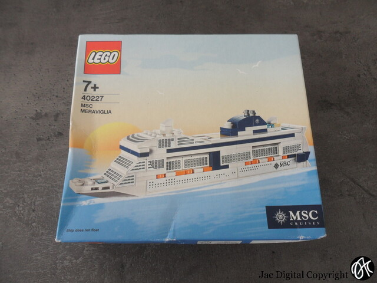](https://www.freelug.org/IMG/jpg/photo_1_.jpg)

[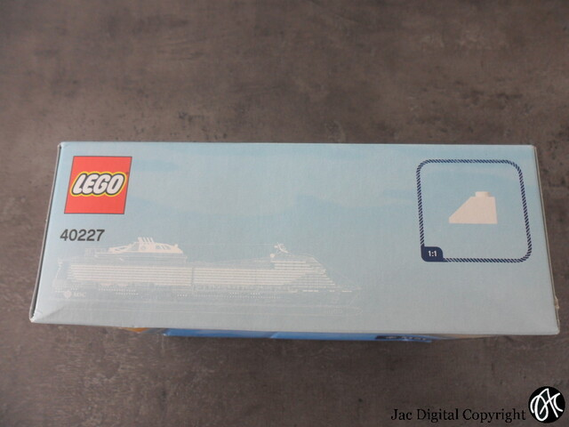](https://www.freelug.org/IMG/jpg/photo_2_.jpg)

[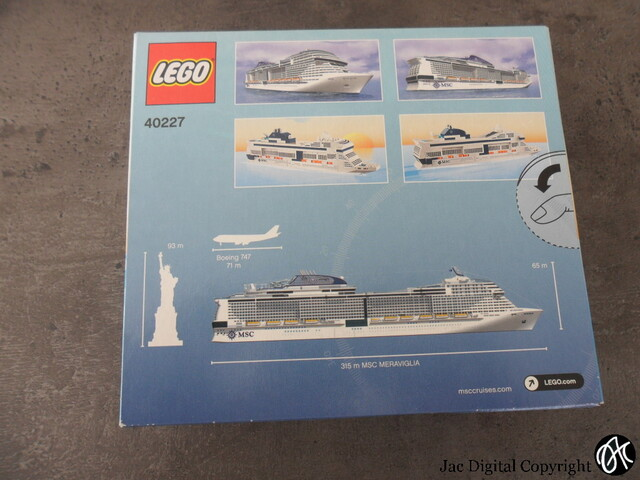](https://www.freelug.org/IMG/jpg/photo_3_.jpg)

L’ouverture de la boite se fait comme d’habitude, en poussant des ergots prédécoupés aux pointillés. Le contenu n’est pas très important mais la boite n’est pas très grosse. C’est surtout la taille de la planche d’autocollants qui peut perturber. Mais sans ceux-là, vous aurez seulement un bloc de briques presque blanc qui ne flotte même pas...

[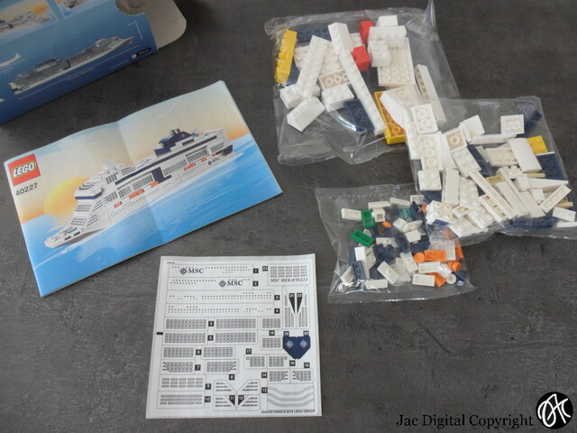](https://www.freelug.org/IMG/jpg/photo_4_.jpg)

Voilà le tas de briques obtenu une fois que vous aurez ouvert tous les sachets. La notice nous invite à commencer par l’avant de la coque. Ça semble logique...

[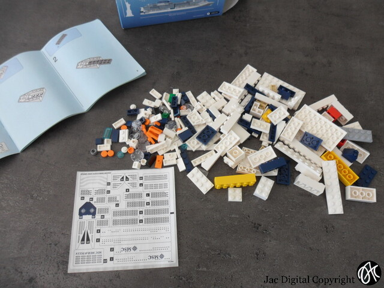](https://www.freelug.org/IMG/jpg/photo_6_.jpg)

Prenez bien soin de coller les autocollants au fur et à mesure. Pour certains, il vaut mieux le faire avant de placer la pièce, c’est plus facile. Voilà le fond de la coque terminé. C’est très coloré, ça le sera beaucoup moins à la fin mais c’est normal et heureusement pour certaines d’entre elles !

[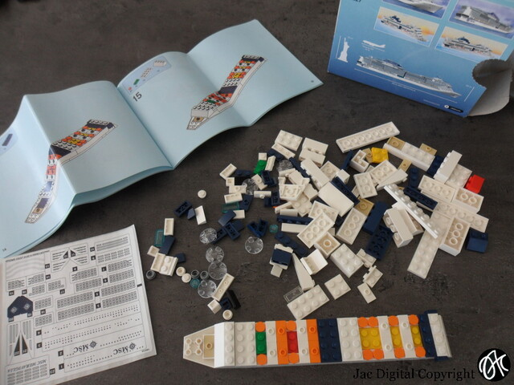](https://www.freelug.org/IMG/jpg/photo_7_.jpg)

La suite de la construction se fait sans soucis. C’est pratiquement un empilage de pièces. Il n’y a pas vraiment de montage spécial qui relève notre attention. Seul le placement de certains autocollants peut s’avérer compliqué, surtout pour bien les aligner et respecter la symétrie. Mais on arrive tout de même au bout. La partie basse des cabines est terminée...

[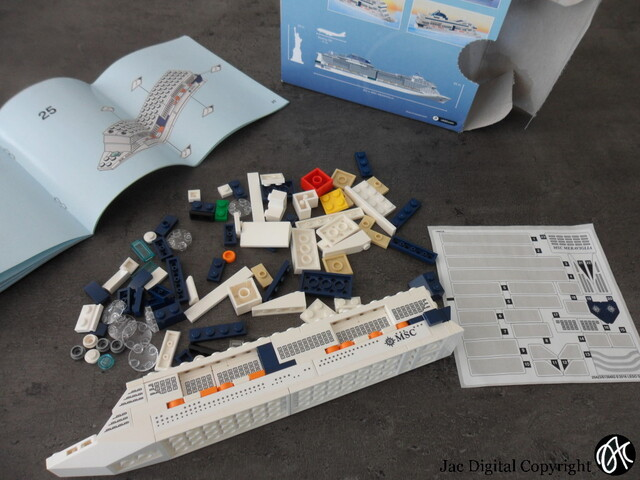](https://www.freelug.org/IMG/jpg/photo_8_.jpg)

Et voilà le paquebot terminé. L’allure de l’ensemble est bien reproduite. On a juste un peu du mal à se représenter la taille exacte réelle du bateau. Mais c’est normal à la vue de l’échelle.

[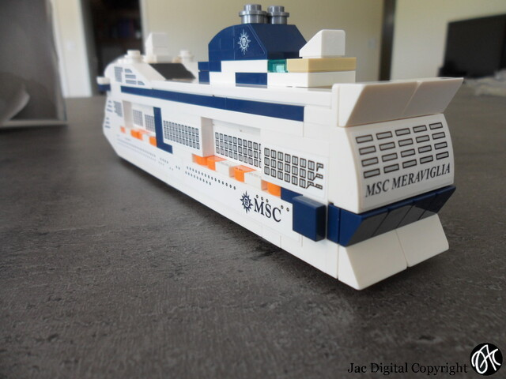](https://www.freelug.org/IMG/jpg/photo_10_.jpg)

Il reste quelques pièces à la fin de la construction. Toutes les petites que l’on risque de perdre.

[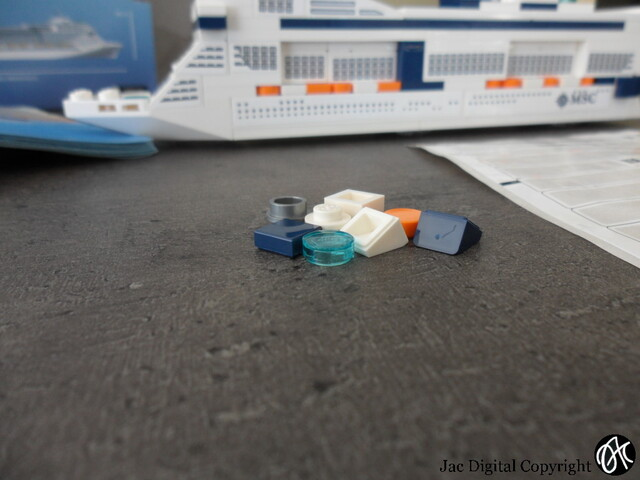](https://www.freelug.org/IMG/jpg/photo_9_.jpg)

Il n’y a rien de particulier à en dire.  
Ce n’est pas une série du type de la gamme "architecture". On peut se dire que ce set est destiné à un large public et pas à des collectionneurs...

Je réfléchissais pour faire une dernière vue en situation du bateau construit en LEGO mais finalement j’ai opté pour une autre solution. Cette construction ne flotte pas et n’est pas du tout destinée à cela. Alors l’idée m’est venue de lui faire un socle, comme pour les maquettes. Et là, problème, le fond tout plat de la coque apparaît ! Il faut absolument changer ça. J’ai donc cherché sur internet des photos du paquebot en cale sèche. Grâce à quelques bonnes photos j’ai pu tenter de reproduire la partie immergée du bateau. J’ai juste du changer des couleurs car une bande de peinture noire sépare la coque rouge du reste bien blanc du navire. Je n’ai pas pu placer les hélices dans les trous de l’avant, après le sonar. Mais je suis assez satisfait de mes "pods" moteur. L’autocollant de présentation n’existe pas, il est virtuel. Évidemment, encore une construction que je ne garde pas "sortie de boite" !

Finalement c’est comme ça qu’il est le mieux présentable à mon gout ! Il peut maintenant avoir une bonne place en vitrine.

[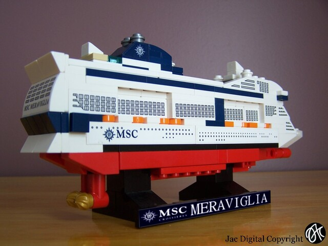](https://www.freelug.org/IMG/jpg/photo_13_.jpg)

[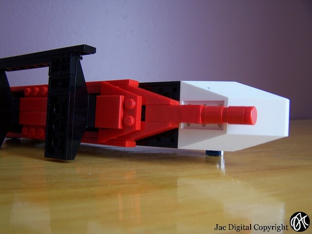](https://www.freelug.org/IMG/jpg/photo_15_.jpg)

La galerie complète :  
[40227 Meraviglia](http://photos.freelug.org/main.php/v/JAC/review/40227/)
