Pour la troisième année consécutive, FreeLUG a participé au Mondial du Modélisme, qui se tenait du 31 mars au 9 avril au Parc des expositions de Paris Le Bourget. Voici le récit de nos aventures quotidiennes !

## Vendredi 30 mars : l’installation

Et oui, pour nous le salon débute réellement la veille, même si les préparatifs ont commencé depuis plusieurs mois.

Didier et Gilles sont les premiers arrivés et prennent possession du stand. Les premières tables sont installées. Denis les rejoint, suivi de moi-même en début d’après midi. Arrive enfin à 16h30 la famille Bréard-Guilbert avec le tiers manquant du réseau et des tables. Vauban est passé entre temps nous voir et nous encourager.

Les choses sérieuses peuvent commencer. Brice puis Jérémy rattrapent le montage en cours.

Après la chute de la montagne de Denis quelques mètres avant le stand, l’affaissement de ma fusée (et dire que je n’avais pas refait la même erreur pour le transport qu’à l’AG...), l’explosion de la fameuse crocodile de Médérik qui a chuté du chariot, c’est ma BB17000 En Voyage qui a eu droit à un vol plané depuis le haut de la table lors des tests 9V... Une journée normale diront certains, tandis que d’autres diraient "On reconstruit et c’est reparti !"

D’ailleurs, certains étaient plus occupés à construire qu’à reconstruire... Médérik construisait son port sur place, avec les pièces encore dans les sachets du LEGOFactory. Quand on connait la taille de son bateau, ça vous laisse imaginer la taille du quai...

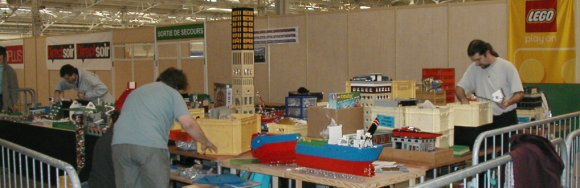

_On a les tables, mais où est le courant ?_

Cette année, bien décidés à ne pas subir les aléas des tables qui arrivent tard le soir comme l’année dernière, nous sommes enfin équipés de tables gracieusement données à FreeLUG par une société qui se débarrassait d’une partie de son mobilier. Mais cette année, c’est le courant qui faisait défaut... une histoire de différents prestataires, de facturation, bref, notre stand n’avait pas droit à l’électricité. Le courant arrive quand même vers les 17h30, ce qui nous permet de tester les premiers équipements électriques. Mais on nous a menacé de recouper le courant plus tard en soirée...

_21H20 : boucle 9V bouclée !_

Enfin, une locomotive parcours la globalité du parcours. Le 12V fait ses premiers tours de roues vers 22H00, alors qu’il ne reste que quelques courageux : la famille Bréard-Guilbert et moi-même. Le hall est bien désert à cette heure-ci. Nous quitterons les lieux 20 minutes plus tard, pour espérer trouver un lieu où remplir nos ventres affamés et se réchauffer de la faible température du hall (les gants n’étaient pas loin).

## Samedi 31 mars

Bonne nouvelle, nous avons du courant pour le reste du mondial :)

Ce premier jour s’est bien passé : le public est présent et nombreux.

Cette première journée a été consacrée... au montage :) Et oui, même après l’ouverture. A 16H00, Médérik n’avait toujours pas fini d’installer son port alors que Pascal s’affairait aux détails de sa ville, au point de ne laisser tourner qu’un 7745 (ou une vapeur quand elle n’était pas cassée) pendant toute la journée, ses autres trains 12V étant toujours dans les caisses.

Notez les sacs en plastique sur la table, et bien dimanche matin, ils seront toujours là :)

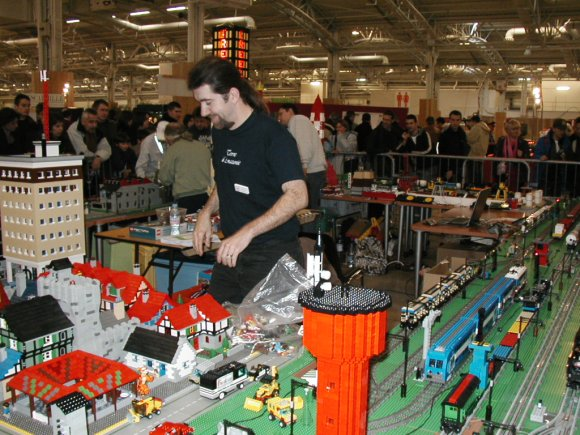

De mon côté, je me suis occupé (quelques instants) avec la (re)construction du 7991, le nouveau camion poubelle ainsi que du 7998, le nouveau camion benne, ces deux modèles ne sortant qu’au mois de Juin. LEGO nous a en effet envoyé les 7991 et 7998, pour les présenter en exclusivité au Mondial du Modélisme. Le [montage du camion benne fait l’objet d’un article](/articles/montage-commente-du-camion-benne-7998/).

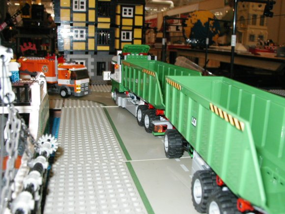

De son côté, Brice construisait la [crocodile du Kit Hobby Train](/articles/lego-hobby-train-10183/), également fourni par LEGO.

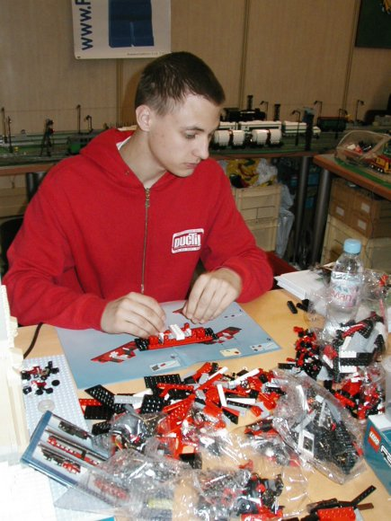

**Module de Denis**

Commençons le tour de tables qui s’étalera sur la semaine. Voici le module de Denis avec le moulin à papier que vous avez déjà pu découvrir à [Quincy Sous Sénart](/articles/compte-rendu-de-l-exposition-quincy-sur-rails/) ou bien à [Orléans](/articles/compte-rendu-de-l-exposition-de-modelisme-ferroviaire-d-orleans-2006/) ainsi que Pithiviers. Denis présente à travers son module la fabrication du papier à partir d’un moulin à eau. La roue fonctionnelle grâce à l’eau coulant de la rivière entraine la mécanique nécessaire au pétrissage de la pâte à papier.

Roger, le père de Médérik installe les caténaires, attention à la haute tension !

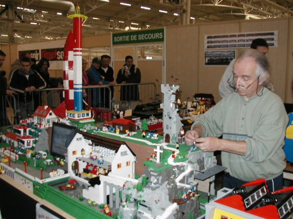

## Dimanche 1er avril

Incroyable, aucune casse ou chute de train aujourd’hui ! Et ce n’est pas un poisson d’avril. Bon, on a quand même frôlé la catastrophe....

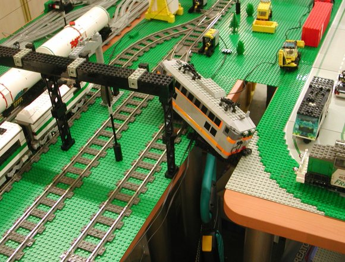

Pour ce dimanche 1er avril, nous avons affrété un train spécial qui a bien fait sourire le public.

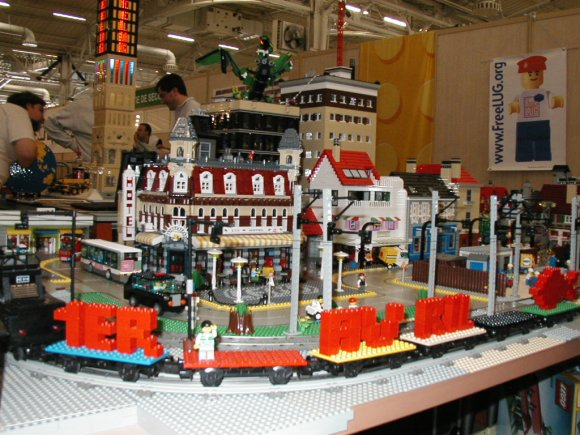

Remercions Sébastien, Jean-Claude et son fils Xavier d’avoir fait le déplacement spécialement pour venir nous voir, ainsi que les deux nouveaux membres pour avoir adhéré sur place. Laurent s’est plongé rapidement dans l’ambiance après avoir discuté longuement avec Gilles, au point de décider de revenir mercredi pour aider les quelques exposants qui seront présents à maintenir le stand.

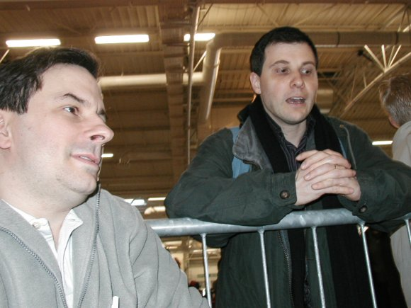

Comme annoncé, Pascal était toujours dans l’installation quand nous sommes décidés vers les 17h00 à lui apporter une aide dont il se serait bien passé : mettre toute sorte de minifigs étrangement équipées dans des situations cocasses dans sa ville :)

**Module de Didier**

Le module du jour est celui de Didier. Il a apporté une usine de motos. Derrière la grande baie vitrée se trouvent trois carrousels (donc rotatifs et motorisés par un moteur) montrant les différentes étapes de montage de la moto.

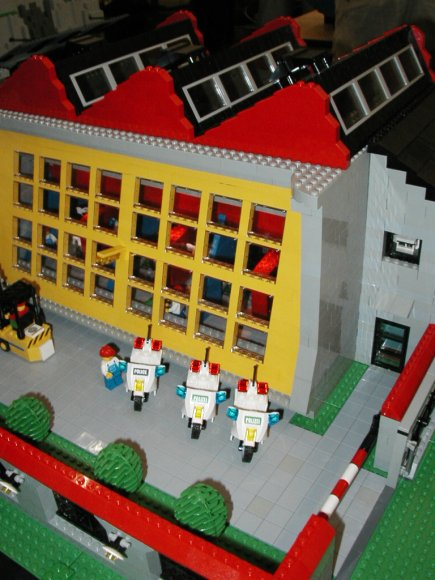

## Lundi 2 avril

Troisième jour d’exposition, premier jour de la semaine, et le public est moins nombreux pour cette journée que les jours précédents. Quelque-part, tant mieux, cela nous repose de l’effervescence du week-end.

Aujourd’hui, la crocodile du kit Hobby train a été rattrapée par une rame Transilien et a fini en morceaux à terre. Quelques minutes plus tard, elle était à nouveau sur les rails, la magie des LEGO.

**Le module de Médérik**

Comme promis, c’est le port de Médérik qui a droit aux honneurs aujourd’hui. En son absence, c’est Gilles qui s’est chargé d’ajouter un peu d’animation dans la zone portuaire. Médérik est venu avec son [énorme bateau qu’il avait présenté il y a maintenant quelques années à l’Assemblée Générale](/articles/exposition-privee-freelug-a-saint-michel-sur-orge-21-22-fevrier-2004/). Le quai a été construit sur place, avec les briques du LEGO Factory : quai, barrières, pylônes pour projecteurs... Même le hangar a été construit sur place ! La grue, fonctionnelle, dispose d’un système d’accrochage et de décrochage des containers par aimant. Le jeu est d’aller chercher les containers en fond de cale, qui n’est pas visible depuis les commandes :) Médérik a également ramené deux chaluts, caché derrière le bateau sur la photo. Gilles y a ajouté une chasse au trésor sous-marine (mais qui a caché les palmes ?) tandis que les dockers bloquaient l’accès au port en manifestant.

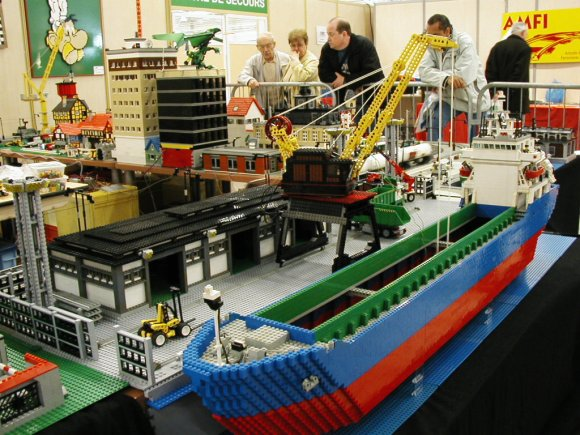

Jérémy a occupé quelques instants de sa journée en construisant une petite vapeur verte KT304.

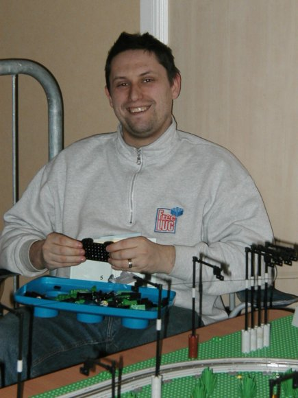

Pascal (le président de FreeLUG) nous a rendu visite pour la journée, ainsi que Jan Beyer, responsable chez LEGO de la communauté AFOL. Il a passé la journée avec nous, ainsi que la soirée qui a été partagée avec de nombreux FreeLUGiens (tout AFOL était le bienvenu). Didier (l’autre) nous a ramené [le kit Hobby Train que LEGO lui avait fait parvenir en avant première pour le présenter dans nos colonnes](/articles/lego-hobby-train-10183/), et la croco a fièrement trôné sur la table du restaurant pendant toute la soirée. Philo quant à lui a amené quelques exemplaires d’un nouveau livre sur le NXT, coécrit avec sa fille Isabelle et Michael Gasperi, _Extreme NXT : Extending the LEGO MINDSTORMS NXT to the Next Level_, qu’il s’est fait un plaisir à dédicasser en fin de soirée à quelques chanceux :)

Notons également la visite de Didier (encore un autre) et deux de ses amis AFOL, qui ont entre autre réalisé le port de Rouen en LEGO.

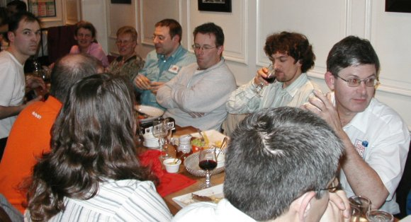

Bref, une journée bien remplie, qui s’est finie très tardivement...

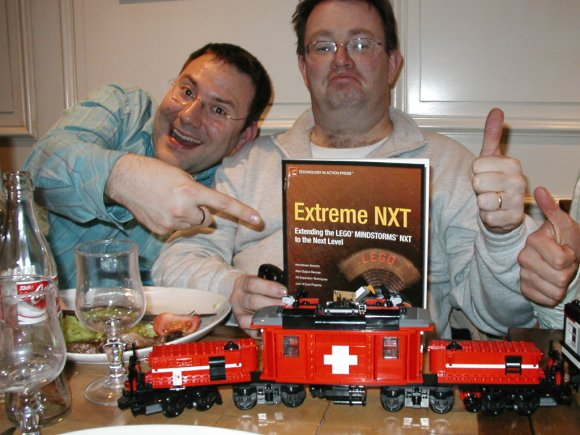

**Jan et Didier présentant le livre de Philo avec en premier plan la crocodile**

## Mardi 3 avril

La dure réalité étant ce qu’elle est, je ne peux participer tous les jours au mondial. Merci à Gilles pour le résumé de la journée.

"Un peu plus de visiteurs que lundi, mais on a pu tenir le stand à 3 même en allant ce promener. Etant le seul des 3 rigolos qui a pollué le module de Pascal, je n’ai pas  
osé le refaire car il aurait immédiatement su de qui cela venait."

**Le module de Brice**

Brice a découvert l’existence de FreeLUG il y a exactement un an, à ce même salon. Il nous a rejoint immédiatement. Aujourd’hui, il expose un pont roulant pour locomotives. Les commandes, cachées derrière les palissades, permettent de piloter entièrement le module.

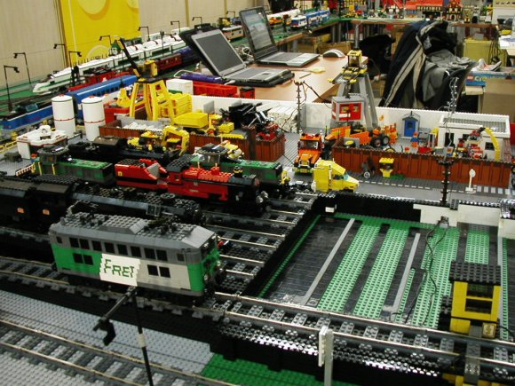

En tant que passionné de grues, Brice a également amené une grue, qui ici permet l’installation d’une antenne téléphonique sur le toit d’un château d’eau prêté par Philippe. Car même si ce dernier n’a pas pu être présent sur le stand faute de temps, il a tout de même souhaité participé en nous laissant quelques créations. La grue a tantôt permis le vol spectaculaire d’un distributeur automatique de billets auquel était toujours accroché le voleur !

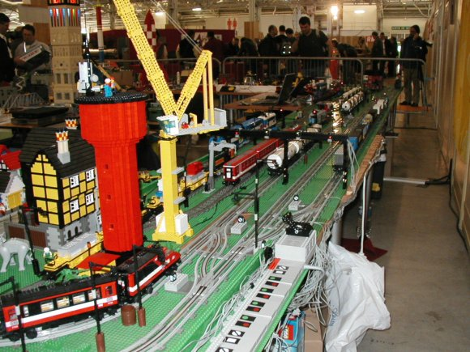

## Mercredi 4 avril

_Commentaire de Gilles, encore une fois_

Aujourd’hui jour des enfants, plus de monde mais sans atteindre la fréquentation du week-end. Nous étions 5 à tenir le stand (Laurent qui s’est inscrit dimanche est venu nous aider) plus deux accompagnatrices qui ont même répondu aux questions des visiteurs (c’est vrai que nos femmes en nous entendant finissent par connaître les briques LEGO).

Avec les enfants les questions et les réflexions augmentent : Combien il vous a fallu de temps pour faire cela, combien de briques, comment vous faites. Des LEGO, des Playmobil (de temps en temps) waouh, génial, regarde il y a de l’eau, un train en LEGO, ça bouge, une balançoire, oh Spiderman  
(à mon avis il y en a au moins 6 sur le réseau suivant nos  
inspirations...)

Nouvelle animation sur notre stand : mes filles se sont achetées des petits hélicoptères qui ont survolé le réseau en occasionnant quelques crashs. Cela nous a amusé un bon moment et plusieurs personnes de notre stand ainsi que des visiteurs sont partis s’en acheter.

Pas d’accidents de train, mais des évènements spectaculaires : un fil a lâché sur la grue de Brice, patatras elle se disloque et tombe. Caténaires  
endommagés, un train qui arrivait à ce moment a alors déraillé. Après un peu de remontage tout est revenu normal. Enfin il reste des briques de la grue mais elle est debout.

J’étais en train de filmer et un bruit de chute survient : la nacelle de la tour panoramique de Denis se détache et fait une chute de 20 à 30 cm. Le plus beau c’est que j’ai les images sur mon film !

Une de mes filles a fait dérailler un train avec la tête en se cognant dans la table par laquelle nous accédons au milieu du réseau. La tête et la table vont bien. (NDLR : Gilles ne nous dit pas si le train va bien ;) )

_Fin du commentaire_

Mercredi, cinquième jour d’exposition, et Pascal continue d’installer son module : aujourd’hui, c’était la pose de poteaux électriques.

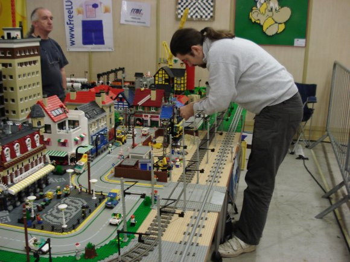

**Module de Jérémy**

Derrière le module de Brice, on découvre le dépôt de chantier de Jérémy : grues, engins de BTP et divers matériaux sont entreposés ici en l’attente d’une  
nouvelle construction dans la ville. A l’origine, il devait s’agir d’une casse automobile. Jérémy a également apporté son globe qu’on aperçoit sur la photo.

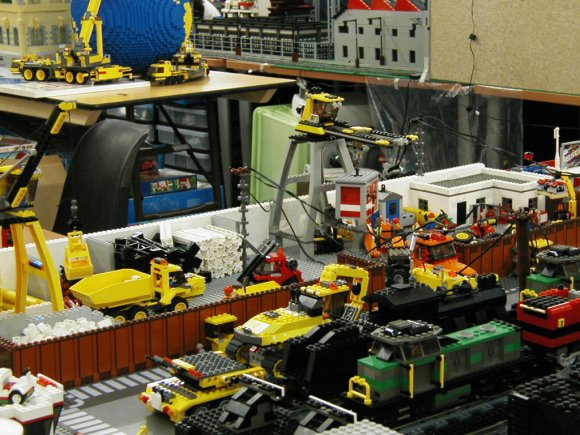

## Jeudi 5 avril

**Module de Gilles**

Gilles est en fait venu avec deux modules : un petit parc de jeux et sa ligne de metro automatisée. Le parc de jeux est animé : le tourniquet tourne, la balançoire balance, le tape-cul tape le... heu monte et descend. La balançoire  
intrigue le public : par quelle magie est-elle animée ? Le métro automatique, déjà présenté à Orléans, est quant à lui apprécié des Parisiens.

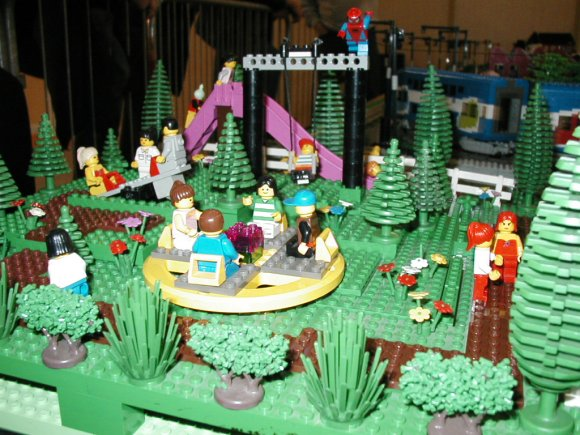

Gilles a également apporté la grande tour éclairée qui siège au milieu du stand.

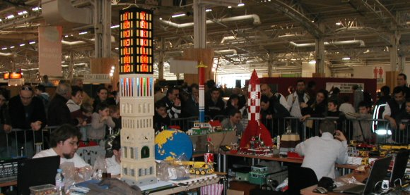

## Vendredi 6 avril

De retour au salon jusqu’à la fin, je reprends la rédaction du résumé. Hier et aujourd’hui, Richard (de Lille) est venu nous apporter un coup de main. Il en a profité pour amener sa locomotive américaine (dont le nom ne cesse de m’échapper) ainsi qu’une pompe à eau pour vapeurs.

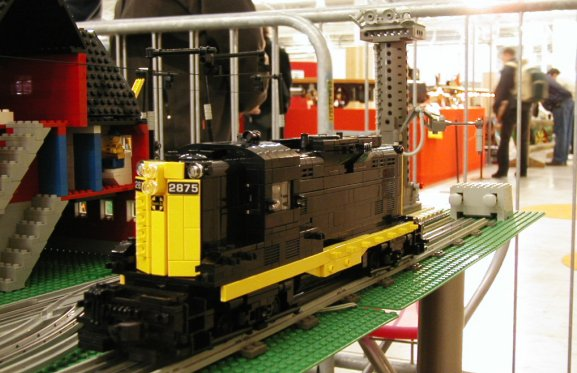

Richard, spécialiste du coup de crayon (il prépare un article à ce sujet) prépare les croquis de bâtiments modulaires pour ville dont il avait abordé l’idée il y a quelques temps. Il s’inspire du travail réalisé par Pascal pour sa ville.

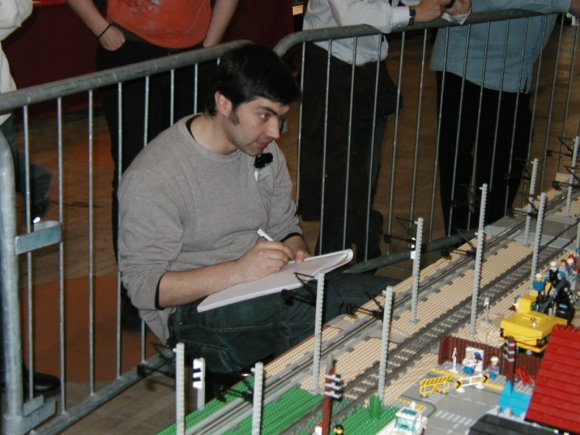

Manu, qui n’est pas venu, m’a laissé ce vendredi matin avant de partir au boulot un petit module à placer sur le stand : des jeunes en train de s’essayer aux voitures télécommandées. La petite voiture réalisant des ronds a remporté un joli succès, notamment auprès des amateurs de véhicules radio-commandés (n’oublions pas que nous sommes dans un salon de modélisme).

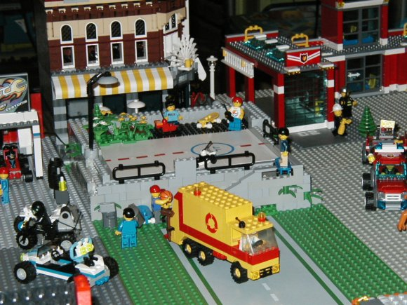

Enfin en soirée, alors que les visiteurs désertaient le hall, Pascal s’est essayé au pilotage d’un hélicoptère équipé d’une caméra pour filmer le réseau vu du ciel. Le cadrage n’était pas fameux, mais le vendeur de l’hélicoptère devrait venir samedi matin pour nous le faire.

**Module d’Erik**

Voici le tour de mon module. J’ai apporté la fusée de Tintin que j’avais présentée à l’AG. Indéniablement, elle attire l’oeil du public qui la reconnait sans problème, à l’exception de cette grand-mère : "Oh regarde, la fusée Ariane !". Le module est complété par les incontournables vaches qui tournent la tête au passage des trains et par une voie de garage désaffectée sur laquelle rouille une vielle locomotive. L’usine abandonnée abrite le RCX qui pilote les vaches.

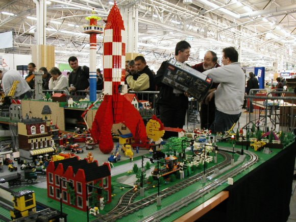

## Samedi 7 avril

Huitième jour d’exposition, et quel jour ! Que de monde, ce doit être la journée la plus chargée depuis le début du salon. Il est même arrivé un moment où le public n’arrivait plus à avancer devant les barrières du stand.

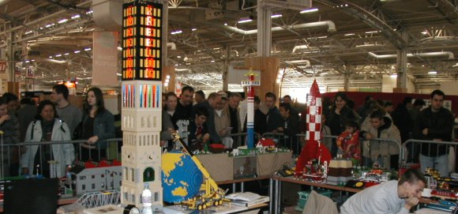

Aujourd’hui, c’est Alain et sa compagne qui sont venus de Toulouse rien que pour nous voir (enfin, le compromis avec Madame était d’en profiter pour aller visiter le château de Versailles dimanche...).

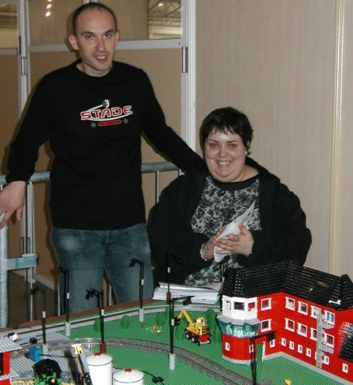

Alain est venu avec une locomotive modifiée du 7898. Avec celle de Pascal expédiée chez Didier pour la recevoir pour le Mondial (enfin, pendant), cela nous a permis de faire une petite course de trains à piles au milieu de la circulation des trains 12V et 9V. Collisions et chute de table au programme ! La télécommande infra rouge, c’est cool, mais pas à l’autre bout du réseau à 10m de distance dans un hall d’exposition.

**Module de Pascal**

Aller, depuis le temps qu’on en parle, voici le module de Pascal, une grande ville où se mélangent anciens remparts ("de 1984 !"), maisons à colombage et immeubles modernes (qui servent quand même de support à un dragon). La ville met en valeur le nouveau Corner Café, ici deux exemplaires fusionnés et aménagés. La place est un pavage représentant le logo LEGO.

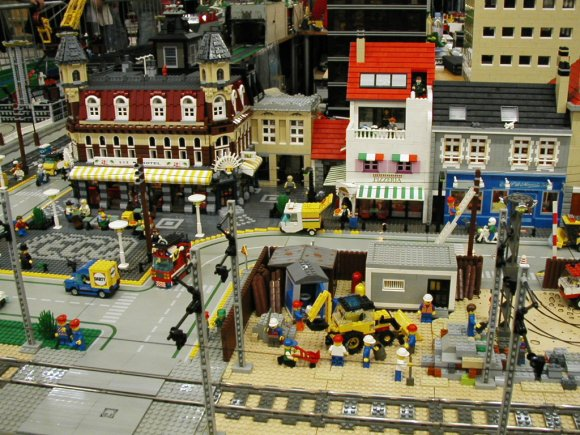

Pascal, qui est souvent occupé à présenter le fonctionnement du pupitre de commande 12V ou sa pelleteuse pneumatique avec compresseur automatique régulé, ne peut porter son attention sur quelques-uns de ses camarades de jeux qui plaçaient toute sorte de minifigs dans les ruelles (ou coupe gorge) de sa ville médiévale : un storm en train de se faire servir une burette d’huile sur la terrasse du café, un droïd postant une lettre, un monsieur se promenant avec un ours bleu, un Bobba Feet dans un cabriolet rotatif etc. Il a profité de notre absence en semaine pour faire le ménage (le fourbe !) mais qu’on se rassure, il risque de découvrir de nombreuses choses lors du démontage. Heureusement qu’il ne lit pas ces résumés durant le salon ;)

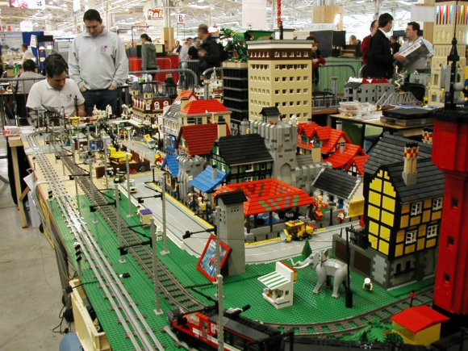

Sa pelleteuse pneumatique impressionne le public (et nous aussi) par son fonctionnement miniaturisé.

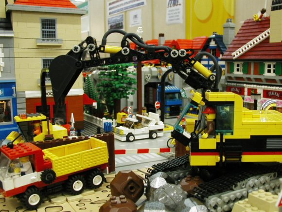

## Dimanche 8 avril

Aujourd’hui dimanche de Pâques, nous avons affrété un train spécial.

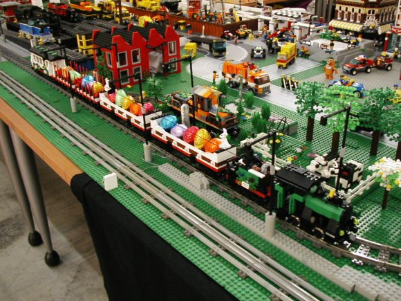

Basé sur la petite locomotive construite par Jérémy quelques jours avant et les wagons provenant de deux trains de Noel 10173, ce train véhiculait des oeufs en chocolat. Le jeune public (et moins jeune) tendait vainement les bras au dessus des barrières pour essayer d’attraper un oeuf au passage du train :)

Virginie et son mari sont passés nous dire bonjour sur le stand (saluons une des rares femmes dans le monde des AFOLs), ainsi que Michel.

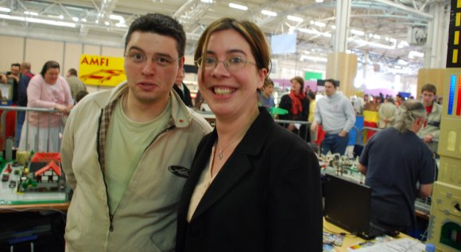

Une autre soeur de Médérik (la famille Guilbert-Bréard est nombreuse !) est également venue découvrir en vrai ce que font son frère et le mari de sa soeur, aidés par son père (vous suivez ? :) )

La journée s’est bien passée : un peu moins de monde que la veille, quelques accidents de train, un peu de chocolat...

Elle s’est terminée par l’intervention du vendeur d’Euromodel, Vinh, qui avait vendu un hélicoptère télécommandé à Pascal pour faire une petite séance de vol au dessus du réseau, l’hélicoptère ayant été équipée d’une petite caméra numérique. Après avoir bluffé tout le monde par sa maitrise de l’hélicoptère et l’atterrissage sur l’héliport improvisé dans l’après-midi sur une des tours de Pascal, nous avons eu le plaisir de visionner le film sur le PC : "Dis Pascal, c’est normal que ce soit tout jaune ?" "Tu n’aurais pas mis la caméra à l’envers là ?"

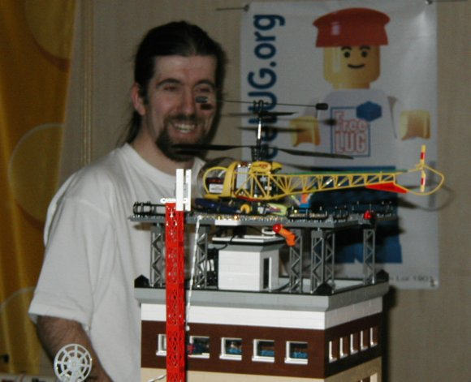

Le pilote a donc effectué un second vol écourté par l’autonomie des batteries. Le rendez-vous est donné au lendemain matin pour une nouvelle prise, mais les premiers extraits donnent envie.

En tout cas, ce fut encore une belle façon de se faire remarquer au milieu des autres modélistes :)

**Zone de triage**

Occupant toute une longueur du réseau, la zone de triage des trains ne peut rester sous silence, d’autant qu’elle présente quelques particularités.

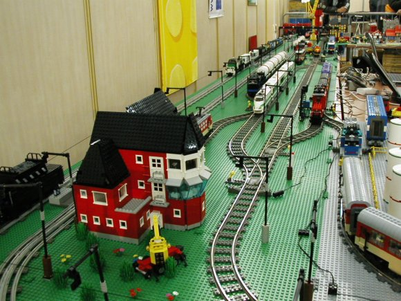

Pascal explique le fonctionnement des commandes 12V : feux, aiguillages, et fait des démonstrations de changement de trains.

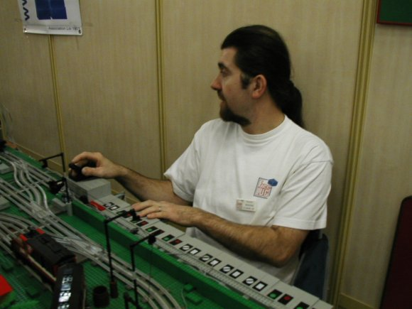

Côté 9V, la chose est entièrement automatisée par ordinateur. La pièce maitresse est l’emploi d’une interface Dacta (set 9751) qui est reliée au PC. J’ai entièrement développé l’application permettant la rotation de trains : 3 trains sont garés tandis qu’un quatrième circule. Après avoir effectué un certain nombre de tours, un train au garage est choisi, libère la place et celui qui  
circulait se gare. Cela permet une rotation régulière des trains et donc de proposer quelque chose de nouveau régulièrement au public mais également de laisser reposer les moteurs. Des capteurs de luminosité détectent les passages des trains, des moteurs commandent les aiguillages (et donc l’alimentation des voies) tandis que des feux régulent la circulation. Tout ceci sera l’objet d’un prochain article.

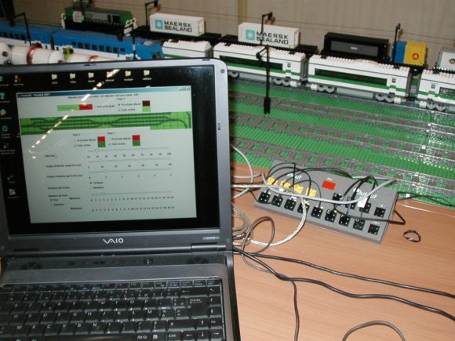

Pour donner quelques chiffres, c’est environ 1000 passages de train par jour d’exposition, soit à peu près 110 tours par heure. Au cours de la journée du lundi 2 avril, avec trois tours par train soit plus de 300 changements, seuls 6 ou 7 accidents de train ont eu lieu, les 2 premiers jours ayant été consacrés à la mise au point du système.

## Lundi 9 avril

Dernier jour d’exposition, la fatigue s’affiche sur tous nos visages. La journée se déroule tranquillement mais parait bien longue. Les visiteurs sont présents mais ce n’est pas la foule du samedi.

Le matin, avant l’ouverture, Vinh refilmait le réseau. Cette fois ci, c’est dans la boite, avec la chute de la grue de Brice due au souffle de l’hélicoptère !

Denis est revenu après son absence durant la semaine et gagne le droit de reprogrammer ses RCX et faire un peu de maintenance sur sa tour panoramique. Le salon, ça use les éléments mécaniques : une petite roue dentée Technic cassée, et voilà la tour bloquée.

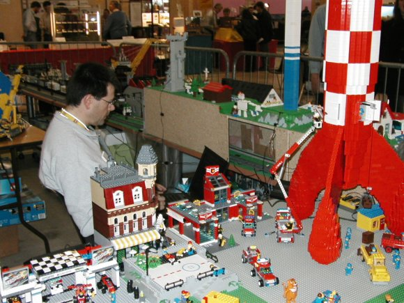

Médérik est pris au vif en train de prendre un oeuf sur le train de Pâques. La chaleur commence à faire fondre le chocolat.

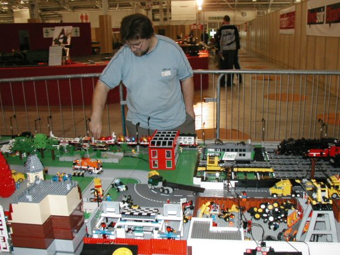

L’après-midi, Pascal est allé faire barboter le bateau pompier dans le grand bassin, juste après une animation. Les tribunes étaient encore pleines quand le bateau LEGO évoluait dans le bassin !

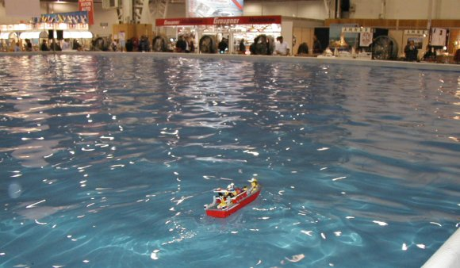

18h00, nous atteignons les 1000 tours de trains 9V de la journée, la première fois en 10 jours que le programme tiens aussi longtemps :). Nous débouchons les bouteilles, prenons une photo de groupe. Ce cap donne le départ du démontage : caténaires, poteaux électriques, petits éléments de décors sont progressivement retirés du réseau pendant que le public de plus en plus rare en cette fin de salon nous observe dans cette tâche de destruction.

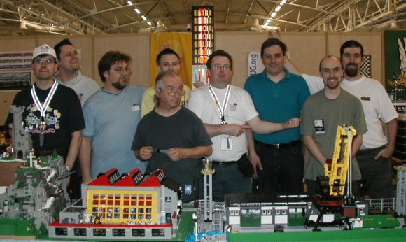

**Photo de groupe**

De gauche à droite : Denis, Jérémy, Médérik, Roger, Brice (derrière), Didier, Gilles, Erik, Pascal

19h00, le salon ferme ses portes alors que les stands de modélisme traditionnel sont déjà bien avancés dans le démontage. Chez nous, les trains tournent toujours.

Le démontage se poursuit : véhicules, bâtiments, puis trains, rails, plaques de base, tables... tout reprend plus ou moins bien place dans les cartons ou caisses, avec les traditionnelles questions : A qui est ce transfo ? A qui est cette rallonge ? A qui est cette plate 2x2 verte ?

La voix off du salon nous annonce le bilan : 85 000 visiteurs sur les 10 jours. C’est moins qu’espéré, mais le pari de faire vivre le Mondial du Modélisme est gagné.

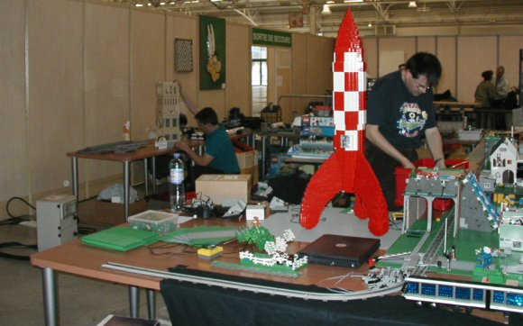

Nos voisins de la FFMF qui quittent le salon les uns après les autres viennent nous dire au revoir, nous félicitent et nous souhaitent bon courage pour la suite du démontage.

Dernier installé, dernier désinstallé : Pascal range sa ville avec un gros challenge : faire rentrer dans le Kangoo toute sa ville et le module de Médérik, alors que le tout était venu en deux véhicules. Tout le monde participe à la tâche : démontage, explosion de boites LEGO, transvasement de briques entre caisses. Il faut que ça rentre !

C’est à 22h00 bien passée, après une petite collation offerte par la FMMF, que tout sera enfin chargé, ne laissant plus beaucoup de place dans le coffre. C’est l’occasion d’une dernière photo de groupe, tout le monde est encore présent sauf Médérik reparti en train quelques heures auparavant, et oui, c’était lui ou les LEGO :)

Le salon est déjà bien vide : il ne reste plus que quelques professionnels en train de ranger leurs produits.

Après avoir raccompagné Brice chez lui, je rentre bien fatigué mais heureux chez moi, et ce salon se termine comme il commença : à deux mètres de la porte du garage, la fusée de Tintin explosa à terre...

Je remercie toutes les personnes qui sont passées nous voir, nous aider le temps d’une journée ou deux, ou qui m’ont fait part d’avoir apprécié la lecture de ce petit journal, ici, sur le chat ou bien directement au salon.

Ainsi s’achève ce résumé au quotidien.

Galeries de photos  
**–** [Photos de Didier](http://photos.freelug.org/main.php/v/La-Gallerie-de-qdm/Expositions/Mondial-2007/)  
**–** [Photos d’Erik](http://www.brickshelf.com/cgi-bin/gallery.cgi?f=247375)  
**–** [Photos de Pascal](http://www.brickshelf.com/cgi-bin/gallery.cgi?f=232490)

FreeLUGuement,

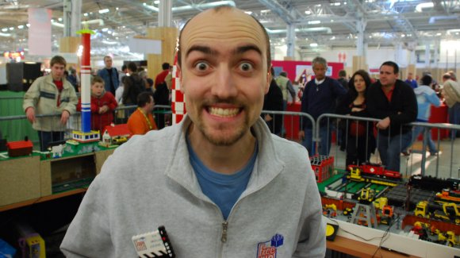
