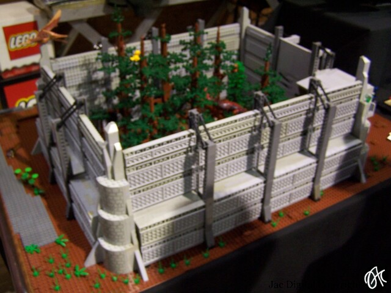
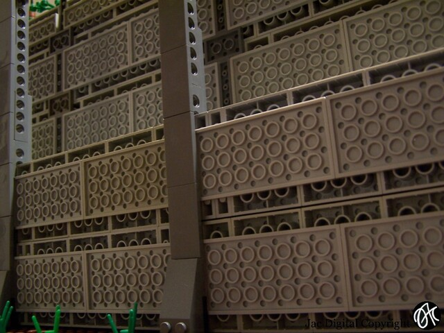
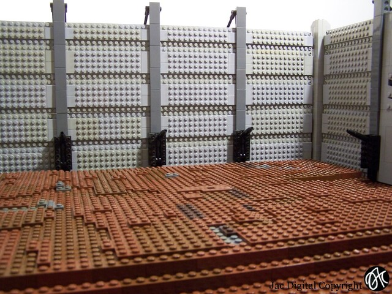
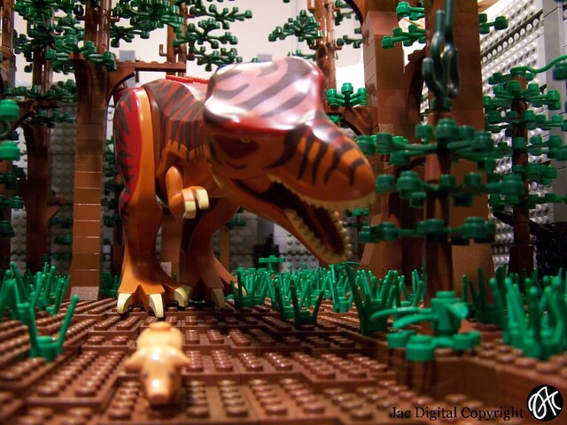
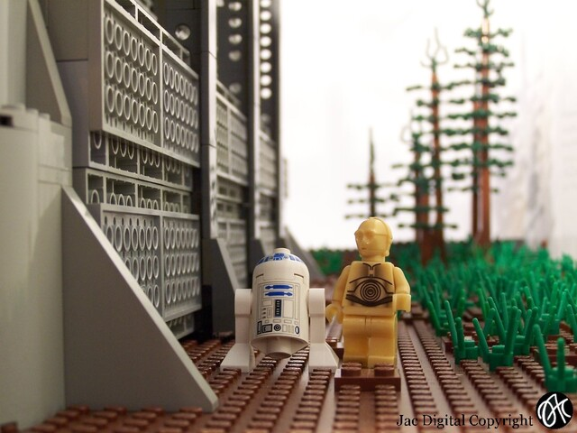
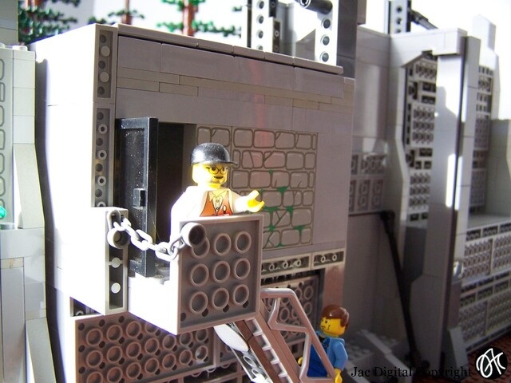

J’ai voulu reproduire le parc de l’indominus rex, le méchant héros de Jurassic World ; voilà quelques éléments de ma procédure de construction.

J’aime bien créer de nouvelles choses lors de mes participations à la convention Star Wars et science-fiction qui a lieu chaque année à l’espace Chambon de Cusset (03). Pour 2019, après quelques réflexions et essais, je me suis lancé dans la création du parc d’un dinosaure assez violent et très malin, l’indominus rex. Il est la star du film Jurassic World, dans lequel il crée une belle pagaille.

Après quelques recherches sur l’internet, j’ai trouvé seulement 3 photos qui m’ont permis de me faire une idée du parc. Heureusement, les passages du film qui le concernent ont apporté quelques éléments de détail supplémentaires. En revanche, certains endroits ont été construits par intuition. Le parc n’est pas très grand comparé à la taille du dinosaure, mais c’est justement le problème développé dans le film.

J’avais aussi en tête un cahier des charges : un parc pas très grand, ce qui est commode pour les pièces, ainsi que de la place devant la porte pour placer les véhicules et quelques personnages. Je voulais également, dans ma construction, que l’on reconnaisse la porte griffée et que le poste de contrôle avance légèrement sur le parc avec un accès extérieur comme dans le film. Comme pour toutes les expositions, je privilégie le côté modulaire et prévois donc le décor par plaque de 32x32 pour pouvoir le transporter plus facilement.  
Tout est démontable ; les blocs de béton s’empilent entre les poteaux.  
Pour faciliter le rangement dans mes caisses, toute la végétation sera installée sur place.

J’avais bien réfléchi à la manière de construire les murs avec des blocs de ciment gris, coincés entre des piliers IPN en métal. J’ai fait plusieurs essais pour arriver à des parois convenables et assez solides pour retenir la bête. Mais les premières versions des piliers n’étaient pas très résistantes. Je m’en suis rendu compte lorsque l’une de mes filles en a poussé un avec le doigt ! J’ai donc modifié un peu la charpente et une fois tout assemblé, l’ensemble était bien rigide.

Une fois les murs en place et le parc terminé, j’ai enlevé les murs pour construire le sol que je voulais irrégulier, terreux et recouvert de plantes vertes, d’arbres et de quelques animaux.

J’ai ensuite eu le choix entre 2 dinosaures, mais, à mon goût, c’est le marron qui convenait le mieux. Le noir issu des sets "Dino 2000" est vraiment trop gros. Ça m’a permis de réaliser quelques clichés sympathiques.

Il n’y rien à faire : il faut toujours qu’ils s’invitent à la fête ces deux-là...

Petit clin d’œil à Steven !

Je me suis posé plein de questions sur la réussite de mon projet car je savais qu’il lui manquait des choses. Mais le public a su reconnaître, et surtout apprécier la construction. Cela fait énormément plaisir. On m’a souvent signalé que le dinosaure n’était pas marron mais gris dans le film. J’ai alors expliqué que l’indominus rex avait le pouvoir du caméléon et que du coup il se confond avec la terre qui compose le sol.

En exposition, je n’ai pas pu prendre le temps de faire de belles photos. Il y avait du monde, et je préférais échanger et discuter avec le public. J’ai donc remonté tout le diorama chez moi.  
J’ai sélectionné mes meilleurs clichés :  
\[[https://photos.freelug.org/main.php/v/JAC/MOC/Diorama/IndominusPark/](https://photos.freelug.org/main.php/v/JAC/MOC/Diorama/IndominusPark/)\]
