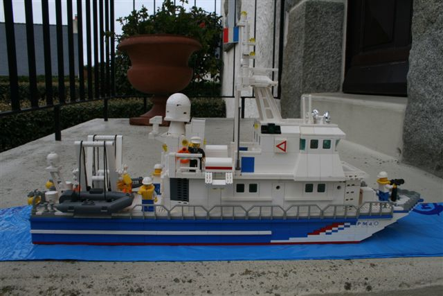
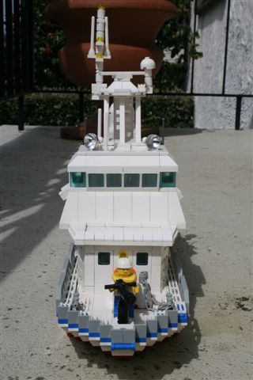
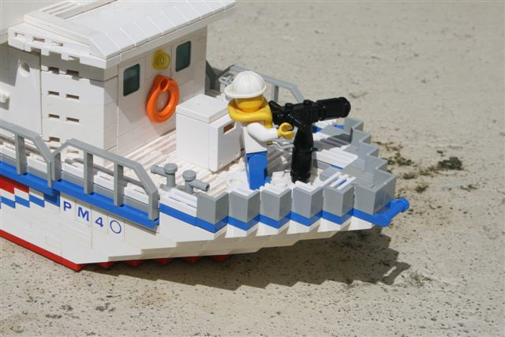
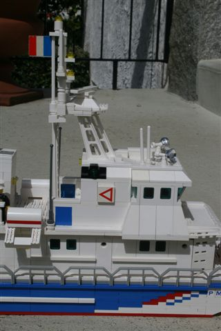
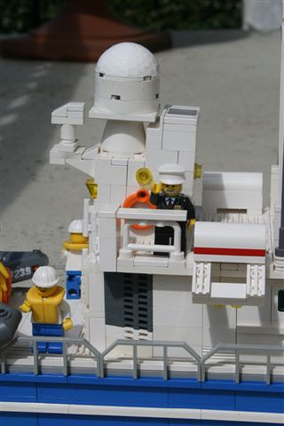
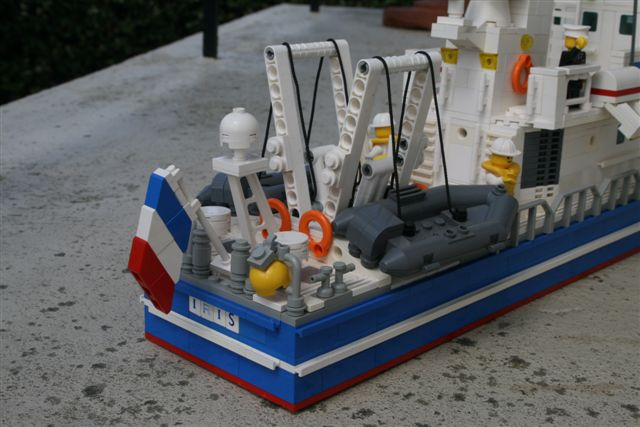
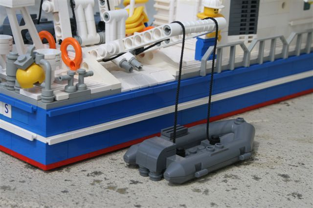
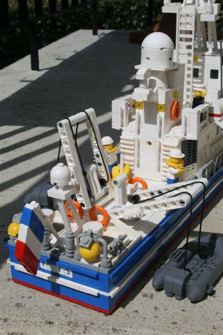

Pour ce troisième article, nous vous présentons la reproduction d’un patrouilleur des Affaires maritimes.

Le navire "patrouilleur des Affaires maritimes" peut remplir plusieurs missions. Dans les principales, il lutte contre les trafics de stupéfiants, de contrefaçons et il surveille les zones de pêche (contrôle des quotas). Tous les détails sont expliqués sur la [page Wikipedia consacrée au Patrouilleur Iris](http://fr.wikipedia.org/wiki/Affaires_maritimes).

Justement, pour cette reproduction, Jean-Marc s’est inspiré fortement du navire "Iris", présenté dans le lien ci-dessus. Il est basé à Lorient (56). C’est une des deux grosses unités de la façade Atlantique. Il couvre ses missions entre Brest et La Rochelle. L’autre unité est basée à La Rochelle et couvre la zone restante, de La Rochelle à Bayonne.

**Vue de face.**

**Vue de l’avant.**

La reproduction de Jean-Marc mesure 66 tenons de long, sur 12 de large. Sa plus grosse difficulté a été de reproduire le navire avec une seule photo, au début. Du coup, beaucoup d’éléments étaient compliqués à placer : la cheminée, les détails de la proue... C’est avec l’aide d’un maquettiste de Crozon, qui lui apportera quelques photos supplémentaires, dont certaines en carénage pour révision complète, que Jean-Marc put finir sa reproduction. Mais, finalement, il n’y avait pas beaucoup d’erreurs sur la première version.

**Détail de l’avant.**

**Détail du côté, avec le mât.**

**Le radar sous dôme.**

**Détails de l’arrière.**

Comme le vrai, le modèle est équipé d’un petit canon à l’avant, d’une mature complète, d’un radar sous dôme, d’un petit matériel bâché à coté du radôme blanc et de deux zodiacs sur treuils fonctionnels.

**Débarquement d’un des Zodiacs.**

**Le Zodiac est prêt à intervenir...**

Les marquages sont provisoires. Ils ont été remplacés par de plus jolis avant le salon de Saint-Martin. Pas de photos pour l’instant, mais il sera facile de retrouver ce navire sur les nombreuses expositions de Jean-Marc.
