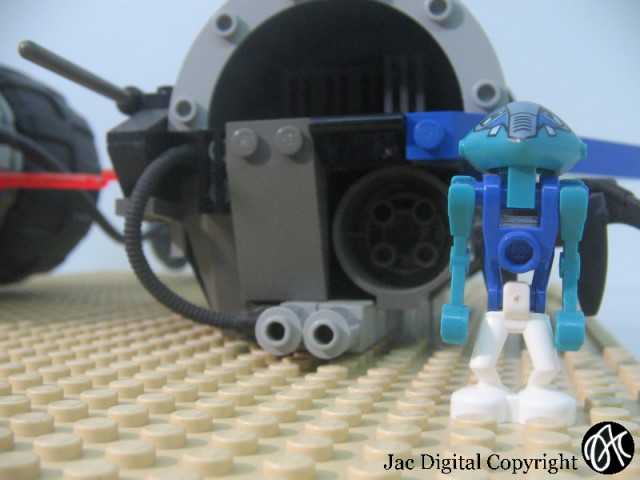
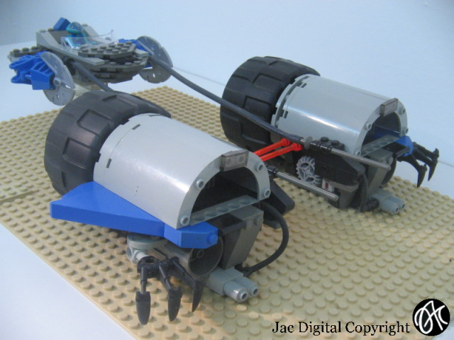
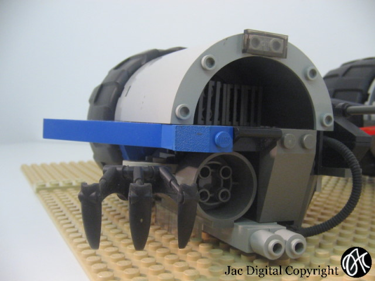
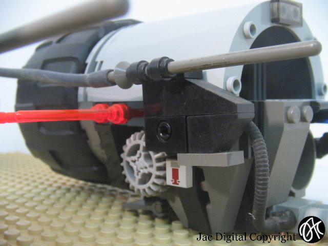
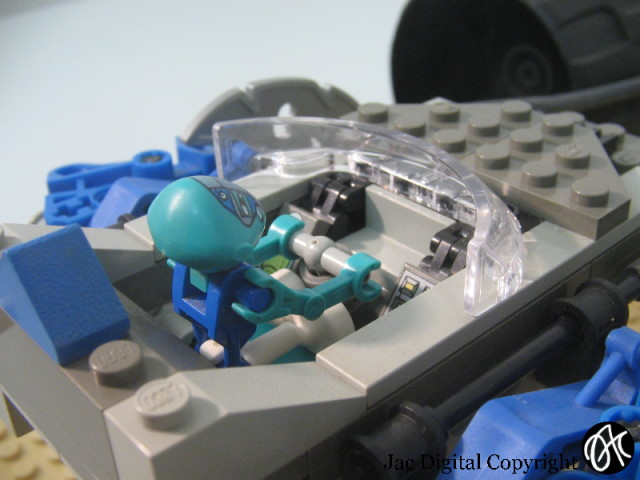
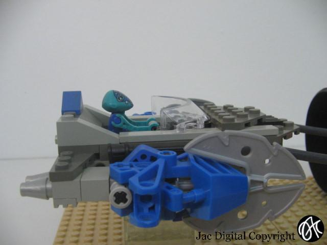
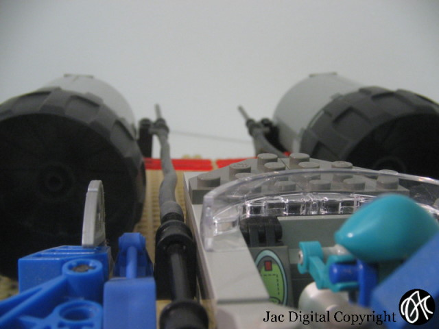

Dans le set qui représentait le stock de pièce de Watto (7186), il était possible d’inventer des pods. Voici celui de Marsimilian.

Comme quelques boîtes du [s@h](http://shop.lego.com/Default.aspx), la casse de Watto ([Watto’s Junkyard 7186](http://guide.lugnet.com/set/7186) en 2001), a eu une durée de vie très courte. Du coup aujourd’hui, il est très dur à obtenir. Je pense même que cette boîte a été oubliée. Ce qui me plaisait dans ce set c’est que l’on pouvait construire deux pods supplémentaires, par rapport au set qui en proposait trois ([Mos espa Pod race 7171](http://guide.lugnet.com/set/7171) en 1999). Une fois construit, il restait des pièces supplémentaires pour créer son propre pod et affronter le redoutable Sébulba.

N’ayant jamais pu m’acheter aucune de ces deux boîtes, juste la petite [7131](http://guide.lugnet.com/set/7131), j’ai tout de même eu envie d’inventer un pod. L’idée de construire un bolide avec deux énormes réacteurs et une toute petites nacelle reliée par deux très fins tuyaux me plaisait beaucoup. Évidement, j’ai gardé ce principe pour créer celui de Marsimilian.

Le pilote fut vite trouvé. J’aimais bien les minifigurines martiennes sorties dans les années 2000. Du coup, j’ai fait un rajout pour avoir aussi le nom du pilote.

**Marsimilien, pilote de Pod.**

Donc, comme expliqué plus haut, le pod que j’ai créé est construit sur le même principe que ceux du film, c’est à dire que l’on a deux gros réacteurs et une nacelle de commande, tirée par deux câbles. Les deux réacteurs sont reliés entre eux par un arc de canalisation d’énergie, qu’il ne faut pas traverser, au risque d’être paralysé pendant quelques minutes.

**Le Pod de Marsimilien.**

Quelques caractéristiques techniques purement inventées aussi. Mais, ça fait plus "vrai".  
**–** Modèle : Podracer "court" BY-2735  
**–** Constructeur : JAC  
**–** Moteurs : 2 réacteurs de poussée Mega-TUB XZ-24 et 2 réacteurs/accélérateur A2P-GW  
**–** Dimensions : Cockpit 3,05m ; Moteurs 4,30m ; Envergure impossible à déterminer.

Des détails des imposants moteurs :

**Vue extérieure, avec la griffe de défense.....**

**Vue intérieure.**

La nacelle a été munie aussi de défenses, grâce à des pièces Bionicle, comme quoi, tout peut servir !

**l’intérieur de la nacelle.**

**Vue de l’extérieur avec ses protections....**

Une dernière photo, pour voir la course comme si vous y étiez. Il ne manque plus que les concurrents, officiels ou non.

**Une vue de la course.....**

Si vous voulez vous aussi créer votre pod et que vous cherchez l’inspiration, il suffit de faire quelques recherches sur le net. Comme tout vaisseau de la saga Star Wars, beaucoup de sites les référencent. Pour ma part, je me suis inspiré de livres très bien faits, avec des dessins en éclaté de certains vaisseaux : plans secrets des vaisseaux et engins, edités chez Nathan.

Quelques préférés tout de même : Teemto Pagalies, Boles Roor, Mars Guo et Celui de Sebulba, bien sûr.
