Dans les nouveautés 2008, il y a le renouvellement de la gamme police, avec une nouvelle caserne, un nouveau camion, un hydravion, ainsi qu’un nouvel hélicoptère.  
C’est le poste de police que je vais vous décrire ci-dessous.

Après le poste de police [7237](http://www.peeron.com/inv/sets/7237-2), LEGO nous offre ce nouveau commissariat de police avec un nouveau logo, bleu.

## Descriptif de la boîte

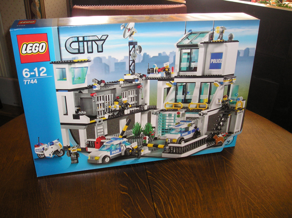

**la boite**

**–** Nom de la boîte : le poste de police  
**–** Numéro de la boîte : 7744  
**–** Nombre de pièces : 953  
**–** Date de commercialisation : janvier 2008

On la trouve sur le [shop](http://shop.lego.com/ByTheme/Product.aspx?p=7744&cn=153&d=9) et dans le commerce pour environ 90 euros.

On peut ouvrir le couvercle de la boîte pour découvrir plus de détails.

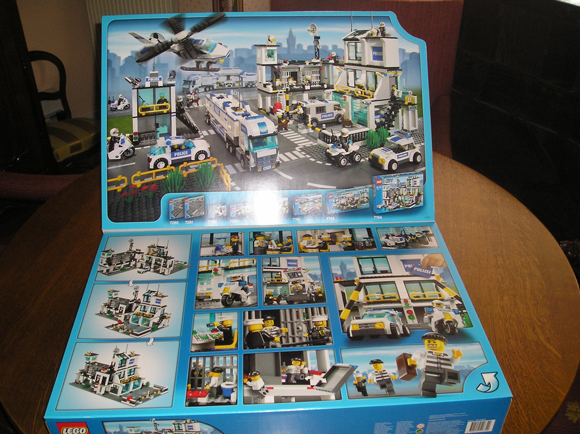

**sous le couvercle**

Derrière la boîte, on nous montre que le montage se fera en neuf étapes.

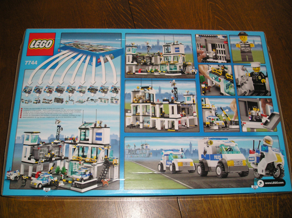

**derrière la boite**

Je trouve que neuf étapes est bien beaucoup, mais cela reste un jouet qui est destiné avant tout aux enfants, donc il faut un jeu facile et immédiat...

## Montage

En ouvrant la boîte, on retrouve donc 9 sachets numérotés, un sachet avec quelques grandes pièces, une planche d’autocollants, une plaque 16x32 en dark stone, une plaque 32x32 avec double voie en dark stone ainsi que 4 notices.

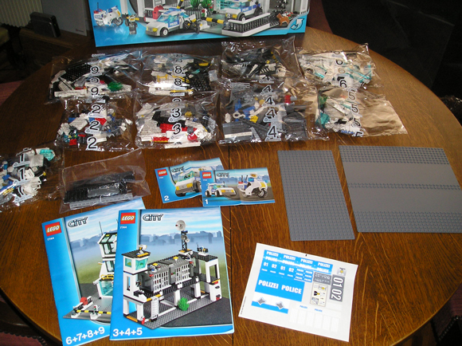

**le contenu**

A noter quelques nouvelles pièces.

Des menottes pour les méchants.

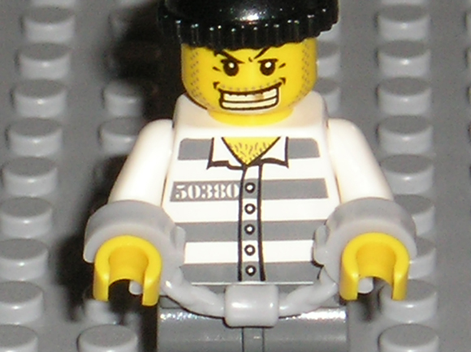

**les menottes**

Cette pièce blanche se trouve sur le capot de la voiture. Elle fait 2x4 et 2 plates de haut. Elle est creuse.  
Elle se retrouve dans la gamme Racers en noire.

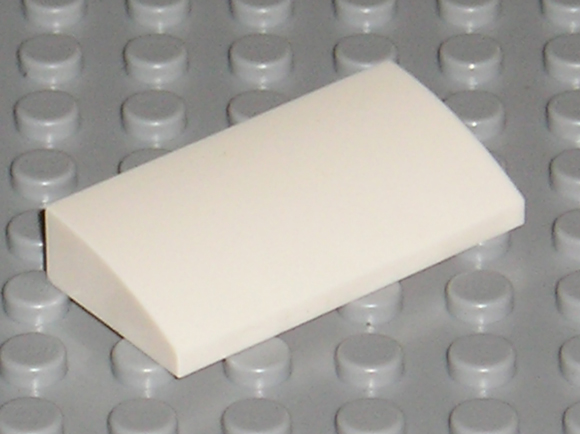

**pièce 1 dessus**

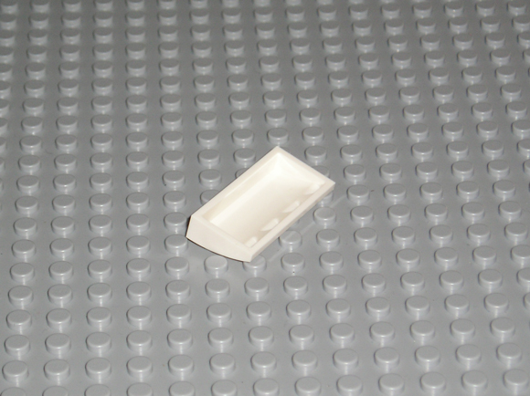

**pièce 1 dessous**

La porte de prison vient rejoindre les autres portes déjà sorties parmi les nouveautés. On retrouve le même cadre.

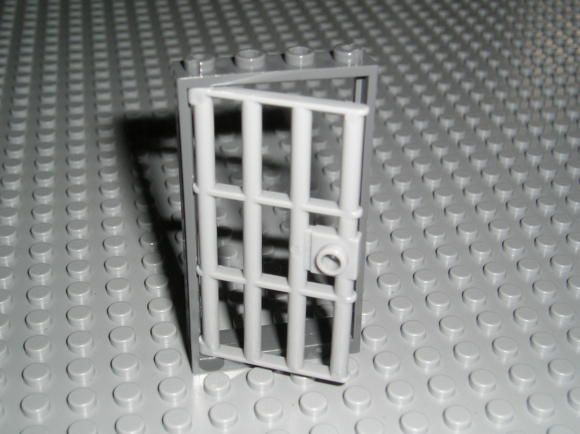

**pièce 2 porte de prison**

**–** Vient ensuite le début du montage.  
On commence donc par la première étape pour construire une moto et une voiture.

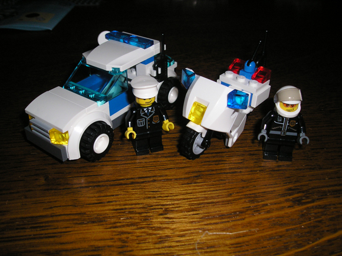

**étape 1**

Ensuite, on complète les véhicules en faisant une petite camionnette.

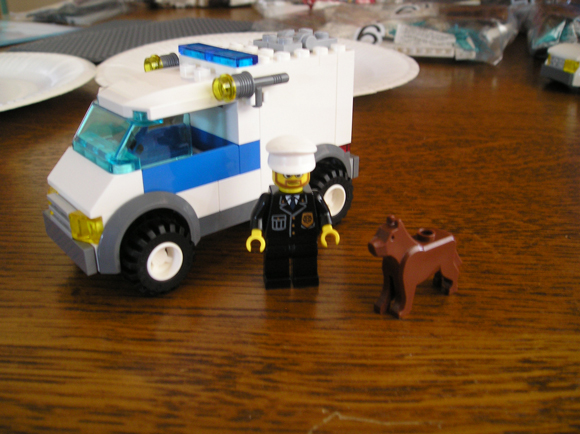

**étape 2**

Après quoi on s’attaque à la construction du premier module.

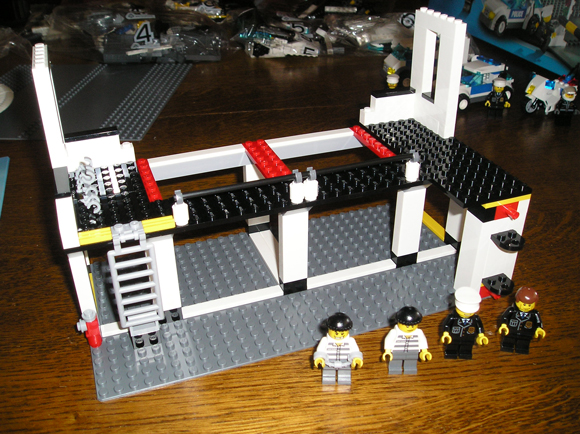

**étape 3**

La prison avec ses deux cellules.

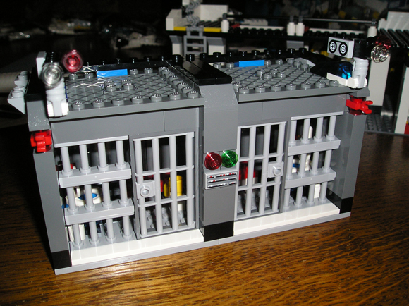

**étape 4**

Enfin après la 5e étape on passe à l’assemblage final.

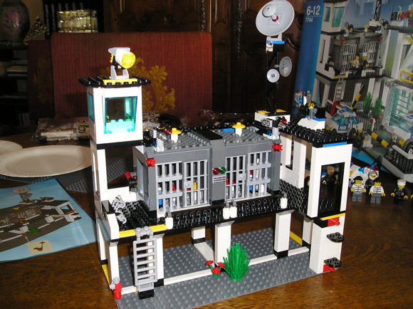

**étape 5 + 4 + 3**

**–** Après avoir construit cette première partie sans difficulté, on s’attelle à la construction du module principal.

On passe donc à l’étape 6.  
J’ai d’ailleurs été ravi de retrouver ces portes de garage que je trouve excellentes.

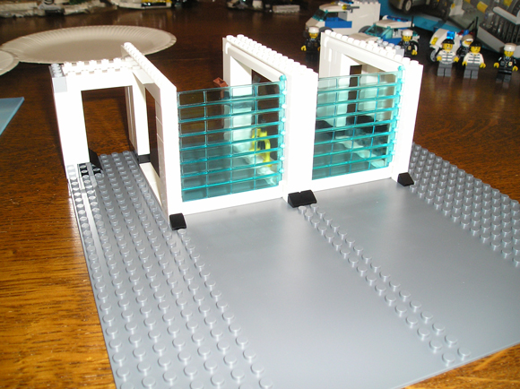

**étape 6**

On commence l’étage dans la 7e étape.

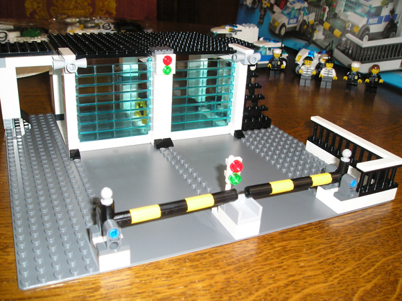

**étape 7**

Vient ensuite la 8e étape sans difficulté.

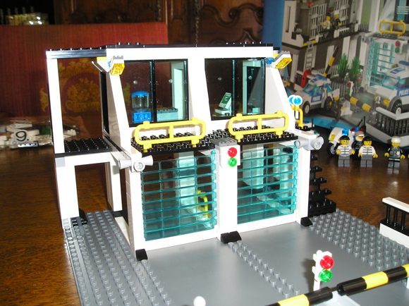

**étape 8**

Puis pour finir, nous ouvrons le dernier sachet numéroté 9.  
On finit alors le dernier étage.

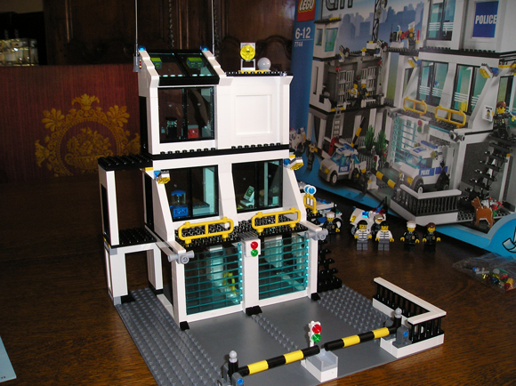

**étape 9**

On assemble alors la prison avec les bureaux et le garage.  
Cela fait quand même un bel ensemble.

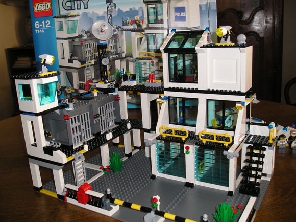

**assemblage des 2 parties**

On ajoute les véhicules avec les minifigs.  
Il y a de quoi faire avec tout ce petit monde, et ce grand commissariat.

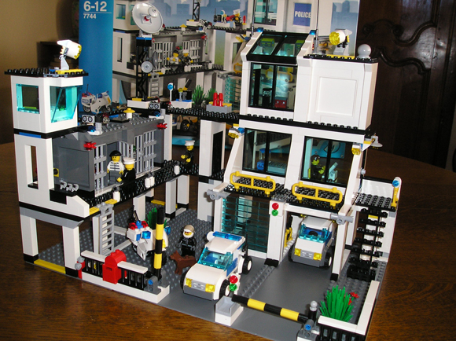

**fini**

Petit détail dans les bureaux. A noter la présence de la fontaine à eau, de la cafetière, ainsi que du bureau interrogatoire avec la vitre sans tain.

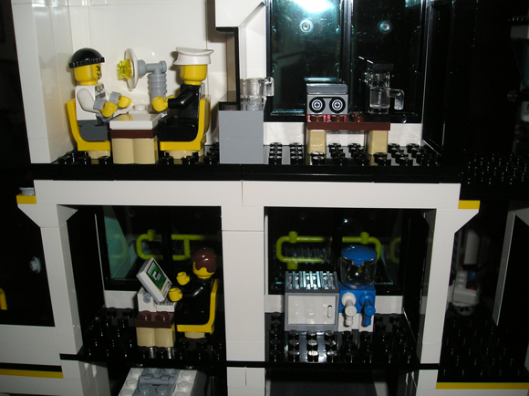

**détail**

## Conclusion

Beau commissariat, deux garages avec deux véhicules plus une moto, sept minifigs avec un chien.

Il reste de la place sous la prison pour mettre d’autres véhicules, ou encore agrandir les bureaux.

Il y a toujours aucune arme dans les mains des policiers. Les policiers de LEGOLAND savent se faire respecter !

A noter la présence d’une boîte aux lettres avec une enveloppe, ainsi qu’une bouche à incendie.

Mon principal regret, ce sont les autocollants, 27 à coller normalement.

Et puis il y a le changement de logo, du noir il passe au bleu.

Sinon le montage est classique. Il n’y a pas trop de grosses pièces.  
Un bel ensemble qui comblera les plus jeunes comme les un peu moins jeunes...!
