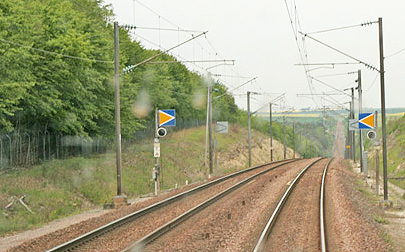
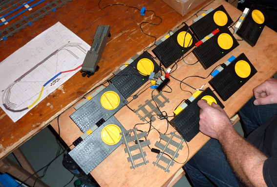
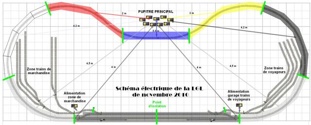
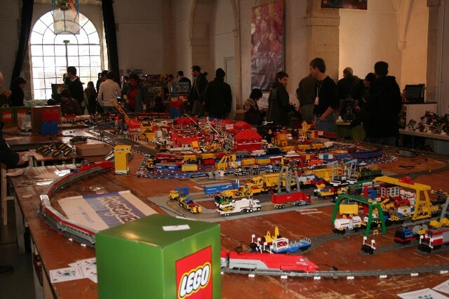

Le canton est une portion de voie ferrée qui est la base du système permettant l’espacement des trains, ce qui permet d’éviter les rattrapages.

Mais cette notion transposée dans l’AFOLLAND, ça donne quoi ?

## Le canton

_Librement inspiré de Wikipédia_

Lors de la création des premiers réseaux de chemin de fer, au début du XIXe siècle, les trains circulaient en marche à vue, comme les véhicules routiers. Mais dès les années 1850 est apparue la nécessité de réguler les circulations, car le nombre de celles-ci augmentait et les vitesses pratiquées étaient déjà importantes, de l’ordre de 50 à 60 km/h.

Comme le faible coefficient d’adhérence des roues sur le rail ne permet pas d’obtenir dans certains cas (courbes, etc) l’arrêt sur la partie de voie visible par le mécanicien, il convient de prévenir le train assez tôt de la présence d’un obstacle à sa marche. On a donc placé des agents (cantonniers) le long des voies pour prévenir les trains d’un ralentissement ou d’un arrêt. D’abord en vue les uns des autres, ils ont ensuite été espacés à mesure que les moyens de communication se sont améliorés (télégraphe, etc).

## Le cantonnement

Le cantonnement est le moyen généralement employé pour assurer l’espacement des trains circulant dans le même sens sur une même voie. Par principe, on n’admet la présence que d’un seul train dans un canton donné.

Lorsqu’un train pénètre dans un canton, le signal d’entrée du canton est fermé. Lorsque le train poursuivant sa marche entre dans le canton suivant, le signal d’entrée de ce dernier est fermé tandis que celui du canton précédent est ouvert.

Cela se fait soit manuellement par échange d’informations entre postes de cantonnement, soit dans les chemins de fer modernes de manière automatique, grâce aux systèmes dits de « block automatique » utilisant les circuits de voie. On parle de « cantonnement absolu » quand cette règle est appliquée strictement.

**Signaux de début d’un cantonnement sur une LGV.**

## Le cantonnement chez les modélistes

La transposition du cantonnement en modélisme revient finalement à gérer l’alimentation électrique des cantons. Donc, en l’absence d’alimentation d’un canton, le train s’y arrête. Avant l’arrivée du DCC, c’était le moyen le plus simple et le plus sécurisé d’automatiser la circulation de plusieurs trains sur une voie. Mais pour cela il faut bien sûr un peu d’électronique (ou d’informatique).

Mais ne pourrait-on pas imaginer un usage un peu différent de ce principe de cantonnement pour la circulation de nos train LEGO en exposition où nous avons principalement deux problèmes ?

1.  Un seul train sur une voie, mais qui, la moitié du temps, ne circule pas à une bonne vitesse : s’il a une bonne vitesse en ligne droite, il ne passe pas les courbes et, s’il passe les courbes alors il se traine en ligne droite.
2.  Deux trains sur une même voie : forcement l’un va plus vite que l’autre et donc il faut intervenir manuellement sur le train le plus rapide (en clair le bloquer avec la main) pour remettre un peu de distance.

## Le cantonnement ELTEP !

Le système de cantonnement ELTEP va permettre de régler à peu de frais et uniquement avec du LEGO standard ces deux insupportables problèmes.

Le principe est finalement très simple. Une fois la voie définie, il suffit d’identifier les portions (c’est à dire les cantons) où les trains doivent circuler à des vitesses différentes. Généralement, ça se réduit aux lignes droites (où les trains doivent circuler à tension maximale) et aux virages et aiguillages (où les trains doivent circuler à une vitesse réduite). On peut aussi définir une portion lente pour raison de sécurité si la voie passe près d’un bord de table très proche du public ou pour raison de projection de l’image en direct d’une caméra embarquée qui s’accommode mieux d’une vitesse réduite.

[Vidéo de la publication d’origine](http://www.youtube.com/v/GtS-Q6ImiMk?fs=1&hl=fr_FR)

_Exemple d’utilisation du cantonnement pour ralentir ou accélérer un train Shinkansen poursuivi par des enfants dans certaines portions du circuit : ici, le train est ralenti dans les secteurs proches des aiguillages et circule à tension maximale dans les autres secteurs sans que personne ne soit au pupitre._

La mise en œuvre se fait en isolant d’abord les différents cantons les uns des autres à l’aide d’un petit bout d’adhésif isolant collé au point de contact entre rails et la vérification de l’isolation à l’aide d’un ohm-mètre. Une fois les cantons constitués, il ne reste plus qu’à relié chaque canton à une alimentation afin de pouvoir appliquer des tensions différentes selon la nature du canton. On peut réduire le nombre des alimentations en raccordant tous les cantons "rapides" à une seule et même alimentation et tous les cantons "lents" à une autre alimentation. La solution luxueuse est d’avoir autant d’alimentations que de cantons ce qui permet d’adapter la tension à la configuration de chaque canton.

**Pupitre de la LGL**

Vue du pupitre de la LGL avec les 9 alimentations que l’on identifie par un code de couleur. Sur cette photo, les branchements sont en mode survoltés où seules 2 alimentations fournissent le courant (les rails isolés servent à effectuer le branchement série).

## Le cantonnement régulier pour la circulation de longs trains

Si le train est léger (ce qui est le cas des trains commercialisés par LEGO), un seul moteur placé dans la locomotive est suffisant pour le tracter. Avec l’augmentation des surfaces d’exposition et de la longueur des lignes, on a vu apparaître des trains de plus en plus longs dépassant plusieurs mètres nécessitant d’équiper la locomotrice d’un second moteur. C’est à ce stade qu’on commence à atteindre les limites de ce que peuvent fournir les alimentations LEGO.

L’exemple de trains qui posent le plus de problèmes de circulation sur des voies électrifiées de façon classique est les trains à grande vitesse de type TGV qui sont tracter par une locomotive de tête et une autre de queue. En effet, si on veut reproduire une rame complète à l’échelle, le train est long et lourd et 2 moteurs ne suffisent plus pour le faire circuler à une vitesse digne d’un TGV. L’exemple typique est le Thalys, construit par l’un des auteurs de cet article (Daniel), spécialement pour la LGV2. En effet, la rame est constituée de 10 véhicules (2 locomotives aux extrémités et 8 wagons articulés), 6 boggies isolés et 7 boggies Jacob partagés par 2 wagons. Conçue pour la LGV2 et son alimentation sur-puissante, la rame mesure 3 mètres 40 de long, pèse près de 4 kg et intègre 13 moteurs (elle est motorisée en mode Automotrice à Grande Vitesse à motorisation répartie sur toute la rame). Cette rame a superbement circulé sur la LGV2 à Fana’briques 2010 atteignant même les 20 km/h réels. Mais voilà, comment faire circuler ce monstre vorace en puissance électrique ailleurs que sur la LGV2 ?

La solution consiste en (1) modifier la rame en remplaçant les boggies moteurs des wagons par des boggies passifs et en (2) partitionner la ligne en cantons de même longueur inférieure à la distance séparant les 2 locomotives. En effet, le Thalys circule correctement en n’équipant que les locomotives avec 2 moteurs ; ce qui fait tout de même 4 moteurs à alimenter à pleine puissance pour une vitesse maximale. Ceci est rendu possible puisque la longueur des cantons est telle qu’un canton n’alimente qu’une seule locomotive ; on a donc une alimentation pour 2 moteurs. De plus, si on a N cantons et N alimentations (une alimentation n’est reliée qu’à un seul canton), alors une alimentation ne fournira la pleine puissance que durant une fraction (2/N pour être précis) d’un tour complet. On peut donc laisser les alimentations à puissance maximale puisqu’elles se "reposent" durant une grosse partie d’un tour complet ((N-2)/N d’un tour complet pour être précis).

## Mise en pratique sur la LGL à Festi’briques 2010 bis

L’exposition Festi’briques 2010 bis nous a donné l’occasion de mettre cette belle théorie en pratique puisqu’une surface de 3m80 par 10m y était réservée pour y exposer du "train". C’est donc une ébauche de Ligne de Grande Longueur développant 24 mètres qui a été installée en forme de cacahouète avec des virages d’un diamètre de 3m70 construits à l’aide de rails droits légèrement désorientés (cf article dans Railbricks 1 et un [précédent article sur FreeLUG](/articles/une-ligne-moyenne-vitesse-pour-la-mise-au-point-des-trains-pour-la-lgv2/)). Elle consiste en 9 cantons de 21 rails droits chacun ayant chacun son alimentation.

**Schéma électrique de la LGL**

Schéma de la Ligne de Grande Longueur installée lors de Festi’briques 2010 bis. La voie extérieure est partitionnée en neuf cantons (chaque canton possède sa propre alimentation électrique) auxquels s’ajoutent la voie en parallèle de la ligne droite et les deux zones de trains de marchandises et de voyageurs (chaque zone a sa propre alimentation électrique pour permettre aux trains d’y circuler).

**Vue d’ensemble de la LGL**

On distingue le pupitre principal à gauche et, au premier plan, le Thalys qui y circule et la zone trains de marchandise. La partie centrale a été remplie par une ville construite par Guy Meyer entourée par d’autres voies de trains.

Le samedi de l’exposition a été consacré à la validation du principe en faisant circuler toutes sortes de trains à des vitesses différentes selon le canton et en faisant circuler le Thalys à pleine puissance sur un tour complet.  
Le samedi soir (une fois le public parti), nous avons fait une séance "survoltée" en reliant tous les fils d’alimentation ensemble à 2 alimentations montées en série permettant d’aller jusqu’à 18 V. Ainsi, le turbo-train de JAC a circulé jusqu’à 13-14 V avant de se fracasser au sol et la locomotive du Shinkansen a circulé à 16 V (ce qui correspond à une vitesse réelle d’environ 10 km/h) avant de sortir de la voie par insuffisance de dévers.

[Vidéo de la publication d’origine](http://www.youtube.com/v/ZA30kjHVDZg?fs=1&hl=fr_FR)

_Séance survoltée du samedi soir (extrait de la vidéo prise par ramoutcho7387 de Setechnic_

Dimanche, après une maintenance de la LGL à l’aube, nous avons fini par faire circuler simultanément 2 longs trains en mode course-poursuite pendant plus d’une heure : le Thalys de 3m40 de long coursait le train de marchandise Maersk de JeanG de plus de 4m de long. Le cantonnement régulier permettait d’alimenter les 6 moteurs sans baisse de régime et de ralentir le Thalys lorsqu’il commençait à se rapprocher un peu trop près du train de marchandise.

[Vidéo de la publication d’origine](http://www.youtube.com/v/6IWLpyCpPYI?fs=1&hl=fr_FR)

_Utilisation classique du cantonnement pour ralentir le train le plus rapide (ici le Thalys) lorsque 2 trains circulent sur le même circuit_

C’était du grand spectacle qui a particulièrement impressionné le nombreux public présent à cette heure de pointe.

## Conclusion

Le bilan de cette première sortie de la LGL avec cantonnement régulier est plus que positif puisqu’elle a démontré la faisabilité 100% LEGO du montage, la versatilité et la stabilité de la ligne, la fiabilité de l’alimentation et le coté spectaculaire de la circulation simultanée de longs trains. Enfin, pouvoir y faire de la moyenne vitesse est un bonus sympathique (même si la ligne ne peut pas prétendre égaler une LGV).

Pour finir, la Ligne de Grande Longueur destinée initialement (un peu égoïstement) à la circulation du Thalys s’est transformée en l’espace d’un weekend en une Ligne de Grand Loisir.
