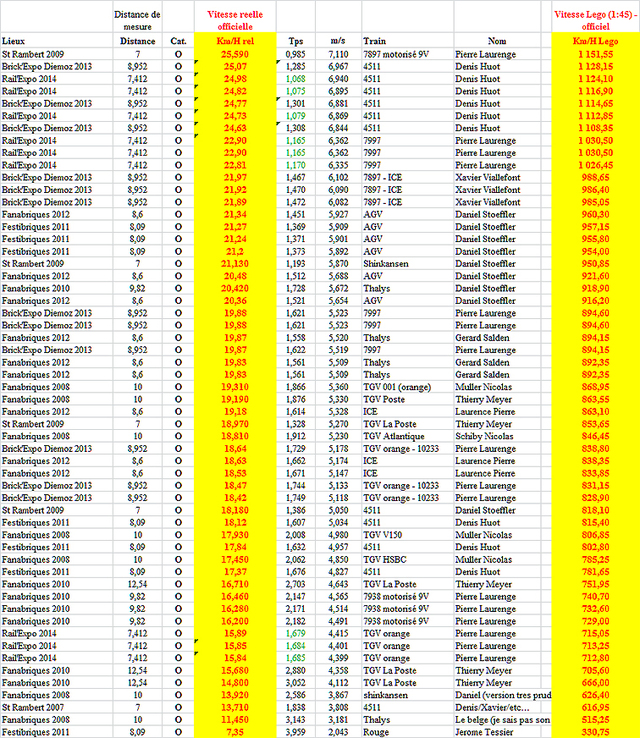
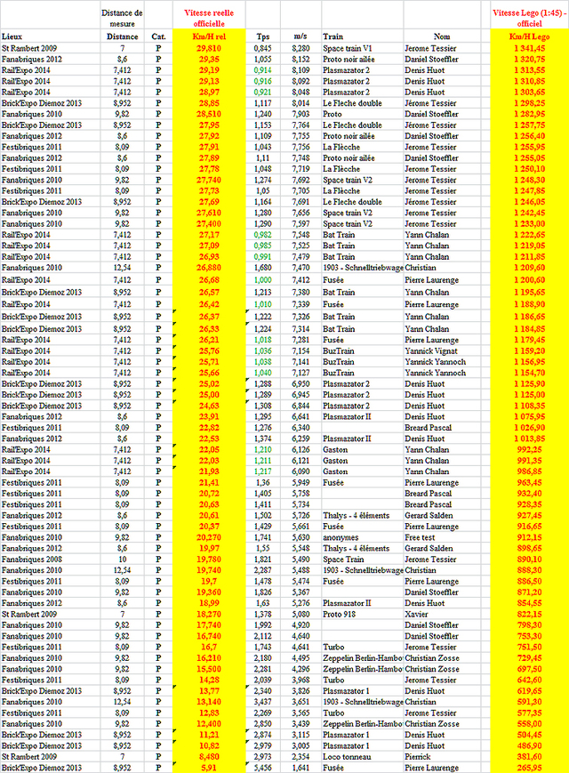

Après Model’Rail 2014, voici une remise à jour des résultats des tentatives de record sur la LGV.

**Résultats**

Ces tableaux sont un récapitulatif des vitesses atteintes.  
Pour établir les tableaux de résultats, il a été gardé un maximum de 3 chronos par manifestation/catégorie/train.

**Récapitulatif catégorie officielle**

Record actuel : 25,59 Km/H

**Récapitulatif catégorie "proto"**

Record actuel : 29,81 Km/H

Normalement, la prochaine sortie de la LGV est Fanabrique 2015 (juin). Puis à Diemoz en septembre.
