## Fana’briques 2012

Pour cette édition de Fana’briques 2012, c’est la première sortie de la LGV V2 complète (hum ; à deux mètres près) ; mais pas de record de vitesse pure à la clef car nous avons privilégié le spectacle pour le public avec des grands trains plutôt que de faire des runs à record.

Malgré tout le spectacle fut au rendez-vous avec quasiment tous les grands trains roulant entre 17 et 20 Km/h sur les 2 grandes lignes droites plus quelques crashs au bout.

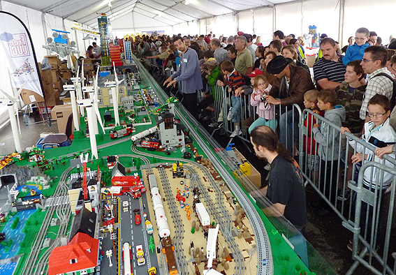

## Résultats

_Nota 1 :_ important à propos de ces deux tableaux récapitulatifs

Les lecteurs attentifs auront noté des différences entre les vitesses à l’échelle du présent tableau par rapport aux valeurs données dans des articles antérieurs.

En fait, à Fana’briques 2008, l’échelle était de 47:1, mais de 43:1 à Saint-Rambert et enfin de 45:1 à Fana’briques 2010. Afin d’y voir plus clair, toutes les valeurs ont été recalculées, si besoin est, avec l’échelle définitivement officielle de 45:1 en accord avec la dernière version du règlement.

_Nota 2 :_ Pour établir les tableaux de résultats, il a été gardé un maximum de 3 chronos par manifestation/catégorie/train.

## Récapitulatif catégorie officielle

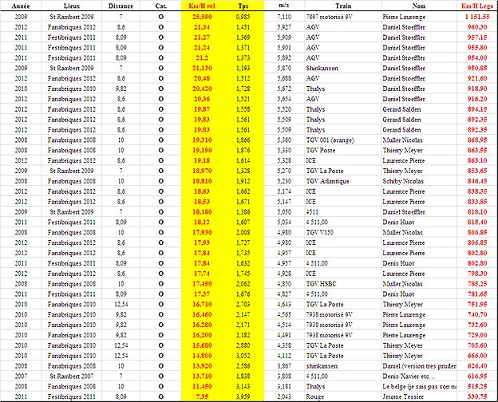

## Récapitulatif catégorie "proto"

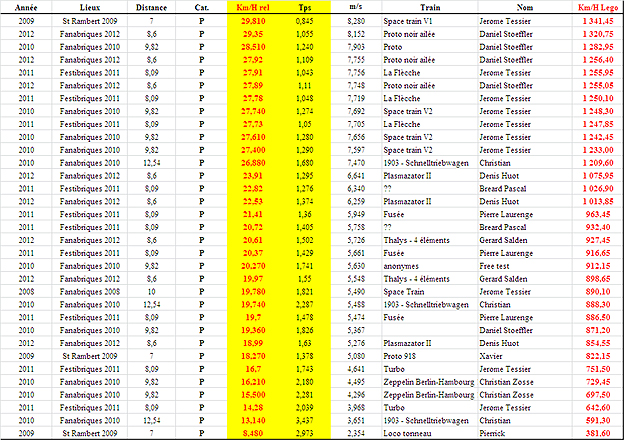

## La prochaine fois...

Si tout va bien, la prochaine sortie de la LGV sera pour Bricqu’Expo Diemoz les 14-15 septembre 2013.  
Lors de cette manifestation, nous privilégierons les tentatives sérieuses pour battre les deux records ; mais toujours avec le même esprit qui nous anime depuis le début : alors réservez cette date dès maintenant.

**Et pour finir, quelques trains...**

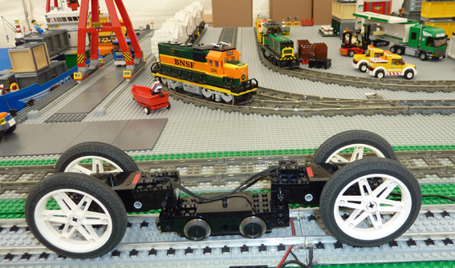

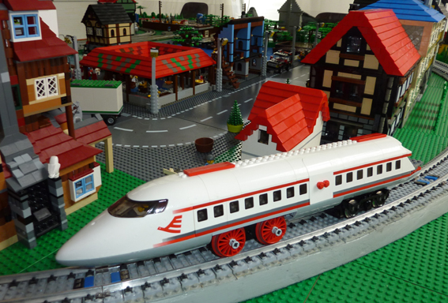

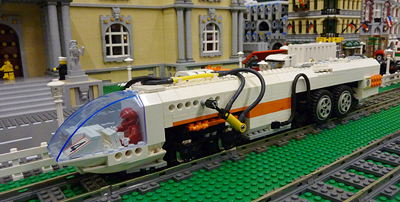

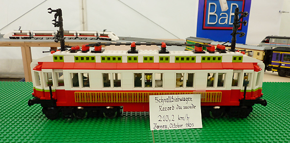

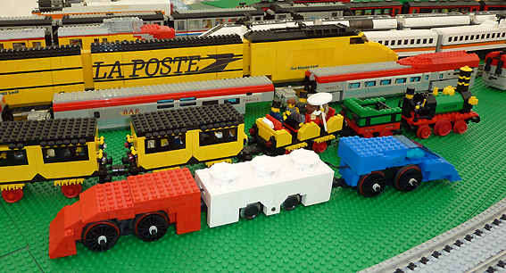

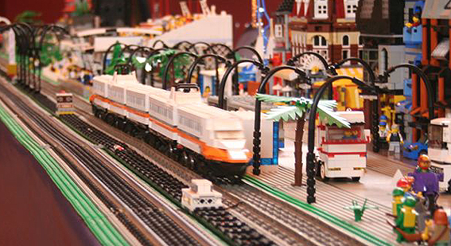

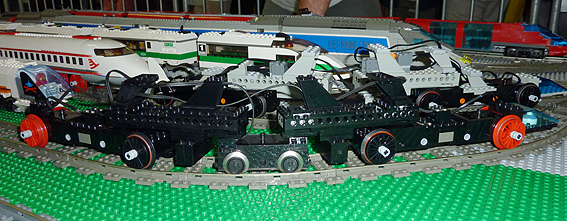

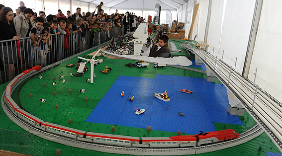

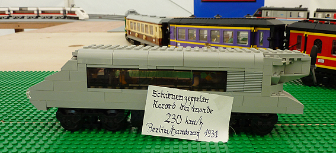

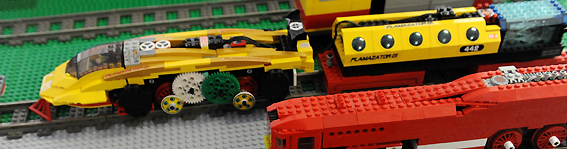

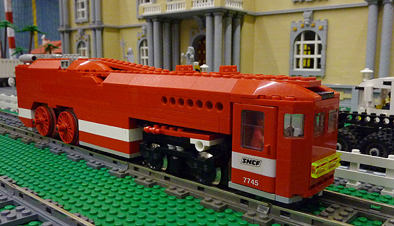

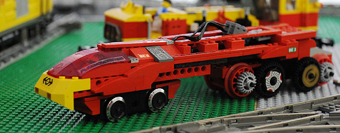

...... et le votre prochainement ?

**Et quelques vidéos**

**–** [L17 - Lego 4511 et 7938 on LGV at Fanabriques 2012](http://youtu.be/CG8Aylz1ilo)  
**–** [L16 - With Thalys on LGV - Fanabriques 2012](http://youtu.be/Cg6ePn1A8ag)  
**–** [L15 - Thalys on LGV - Fanabriques 2012](http://youtu.be/MslLOjbq4tM)  
**–** [L14 - The prototypes on the LGV](http://youtu.be/nGqqN-XHz_I)  
**–** [L13 - AGV Italo - Fanabriques 2012](http://youtu.be/IR1FmjCy868)  
**–** [L11 - Thalys and LGV Fanabriques 2010](http://youtu.be/5DZnSroTRLA)  
**–** [L05- Train Thalys Festi2011](http://youtu.be/641Q0nafjBU)  
**–** [L04- Train Octan fast Legnome](http://youtu.be/6LNnC0hf3Ts)  
**–** [L03- Lego 4511 run on LGV](http://youtu.be/D2Nms2_hzXc)
