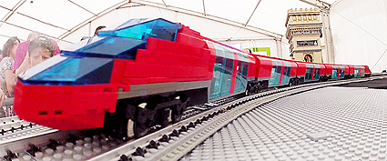
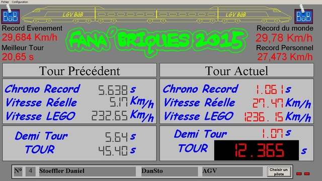
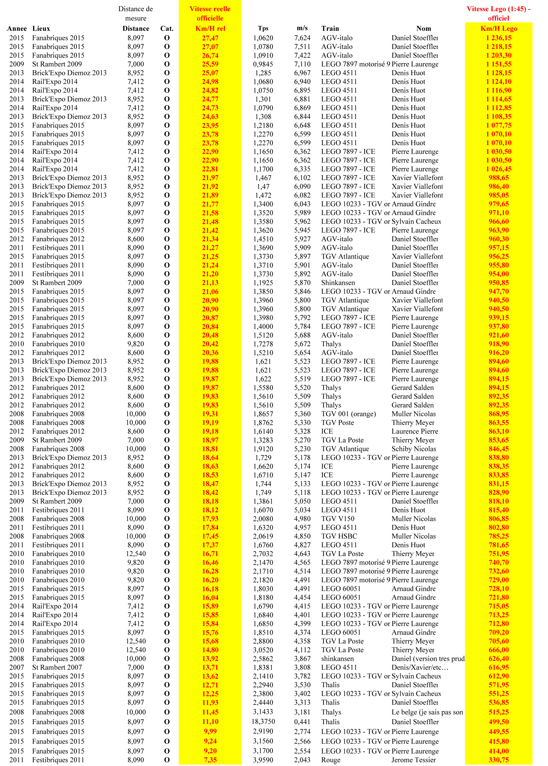
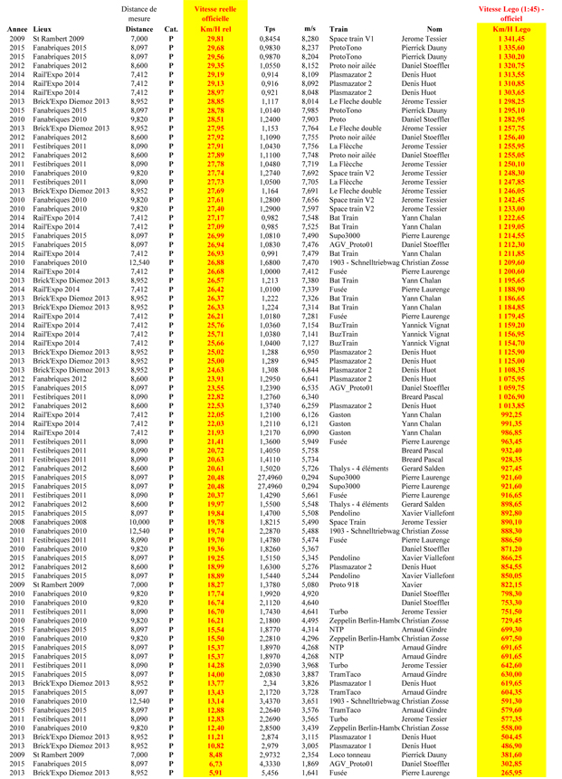

Après Fanabriques 2015, voici une remise à jour des résultats des tentatives de record sur la LGV.

**Résultats**

Ces tableaux sont un récapitulatif des vitesses atteintes.  
Pour établir les tableaux de résultats, il a été gardé un maximum de 3 chronos par manifestation/catégorie/train.

**Récapitulatif catégorie officielle**

Record actuel : 27,47 Km/h - nouveau record établit lors de Fanabriques 2015

**L’AGV Italo - nouveau record à 27,47 Km/h**

**Récapitulatif catégorie "proto"**

Record actuel : 29,81 Km/H

Normalement, la prochaine sortie de la LGV est Diemoz 2015 (septembre).

cdhd.

Tab\_Proto

Tab\_Officiel
