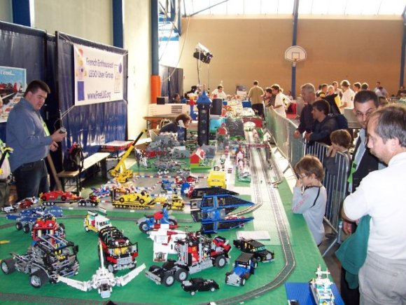
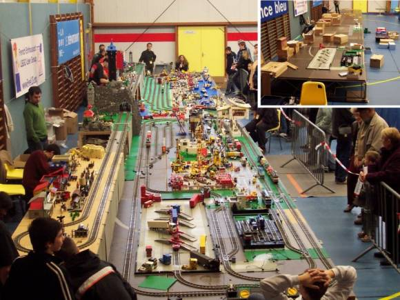
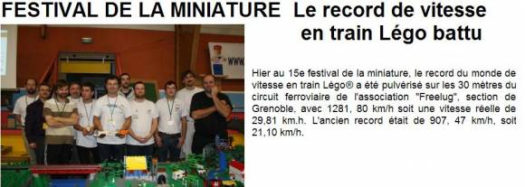
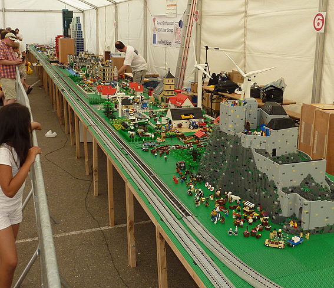
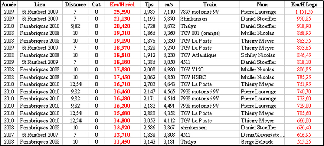
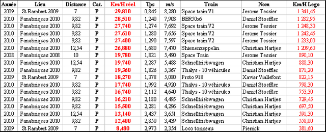

## La première fois : exposition de Claix - novembre 2005

**1ère ligne droite à Claix en 2005. Pas encore une LGV !**

C’est déjà la préhistoire.  
Xavier avait construit un TGV, alors pour cette exposition, on fait une ligne droite la plus longue possible afin de faire rouler son TGV. Mais c’est vite la frustration. La ligne droite fait à peine 13 mètres et on ne peut pas vraiment mettre le train à fond qu’il faut déjà freiner. Et puis on ne sait pas exactement à quelle vitesse roule le train.

On en parle...

Video Player

[Vidéo de la publication d’origine](https://www.freelug.org/IMG/avi/xavier_tgv_claix2005_01.avi)

**TGV Xavier -a**

Video Player

[Vidéo de la publication d’origine](https://www.freelug.org/IMG/avi/xavier_tgv_claix2005_02.avi)

**TGV Xavier - b**

## Puis Saint-Rambert novembre 2007

**En 2007 à St Rambert d’Albon. 18 m de ligne droite**

Oui, deux ans après, c’est long, mais la première difficulté c’est de trouver une exposition permettant de s’étendre un peu !

Donc à Saint-Rambert 2007, on peut passer de 13m à 18m de voie droite. En plus nous avons une alimentation électrique un peu plus puissante et surtout un système de chronométrage.

Essais assez concluants et surtout très amusants. Allez voir les vidéos !

La mesure a été faite sur 7 mètres et en fait il n’y a qu’un seul TGV qui s’y colle : modèle LEGO 4511 de Denis,  
vitesse réelle de 13,71 Km/H

On en parle...

## Fana’briques, juin 2008

Première vraie sortie de tout le système : alimentation électrique boostée mais sécurisée, système de chronométrage amélioré et enfin une LGV spécialement construite pour la vitesse.

La ligne droite fait 30 mètres et la mesure de vitesse se fait sur 10 mètres. Les 19,31 Km/H en vitesse réelle est atteint par le TGV OO1 de Nicolas.

## Saint-Rambert, novembre 2009

Seconde sortie officielle de tout le système. Il n’y a pas de nouveauté coté voie. Mais coté alimentation électrique et chrono le système est maintenant complètement fiabilisé avec l’expérience de Fana’briques en 2008. La ligne droite fait 27 mètres et la mesure de vitesse se fait sur 7 mètres.  
**–** 639 : le nombre de runs effectués pendant les 16h d’ouverture de l’exposition. Ca fait quand même un run toutes les minutes et demi pause repas et reconstruction comprises.  
**–** 29.81 km/h : record de Jac avec son "Truc"  
**–** 25.59 km/h : record de Pierre avec son 7897 à peine modifié  
**–** 21.48 km/h : la moyenne des 100 meilleurs runs du weekend  
**–** au moins 5 : le nombre de fois que chaque concurrent a reconstruit son train à cause d’un freinage tardif ou d’une accélération hâtive.  
**–** 3 : le nombre de moteurs complètement HS pour tout le weekend. Ce n’est vraiment pas beaucoup vu les chocs électriques qu’ils ont subis

Nous avons donc eu deux records de vitesse réelle : Jérôme et son prototype avec 29,81 km/h ; et Pierre et son 7897 boosté avec 25,59 km/h.

## Fana’briques 2010

Pour cette édition de Fana’briques 2010, c’est la première sortie de la LGV V2. Certes, sur un tour complet, cette LGV permet une circulation beaucoup plus rapide avec son grand rayon de courbure et son dévers ; mais pas record de vitesse pure à la clef !

La plus haute vitesse atteinte pour la catégorie officielle est de 20,42 Km/H réel par le tout nouveau Thalys de Daniel Stoeffler.

Dans la catégorie proto, encore Daniel Stoeffler avec le BBR50x6 pour une vitesse de 28,51 Km/h réel.

## Récapitulatif catégorie officielle

## Récapitulatif catégorie ’proto’

_Nota important à propos des ces deux tableaux récapitulatifs_

Les lecteurs attentifs auront noté des différences entre les vitesses à l’échelle du présent tableau par rapport aux valeurs données dans des articles antérieurs.

En fait, à Fana’briques 2008, l’échelle était de 47:1, mais de 43:1 à Saint-Rambert et enfin de 45:1 à Fana’briques 2010. Afin d’y voir plus clair, toutes les valeurs ont été recalculées, si besoin est, avec l’échelle définitivement officielle de 45:1 en accord avec la dernière version du règlement.
