Parmi la magnifique collection Star Wars proposée par LEGO, il y a le Sandcrawler, sorti en 2005. Je vais donc me faire un plaisir de vous faire part de mes impressions lors de son montage.

Le [Sandcrawler](http://www.swg1.net/encyclo/voir_fiche_in.php?fiche=368) était utilisé à l’origine par les premiers colons arrivés sur Tatooine, planète minière. C’est lorsque les mines s’épuisèrent et que ces engins ne furent plus utilisés que les Jawas les récupérèrent pour les utiliser comme moyen de locomotion et abri.

Les Jawas modifièrent un peu les sandcrawlers, afin qu’ils puissent accueillir un clan complet de Jawas. Aujourd’hui, ils parcourent encore les déserts de Tatooine à la recherche d’épaves ou de droïdes perdus.

Petite fiche technique d’un Sandcrawler :  
**–** Constructeur : Corporation Minière Corellienne  
**–** Modèle : excavatrice à chenilles  
**–** Longueur : 36,8 m  
**–** Hauteur : 20 m  
**–** Equipage : environ 50 Jawas  
**–** Propulsion : moteur à fusion nucléaire  
**–** Vitesse max. : 30 km/h  
**–** Autonomie : 2 mois de carburants et de vivres  
**–** Armement : aucun  
**–** Cargaison : environ 50 tonnes et 1500 droïdes stockés

Voilà pour la petite histoire du Sandcrawler...

## Descriptif de la boîte

**–** Numéro de la boîte : 10144  
**–** Nom de la boîte : Sandcrawler  
**–** Gamme : Star Wars  
**–** Nombre de pièces : 1669  
**–** date de commercialisation : 2005  
**–** Prix : 169,99 €

Toujours disponible sur le [shop](http://shop.lego.com/ByTheme/Product.aspx?p=10144&cn=240&d=322).

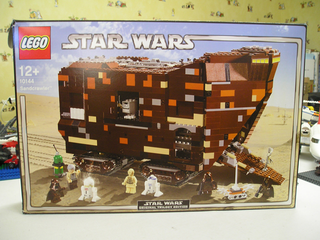

**la boite**

C’est une belle grosse boîte, qui a l’air bien remplie. Le derrière de la boîte nous montre les quelques fonctions intéressantes proposé par ce Sandcrawler.

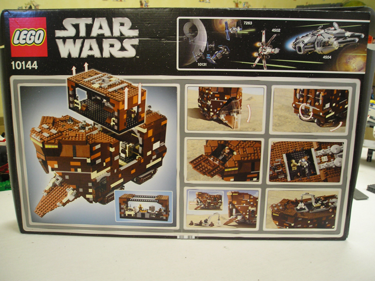

**la boite de derrière**

Sur la tranche de la boîte, nous avons un aperçu des 11 personnages, dont 7 droïdes.

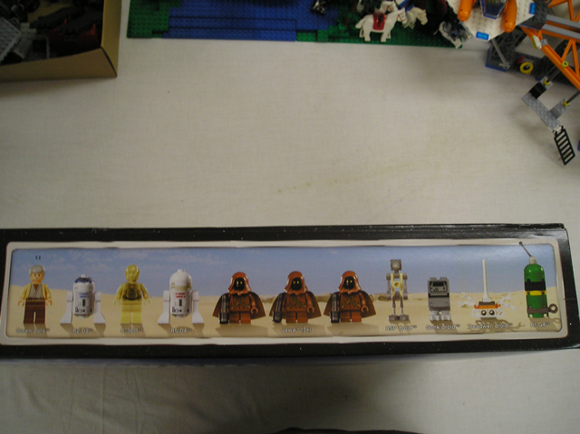

**les personnages**

## Montage

On ouvre donc la boîte par le dessus. Et on constate qu’effectivement la boîte est bien remplie...

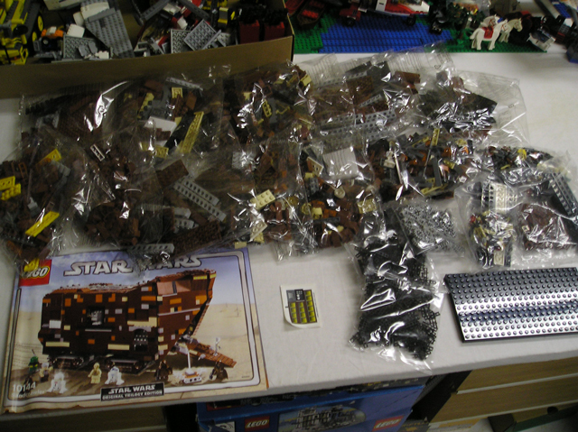

**le contenu**

On découvre alors pas moins de 22 sachets, non numérotés pour apprécier encore plus le montage..., une brique plate noire 12x24, une notice de 96 pages et 5 malheureux petits autocollants...

On ouvre alors les sachets, et on commence un petit tri.

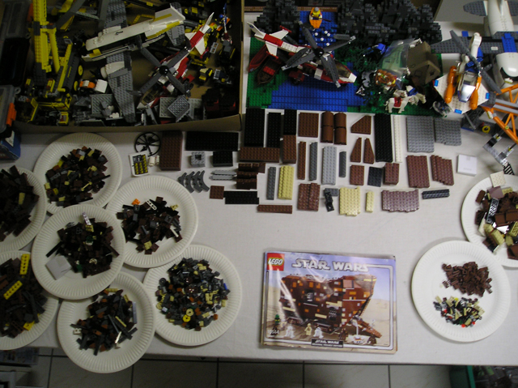

**un petit tri...**

Rien d’exceptionnel dans les pièces, si ce n’est la dominance de la couleur marron, ou RedBrown pour les puristes.

On commence tout naturellement par le montage des personnages.

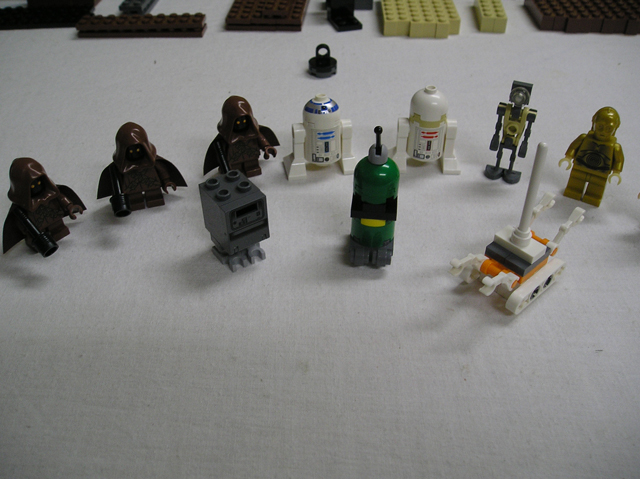

**les minifigs**

Onze personnages dont trois Jawas, Oncle Owen Lars, R2D2, C3PO, R5D4, ASP droïd, Gonk droïd, Treadwell droïd et pour finir R1G4.  
Cela rajoute pas mal de personnages à la collection Star Wars.

Après les personnages, on s’attaque à la construction du Sandcrawler.

Les premières étapes permettent la construction de la base du véhicule avec l’aide de plusieurs plates.

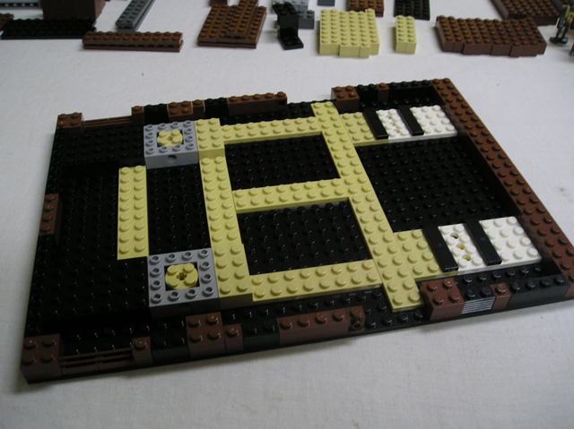

**étape 6**

Puis on commence vite par monter les murs.

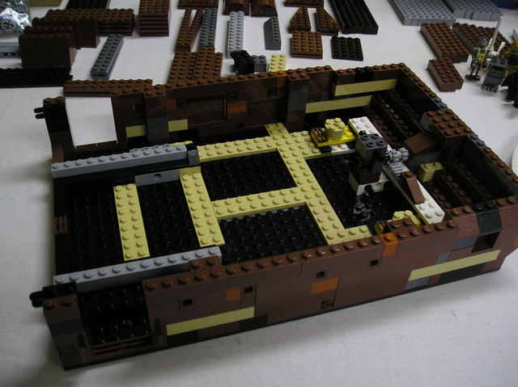

**étape 14**

On voit déjà que le Sandcrawler prend du poil de la bête, enfin bon il commence à être gros...

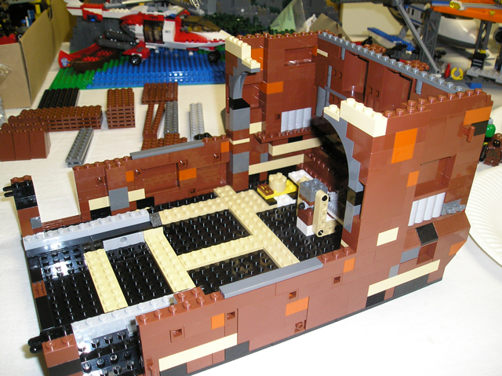

**étape 18**

On arrive alors à la construction des chenilles. L’assemblage des chenilles est long mais on arrive tout de même à notre fin.

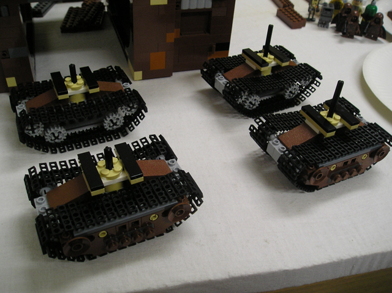

**les chenilles**

Les deux chenilles arrières sont directrices, les deux devant sont fixes. Pour la petite histoire, dans le vrai Sandcrawler, ce sont les chenilles avant les directrices et les chenilles arrières les motrices...

La construction se poursuit sans difficultés.

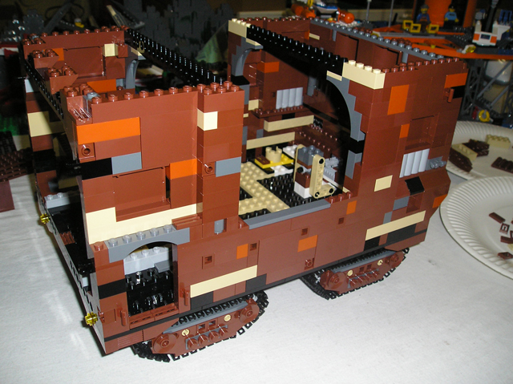

**étape 23**

On s’attaque à l’avant de la bête.

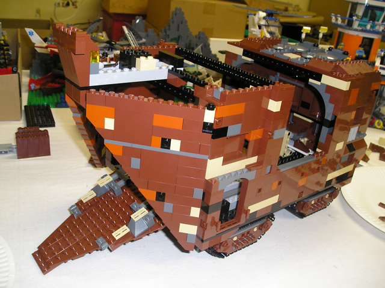

**étape 29**

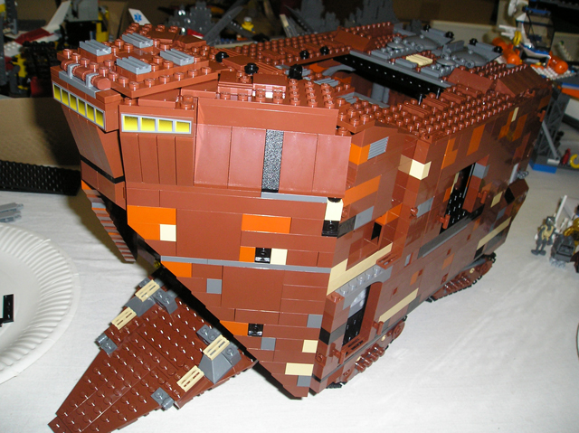

**étape 34**

Et enfin on fini le Sandcrawler par l’étape 37.

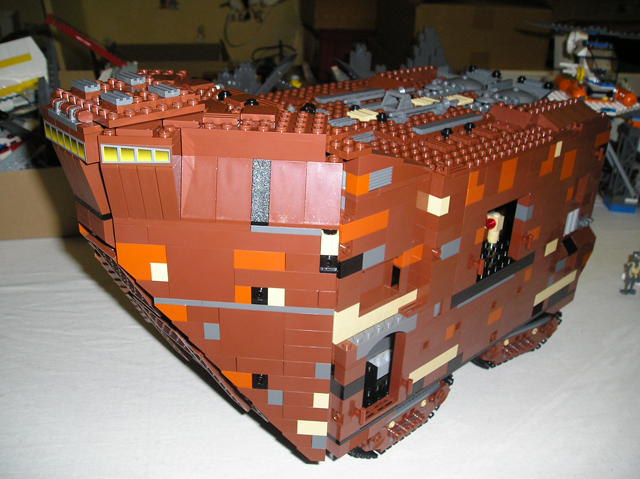

**étape 37 et fin**

Voilà donc la construction de ce nouveau véhicule Star Wars achevée. Il n’y a eut aucune difficulté majeur, si ce n’est de bien faire attention à ne pas confondre les couleurs sur la notice ( entre le noir et le DarkStone ).  
Le Sandcrawler est symétrique, le côté droit est identique au côté gauche.

## Vue d’ensemble

Il y a une cabine de pilotage sur le devant tout en haut. On retrouve divers ouvertures sur le dessus du Sandcrawler pour faire rentrer toute la marchandise dans les entrailles de la bête.

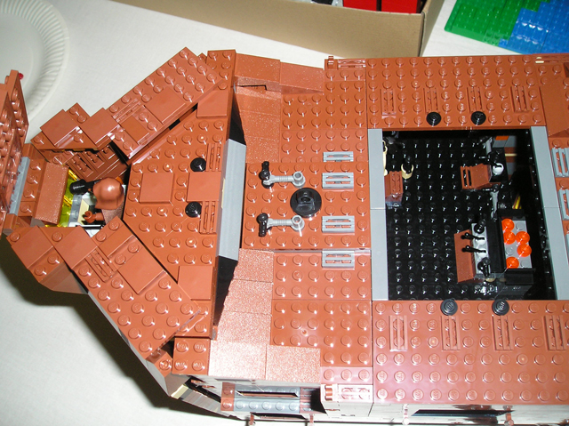

**ouvertures sur le dessus**

Au milieu du Sandcrawler, il y a un module qui se démonte du reste. Ce module a pour base la fameuse plaque 12x24, qui permet d’avoir un atelier Jawas que l’on peut enlever et ainsi profiter de l’espace intérieur.

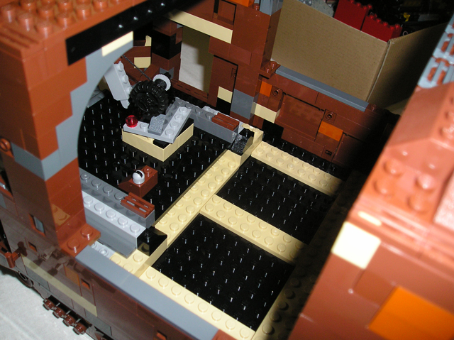

**l’intérieur avec beaucoup de place !**

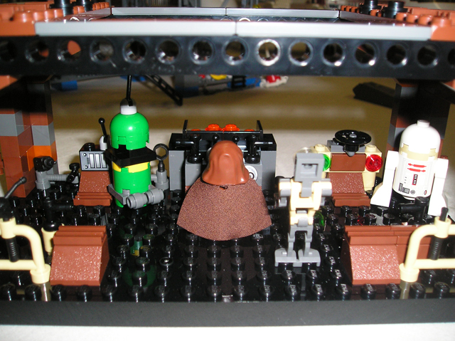

**intérieur du module**

Pour aider les Jawas à charger les droïdes dans les soutes, une grue est disponible. Elle se range à l’intérieur sur l’avant, puis on peut la sortir et la mettre en place sur le toit du véhicule.

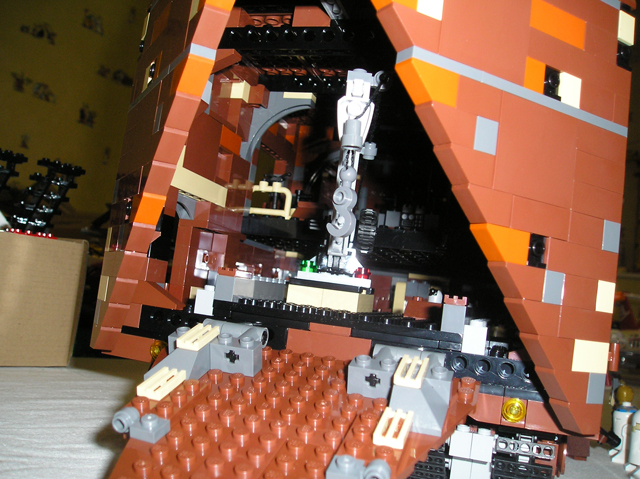

**la grue rangée à l’intérieur**

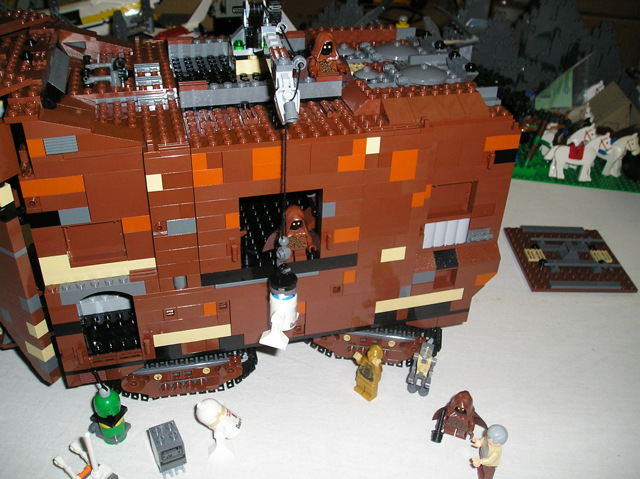

**vue de côté**

Enfin quelques vues supplémentaires du véhicule utilisé par les Jawas sur Tatooine...

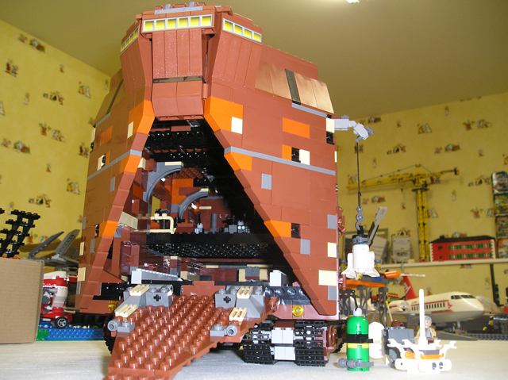

**vue de devant**

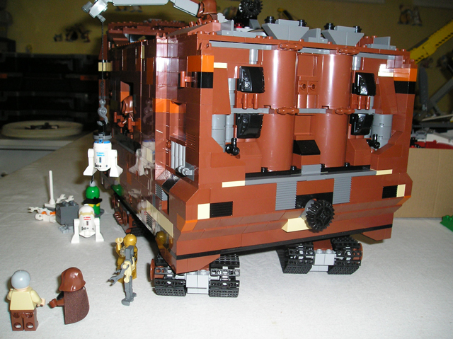

**vue de derrière**

## Conclusion

**–** C’est encore une belle réalisation de LEGO. Ce véhicule vient compléter la collection Star Wars déjà bien riche.  
**–** 170 € ça fait comme même cher, même si à la fin on a un gros véhicule avec plusieurs personnages. On paye la licence...  
**–** Je ne m’attendais pas à le voir aussi large, 24 tenons de large, c’est bien, il y a plus de place à l’intérieur.  
**–** Que dire de plus si ce n’est que l’on souhaite que l’alliance LEGO et Star Wars continue encore longtemps...
