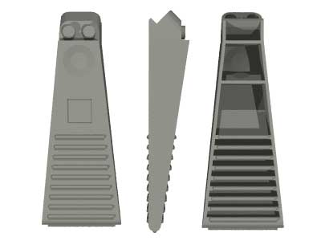
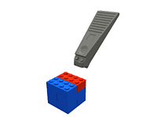
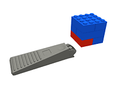
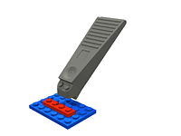
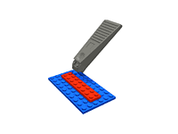
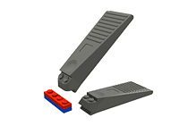
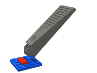
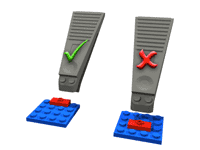
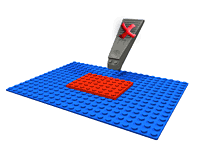

En discutant avec plusieurs legophiles avertis, je me suis rendu compte que beaucoup connaissaient peu ou pas les utilisations du séparateur de briques.

Voici donc un petit Kama-Sutra de cet accessoire remarquable !

_Cliquer sur les images pour voir les animations_

|  |  |
| --- | --- |
|  | Facile : par le dessus... |
|  | ...ou par le dessous |
|  | Plus difficile sans lui, la petite plaque au milieu d’une grande |
|  | Si la plaque est plus grande, procéder avec précaution |
|  | Le fin du fin : deux séparateurs pour démonter deux plaques de même taille empilées |
|  | Le séparateur permet même de faire sauter des plaques sans tenon qui ne sont pas sur un bord |
|  | Le séparateur est impuissant sur les briques à un tenon au milieu d’une plaque... |
|  | ...et il est franchement déconseillé pour démonter les grandes plaques (risque de casse) |

Pour quelques trucs et astuces supplémentaires, voir aussi cette [discussion sur Lugnet](http://news.lugnet.com/announce/?n=2225)

_[English version](http://www.philohome.com/remover/remover1.htm)_
